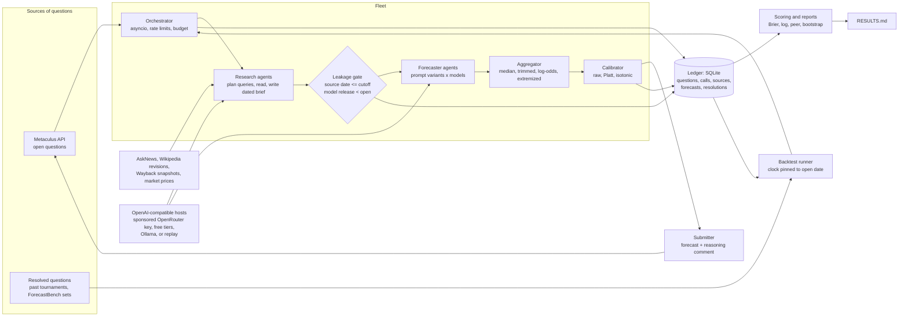

# Augur: plan

## Goal

**The problem.** A forecast about a real event is scored only after the event
happens, often months later, so a team building an AI forecaster cannot tell in
time whether a change helped, and most forecasters that look accurate in
backtests quietly read the answer in news written after the question closed.

Both halves are measured facts, not worries:

- **Slow, noisy feedback.** In Metaculus's Spring 2026 bot tournament the ten
  best bots averaged 13.2 to 18.9 spot peer points per question with intervals
  about 8.5 points wide over 297 questions: after three months, no bot was
  clearly separated from the next
  ([results](https://www.lesswrong.com/posts/wZBbDqzfBjYG58CxK)).
- **Leaky backtests.** An audit of Google's `before:` filter on 393 resolved
  Metaculus questions found a page with major post-cutoff information for 71%
  of questions and a direct answer for 41%; feeding those pages to a
  forecaster moved its Brier score from 0.242 to 0.108
  ([El Lahib et al., ACL 2026](https://arxiv.org/abs/2602.00758)). The paper
  recommends frozen, time-stamped snapshots. FutureSearch's closed
  "pastcasting" environment does that (a frozen crawl per question,
  [Bench to the Future](https://arxiv.org/abs/2506.21558)); no open-source
  bot I found does.

**What Augur is.** A fleet of research, forecasting and calibration agents
that enters Metaculus's FutureEval bot tournament ($50k per season) and the
two-week MiniBench rounds, where it is scored on the same questions as about
110 other bots and Metaculus's own template bots. Around the fleet sits the
part I think is the actual contribution: a **ledger** that stores every
question, prompt, source (with the evidence for its date), forecast and
resolution, and a **backtest that cannot leak by construction**: every source
must prove it existed before the question opened, every model must have been
released before the question opened, and a test fails the build otherwise.
Each change is judged on that backtest first and live second.

**Why it is interesting.**

1. The score is an outside result: a public leaderboard I do not control.
2. The backtest's honesty is itself measured (Q2): the same forecaster, the
   same pages, once as they were when the question opened and once as they
   are today.
3. The live ledger doubles as a frozen corpus. Research captured while a
   question was open is leak-free forever, so a new prompt or aggregation rule
   can be replayed against it the day the question resolves.
4. The statistics are the hard part and are stated up front: with 60
   questions per MiniBench round, what difference between two bot versions is
   detectable at all?

**What already exists, and what is different.** Metaculus ships a
[template bot](https://github.com/Metaculus/metac-bot-template) on
[`forecasting-tools`](https://github.com/Metaculus/forecasting-tools) (0.3.7,
2026-11-14): one research call, five forecasts, median. Open-source entrants
(nostreambot, Panshul42's Q2 2025 winner) add model ensembles and more search.
`forecasting-tools` has a benchmarker, but it scores against the community
prediction on open questions, not resolutions. The closest prior work is
FutureSearch's: pastcasting on frozen web snapshots and paired bootstrapped
comparisons, with a lead it reports as real at about 1,800 questions (0.010
Brier, plus or minus 0.003, n = 1,810)
([Iterating on a forecaster](https://futuresearch.ai/iterating-on-a-forecaster),
2026-07-10). It is closed: the corpus, harness and bot are not public. I did
not find an open-source bot whose backtest enforces source dates as a
failing test, measures its own leakage on the same questions, or reports the
smallest improvement its question count can detect. Augur is not a better
prompt; it is an open version of that measurement apparatus plus a bot that
is developed with it.

## Questions

Each question has a prediction written here before any run, the milestone
that answers it and the number it produces. A prediction that fails is
reported as failed.

| # | Question | Prediction (fixed now) | Milestone | Number |
|---|----------|------------------------|-----------|--------|
| Q1 | Does the bot beat the Metaculus template bot on the same questions? | Yes, but not resolvably in one MiniBench round: the interval on about 60 questions will include 0. | M3 (live), M4 (first scored report) | Mean head-to-head score (100 × ln(p_augur / p_template) on the outcome) against a shadow run of the real template on the same live questions, with a paired bootstrap interval; and the leaderboard peer score beside the `metac-*` bot using the same model. |
| Q2 | How much of a backtest's accuracy is leakage? | Unrestricted retrieval improves Brier by at least 0.05 on the same questions; the date-cut arm is no better than "no retrieval" by more than 0.02. | M6 | Brier and log score for three arms (no retrieval, sources as of the open date, sources as of today) on the same resolved questions, paired intervals, and the share of admitted sources a judge still flags. |
| Q3 | Which part carries the score: research depth, number of forecasters, model mix or the aggregation rule? | No single factor is resolvable at the table's n. Research depth has the largest point estimate of the four, but on leak-free sources it stays inside Q2's bound (under 0.02 Brier against no research); forecasters beyond 5 add less than the noise; extremizing by a fixed factor hurts. | M5 (replay, hosted models), M7 (backtest) | An ablation table on the leakage-proof backtest (one factor changed at a time, paired bootstrap intervals), with the minimum detectable effect at the table's n printed beside it. |
| Q4 | Can calibration be learned from the bot's own resolved history? | Not with fewer than about 200 resolutions: Platt and isotonic fitted on past questions will not beat raw on later ones (interval includes 0), and isotonic will be worse than Platt. | M8 | Reliability diagram, expected calibration error, Brier and log score, raw against each calibrator, fitted only on questions that resolved before each test question opened. |
| Q5 | Where does the fleet stand against the frontier? | Above the median bot and above the best same-model template bot; below the top 10. | M4 (first standing), M10 (final) | Rank and average spot peer score with interval in each MiniBench round and in FutureEval, the gap to the best template bot, the best open-source bot and rank 1, the gap to the pro baseline where Metaculus publishes it, and prize money if any. |
| Q6 | Open: does the bot know when it does not know? | Disagreement among forecasters predicts the final forecast's error with AUROC above 0.6, and shrinking high-disagreement forecasts toward the prior improves the backtest score by less than the detectable effect. | M9 | AUROC of disagreement against error (Brier above the median), and the change in score from shrink and from skip policies on the backtest, then live on a pre-registered half of questions split by question id. |

**Q1's decision rule, committed 2026-11-19 before any live round resolves.**
The comparison is `augur score` on every resolved live question that has
both Augur's posted forecast and a shadow template forecast from the same
model (`augur baseline`): the mean head-to-head score, Augur minus the
template, with its paired bootstrap interval clustered by opening week.

- **Target:** +5 points per question, the smallest gain over its own
  baseline among Fall 2025's top five scaffolds (Metaculus notebook 43337).
- **Held:** the interval's lower bound is above 0.
- **Failed:** the interval's upper bound is below 0, or, after both
  remaining Fall MiniBench rounds have resolved, the point estimate is
  negative even though the interval includes 0. A negative estimate after
  both rounds means the pipeline subtracts value, and the next milestone
  diagnoses why before any fleet work (M7).
- **Not yet resolvable:** anything else, reported with the interval and
  the detectable effect at that n.

The same rule and report apply against the community prediction where the
API shows it (it does not to a bot token on scored tournaments; M4).

**M5's predictions and decision rules, committed 2026-11-19 before any
replay run.** The replay evaluation compares arms on the same resolved
binary questions. The arms:

- **(a) price-only:** the market's price as of the cutoff, no model;
- **(b) Augur without prices:** the forecaster draws on the recorded
  research (none for ForecastBench), median;
- **(c) blend:** a fixed log-odds blend, one third Augur (b) and two
  thirds the price (a), both clipped to [0.01, 0.99]. The weight is
  AIA Forecaster's, fixed now and never fitted;
- **(d) Augur with prices:** the same forecaster, with the market source
  shown to it as the first source of the brief, median.

The settings arms come from (b)'s own draws, with no new calls: 1 draw
against 3, and the median against the mean, the mean of log-odds and
extremized log-odds (factor 1.5, fixed now).

The corpora:

- **C1:** ForecastBench 2026-05-24, 139 market questions. Arm (b) is
  M4's `qwen2.5:7b` run (1 draw, no retrieval); arms (a) and (c) only.
- **C2:** ForecastBench 2026-06-21, market questions resolved to 0 or 1
  (frozen 2026-06-11). Arms (a) to (d), 3 draws, on
  `nvidia/nemotron-3-ultra-550b-a55b:free`. That model answered most of
  the bot's live forecasts in M3, and it was listed on 2026-06-04, before
  the freeze, so the release gate admits it.
- **C3:** live questions in the committed ledgers that have resolved. On
  2026-11-19 that is none, so C3 is the harness plus a count of 0.

The price comes from the market's own API as of the freeze instant (a
Manifold bet, a Polymarket price-history point). The Metaculus community
prediction is hidden from the bot's token, and INFER has no public price
API, so those questions have no usable price.

Predictions:

| # | Prediction | Corpus |
|---|------------|--------|
| P1 | The price alone beats Augur without prices: the interval of Brier(b) − Brier(a) is above 0. | C1, C2 |
| P2 | The blend beats Augur without prices: the interval of Brier(c) − Brier(b) is below 0. | C1, C2 |
| P3 | Against the price alone, the blend is worse on C1 (point estimate; a near-constant model only pulls the price toward 50%), and within ±0.01 Brier on C2 (the interval includes 0). | C1, C2 |
| P4 | Showing the price to the model (the market searcher's effect, which the survey scores at r = +0.34) improves Brier by at least 0.03, with an interval of Brier(d) − Brier(b) below 0. The model still under-uses the price: the point estimate of Brier(d) − Brier(a) is above 0. | C2 |
| P5 | The as-of price matches ForecastBench's recorded freeze value within 0.01 on at least 90% of priced questions. A usable exact price is found for at least 90% of Polymarket and Manifold questions, 0% of Metaculus and INFER questions. On live MiniBench questions (search, not an exact match), a similar market about the same event is the top hit for under 25% of a round's questions, judged by hand. | C2, MiniBench 2026-11-16 |
| P6 | Three draws against one: \|ΔBrier\| < 0.01, interval includes 0. Mean of log-odds against the median: \|ΔBrier\| < 0.005. Extremizing at 1.5 is worse than the median (point estimate), with an interval that includes 0. | C2 |

Research depth cannot be varied on C1 or C2, which have no retrieval. It
runs on C3 once live questions resolve.

**Decision rules** (M7's replacement rule: a variant replaces the default
only if its paired interval against the default excludes 0 in its favour,
or it is no worse and cheaper; neither variant here is cheaper):

- **Markets searcher:** it becomes the live default only if the interval of
  Brier(d) − Brier(b) on C2 lies below 0. Until then it is behind
  `--markets`.
- **Blend:** it enters the live default only if (c) is not worse than (b) on
  C2, with the interval of Brier(c) − Brier(b) lying below 0. Live, it
  applies only to an *exact* price of the same question. On Metaculus that
  is the question's own community prediction, where the API shows it to the
  bot. A similar market found by search is shown to the model and never
  blended.

**What these corpora can and cannot say.** On C1 and C2 every question is
itself a market, so the exact price exists by construction. That is the
best case for prices; most MiniBench questions are not markets (P5), so
C2's price-only score is an upper bound on what prices bring live. A
finding on C2 is a finding about one free model on one question set.

**M5's results (2026-11-19; RESULTS.md, the predictions above unedited).**
P1 held on C1 and C2: the price alone (C2 0.106) beats Augur without it
(0.240). P2 held on both: the blend is 0.111 better than Augur on C2. P3
held on C1 and failed on C2 (the blend is 0.023 worse than the price, the
interval [−0.001, +0.047] includes 0 but the point is outside ±0.01). P4
held: shown the price, Augur improves by 0.097 [0.054, 0.144] and still
trails the price by 0.037 [0.003, 0.073]. P5 held in all three parts (91 of
101 within 0.01 of ForecastBench's value; 101 of 101 Polymarket and
Manifold priced after a disclosed fix to a staleness cut, 0 of 37 Metaculus
and INFER; a same-event market for 2 of 59 MiniBench questions). P6: one
draw against three failed (0.022 worse [0.004, 0.044]); the log-odds mean
and extremizing parts held. Under the decision rules both the markets
searcher and the exact-price blend became the live default (`--no-markets`,
`--no-blend`). C3 still has no resolved question, so research depth is not
yet measured on live research.

**Status after M4 (2026-11-19).** Q1: *not yet resolvable*; no live
question with both an Augur and a shadow-template forecast has resolved,
and the floor has kept Augur out of scored rounds until a frontier model
answers. Q5: *no reading*; Augur has no leaderboard entry. What M4 did
measure for both: the median bot's line and the best template bot's average
in the 2026-11-02 round (RESULTS.md), and the sample each needs: at a
per-question spread of 32 points, 60 resolved questions detect a
difference of 11.6 points and 300 detect 5.2, so Q1's +5 target is a
Spring 2027 measurement and Fall 2026 can place Augur only above or below
the median bot. Q5's secondary row, ForecastBench without retrieval on
`qwen2.5:7b` (139 market questions): Brier 0.2395, indistinguishable from
always 50% and the base rate, 0.108 behind the market price; a floor, not a
placing.

**Reconciled before any run (2026-11-18).** The first version of Q3 said
research depth would be the largest effect, while Q2 says leak-free
retrieval is worth at most 0.02 Brier over none. Both cannot hold on the
same backtest unless every other factor is smaller still, so Q3 now says
exactly that, and adds that nothing in its table is expected to be
resolvable. A finding from either is labelled with the model that produced
it; a backtest on `qwen2.5:7b` says nothing yet about the hosted model the
bot ships with, which is why the replay evaluation (M5) comes before the
backtest (M6).

**What this season's sample can resolve.** In Spring 2026 the winning bot's
average spot peer score was 18.90 with interval [15.18, 22.61] over 288
questions, which puts the spread of one bot's per-question peer score near
32 points (derived: half-width / 1.96 × √288). With the floor below, Augur
forecasts live only once a frontier model is available (M2); the Fall
MiniBench rounds that remain (from about 2026-11-30 and 2026-12-14, about
60 questions each) give at most about 120 live forecasts, so an interval of
roughly ±5.8 points on an average peer score, ±8.1 for one round. That
resolves nothing a season's leaders are separated by. Concretely: Q1 is not
resolvable in Fall unless the gap to the template exceeds about 6 points
(a paired difference may have a smaller spread; M4 reports the measured
one); Q5 places the bot only coarsely (above or below the median bot);
Q4's live arm and Q6's live arm need more resolutions than Fall gives and
are Spring 2027 measurements. Q2, Q3 and the backtest arms of Q4 and Q6 run
on resolved questions, so their n is set by the backtest corpus, not the
season. Fall 2026 is the shakedown; Spring 2027 is the season to place in.

## Architecture

### Components

| Module | Job |
|--------|-----|
| `augur/metaculus.py` | Typed `httpx` client for the five calls the bot needs: list a tournament's posts, post details, submit a forecast, create a comment, read my scores. Token from the environment only. Client-side rate limit, `Retry-After` honoured. |
| `augur/questions.py` | `Question` models for binary, multiple choice, numeric and discrete, with open, close and resolve times. Converts percentiles to the 201-point CDF Metaculus accepts (fewer points for discrete) and enforces its validity rules. |
| `augur/llm/` | `Provider` protocol over plain `httpx` (one HTTP stack, mocked and recorded): from M2 one generic OpenAI-compatible provider (base URL, the name of the environment variable holding its key, model; Bearer auth), so OpenRouter, Groq, Gemini's OpenAI endpoint, GitHub Models and Ollama are configuration, not code; `replay` (serves recorded calls by request hash). An ordered model list per role (a cheap model for planning and the brief, the best answering model for the forecasts), probed at run start, falling to the next model on rate-limit or out-of-credit errors. Prices and listing dates come from OpenRouter's model list (the listing date stands in for the release date where none is known, which is conservative for the gate); a few local models keep hand-written release dates. The **submit floor**: a named frontier tier, outside of which `--submit` refuses every tournament but the bot-testing-area. Token-bucket and semaphore limits per provider. |
| `augur/research/` | Searchers that all take an `as_of` instant: `asknews` (news, with `end_timestamp`), `wikipedia` (the revision current at `as_of`), `wayback` (latest capture at or before `as_of`). Each returns `Source` records with `published_at`, `retrieved_at` and `date_evidence` (which field or capture timestamp proves the date). From M5, `markets`: the Metaculus community prediction where the API exposes it, and similar questions on Polymarket, Manifold and Kalshi through their public APIs, each with its price **as of the cutoff** (the trade or candle timestamp is the date evidence), so the leakage gate holds for prices too. |
| `augur/leakage.py` | The gate. Admits a source only if its date evidence is at or before the cutoff; refuses undated sources in backtests; refuses a model whose release date is not before the question's open date. Everything it rejects is logged with the reason. |
| `augur/agents/` | `researcher` (plans queries, reads, writes a brief that cites source ids), `forecaster` (prompt variants: outside view, inside view, sceptic), `parser` (structured output into a typed forecast). |
| `augur/aggregate.py` | Median, trimmed mean, mean of log-odds, extremized log-odds; for numeric questions, a mixture of CDFs; for multiple choice, normalised per-option aggregates. |
| `augur/calibrate.py` | Calibrators fitted on resolved history: identity, fixed extremizing, Platt (a line in log-odds), isotonic (pool adjacent violators), with a time-ordered fitting harness. |
| `augur/score.py` | Brier, log score, Metaculus baseline score, head-to-head and peer score for all question types; paired, question-clustered bootstrap; minimum detectable effect. |
| `augur/ledger.py` | Append-only SQLite store and its JSONL export. Nothing is updated in place; a resolution is a new row. |
| `augur/backtest.py` | Runs the same orchestrator with the clock pinned to each question's open date and submission disabled. |
| `augur/cli.py` | `augur forecast`, `augur backtest`, `augur resolve`, `augur score`, `augur report`, `augur ledger export|import`, `augur models probe`, `augur standings`. |

### Data flow for one live question

1. `augur forecast --tournament minibench` lists open questions and drops the
   ones the account has already forecast (`my_forecasts` in the API payload),
   then takes at most `AUGUR_MAX_QUESTIONS_PER_RUN`.
2. The researcher plans queries and each searcher runs with `as_of = now`.
   Every source is written to the ledger before any model sees it.
3. The gate checks each source against the cutoff (live: now; backtest: the
   open date) and the brief is built from admitted sources only.
4. N forecasters run in parallel within the provider's limits; each returns a
   typed forecast and its reasoning. The aggregator combines them and the
   calibrator maps the result.
5. With `--submit` and a token, the submitter posts the forecast and a private
   comment built from the members' actual reasoning and the sources cited.
   Without either, it prints what it would have posted (dry run). Outside the
   bot-testing-area, `--submit` refuses before any model call unless the
   answering model is in the frontier tier (the submit floor).
6. Later, `augur resolve` appends resolutions and `augur score` reports.

### Design decisions

| Decision | Chosen | Alternative considered | Which part of the problem needs it |
|----------|--------|------------------------|-------------------------------------|
| Language and runtime | Python 3.12, `asyncio`, `uv` | 3.14 (the runner's default): `forecasting-tools` does not support it yet, and the shadow baseline needs that package | A question is open for about 1.5 hours; research and several forecasters must run concurrently within rate limits. |
| Metaculus access | Own `httpx` client, about 200 lines, strict types | Build on `forecasting-tools`' `ForecastBot`: it brings LiteLLM, `nest_asyncio` and its own report types, and hides the calls I need to record | Every request and response has to land in the ledger, and I have to be able to explain each call. |
| Template baseline | The real `TemplateBot` from `forecasting-tools`, run unpublished in an optional `baseline` extra | Reimplementing the template's prompt: then "beats the template" would mean "beats my copy of it" | Q1 must be like for like. |
| Models | Metaculus's sponsored credits, now delivered as an OpenRouter key, plus OpenRouter `:free` models and other free OpenAI-compatible tiers, all through one generic provider (M2); Ollama with small open models for development; `replay` for tests | A paid balance on any provider: never added. (The first plan ruled out OpenRouter as paid; that was wrong once the sponsored credits arrived as an OpenRouter key, and the proxy at `llm-proxy.metaculus.com` no longer resolves.) | The tournament provides credits; development and CI must cost nothing and be deterministic. |
| Submit floor | `--submit` to any tournament other than the bot-testing-area needs a hosted model in a named frontier tier; it refuses otherwise, before any model call (built in M1) | Submitting whatever model answers: an expired key would then post small-model forecasts, and a weak forecast loses peer points that skipping does not | A score is only worth having if every forecast behind it came from the bot as designed. |
| News | AskNews through the tournament's sponsorship, Wikipedia revisions, Wayback captures | Google or DuckDuckGo date filters: measured to leak on 71% and 81% of questions; Perplexity or Exa: paid | Backtests need a date that can be proven, not a date filter that is hoped to work. |
| Source dating | A source is admitted on **evidence**: an archive capture timestamp, a revision timestamp, or the news provider's publish date bounded by the query's `end_timestamp`; otherwise rejected in backtests | Trusting the page's own date metadata: the cited audits show it is often wrong | "Leakage is a build failure" needs a rule a test can check on every row. |
| Model memory | A model may forecast a backtest question only if it was released before the question opened | Trusting stated training cutoffs: they are not guarantees, and a release date is a hard upper bound | Otherwise the model can simply remember the answer and the backtest measures recall. |
| Store | SQLite, append-only, one file, plus JSONL export | DuckDB: columnar speed is not needed at tens of thousands of rows, and SQLite's single-writer transactions suit an append-only ledger and ship with Python. PostgreSQL: a server for a bot that runs in a CI job is the wrong shape | Replay and audits need every prompt and source exactly as used. |
| Ledger across scheduled runs | Skip logic reads `my_forecasts` from Metaculus, so a run needs no earlier state; each scheduled run then pushes its JSONL export to a `ledger` branch automatically (one file per run, so runs never edit the same file, and the concurrency group serialises pushes); `augur ledger import` rebuilds the SQLite ledger from that branch | Artifacts only (the first plan): they expire, and a forgotten manual commit would lose the live record that M5's replay evaluation depends on | The live record must survive a runner and stay reproducible from the repo. |
| Scheduling | GitHub Actions `schedule` with a concurrency group, a first job that polls with the standard library only and exits when nothing is open, and caps per run | A server or a cloud function: something to pay for and operate | The bot has to run unattended through a season at no cost. |
| Statistics | Paired comparisons on the same questions, bootstrap resampled by question cluster (same post group or same opening week), intervals on everything, minimum detectable effect printed with each table | Unpaired means: the Spring results show they cannot separate even the top ten | The whole point is knowing whether a change helped. |
| Comments | Generated from the members' recorded reasoning and the cited sources, posted privately as the template does | A fixed boilerplate comment: against the prize rule that comments "accurately represent the reasoning process and final decision" | Prize eligibility. |

### The hard part

Making a backtest whose result I would bet on. Three things have to hold at
once and each is tested:

1. **No source from the future.** Enforced by the gate, by a schema
   constraint in the ledger (a `source_use` row cannot reference a source
   dated after its run's cutoff), and by `tests/test_leakage.py`, which scans
   every committed backtest ledger and fails on any violation. Then measured:
   Q2 runs the unrestricted arm on purpose and a judge audits the admitted
   sources for residual leaks (a page captured before the cutoff can still
   embed a widget; a revision cannot).
2. **No answer from memory.** The model registry's release dates gate which
   questions each model may be scored on. This shrinks the usable backtest
   for new models to almost nothing, which is the honest state of affairs and
   the reason the live ledger matters: research captured live stays valid.
3. **Enough questions to see the effect.** Every comparison is paired and
   reports its minimum detectable effect, so "no difference" and "could not
   tell" are never confused.

## Evaluation

### Data

| Set | What | Access | Used for |
|-----|------|--------|----------|
| Live | MiniBench rounds (about 60 questions per two weeks) and Fall 2026 FutureEval (id 33121) while it still opens questions, then Spring 2027 | `METACULUS_TOKEN` | Q1, Q5, Q6 live arm |
| Past tournaments | Resolved questions from earlier bot tournaments (`spring-aib-2026`, Summer 2026 id 33022, earlier seasons) with open time and resolution | `METACULUS_TOKEN` (the API returns 403 without one; checked 2026-11-17) | Q2, Q3, Q4, Q6 backtests |
| ForecastBench | Biweekly question sets and resolution sets, 2024-07 onward, CC BY-SA 4.0 ([datasets repo](https://github.com/forecastingresearch/forecastbench-datasets)) | Public, no key | M4's first measured number, a backtest corpus that needs no token, and the same-question comparison in the Frontier table |
| Replay corpus | The bot's own live research, frozen in the ledger and pushed to the `ledger` branch | Grows with every run | M5's replay evaluation: re-forecasting resolved live questions from the recorded sources under alternative settings, on the hosted models used live |

A question enters a backtest only if: it resolved (not annulled); it opened
after the release date of every model in the variant; and it was not resolved
before it opened. The filters and the counts they remove are printed with
every result.

### Metrics

- **Brier** and **log score** on binary questions; log score of the
  probability placed on the outcome for multiple choice; the Metaculus log
  score on the submitted CDF for numeric.
- **Metaculus baseline score**, `100 × (log2(p_outcome) + 1)` for binary, so
  backtest numbers are in the tournament's units.
- **Against the community prediction.** Every variant is judged against
  the Metaculus community prediction as well as the template bot: the peer
  (head-to-head) score against the community aggregate on resolved
  questions, wherever the API exposes it for the question; the count of
  questions without one is reported beside the score.
- **Head-to-head score** between two forecasters on the same question,
  `100 × ln(p_a / p_b)` on the outcome, as Metaculus uses for pros against
  bots. A **peer score** is its mean against all others.
- **Calibration**: reliability diagram, expected calibration error with
  equal-mass bins, and the sharpness beside it (calibration alone rewards
  guessing the base rate).
- **Uncertainty**: paired bootstrap over question clusters, 10,000 resamples,
  seed recorded; the minimum detectable effect at 80% power for each table.
- **Cost and latency**: tokens, sponsored-credit cost estimate and wall time
  per question, from the ledger.

### Baselines

1. Always 50%, and the tournament base rate (binary questions resolved Yes
   33% of the time in Spring 2026).
2. One model call with no research.
3. The real Metaculus template bot (shadow run, same questions, same model).
4. Live: the `metac-*` template bots on the same leaderboard.

### Frontier

The strongest outside results on this problem, re-read at their sources on
2026-11-17 and corrected on 2026-11-18 (M3): the survey's r = 0.42 belongs to
GPT-5.4 as the final model, not to frontier models in general; FutureSearch
never reported 0.01 Brier gaps as ties; its self-reported final Summer 2026
standing is #2 of 284;
and the ForecastBench leaderboard figures could not be read at the source.

| Result | Number | Protocol | Source, date |
|--------|--------|----------|--------------|
| Best bot, FutureEval Spring 2026 | GreeneiBot2: average spot peer score 18.90 [15.18, 22.61], 288 of 297 questions, 1st of 173 bots (111 outside Metaculus). Closed source; parallel AskNews, Perplexity and GPT-5 search pipelines. | Spot peer score at question close | [LessWrong results post](https://www.lesswrong.com/posts/wZBbDqzfBjYG58CxK), 2026 |
| Best template bot, same tournament | `metac-gpt-5-1-high+asknews`: 11.32 [7.18, 15.45], 18th of 173 | Same | Same |
| Best open-source bot, same tournament | nostreambot, 10th or 11th (the post gives both), MIT licence, model ensemble with median | Same | Same |
| Professional forecasters | Top-10 bot team minus pro team: −1.25 head-to-head points per question, 95% CI [−4.87, 2.37], 99 shared questions (not significant) | Head-to-head on shared questions | Same |
| Prize money, Q2 2025 | 1st Panshul42 (open source) $7,550; 2nd pgodzinai $4,563; 3rd CumulativeBot $3,270 | Tournament payout | [Metaculus notebook 39140](https://www.metaculus.com/notebooks/39140/), 2025 (re-read 2026-11-17) |
| Rest of the Spring 2026 top five, by summed score | Preseen-Atlas 18.25 [13.52, 22.99], SynapseSeer 16.87 [12.26, 21.47], manticAI 16.01 [11.72, 20.30], Preseen-Chestnut 18.26 [11.87, 24.64]; with GreeneiBot2 these are the top five by sum. The intervals overlap: no top bot is separated from the next | Same | [Spring 2026 results](https://forum.effectivealtruism.org/posts/iJ3qBDwpWCfNy9ZGd), 2026-09-09 |
| Best bot, Summer 2026 (self-reported) | FutureSearch: #2 of 284 bots in Summer 2026 FutureEval behind laertes (5,783.66 against 5,803.42 summed spot peer score); no organiser results post for Summer 2026 found | Spot peer score, live | [FutureSearch evals](https://evals.futuresearch.ai/), 2026 |
| Pastcasting, frozen web (self-reported) | FutureSearch: Brier 0.116 [0.109, 0.123] against Claude Opus 5 (xhigh) 0.120 on 2,386 Bench to the Future 3 questions, paired difference −0.0047, p < 0.001; its earlier lead of 0.010 ± 0.003 (n = 1,810) is reported as real, and the tie it reports is between two other models (0.0005, p = 0.85) | Backtest on frozen snapshots | [FutureSearch evals](https://evals.futuresearch.ai/); [Iterating on a forecaster](https://futuresearch.ai/iterating-on-a-forecaster), 2026-07-10 |
| ForecastBench (the reference M4's number is set beside) | AIA Forecaster: Brier 0.1076 against superforecasters' 0.1110 on FB-7-21 (0.0753 against 0.0740 on its market subset), with agentic search and a fixed Platt step. A no-retrieval `qwen2.5:7b` run (M4) is **not comparable** to it: different questions, no search, a small local model; it is reported beside it only to show the distance | Backtest, self-reported | [AIA Forecaster, arXiv 2511.07678](https://arxiv.org/abs/2511.07678), 2025-11-10 |
| ForecastBench leaderboard (unverified) | The Brier Index figures in the first plan (superforecasters 70.6, best LLM systems 67.9) came from search snippets; the page returned 403 on 2026-11-17 and 2026-11-18, so they are not used until read at the source | Biweekly live question sets | [FRI, Brier Index post](https://forecastingresearch.substack.com/p/introducing-the-brier-index) |
| Leakage through date-filtered search | Brier 0.244 with no retrieval, 0.242 with leak-free documents, 0.108 with documents rated 3 to 4 on their 0 to 4 rubric; 93 binary questions opened in 2025 (from 393 audited); gpt-oss-120b | Retrospective, Google `before:` | [El Lahib et al.](https://arxiv.org/abs/2602.00758), ACL 2026 |
| What separated winners | No strategy significant after correction (n about 40, 33 features); strongest raw signals: **GPT-5.4 as the final model r = +0.42** (a frontier final model in general only +0.20), checking similar questions or markets +0.34, extremizing −0.30, aggregating several forecasts −0.19; higher-reasoning variants beat their standard twins in 8 of 8 pairs (p = 0.004) | Self-reported survey against score | [Spring 2026 survey](https://forum.effectivealtruism.org/posts/tJoxFWkRev5wrEBar), 2026-09-09 |

**How Augur is compared, like for like.**

- **Live leaderboard (Q5).** Same questions, same scoring, same close times
  as every other bot, by construction. The target to beat is the best
  template bot (the `metac-*` entry using the same model family); the gaps to
  the best open-source bot and to rank 1 are reported with intervals whatever
  they are. The compute budget is stated: sponsored credits only (about $100
  to start, more if MiniBench results are above average), against top bots
  that pay for Perplexity and frontier models. That is unfair in their
  favour and RESULTS.md will say so.
- **Template, controlled (Q1).** The real template run in shadow on the same
  live questions with the same model, so the difference is the pipeline and
  not the model.
- **Leakage (Q2).** The published gap (0.242 to 0.108) was measured on
  Google results with one model. I reproduce the experiment's shape on
  sources I can date (Wikipedia as of open against today; Wayback captures)
  and report my gap beside theirs, noting the different retrieval and model.
  Their three relevant arms map onto mine (no retrieval 0.244, leak-free
  0.242, leaky 0.108); Q2's prediction is that my no-retrieval and as-of-open
  arms are as close as theirs, which is the like-for-like check. The judge
  uses their 0 to 4 rubric so the residual leak rates are comparable.
- **Power (Q3).** The power statement comes from M7's own simulation: a
  known improvement planted in resampled backtest scores, and how often each
  n detects it. FutureSearch's reported lead (0.010 Brier, ±0.003, at
  n = 1,810) is set beside it as an outside point of reference, not as a rule.
- **ForecastBench (Q5, secondary).** Brier on a past question set against
  the forecasts in its public `forecast_sets`, same questions. The
  leaderboard entrants forecast live and I would be backtesting, so this row
  is labelled a backtest and never ranked against them.

No claim of "beats X" is written without a same-protocol number and the
source of X in RESULTS.md.

### Budget

Sponsored credits are finite. Every model call is recorded with tokens and an
estimated cost; `AUGUR_MAX_COST_PER_QUESTION` and `AUGUR_MAX_COST_PER_RUN`
stop a run before it overspends. Backtests default to local models and to the
replay cache; a hosted-model backtest is a manual run with a stated question
count.

## Release

- **Package.** `pip install augur-forecast` (the name `augur` is taken on
  PyPI; the import and the CLI stay `augur`). Published by trusted publishing
  from a tag; nothing is published until the maintainer does it.
- **CLI.** `augur forecast --tournament minibench` is a dry run unless
  `--submit` is passed and `METACULUS_TOKEN` is set.
- **Scheduled Action.** `.github/workflows/tournament.yml`: a cron with a
  concurrency group; job one polls for open, unforecast questions using only
  the standard library and stops if there are none; job two installs from the
  lock file and forecasts, capped per run. A repository variable
  `AUGUR_SCHEDULE` (`off`, `minibench`, `all`) switches it without a commit.
- **Going public.** The repository becomes public when M2 merges (moved
  from M8 on the maintainer's direction; M2 is now the model-access milestone, the first to merge after M1): it is then listed on Metaculus as
  an open-source bot, which gets about twice the sponsored credits, and a
  public repository runs the scheduled workflow without spending the private
  Actions-minute allowance. From M1 on the repository is kept ready to be
  public: the README's first screen explains the bot, and no secret, token
  or private data is in the code, the logs or the history. Until it is
  public the schedule is throttled (see Risks). The audit and the
  maintainer's steps for the switch are in RELEASE.md (M2).
- **Heavy runs.** Backtests and local-model evals are `make` targets and a
  `workflow_dispatch` workflow; the per-PR workflow is lint, types and unit
  tests only.

**The maintainer provides:**

| What | Where | Why |
|------|-------|-----|
| A Metaculus bot account and its token, as `METACULUS_TOKEN` | Repository secret | Reading questions and submitting |
| The sponsored OpenRouter key Metaculus issues, as `OPENROUTER_API_KEY` | Repository secret | The hosted models (M2); never topped up with a paid balance |
| The participation form (first section) and the credit request | Metaculus | Sponsored LLM credits |
| AskNews access for the bot (their Discord or email), as `ASKNEWS_CLIENT_ID` and `ASKNEWS_CLIENT_SECRET` | Repository secrets | News search. The template names the second one `ASKNEWS_SECRET`; Augur reads either. |
| The end-of-season bot survey | Metaculus | Required for prizes |
| A PyPI trusted publisher for `augur-forecast` | PyPI | Release |

Rules the bot follows: one bot account; forecasts and private comments only
through the documented API; no scraping behind logins; no creating, editing
or commenting publicly on questions; client-side rate limits below the
documented ones.

## Risks

| Risk | Effect | Mitigation |
|------|--------|------------|
| The sponsored LLM proxy is gone (checked 2026-11-17 in M1: `llm-proxy.metaculus.com` returns NXDOMAIN from public DNS, and `www.metaculus.com/proxy/` answers with a bot challenge, which the bot must not get around) | No sponsored models; live forecasts come from a local model | Done in M2: one OpenAI-compatible provider, and OpenRouter is a preset. Until a frontier model answers, the submit floor keeps the bot out of scored tournaments; small models run only dry runs, backtests and the bot-testing-area. |
| Free hosted models fail often (M2: 8 of 10 recorded attempts on Google's free Gemma models were upstream 429s; one key gets about 20 free requests a minute across all free models) | Research calls stall or fail | An ordered chain per role with fallback, a client-side ceiling of 20 a minute on OpenRouter, the probe at run start, and frontier models first in the forecast chain once credits are confirmed. |
| Credentials arrive late or partly | Without `METACULUS_TOKEN` nothing live can be verified (the API returns 403) | Everything is built against a fake server first and everything live sits behind `--submit`. `METACULUS_TOKEN` arrived during M1 (2026-11-17) and the live path was exercised then; AskNews keys had not, so that searcher is tested on recorded payloads and listed under "To measure". |
| The Fall season stops opening questions a few weeks before 2027-01-01 | Few FutureEval questions left | MiniBench runs back to back (rounds from 2026-11-16, 2026-11-30 and 2026-12-14 if the two-week cadence from 2026-09-21 holds; confirmed from the API in M3). The Fall announcement says most MiniBench questions launch in a round's first few days; the 2026-11-16 round, read from the API at the end of M1, opened 56 questions in its first 42 hours, spread across the day, so that round is already live. The Fall result is reported as partial coverage; Spring 2027 is the first full season. |
| Each MiniBench question is open for only a few hours (all 56 questions of the 2026-11-16 round's first 42 hours were open exactly 3.0 hours; a new binary one opened every 1.5 hours at the median, at most 5.8 hours apart; read from the API at the end of M1, the full measurement is M3's) | A missed window scores nothing, and a 7B model on a CPU runner takes about 11 minutes a question | Cron cadence chosen from the measured open times and the measured cron delay (M3), at most about 2 hours so no window is missed; the forecast path has a deadline and submits the best aggregate it has when the deadline is near. |
| Actions minutes while the repository is private | A 20-minute cron is about 2,160 billed minutes a month, more than the whole shared allowance | Until public: MiniBench only, a cadence set from the measured windows, the poll job exits in seconds, caps per run. The repository goes public when M2 merges, after which minutes are not billed. |
| Model memory in backtests | Scores measure recall | Release-date gate; the count of questions it leaves is printed; local models with old release dates for most backtests. |
| Residual leakage inside admitted sources | A capture taken before the cutoff can still be wrong about its own date | Prefer revisions and news items with provider dates bounded by the query; judge audit in Q2 reports the residual rate; anything flagged is fixed at the gate, never by editing results. |
| Small n | A real improvement looks like noise, or noise like an improvement | Paired design, clustered bootstrap, minimum detectable effect, predictions fixed beforehand, no tuning on the test split. |
| Small local models forecast badly | Backtest conclusions may not carry to the hosted models used live | Every backtest finding is labelled with its model. The replay evaluation (M5) runs on the hosted models used live before the backtest (M6) exists, and each Q3 finding is re-checked there. |
| Sponsored credits or AskNews access not granted | No frontier models or news | Wikipedia and Wayback need no key; Ollama runs the pipeline; the result is then reported as what a zero-budget bot achieves. |
| Wayback and Wikipedia rate limits | Slow backtests, blocked requests | One request at a time with backoff, a descriptive user agent, and every response cached in the ledger so a source is fetched once. |
| A bad deploy posts wrong forecasts | Real score damage | Dry run by default, a bot-testing-area check for each question type before the first live run, validity checks on every payload, and a kill switch (`AUGUR_SCHEDULE=off`). |

## Milestones

- [x] M1: Scaffold, CI and one MiniBench question forecast end to end — `uv` project on Python 3.12, `ruff`, `mypy --strict`, `pytest`, `make check`, GitHub Actions with a dependency cache and `timeout-minutes`; the `Question` model and Metaculus client (list open questions, details, `my_forecasts` skip) against a fake server; `Provider` protocol with `ollama`, `metaculus_proxy` and `replay`; one searcher (`wikipedia`, as of an instant) and the AskNews searcher behind its credentials; the `Source` record, the leakage gate and `tests/test_leakage.py` from the first commit that stores a source; a single researcher and five forecaster draws combined by median for binary questions; the ledger schema; the comment renderer; `augur forecast --tournament minibench` (dry run without a token, on committed sample questions; real listing, binary submission and the private reasoning comment with `--submit` and a token). Done when `make check` is green, `augur forecast` on the sample questions with a local Ollama model writes questions, calls, dated sources and forecasts to the ledger and prints the forecast and comment it would post, a fake-server test covers the submit and comment calls, a test proves a source dated after the cutoff is rejected and that a ledger containing one fails, and no token ever appears in logs (tested). If `METACULUS_TOKEN` is present in the build environment, the bot also submits binary forecasts with comments in the bot-testing-area and then on the current MiniBench round, and the ledger rows are cited in the PR; otherwise the exact commands are under "To measure". (Amended 2026-11-18 by the submit floor: M1 submits in the bot-testing-area only, and the MiniBench command is under "To measure".)
- [x] M2: Model access and the submit floor on the answering model — replace `metaculus_proxy` with one generic OpenAI-compatible provider (base URL, the name of the environment variable holding its key, model; Bearer auth), so OpenRouter (the sponsored key and `:free` models), Groq, Gemini's OpenAI endpoint, GitHub Models and Ollama are configuration, not code; an ordered model list per role (a cheap model for query planning and the brief, the best answering model for the forecasts); `augur models probe`, run at the start of every run, which calls each listed model once, records which answer and measures each free tier's real limits (requests and tokens per minute, the error a limit returns) rather than assuming them; fallback to the next model on rate-limit and out-of-credit errors, with every switch in the ledger; prices and listing dates read from OpenRouter's model list instead of the hand-written registry (an unknown model must not be priced at frontier rates and trip the caps; the listing date is the conservative stand-in for the release-date gate); the submit floor (built in M1) applied to the model that actually answers each question, so a fallback below the frontier tier skips the question rather than posting. Release notes for the merge: the repository audit for going public (no secrets in the history, licence, README first screen) and the steps to make it public and list it on Metaculus as an open-source bot, done by the maintainer when M2 merges. Done when `make check` is green, a fake-server test proves a fallback below the tier never submits, the probe lists answering models with their measured limits, and a bot-testing-area run completes on a free hosted model (with `OPENROUTER_API_KEY`; otherwise the exact commands are under "To measure").
- [x] M3: Live on MiniBench (Q1 starts) — only what a live round needs: multiple choice, numeric and discrete forecasts (percentiles to a valid CDF, property-tested against Metaculus's validity rules); per-run and per-question caps, cost estimates, and a deadline per question so a run stays inside the round's window and reports its coverage (questions forecast in time, missed, skipped, and why); the scheduled workflow with the standard-library poll job, concurrency group and `AUGUR_SCHEDULE` switch, cheap while the repository is private (skip what is already forecast, cap each run); a measured check of how late GitHub's cron actually fires against the measured question windows, with a fallback trigger if it misses; the durable live ledger (each scheduled run pushes its JSONL export to the `ledger` branch). Done when every question type is accepted in the bot-testing-area, a fake-server test proves a second run never forecasts a question twice, the scheduled workflow passes a `workflow_dispatch` or `act` dry run, RESULTS.md records the open-time measurement, the cron delay measured against it and the chosen cadence with its billed minutes per month, and the bot has submitted forecasts with private comments on live MiniBench questions (only if the floor passes; otherwise the exact commands are under "To measure").
- [x] M4: Baselines, scoring and the first scored report (Q1, Q5 first reading) — the shadow template baseline (`baseline` extra) logging the real template's unpublished forecast for the same live questions; the tokenless ForecastBench number (the M1 pipeline without retrieval on `qwen2.5:7b` over at least 100 resolved ForecastBench binary questions that opened after the model's release, with a minimal loader extended in M6; Brier and Metaculus baseline score against always-50% and the set's base rate, with paired bootstrap intervals; $0); `augur resolve` appending resolutions and annulments; `augur score` with Brier, log, baseline and head-to-head scores for all question types, the question-clustered paired bootstrap and the minimum detectable effect; `augur ledger export|import` (import rebuilds the ledger from the `ledger` branch); `augur report` rendering RESULTS.md from the ledger with a test that the committed file matches a render; the first scheduled runs on `main` checked from the `ledger` branch (questions forecast, skipped, missed, minutes billed); `augur standings`: rank, average spot peer score and interval per MiniBench round from the leaderboard API, beside the best template bot, the best open-source bot and rank 1, with each missed question explained from the ledger. Done when scoring is checked against hand-computed cases and against Metaculus's own score for at least one resolved question per type, RESULTS.md holds Augur against the shadow template and against the community prediction (where the API exposes it) on every resolved live question with intervals and the detectable effect at that n,, RESULTS.md holds the tokenless ForecastBench row with its method, model and cost and the standings table with dated sources and every unfair comparison named, Q1's prediction is marked held, failed or not yet resolvable, and Q5's first reading is reported with the sample-size limits stated under Questions.
- [x] M5: Market prices, the community prior, and evaluating the bot that ships — the `markets` searcher: the Metaculus community prediction where the API exposes it, and similar questions on Polymarket, Manifold and Kalshi through their public APIs, each price taken as of the cutoff with the trade or candle timestamp as its date evidence, so `tests/test_leakage.py` covers prices too; the replay evaluation: re-forecasting resolved live questions from the sources the ledger recorded, under alternative settings (with and without market prices, research depth, number of forecasters, aggregation rule), on the hosted models actually used live, with paired bootstrap intervals and the detectable effect at its n. Done when RESULTS.md holds the replay table labelled by model, with the market searcher's effect answered against the Frontier table's survey signal (checking similar markets, r = 0.34), the live default changed only under the replacement rule in M7, and a fake-server test proving a price dated after the cutoff is rejected.
- [ ] M6: The leakage-proof backtest and what leakage is worth (Q2) — the resolved-question loader (past tournaments by API, ForecastBench sets without a token) with its eligibility filters; the model registry's release dates enforced; the `wayback` searcher (capture at or before the instant; the CDX `to=` bound is inclusive of the whole day, so the capture timestamp is compared, not the query); `augur backtest` with the clock pinned to each open date; the three-arm experiment (no retrieval, as of open, as of today) on the same questions, with the prediction above; an LLM judge using the published 0 to 4 leakage rubric on admitted sources, with a hand-labelled sample to check the judge. Every finding is labelled with its model. Done when `tests/test_leakage.py` passes on the committed backtest ledger and fails on a planted violation of each kind (late source, undated source, model too new), RESULTS.md holds the three arms with paired intervals, the residual leak rate and the judge's agreement with the hand labels, and the published 0.242 to 0.108 gap is shown beside mine with the protocol differences stated.
- [ ] M7: The fleet: research depth, head count, model mix and aggregation (Q3) — the orchestrator: several research agents (query planning, sub-questions, a second pass that looks for what would change the answer), forecaster prompt variants, token-bucket limits per provider and a per-question budget, with a concurrency test on a fake provider that proves limits hold under load and a failed member does not sink the question; then the ablation on the M6 backtest and, for the factors M5 did not settle, on the replay evaluation: research depth (none, one pass, two passes with sub-questions) and number of forecasters (1, 3, 5, 9), one factor at a time. Then aggregation rules (median, trimmed mean, mean of log-odds, extremized log-odds with a fixed factor) for all question types; mixed-model fleets from the hosted models the probe found, or two local models without a token; a simulation that plants a known improvement in resampled backtest scores and reports how often each n detects it. Done when RESULTS.md holds the ablation, aggregation and model-mix tables on the same questions with paired intervals, cost and latency per variant and every row labelled by model; the power curve (questions needed to detect 2, 5 and 10 head-to-head points, and a 0.01 Brier difference, set beside FutureSearch's reported 0.010 ± 0.003 at n = 1,810); Q3's reconciled prediction answered; the live default changed only under the rule stated in this file (a variant replaces the default only if its interval against the default excludes 0, or it is no worse and cheaper); throughput under the limits measured; and a plain statement of which differences this backtest cannot resolve.
- [ ] M8: Calibration learned from resolved history (Q4) — the calibrator interface, contract tests and reference oracle; a time-ordered harness in which each test question is calibrated only with questions that resolved before it opened (a test fails otherwise); reliability diagrams, calibration error and sharpness; raw against fixed extremizing, Platt and isotonic on the backtest and on the live ledger's resolved questions. Done when RESULTS.md holds the diagram and the table with intervals, the prediction about data size is answered with a learning curve (score against number of resolutions used to fit), and the live calibrator is chosen under the same replacement rule as M7.
- [ ] M9: Does the fleet know when it does not know? (Q6) — disagreement measures (spread of log-odds across forecasters, across models, across research passes); AUROC of each against the final forecast's error on the backtest; shrink-toward-prior and skip policies simulated in tournament units; then the live test, pre-registered here before it starts: questions split by question id parity, the policy applied to one half, analysed after a fixed number of resolutions. Done when RESULTS.md holds the AUROC table, the simulated and live score changes with intervals, the pre-registered block byte for byte, and the verdict (adopted, rejected, or not resolvable at this n with the count needed).
- [ ] M10: Release readiness and the final standing (Q5, final) — the schedule at full cadence for Spring 2027 and the standings re-read each round; the ForecastBench same-question backtest row; the Frontier table re-verified at its sources and updated with any Summer or Fall 2026 results published since; packaging as `augur-forecast` with a clean-environment install check, `release.yml` guarded by tags and trusted publishing, RELEASE.md, a Dockerfile for running the bot outside Actions, the README complete (what and why, demo with capture instructions, quickstart, architecture diagram, decisions and trade-offs, results table, roadmap), RESULTS.md complete with every number's method, cost and raw output and a "To measure" section for anything unrun, the season's final rank and any prize recorded, and a short published postmortem of the season (what carried the score, what leakage was worth), as committed on Metaculus's credits form. Done when a fresh clone runs the README quickstart as a dry run with a local model, `make check`, `make eval` and `make results` are green and byte-stable, the release workflow dry-runs, and every claim in the README traces to RESULTS.md.

**Plan changes, 2026-11-19 (M4, decided while building it).**

- *A bot token sees no resolution.* On 80 resolved posts across two
  MiniBench rounds, Fall 2026 and Spring 2026, the API returned
  `resolution: null`, empty aggregations and no score for this account
  (`scripts/resolution_visibility.py`). So "checked against Metaculus's own
  score for a resolved question of each type" became: checked against
  Metaculus's own scoring code, `score_math.py` at a pinned commit, run on
  fixed cases of every type (`tests/test_score_vectors.py`). `augur resolve`
  counts hidden questions as hidden and also takes a resolution read by hand
  (`--manual ... --evidence`). The API check stays under To measure.
- *That check found a bug:* Augur split the 0.05 tail mass between two open
  bounds; Metaculus gives each open tail 0.05.
- *The ForecastBench number uses one draw, not five.* On a 4-core CPU,
  concurrency does not raise `qwen2.5:7b`'s throughput, and five draws on
  139 questions would take about 15 hours (five times the 3.1 h one draw took). Market questions only (dataset
  questions ask about several horizons at once; the loader grows in M6),
  from the 2026-05-24 set: 139 of 500 resolved to 0 or 1.
- *The shadow template is the real `TemplateBot`* (forecasting-tools 0.3.7)
  with every role on Augur's first forecast route; left unset, its roles
  default to paid models. Its first run had no AskNews keys, so no research.
- *Reference forecasts pool across ledgers* by question id, so the template
  can keep its own ledger.
- *MiniBench's community prediction is the bots' own aggregate*
  (`include_bots_in_aggregates`), and the leaderboard ranks three of them;
  it is reported as that, not as the human Community Prediction.
- *Not done:* the first scheduled runs on `main` could not be read (private
  repository, no credentials here); the commands are under To measure.

**Plan changes, 2026-11-18 (M3, decided while building it).**

- *Half of MiniBench is not binary.* The window measurement found 451 of 954
  questions over 16 rounds were numeric, discrete or multiple choice, so
  every type had to ship before the first live round, not after it.
- *Members combine per type*: the median (binary), the per-option median
  renormalised (multiple choice) and the mean of the members' CDFs (numeric,
  discrete). The mixture is valid by construction and keeps disagreement as
  spread; M7 compares it with the median of each percentile.
- *One token budget, 4,000, for every forecast.* Free reasoning models ran
  out at 1,500 on 5 of 25 non-binary draws and 3 of 5 binary ones on a live
  MiniBench question, and still emptied 5 of 30 calls at 2,500.
- *Deadlines are per question*, from each close, never past the run's own
  deadline, and a question too close to its close is *missed*, not started.
  Every question a run saw leaves a `question_outcomes` row (schema 4), so
  M4 can explain each missed question from the ledger.
- *The frontier tier was reviewed* against the hosted list, under a
  stated rule (an outside forecasting result must name the model): GPT-5.4
  and Claude Opus 5 were admitted and the rest of the newer hosted models
  listed but not admitted; the tier is now `frontier-2026-11b`.
- *Reasoning effort is per route* (`@high` on a route), recorded on every
  call and probe (schema 3).
- *GitHub's cron delay was measured on public repositories*, not on this
  one: it is private and no session can push to it, so its own scheduled
  runs are first measured from the `ledger` branch in M4. The measurement
  found the scheduler drops most short-interval ticks there (5% of ticks ran
  for crons every 20 minutes or less), so the workflow gained a fallback
  trigger: a self-dispatch chain (`AUGUR_CHAIN_MINUTES`), on once public.
  The cadence while private is every 90 minutes (99.25% of 3-hour windows in
  simulation, about 979 billed minutes a month).
- *Not done:* no MiniBench submission. No billed model was called (the only
  key reports a $1 limit that may not be the sponsorship), so the floor
  refused, as designed. The command is under To measure.

**Plan changes, 2026-11-18 (M2, decided while building it).**

- *Unpriced models are refused, not priced high.* M1 priced an unknown hosted
  model above frontier rates so the caps would bind; with OpenRouter's list,
  that rule would charge every free model $15/$75 per million. A model on a
  billing host with no listed price is now not called (`unpriced` in the
  ledger); free hosts and `:free` models cost $0.
- *The floor holds at three points.* `--submit` to a scored tournament
  refuses before any call unless the first forecast model is in the tier;
  the router never falls past the tier in a scored run (the question is
  skipped and the refusal is a ledger row); and the runner checks the routes
  that actually answered before posting. `augur ledger check` scans for it.
- *Tier names are matched as hosts spell them.* M1's rule matched 4 of the
  11 tier names on OpenRouter (no Claude model, written with dots there);
  dots and dashes now read alike (9 of 11), and only on hosts that serve
  these models, which closes M1's known problem of keying on the provider's
  name. The tier itself was not changed; it predates the newest models, and
  reviewing it is the maintainer's call (RELEASE.md).
- *Ollama keeps its native API* rather than its OpenAI-compatible `/v1`,
  which cannot set the context window per request (the truncation found in
  M1); a custom endpoint can still point at `/v1`.
- *`--reforecast`*, for the bot-testing-area only: its one binary question
  was forecast in M1, so a live check of the new model path had nothing to
  forecast.
- *Token budgets* rose (planner 600, brief 1,000, forecasters 1,500) after
  the first live run on a free reasoning model returned no plan and cut two
  of five forecasts off before their probability line.
- *Not done:* no frontier or billed model was called, because the only key
  available reports a $1 limit that may not be the sponsorship; Groq,
  Gemini and GitHub Models were not exercised (no keys). Both are under To
  measure in RESULTS.md. The release steps for going public are in
  RELEASE.md.

**Plan changes, 2026-11-18 (directions received during M1).** A milestone was
inserted before the live round for model access (M2), because the sponsored
proxy is gone and the credits arrive as an OpenRouter key. The old M2 was
split: what a live round needs is M3, and the shadow template and the
ForecastBench number joined scoring in M4 (with Q5's first reading from the
old M8). The market and community-prior searcher and a replay evaluation on
the hosted models were added as M5, ahead of the Wayback backtest, because
the Frontier table's strongest signals are a frontier final model and
checking similar markets (corrected in M3: the r = 0.42 is GPT-5.4 as the
final model; a frontier final model in general is +0.20). The two Q3 milestones (old M5 and M6) were merged
into M7 to keep ten. The submit floor was built in M1, so M1 finished
without a MiniBench submission.
