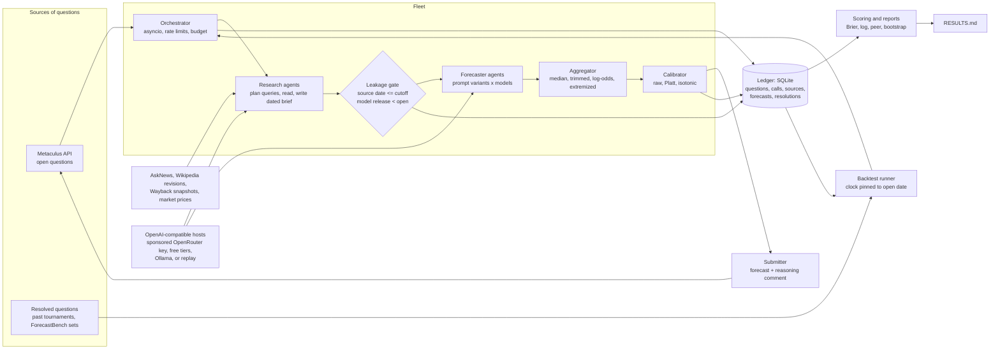

# Augur: plan

## Goal

**The problem.** A forecast about a real event is scored only after the event
happens, often months later, so a team building an AI forecaster cannot tell in
time whether a change helped, and most forecasters that look accurate in
backtests quietly read the answer in news written after the question closed.

Both halves are measured facts, not worries:

- **Slow, noisy feedback.** In Metaculus's Spring 2026 bot tournament the ten
  best bots averaged 13.2 to 18.9 spot peer points per question with intervals
  about 8.5 points wide (the winner covered 288 questions): after three months, no bot was
  clearly separated from the next
  ([results](https://www.lesswrong.com/posts/wZBbDqzfBjYG58CxK)).
- **Leaky backtests.** An audit of Google's `before:` filter on 393 resolved
  Metaculus questions found a page with major post-cutoff information for 71%
  of questions and a direct answer for 41%; feeding those pages to a
  forecaster moved its Brier score from 0.242 to 0.108
  ([El Lahib et al., ACL 2026](https://arxiv.org/abs/2602.00758)). The paper
  recommends frozen, time-stamped snapshots. FutureSearch's closed
  "pastcasting" environment does that (a frozen crawl per question,
  [Bench to the Future](https://arxiv.org/abs/2506.21558)); no open-source
  bot I found does.

**What Augur is.** A fleet of research, forecasting and calibration agents
that enters Metaculus's FutureEval bot tournament ($50k per season) and the
two-week MiniBench rounds, where it is scored on the same questions as about
110 other bots and Metaculus's own template bots. Around the fleet sits the
part I think is the actual contribution: a **ledger** that stores every
question, prompt, source (with the evidence for its date), forecast and
resolution, and a **backtest that cannot leak by construction**: every source
must prove it existed before the question opened, every model must have been
released before the question opened, and a test fails the build otherwise.
Each change is judged on that backtest first and live second.

**Why it is interesting.**

1. The score is an outside result: a public leaderboard I do not control.
2. The backtest's honesty is itself measured (Q2): the same forecaster, the
   same pages, once as they were when the question opened and once as they
   are today.
3. The live ledger doubles as a frozen corpus. Research captured while a
   question was open is leak-free forever, so a new prompt or aggregation rule
   can be replayed against it the day the question resolves.
4. The statistics are the hard part and are stated up front: with 60
   questions per MiniBench round, what difference between two bot versions is
   detectable at all?

**What already exists, and what is different.** Metaculus ships a
[template bot](https://github.com/Metaculus/metac-bot-template) on
[`forecasting-tools`](https://github.com/Metaculus/forecasting-tools) (0.3.7,
2026-11-14): one research call, five forecasts, median. Open-source entrants
(nostreambot, Panshul42's Q2 2025 winner) add model ensembles and more search.
`forecasting-tools` has a benchmarker, but it scores against the community
prediction on open questions, not resolutions. The closest prior work is
FutureSearch's: pastcasting on frozen web snapshots and paired bootstrapped
comparisons, with a lead it reports as real at about 1,800 questions (0.010
Brier, plus or minus 0.003, n = 1,810)
([Iterating on a forecaster](https://futuresearch.ai/iterating-on-a-forecaster),
2026-07-10). It is closed: the corpus, harness and bot are not public. I did
not find an open-source bot whose backtest enforces source dates as a
failing test, measures its own leakage on the same questions, or reports the
smallest improvement its question count can detect. Augur is not a better
prompt; it is an open version of that measurement apparatus plus a bot that
is developed with it.

## Questions

Each question has a prediction written here before any run, the milestone
that answers it and the number it produces. A prediction that fails is
reported as failed.

| # | Question | Prediction (fixed now) | Milestone | Number |
|---|----------|------------------------|-----------|--------|
| Q1 | Does the bot beat the Metaculus template bot on the same questions? | Yes, but not resolvably in one MiniBench round: the interval on about 60 questions will include 0. | M3 (live), M4 (first scored report) | Mean head-to-head score (100 × ln(p_augur / p_template) on the outcome) against a shadow run of the real template on the same live questions, with a paired bootstrap interval; and the leaderboard peer score beside the `metac-*` bot using the same model. |
| Q2 | How much of a backtest's accuracy is leakage? | Unrestricted retrieval improves Brier by at least 0.05 on the same questions; the date-cut arm is no better than "no retrieval" by more than 0.02. | M6 | Brier and log score for three arms (no retrieval, sources as of the open date, sources as of today) on the same resolved questions, paired intervals, and the share of admitted sources a judge still flags. |
| Q3 | Which part carries the score: research depth, number of forecasters, model mix or the aggregation rule? | No single factor is resolvable at the table's n. Research depth has the largest point estimate of the four, but on leak-free sources it stays inside Q2's bound (under 0.02 Brier against no research); forecasters beyond 5 add less than the noise; extremizing by a fixed factor hurts. | M5 (replay, hosted models), M7 (backtest) | An ablation table on the leakage-proof backtest (one factor changed at a time, paired bootstrap intervals), with the minimum detectable effect at the table's n printed beside it. |
| Q4 | Can calibration be learned from the bot's own resolved history? | Not with fewer than about 200 resolutions: Platt and isotonic fitted on past questions will not beat raw on later ones (interval includes 0), and isotonic will be worse than Platt. | M8 | Reliability diagram, expected calibration error, Brier and log score, raw against each calibrator, fitted only on questions that resolved before each test question opened. |
| Q5 | Where does the fleet stand against the frontier? | Above the median bot and above the best same-model template bot; below the top 10. | M4 (first standing), M10 (final) | Rank and average spot peer score with interval in each MiniBench round and in FutureEval, the gap to the best template bot, the best open-source bot and rank 1, the gap to the pro baseline where Metaculus publishes it, and prize money if any. |
| Q6 | Open: does the bot know when it does not know? | Disagreement among forecasters predicts the final forecast's error with AUROC above 0.6, and shrinking high-disagreement forecasts toward the prior improves the backtest score by less than the detectable effect. | M9 | AUROC of disagreement against error (Brier above the median), and the change in score from shrink and from skip policies on the backtest, then live on a pre-registered half of questions split by question id. |

**Q1's decision rule, committed 2026-11-19 before any live round resolves.**
The comparison is `augur score` on every resolved live question that has
both Augur's posted forecast and a shadow template forecast from the same
model (`augur baseline`): the mean head-to-head score, Augur minus the
template, with its paired bootstrap interval clustered by opening week.

- **Target:** +5 points per question, the smallest gain over its own
  baseline among Fall 2025's top five scaffolds (Metaculus notebook 43337).
- **Held:** the interval's lower bound is above 0.
- **Failed:** the interval's upper bound is below 0, or, after both
  remaining Fall MiniBench rounds have resolved, the point estimate is
  negative even though the interval includes 0. A negative estimate after
  both rounds means the pipeline subtracts value, and the next milestone
  diagnoses why before any fleet work (M7).
- **Not yet resolvable:** anything else, reported with the interval and
  the detectable effect at that n.

The same rule and report apply against the community prediction where the
API shows it (it does not to a bot token on scored tournaments; M4).

**M5's predictions and decision rules, committed 2026-11-19 before any
replay run.** The replay evaluation compares arms on the same resolved
binary questions. The arms:

- **(a) price-only:** the market's price as of the cutoff, no model;
- **(b) Augur without prices:** the forecaster draws on the recorded
  research (none for ForecastBench), median;
- **(c) blend:** a fixed log-odds blend, one third Augur (b) and two
  thirds the price (a), both clipped to [0.01, 0.99]. The weight is
  AIA Forecaster's, fixed now and never fitted;
- **(d) Augur with prices:** the same forecaster, with the market source
  shown to it as the first source of the brief, median.

The settings arms come from (b)'s own draws, with no new calls: 1 draw
against 3, and the median against the mean, the mean of log-odds and
extremized log-odds (factor 1.5, fixed now).

The corpora:

- **C1:** ForecastBench 2026-05-24, 139 market questions. Arm (b) is
  M4's `qwen2.5:7b` run (1 draw, no retrieval); arms (a) and (c) only.
- **C2:** ForecastBench 2026-06-21, market questions resolved to 0 or 1
  (frozen 2026-06-11). Arms (a) to (d), 3 draws, on
  `nvidia/nemotron-3-ultra-550b-a55b:free`. That model answered most of
  the bot's live forecasts in M3, and it was listed on 2026-06-04, before
  the freeze, so the release gate admits it.
- **C3:** live questions in the committed ledgers that have resolved. On
  2026-11-19 that is none, so C3 is the harness plus a count of 0.

The price comes from the market's own API as of the freeze instant (a
Manifold bet, a Polymarket price-history point). The Metaculus community
prediction is hidden from the bot's token, and INFER has no public price
API, so those questions have no usable price.

Predictions:

| # | Prediction | Corpus |
|---|------------|--------|
| P1 | The price alone beats Augur without prices: the interval of Brier(b) − Brier(a) is above 0. | C1, C2 |
| P2 | The blend beats Augur without prices: the interval of Brier(c) − Brier(b) is below 0. | C1, C2 |
| P3 | Against the price alone, the blend is worse on C1 (point estimate; a near-constant model only pulls the price toward 50%), and within ±0.01 Brier on C2 (the interval includes 0). | C1, C2 |
| P4 | Showing the price to the model (the market searcher's effect, which the survey scores at r = +0.34) improves Brier by at least 0.03, with an interval of Brier(d) − Brier(b) below 0. The model still under-uses the price: the point estimate of Brier(d) − Brier(a) is above 0. | C2 |
| P5 | The as-of price matches ForecastBench's recorded freeze value within 0.01 on at least 90% of priced questions. A usable exact price is found for at least 90% of Polymarket and Manifold questions, 0% of Metaculus and INFER questions. On live MiniBench questions (search, not an exact match), a similar market about the same event is the top hit for under 25% of a round's questions, judged by hand. | C2, MiniBench 2026-11-16 |
| P6 | Three draws against one: \|ΔBrier\| < 0.01, interval includes 0. Mean of log-odds against the median: \|ΔBrier\| < 0.005. Extremizing at 1.5 is worse than the median (point estimate), with an interval that includes 0. | C2 |

Research depth cannot be varied on C1 or C2, which have no retrieval. It
runs on C3 once live questions resolve.

**Decision rules** (M7's replacement rule: a variant replaces the default
only if its paired interval against the default excludes 0 in its favour,
or it is no worse and cheaper; neither variant here is cheaper):

- **Markets searcher:** it becomes the live default only if the interval of
  Brier(d) − Brier(b) on C2 lies below 0. Until then it is behind
  `--markets`.
- **Blend:** it enters the live default only if (c) is not worse than (b) on
  C2, with the interval of Brier(c) − Brier(b) lying below 0. Live, it
  applies only to an *exact* price of the same question. On Metaculus that
  is the question's own community prediction, where the API shows it to the
  bot. A similar market found by search is shown to the model and never
  blended.

**What these corpora can and cannot say.** On C1 and C2 every question is
itself a market, so the exact price exists by construction. That is the
best case for prices; most MiniBench questions are not markets (P5), so
C2's price-only score is an upper bound on what prices bring live. A
finding on C2 is a finding about one free model on one question set.

**M5's results (2026-11-19; RESULTS.md, the predictions above unedited).**
P1 held on C1 and C2: the price alone (C2 0.106) beats Augur without it
(0.240). P2 held on both: the blend is 0.111 better than Augur on C2. P3
held on C1 and failed on C2 (the blend is 0.023 worse than the price, the
interval [−0.001, +0.047] includes 0 but the point is outside ±0.01). P4
held: shown the price, Augur improves by 0.097 [0.054, 0.144] and still
trails the price by 0.037 [0.003, 0.073]. P5's first two parts failed as first
measured (a seven-day staleness cut priced 85 of 101 Polymarket and
Manifold questions, 75 of those 85 within 0.01 of ForecastBench's value)
and held only after a change made once the data were seen (Manifold
exempted from the cut: 101 of 101 priced, 91 of 101 within 0.01); 0 of 37
Metaculus and INFER priced, and its third part held (a same-event market
for 2 of 59 MiniBench questions). P6: one
draw against three failed (the first draw, 0.022 worse [0.004, 0.044]); the log-odds mean
and extremizing parts held. Under the decision rules both the markets
searcher and the exact-price blend became the live default (`--no-markets`,
`--no-blend`). C3 still has no resolved question, so research depth is not
yet measured on live research.

**M6's predictions and decision rules, committed 2026-11-20 before any
M6 run.** Q2's prediction above stands unedited; this fixes how it is
tested, and adds the judge, the research loop and the edge over the price.

The design:

- **Corpus:** C2 again (ForecastBench 2026-06-21, market questions resolved
  to 0 or 1, frozen 2026-06-11 00:00 UTC, 138 eligible), so the
  no-retrieval arm already exists. The sample is fixed now: the first 64
  eligible questions in question-id order (`--sample 64`; the id is a hash
  of source and id, so the order is unrelated to topic or outcome). The
  loop runs on the first 40 of those 64.
- **Model:** `nvidia/nemotron-3-ultra-550b-a55b:free` (listed 2026-06-04,
  before the freeze) for every role, 3 draws, median, as in C2. The
  release gate now checks every route and role at call time, not only the
  first answering model.
- **Searchers:** Wikipedia (the revision current at the cutoff) and
  Wayback (the newest capture at or before the cutoff of each non-market
  URL the question names; market pages are left out, since the price is
  M5's arm). AskNews is not available here.
- **Queries:** planned once per question, as of its open instant, and
  shared by every arm (`--plan-out`, then `--queries`), so the arms differ
  only in the instant the searches read (or in the loop).
- **Arms:** N, no retrieval (M5's C2 arm (b)); O, one pass as of open;
  T, one pass as of the moment the run reaches the question (an
  `unrestricted` run, never scored as a backtest); L, the research loop as
  of open, at most 3 searches, each followed by a written belief, what is
  still unknown and the next query.
- **Judge:** the same free model with El Lahib et al.'s 0 to 4 rubric,
  given the question, the cutoff, the resolution and every source the
  forecasters were shown; "major leakage" is a score of 3 or 4, as in
  the paper.
- **Hand labels:** 40 sources, 20 from O and 20 from T, drawn by a hash of
  the source id before any judge score is read, labelled from the source
  text against the question and its outcome.

Predictions:

| # | Prediction |
|---|------------|
| P7 | Q2 as written, tested on the 64: Brier(N) − Brier(T) is at least 0.05 with the interval of Brier(T) − Brier(N) below 0 (held if both); Brier(N) − Brier(O) is at most 0.02 (held if the point estimate is). |
| P8 | The judge flags major leakage (a source at 3 or 4) for at least 30% of T's questions and fewer than 10% of O's (the residual leak rate). |
| P9 | The judge agrees with the hand labels at a quadratic weighted kappa of at least 0.6 and on "3 or 4" against "0 to 2" for at least 85% of the 40. |
| P10 | The loop is within ±0.02 Brier of the one pass on the 40 (interval of Brier(L) − Brier(O) includes 0), and costs more model calls a question. |
| P11 | Edge over the price, on priced questions: N, O and L are all worse than the price as of the freeze (interval of arm − price above 0); T's point estimate is above 0 too. |

**Decision rules.** The loop becomes the live default only under M7's
replacement rule (interval of Brier(L) − Brier(O) below 0). Every priced
table headlines the edge over the price, with priced and unpriced
questions reported apart. What these numbers cannot say: they are one
free model on one question set; El Lahib et al.'s leaky arm keeps only
documents their judge rated 3 or 4, while T is naive retrieval as of
today, so T's gap is expected to be smaller than their 0.244 to 0.108.

**M6's results (2026-11-20; RESULTS.md, the predictions above unedited).**
P7 held both ways: researched as of today the bot scores 0.063 against
0.205 with no retrieval (0.142 better [0.074, 0.217], about El Lahib et
al.'s 0.136), and as of open 0.189, no better than none by more than 0.02
(−0.016 [−0.050, +0.017]). P8 held: the judge found a source at 3 or 4
for 40 of 64 questions in T and 1 of 64 in O (a June Wikipedia revision
rendered with a November "as of" count). P9 is not yet tested: it is
stated against hand labels, and the 40 labels are a provisional rating by
a second model (against it, kappa 0.90 and 39 of 40 on "3 or 4"); the
hand labels are under To measure. P10 failed: the loop was 0.026
worse than the one pass [−0.005, +0.060] for 6 calls a question instead
of 4, so the one pass stays the default. P11 held for N, O and L (each
worse than the as-of price) and failed for T, whose point estimate is
below the price (−0.046 [−0.117, +0.022]): the leak alone makes the bot
look level with the market. Past Metaculus tournaments could not be a
corpus (a bot token sees no resolutions; 0 of 269 resolved posts kept).

**M7's predictions and decision rules, committed 2026-11-21 before any
M7 run.** Q3's reconciled prediction above stands unedited; this fixes how
it is tested.

The design:

- **Corpus:** the first 40 questions of M6's fixed C2 sample (the loop's
  40), so every M7 arm sits beside M6's N, O and L on the same questions.
  Binary market questions only: aggregation rules for multiple choice,
  numeric and discrete questions are built and unit-tested, but this
  corpus cannot score them.
- **Model:** `nvidia/nemotron-3-ultra-550b-a55b:free` (listed 2026-06-04)
  in every role unless a row names another; $0.
- **Research depth:** D0 is N (no retrieval), D1 is O (one pass as of
  open), and D2 is two passes: the one pass on the shared query plan, then
  a second pass in which the model reads the first brief, writes up to
  three sub-questions whose answers would most change the forecast, each
  with a search query; those queries run as of open, pass the gate, and a
  final brief is written from every admitted source. 3 draws, median.
- **Head count:** O's three recorded draws (members 0 to 2) plus six new
  draws on the identical recorded request, seeds 3 to 8. k forecasters is
  the median of members 0 to k−1, for k = 1, 3, 5, 9. The live default is
  5.
- **Aggregation**, on the same nine draws, no new calls: median (the
  default), trimmed mean (drop the lowest and highest 20%, rounded down:
  one of nine), mean of log-odds, and extremized log-odds at the fixed
  factor 1.5 (M5's).
- **Model mix:** three draws of `nvidia/nemotron-3-nano-omni-30b-a3b-reasoning:free`
  (listed 2026-04-28, the only other free model that answered the probe
  on 2026-11-21) on the same recorded requests. Mixed fleet: the median
  of ultra's members 0 to 2 and nano's 0 to 2, against ultra's members 0
  to 5 (the same head count).

Predictions:

| # | Prediction |
|---|------------|
| P12 | Two passes against one: \|Brier(D2) − Brier(D1)\| < 0.02 with an interval that includes 0, for at least two more model calls a question. |
| P13 | Head count: one forecaster is worse than five (point estimate at least +0.01); nine against five is within ±0.005 with an interval including 0; three against five has an interval including 0. |
| P14 | Aggregation against the median of nine: mean of log-odds and trimmed mean within ±0.005; extremizing at 1.5 worse (point estimate above 0) with an interval that includes 0. |
| P15 | Model mix: the mixed fleet against six ultra draws has an interval including 0; three nano draws are worse than three ultra draws (point estimate). |
| P16 | Power, from a simulation that plants a known improvement in this sample's resampled per-question scores: 80% detection of a 0.01 Brier difference needs more than 1,000 questions; of 10 head-to-head points, fewer than 300; of 2 points, more than 2,000. |
| P17 | Q3 as written: no factor's interval against its default excludes 0. |

**Decision rule.** The replacement rule, made exact before the run: a
variant replaces the live default only if (a) its paired interval of
Brier(variant) − Brier(default) lies wholly below 0, or (b) it makes fewer
model calls a question and is no worse, meaning that interval's upper
bound is below +0.01 Brier (a non-inferiority margin fixed now). Same-cost
variants (the aggregation rules, the mixed fleet) can only win by (a).

**M7's results (2026-11-21; RESULTS.md, the predictions above unedited).**
On the 40 questions with `nemotron-3-ultra:free`: P12's size part held
(two passes against one −0.0003 [−0.025, +0.022]) and its cost part
failed (1.8 more calls a question, not 2: the brief is not rewritten when
the second pass finds nothing new). P13: one forecaster was not worse than
five (−0.002 [−0.024, +0.017], failed); nine against five (+0.0007) and
three against five held. P14: the trimmed mean (+0.0008) and the log-odds
mean (+0.0014) held; extremizing at 1.5 was worse with an interval that
excludes 0 (+0.027 [+0.009, +0.048]), so its "interval includes 0" part
failed. P15 held (mixed fleet +0.006 [−0.015, +0.026] against six draws;
the second model 0.014 worse than the first). P16: 80% power on 0.01
Brier needs about 450 questions on a research change's spread, not over
1,000 (failed); 10 points about 70 (held); 2 points about 1,650, not over
2,000 (failed). P16 did not name the spread it is judged on, and the
research spread was chosen after the runs began; on the noisier retrieval
spread all three parts hold, so its verdict is reported with every reading
beside it. P17 failed on extremizing alone, a loss. No variant passed
the replacement rule, so the live default is unchanged: one pass, five
forecasters, the median, one model.

**M8's predictions and decision rule, committed 2026-11-22 before any
M8 run.** Q4's prediction above stands unedited; this fixes how it is
tested. It was written before M5 measured this model; C2 since showed the
free model near always-50% without retrieval (Brier 0.240 against 0.250),
so I now expect a fitted line to help, and say so as P19 beside it.

The design:

- **Corpus C4:** nine ForecastBench sets, 2026-06-21 to 2026-10-11
  (freezes 2026-06-11 to 2026-10-09), every market question the loader
  keeps for a model listed 2026-06-04 (resolved to 0 or 1 in the
  resolution sets as fetched 2026-11-22): 930 question instances. A
  market posed in several sets is one instance per set; the bootstrap
  resamples markets, so its instances move together.
- **Forecaster:** `nvidia/nemotron-3-ultra-550b-a55b:free`, no retrieval,
  one draw per instance. 2026-06-21 reuses member 0 of M5's C2 arm (b)
  (the first draw, as C2 already reports it); the eight later sets are
  new runs (792 free calls, inside one day's 1,000). Calibration is a
  property of one forecaster, so every instance comes from the same model
  and arm.
- **Time order:** a test instance may be calibrated only with instances
  whose resolution date is before the day it opened (resolution date <
  freeze date). The harness enforces it and a test fails if any fit
  sees a later resolution.
- **Calibrators**, all on the aggregate, outputs clipped to [0.01, 0.99]
  as the aggregator clips: raw (identity); fixed extremizing (log-odds ×
  1.5, M5's factor, not fitted); Platt (a logistic regression of the
  outcome on the log-odds, maximum likelihood with Platt's smoothed
  targets); isotonic (pool adjacent violators, a step function); and, as
  the reference any calibrator must beat to show the forecasts carry
  information, the history's base rate ((yes + 1) / (n + 2)), which
  ignores the forecast.
- **Walk-forward test (W):** every instance with at least 50 resolutions
  before it opened (sets 2026-07-19 to 2026-10-11, 673 instances), each
  calibrated on all resolutions before it opened (68 to 670).
- **Learning curve (L):** the instances with at least 400 resolutions
  before they opened (sets 2026-09-13 to 2026-10-11, 206 instances), each
  calibrated on the k most recent resolutions before it opened, k = 25,
  50, 100, 200, 400; the same 206 at every k.
- **Metrics:** Brier and log score; paired differences against raw with
  a bootstrap over markets (10,000 resamples, fixed seed); expected
  calibration error on 10 equal-mass bins; sharpness (the standard
  deviation of the forecasts) beside it; the reliability diagram; and the
  edge over ForecastBench's recorded freeze-time price, reported apart for
  Polymarket and Manifold (prices the bot can read) and for Metaculus and
  INFER (hidden from it live).
- **Live:** the same harness on the committed ledgers' resolved live
  binary questions; on 2026-11-22 a bot token sees no resolution (M4), so
  this is expected to be a count of 0.

Predictions:

| # | Prediction |
|---|------------|
| P18 | Q4 as written, on L: with fewer than 200 resolutions (k = 25, 50, 100) neither Platt nor isotonic has an interval of Brier(cal) − Brier(raw) wholly below 0, and isotonic's point estimate is worse than Platt's at each k. |
| P19 | On W, Platt improves Brier over raw by at least 0.02 with an interval wholly below 0, and at least halves raw's calibration error; isotonic's interval is also below 0. |
| P20 | Fixed extremizing at 1.5 is worse than raw on W, with an interval wholly above 0. |
| P21 | On L, Platt's gain at k = 50 is at least half its gain at k = 400. |
| P22 | On W, Platt beats the history's base rate (point estimate), with an interval that includes 0. |

**Decision rule.** M7's replacement rule: a calibrator replaces raw as the
live default only if its paired interval of Brier(cal) − Brier(raw) on W
lies wholly below 0 (no calibrator makes a model call, so none wins on
cost). If more than one passes, the lower point estimate wins. A
calibrator is a property of the model that was fitted: the live default
is then that calibrator fitted on all of C4, applied only to binary
aggregates whose forecast came from that model, before the exact-price
blend; forecasts from any other model (every scored-tournament forecast,
under the floor) stay raw until that model has its own resolved history.
What W cannot say: it is one free model with no retrieval; live
forecasts have research and, where a price exists, the blend.

**M8's results (2026-11-22; RESULTS.md, the predictions above unedited).**
C4 holds 926 instances, not 930 (three questions never gave a parseable
answer, one 2026-06-21 question has no member 0), so W is 671, not 673.
The rule "resolution date < freeze date" was first applied to
ForecastBench's resolution date. Review found that date is often only the
market's close: 239 of 536 markets became public later, by their own APIs.
The harness now takes the later of the two (INFER, with no API, is never
trained on), and the corrected reading is the reported one. It leaves W
as it was and shrinks L from 206 to 130 instances. Verdicts on the
corrected reading: P18 failed on both parts (isotonic's interval clears 0
at k = 100, [−0.077, −0.006], and isotonic beats Platt at k = 25 and 50).
As first read, its first part had held. P19 held (Platt −0.022 [−0.037,
−0.007]; calibration error 0.152 → 0.069; isotonic −0.018 [−0.030,
−0.007]). P20 held (extremizing +0.015 [+0.010, +0.020]). P21 failed
(Platt's gain 0.018 at k = 50 against 0.057 at 400). P22 failed the other
way: Platt beats the history's base rate with an interval that excludes 0
(−0.024 [−0.038, −0.009]), so the forecasts carry information once
rescaled. Q4 as written: about 200 resolutions is right for Platt (first
interval clear of 0 at 200) and too pessimistic for isotonic (100), and
isotonic is not worse than Platt at small k. Under the decision rule
Platt replaces raw for this model's binary forecasts: slope 0.32 and
intercept −0.18 in log-odds, fitted on all 926 (`augur/live_calibrator.json`).
Under the floor no scored forecast comes from this model, so the change
reaches dry runs and the bot-testing-area only. The live arm has 3 posted
binary forecasts and 0 resolved: nothing to fit. Found in review, after the
verdicts: split by source, the whole gain is on Polymarket and Manifold
(Platt −0.044 [−0.063, −0.026], 480 instances); on the 191 Metaculus
questions, the nearest to MiniBench, Platt is worse than raw (+0.035
[+0.013, +0.054]), because the pooled map pulls a 17% base-rate group
toward 35%. The rule was on W as a whole, so the decision stands; a
source-conditioned map is a candidate for a later milestone, prediction
first.

**The source-aware calibrator: prediction and decision rule, committed
2026-11-22 before any run.** M8's pooled Platt map is 0.035 Brier worse
than raw on the hidden-price group of W (Metaculus and INFER), the group
nearest to what MiniBench asks. Two maps that know a question's source
join M8's walk-forward harness, on the same 671 instances and the same
fits (each instance calibrated only on outcomes known before it opened):

- **Per-source Platt (`platt-by-source`):** a separate Platt map for each
  source, fitted on that source's history alone; a source with fewer than
  30 known outcomes in the history (INFER always: it is never trained on)
  gets the pooled map.
- **Partially pooled Platt (`platt-partial`):** one shared slope and a
  per-source intercept, `q = sigmoid(a · logit(p) + b + u_s)`, fitted by
  penalised maximum likelihood on Platt's smoothed targets with the
  penalty `u_s² / (2 · 0.5²)` on each source's offset (a normal prior of
  standard deviation 0.5 log-odds around the shared intercept, fixed now
  and never tuned). A source the history has not seen gets `u_s = 0`.

Both are compared with raw and with pooled Platt overall and by source
(Polymarket, Manifold, Metaculus, INFER), paired bootstrap over markets as
in M8, by `augur calibrate` and checked by `make eval`. For reading beside
it: AIA Forecaster's calibration step is a fixed, unfitted extremizer
(log-odds × √3) on a frontier model, the opposite direction to this free
model's fitted slope of 0.32, so no map transfers across models.

| # | Prediction |
|---|------------|
| P23 | On W's Metaculus instances the partially pooled map is still worse than raw: point estimate above 0 and the interval's upper bound above +0.01. It cuts pooled Platt's Metaculus loss by at least half (point estimates). |
| P24 | Per-source Platt on W's Metaculus instances: the interval of Brier − raw has its upper bound below +0.01. Overall (all of W) both source-aware maps are within ±0.01 of pooled Platt (point estimates). |

**Decision rule.** A source-aware map replaces pooled Platt as the live map
only if (i) on W's Metaculus instances the upper bound of Brier(map) −
Brier(raw) is below +0.01 (M7's non-inferiority margin), and (ii) on all of
W the upper bound of Brier(map) − Brier(pooled Platt) is below +0.01. If
both maps pass, the lower overall point estimate wins. Until some map
passes (i), the live calibrator is not applied to forecasts on Metaculus
questions; every live and bot-testing-area question is a Metaculus
question, so until then live binary forecasts go out raw.

**M9's design, predictions and decision rules (Q6), committed 2026-11-22
before any M9 run.** Q6's prediction above stands unedited. The risk this
design guards against: this model's log-odds are worth about a third of
their face value (M8's slope 0.32), so *any* rule that shrinks forecasts
will look good against raw, whether or not disagreement carries
information. A disagreement-conditioned policy therefore counts only if it
beats two controls on the same questions: **(A) constant shrinkage**, a
Platt map on the final forecast (one slope for every question), and **(B)
the source-aware calibrator**, the partially pooled map above. BLF's
attempt at the same thing, a shrink of the mean logit scaled by the
disagreement of five draws, was a null: leave-one-out tuning chose no
shrinkage (arXiv 2604.18576v5). Everything runs on draws already in the
ledgers, $0, no new model call.

- **Samples.** S138: C2's 138 questions (ForecastBench 2026-06-21), no
  retrieval, `nemotron-3-ultra:free`, three draws each (M5's arm (b));
  final forecast the median of the three. S40: M7's 40 questions, one
  research pass as of open, final forecast the median of draws 0 to 4 of
  the same model (the live default's shape); for it also three draws of
  `nemotron-3-nano:free` on the same briefs, and the loop (L) and
  two-pass (D2) briefs.
- **Disagreement measures**, all on log-odds of forecasts clipped to
  [0.01, 0.99]: *draws*, the standard deviation of the draws' log-odds
  (S138: three, S40: five); *models*, the absolute log-odds gap between
  the median of three ultra draws and the median of three nano draws (S40);
  *passes*, the standard deviation of the three researched briefs' medians
  (one pass, loop, two passes; S40). Beside them, as a reference and not a
  disagreement measure, *confidence*, |logit p| of the final forecast.
- **Error.** A large error is a Brier score of the final forecast strictly
  above the sample's median Brier. AUROC of each measure for large errors
  (ties count a half), with a percentile bootstrap interval over questions
  (10,000 resamples, seeded).
- **What the n can resolve, stated before running.** With half the
  questions in each class, the AUROC's interval half-width is about 0.18
  at n = 40 and 0.10 at n = 138 (Hanley and McNeil), so at n = 40 only an
  AUROC above about 0.68 can clear 0.5, and at 138 above about 0.60. For a
  policy's paired Brier difference, M7's measured per-question spreads
  (0.028 for 9 against 5 draws to 0.077 for two passes against one) put
  the detectable effect at n = 40 between 0.012 and 0.034 Brier, and at
  n = 138 between 0.007 and 0.018.
- **Policies.** Every fitted map (A, B and the fitted policy) is fitted
  leave-one-out within the sample: the question being forecast never
  enters its own fit. These are one ForecastBench set, so the history is
  not time-ordered as M8's is; the procedure is the same for controls and
  policies, and the absolute gains are optimistic for all of them alike.
  (1) *Fitted slope*: B plus a disagreement term in the slope,
  `q = sigmoid((a + c · z) · logit(p) + b + u_s)`, z the measure
  standardised on the training questions, one policy per measure.
  (2) *Fixed spread shrink*, no parameter fitted:
  `q = sigmoid(logit(p) / (1 + d))`, d the draws measure, with its own
  third control, the *matched constant shrink*
  `q = sigmoid(k · logit(p))`, k the sample mean of `1 / (1 + d)`
  (forecasts only, no outcome). (3) *Skip*: forecast the control's value
  except on the quarter of questions with the largest disagreement
  (rounded down; ties by question id), scored in tournament units against
  ForecastBench's recorded freeze-time value as the stand-in for the
  field (a skipped question scores 0), against the same control
  forecasting every question and against skipping the same number at
  random (its expectation).
- **Tournament units.** For a forecast-changing policy, the mean
  head-to-head score against the control, 100 × ln(q(outcome) /
  control(outcome)): the change in peer score from submitting q instead,
  whatever the field. Beside it the paired Brier difference.

| # | Prediction |
|---|------------|
| P25 | Draws: the AUROC of the draws' spread has a point estimate below 0.6 and an interval that includes 0.5, on S138 and on S40 (same-model draws carry little independent signal: M7 found one to nine draws within 0.002 Brier). |
| P26 | Models: on S40 the gap between the two models has the highest AUROC point estimate of the three measures, above 0.6, with an interval that includes 0.5. Passes: its interval includes 0.5. |
| P27 | The trap is real: control A (leave-one-out Platt) beats raw on S138 with the interval of Brier(A) − Brier(raw) below 0, and the matched constant shrink beats raw on S138 (point estimate). |
| P28 | No disagreement-conditioned policy (fitted slope, fixed spread shrink, skip) beats both controls with an interval excluding 0, on either sample; every policy's point estimate against B is within ±0.01 Brier. |
| P29 | Verdict: not resolvable at this n, for every measure; the count needed for an AUROC of 0.6 to clear 0.5 with 80% power is more than 300 questions. |

**Decision rule.** A policy is adopted only if, on the same questions, its
paired interval of Brier(policy) − Brier(control) lies wholly below 0
against both A and B (and, for the fixed spread shrink, against the
matched constant too; for skip, its tournament-unit gain has an interval
above 0 against the control forecasting everything and against random
skipping, on top of A and of B). A policy whose interval against either
control lies wholly above 0 is rejected. Anything else is *not resolvable
at this n*, reported with the count of questions that would detect 0.01
Brier at 80% power on the measured per-question spread.

<!-- q6-preregistration:begin -->
**Q6's live test, pre-registered 2026-11-22 before it starts.**

1. *Policy:* the fixed spread shrink, `q = sigmoid(logit(p) / (1 + d))`,
   p the median of the question's draws and d the standard deviation of
   their log-odds (forecasts clipped to [0.01, 0.99]). Nothing is fitted.
2. *Unit:* a binary question in MiniBench, FutureEval or a shadow round
   (dry run) whose forecast in the committed ledgers has at least three
   member draws, all from one model. The first such forecast per question
   counts; backtests and the bot-testing-area do not.
3. *Split:* the question's Metaculus id. Odd ids are the policy half;
   even ids are the control half.
4. *What is recorded:* nothing new. Every member draw is already in the
   ledger, so the policy, the default (the median, raw) and the controls
   are recomputed from the member rows on every question.
5. *What is submitted:* on odd ids the policy's forecast, only if the
   backtest verdict above adopts the fixed spread shrink; otherwise the
   default everywhere, and the policy is never posted.
6. *Controls:* the default, and the matched constant shrink
   `q = sigmoid(k · logit(p))` with k frozen at the value S40 gives.
7. *Analysis, fixed now:* when the odd half has 60 resolved binary
   questions, or on 2027-03-31, whichever is first, the mean paired
   Brier(policy) − Brier(control) and the head-to-head score on the odd
   half, for each control, with a bootstrap interval clustered by the
   week the question opened (10,000 resamples, seeded). The even half is
   analysed the same way and reported beside it, as a replication.
8. *Verdict:* adopted if both intervals on the odd half lie wholly below
   0 (Brier); rejected if either lies wholly above 0; otherwise not
   resolvable at that n, with the count needed.
<!-- q6-preregistration:end -->

**Q6's live test, two clarifications (2026-11-22, before any unit
exists; the registered block above is unedited).** "Before it starts"
is read as: only runs that start at or after the registration commit
(`ca3aaa9`, 2026-11-22 15:09:51 UTC) are units, so the two earlier dry
runs in the ledgers do not count. "The question's Metaculus id" is the
question id inside the post (the ledger's `question_id`), not the post
id. FutureEval runs are recorded by project id (`33121`) and count.

**The source-aware calibrator's result (2026-11-22; RESULTS.md, P23 and
P24 above unedited).** P23 held in its first part (partially pooled on
Metaculus +0.019 [−0.008, +0.043] against raw) and failed in its second
(it cut pooled Platt's +0.035 loss by 47%, not half). P24 failed in its
first part (per-source Platt +0.014 [−0.008, +0.032], upper bound above
+0.01) and held in its second (both maps within 0.01 of pooled Platt
overall; per-source is 0.007 better [0.003, 0.011]). No map passes the
rule's part (i), so the live map stays pooled Platt with `withheld_from:
["metaculus"]`: live binary forecasts go out raw. M8's "191 Metaculus
questions" were 190 Metaculus and one INFER question.

**M9's results (2026-11-22; RESULTS.md, P25 to P29 above unedited).** The
samples are 135 and 39 questions (three of C2's lack a third draw, one of
M7's 40 a fifth). P25 held (draw spread AUROC 0.507 [0.405, 0.608] on
S138, 0.563 [0.372, 0.743] on S40). P26 failed: the two-model gap scored
lowest, 0.325 [0.164, 0.505]; the passes' interval includes 0.5 (held).
P27 failed in its first part (control A against raw on S138 −0.009
[−0.034, +0.016]) and held in its second (the matched constant shrink
−0.007 [−0.014, −0.000]). P28 failed in its first part, read as
written: skipping by the draws' spread beats A and B forecasting every
question on both samples (+7.3 [+2.9, +12.2] points on S138), only
because the model trails the price almost everywhere; against skipping
at random it gains +0.8 [−3.0, +5.1], so it is not adopted. No shrink
policy beat A and B, and every one is within 0.01 of B (held). P29 held in its first
part (not resolvable at this n for every policy) and failed in its second
(an AUROC of 0.6 needs about 250 questions, not more than 300). Q6 as
written: its first half failed (no measure above 0.6), its second held
(the fixed shrink improves on its matched constant by 0.005, below the
detectable effect). Verdict: **not resolvable at this n**, with 95 to
1,063 questions needed per policy for 0.01 Brier; the fixed spread shrink
is not posted live. Found after the run: the pre-registered label (Brier
above the median) marks hedged forecasts more than wrong ones (confidence
predicts it at AUROC 0.17 and 0.01), so a future registration should use
the wrong-side label; on that label, reported as exploratory, the draw
spread scores 0.60 [0.49, 0.70] and the research passes 0.68 [0.47, 0.88].

**M10's same-question row: predictions and reading rule, committed
2026-11-23 before any comparison is computed.** ForecastBench publishes
every entrant's forecasts for each question set (its processed forecast
sets, `forecastbench.org/datasets`, file last modified 2026-11-17). On
exactly the question instances Augur's committed backtests forecast, each
entrant's Brier is set beside Augur's, paired per question.

- **Augur's arms:** C1 (2026-05-24, 139 questions, `qwen2.5:7b`, no
  retrieval, one draw; M4); C2 (2026-06-21, `nemotron-3-ultra:free`, no
  retrieval, median of three draws; M5's arm (b)); O (the same model, one
  research pass as of open, 64 of C2's questions; M6); C4 (nine sets,
  `nemotron-3-ultra:free`, no retrieval, one draw; M8).
- **Entrants:** every forecast file in the set: ForecastBench's own
  zero-shot LLM runs (with and without the market's freeze value in the
  prompt), the external entries (teams that forecast live with their own
  tools), and ForecastBench's baselines (always 0.5, the naive
  forecaster). An entrant is compared only on questions where its own
  forecast is not imputed, and that n is printed. The freeze value (the
  market price ForecastBench recorded) is a row of its own.
- **Statistic:** Brier(Augur) − Brier(entrant), paired, bootstrap over
  markets (10,000 resamples, seeded), and Augur's rank among each group.

| # | Prediction |
|---|------------|
| P30 | On C2 and on C4, Augur's no-retrieval arm is worse than the median zero-shot LLM entrant shown no freeze value (point estimate), and ranks in that group's bottom quarter. |
| P31 | On C2, at least 90% of the zero-shot entrants shown the freeze value beat Augur's no-retrieval arm with an interval of Augur − entrant wholly above 0. |
| P32 | Researched as of open (O, 64 questions), Augur is still worse than the median external entry on the same questions (point estimate). |
| P33 | No Augur arm beats any external entry with an interval wholly below 0. |

**Reading rule.** This is a placing, not a decision: nothing in the live
bot changes with it. The entrants forecast live with their own tools and
models; Augur's arms are backtests of one free (or small local) model,
mostly without retrieval, so a gap measures tools and model together. The
row is labelled a backtest and never ranked on ForecastBench's own
leaderboard.

**M10's same-question results (2026-11-23; RESULTS.md, P30 to P33 above
unedited).** Augur's arms reproduce their committed Brier exactly, and
ForecastBench's files resolve every instance as Augur was scored. P30
failed: on C2 the no-retrieval arm is level with the median zero-shot LLM
shown no freeze value (+0.002) and ranks 13 of 23, not in the bottom
quarter; on C4 it is worse (+0.017) and in the bottom quarter (59 of 78), but only
because the group includes ForecastBench's web-search runs (34 of 53
without them; noted at review, RESULTS.md).
P31 failed: 17 of 22 entrants shown the freeze value (77%, not 90%) beat it
with an interval above 0. P32 held: researched as of open, all 16 external
entries beat it, by a median of +0.083 Brier. P33 failed: on C4 it beats two
blind entries of one anonymous team (−0.035 [−0.067, −0.004] and −0.038
[−0.071, −0.004]). Readings fixed while building and stated in RESULTS.md:
"median" is the median of the paired differences; an entrant compared on
one market has no interval. Found while building: the files'
`market_value_on_due_date` is a price about ten days after the freeze, not
the freeze value, so both appear as rows. The placing in one line: without
retrieval the free model is an ordinary zero-shot LLM; every external entry
on C1, C2 and O, and most models shown the price, beat it.

**Proposed submit floor, re-based on the latest round (2026-11-20; for
the maintainer to approve, not applied in code).** The tier
`frontier-2026-11b` is argued from the Spring 2026 survey, and the
November leaderboard has overtaken it: in the finalized MiniBench
2026-11-02 round only 4 of 54 plain template bots averaged at or above 0,
and the templates on last year's flagships sit well below it
(`augur standings`, RESULTS.md "Template bots by model"). The proposal:

- **Rule:** a model is admitted only if its Metaculus template bot's
  average spot peer score in the latest finalized MiniBench round is at
  or above 0. The tier is renamed at each review and the ledger records
  the name, as now.
- **Admitted on 2026-11-02's evidence:** `claude-opus-5-5` (+3.66),
  `gemini-3-8-flash` (+2.76), `claude-sonnet-5-5` (+2.39),
  `claude-haiku-5-5` (+0.87). Every interval includes 0, so this is the
  weakest rule the evidence supports, not proof any of them adds value.
- **Dropped for want of current evidence:** `gpt-5`, `gpt-5-1`,
  `gemini-2-5-pro`, `claude-opus-4-1`, `claude-sonnet-4-5` (no template
  in the round), and the "GPT-5.4, r = +0.42" justification for
  `gpt-5-4`, which also has no template there.
- **Cost:** the worst case of one 60-question round on each admitted
  route is printed beside the table (from the agents' token ceilings and
  OpenRouter's list prices): about $37 on Opus 5.5, $18 on Sonnet 5.5,
  $7.6 on Gemini 3.8 Flash and $0.9 on Haiku 5.5, against a key that
  reports a $1 limit. Nothing is spent until the maintainer approves a
  route and the key covers it; the scored round with `augur baseline`
  beside it stays under To measure until then.

**Status after M4 (2026-11-19).** Q1: *not yet resolvable*; no live
question with both an Augur and a shadow-template forecast has resolved,
and the floor has kept Augur out of scored rounds until a frontier model
answers. Q5: *no reading*; Augur has no leaderboard entry. What M4 did
measure for both: the median bot's line and the best template bot's average
in the 2026-11-02 round (RESULTS.md), and the sample each needs: at a
per-question spread of 32 points, 60 resolved questions detect a
difference of 11.6 points and 300 detect 5.2, so Q1's +5 target is a
Spring 2027 measurement and Fall 2026 can place Augur only above or below
the median bot. Q5's secondary row, ForecastBench without retrieval on
`qwen2.5:7b` (139 market questions): Brier 0.2395, indistinguishable from
always 50% and the base rate, 0.108 behind the market price; a floor, not a
placing.

**Reconciled before any run (2026-11-18).** The first version of Q3 said
research depth would be the largest effect, while Q2 says leak-free
retrieval is worth at most 0.02 Brier over none. Both cannot hold on the
same backtest unless every other factor is smaller still, so Q3 now says
exactly that, and adds that nothing in its table is expected to be
resolvable. A finding from either is labelled with the model that produced
it; a backtest on `qwen2.5:7b` says nothing yet about the hosted model the
bot ships with, which is why the replay evaluation (M5) comes before the
backtest (M6).

**What this season's sample can resolve.** In Spring 2026 the winning bot's
average spot peer score was 18.90 with interval [15.18, 22.61] over 288
questions, which puts the spread of one bot's per-question peer score near
32 points (derived: half-width / 1.96 × √288). With the floor below, Augur
forecasts live only once a frontier model is available (M2); the Fall
MiniBench rounds that remain (from about 2026-11-30 and 2026-12-14, about
60 questions each) give at most about 120 live forecasts, so an interval of
roughly ±5.8 points on an average peer score, ±8.1 for one round. That
resolves nothing a season's leaders are separated by. Concretely: Q1 is not
resolvable in Fall unless the gap to the template exceeds about 6 points
(a paired difference may have a smaller spread; M4 reports the measured
one); Q5 places the bot only coarsely (above or below the median bot);
Q4's live arm and Q6's live arm need more resolutions than Fall gives and
are Spring 2027 measurements. Q2, Q3 and the backtest arms of Q4 and Q6 run
on resolved questions, so their n is set by the backtest corpus, not the
season. Fall 2026 is the shakedown; Spring 2027 is the season to place in.

## Architecture

### Components

| Module | Job |
|--------|-----|
| `augur/metaculus.py` | Typed `httpx` client for the five calls the bot needs: list a tournament's posts, post details, submit a forecast, create a comment, read my scores. Token from the environment only. Client-side rate limit, `Retry-After` honoured. |
| `augur/questions.py` | `Question` models for binary, multiple choice, numeric and discrete, with open, close and resolve times. Converts percentiles to the 201-point CDF Metaculus accepts (fewer points for discrete) and enforces its validity rules. |
| `augur/llm/` | `Provider` protocol over plain `httpx` (one HTTP stack, mocked and recorded): from M2 one generic OpenAI-compatible provider (base URL, the name of the environment variable holding its key, model; Bearer auth), so OpenRouter, Groq, Gemini's OpenAI endpoint, GitHub Models and Ollama are configuration, not code; `replay` (serves recorded calls by request hash). An ordered model list per role (a cheap model for planning and the brief, the best answering model for the forecasts), probed at run start, falling to the next model on rate-limit or out-of-credit errors. Prices and listing dates come from OpenRouter's model list (the listing date stands in for the release date where none is known, which is conservative for the gate); a few local models keep hand-written release dates. The **submit floor**: a named frontier tier, outside of which `--submit` refuses every tournament but the bot-testing-area. Token-bucket and semaphore limits per provider. |
| `augur/research/` | Searchers that all take an `as_of` instant: `asknews` (news, with `end_timestamp`), `wikipedia` (the revision current at `as_of`), `wayback` (latest capture at or before `as_of`). Each returns `Source` records with `published_at`, `retrieved_at` and `date_evidence` (which field or capture timestamp proves the date). From M5, `markets`: the Metaculus community prediction where the API exposes it, and similar questions on Polymarket, Manifold and Kalshi through their public APIs, each with its price **as of the cutoff** (the trade or candle timestamp is the date evidence), so the leakage gate holds for prices too. |
| `augur/leakage.py` | The gate. Admits a source only if its date evidence is at or before the cutoff; refuses undated sources in backtests; refuses a model whose release date is not before the question's open date. Everything it rejects is logged with the reason. |
| `augur/agents/` | `researcher` (plans queries, reads, writes a brief that cites source ids), `forecaster` (prompt variants: outside view, inside view, sceptic), `parser` (structured output into a typed forecast). |
| `augur/aggregate.py` | Median, trimmed mean, mean of log-odds, extremized log-odds; for numeric questions, a mixture of CDFs; for multiple choice, normalised per-option aggregates. |
| `augur/calibrate.py`, `augur/q4.py`, `augur/livecal.py` | Calibrators fitted on resolved history: identity, fixed extremizing, the history's base rate, Platt (a line in log-odds), isotonic (pool adjacent violators); the time-ordered harness (walk-forward and learning curve) that fits each question only on outcomes resolved before it opened; the live map, keyed by the model it was fitted on. |
| `augur/score.py` | Brier, log score, Metaculus baseline score, head-to-head and peer score for all question types; paired, question-clustered bootstrap; minimum detectable effect. |
| `augur/ledger.py` | Append-only SQLite store and its JSONL export. Nothing is updated in place; a resolution is a new row. |
| `augur/backtest.py` | Runs the same orchestrator with the clock pinned to each question's open date and submission disabled. |
| `augur/cli.py` | `augur forecast`, `augur backtest`, `augur resolve`, `augur score`, `augur report`, `augur ledger export|import`, `augur models probe`, `augur standings`. |

### Data flow for one live question

1. `augur forecast --tournament minibench` lists open questions and drops the
   ones the account has already forecast (`my_forecasts` in the API payload),
   then takes at most `AUGUR_MAX_QUESTIONS_PER_RUN`.
2. The researcher plans queries and each searcher runs with `as_of = now`.
   Every source is written to the ledger before any model sees it.
3. The gate checks each source against the cutoff (live: now; backtest: the
   open date) and the brief is built from admitted sources only.
4. N forecasters run in parallel within the provider's limits; each returns a
   typed forecast and its reasoning. The aggregator combines them and the
   calibrator maps the result.
5. With `--submit` and a token, the submitter posts the forecast and a private
   comment built from the members' actual reasoning and the sources cited.
   Without either, it prints what it would have posted (dry run). Outside the
   bot-testing-area, `--submit` refuses before any model call unless the
   answering model is in the frontier tier (the submit floor).
6. Later, `augur resolve` appends resolutions and `augur score` reports.

### Design decisions

| Decision | Chosen | Alternative considered | Which part of the problem needs it |
|----------|--------|------------------------|-------------------------------------|
| Language and runtime | Python 3.12, `asyncio`, `uv` | 3.14 (the runner's default): `forecasting-tools` does not support it yet, and the shadow baseline needs that package | A question is open for about 1.5 hours; research and several forecasters must run concurrently within rate limits. |
| Metaculus access | Own `httpx` client, about 200 lines, strict types | Build on `forecasting-tools`' `ForecastBot`: it brings LiteLLM, `nest_asyncio` and its own report types, and hides the calls I need to record | Every request and response has to land in the ledger, and I have to be able to explain each call. |
| Template baseline | The real `TemplateBot` from `forecasting-tools`, run unpublished in an optional `baseline` extra | Reimplementing the template's prompt: then "beats the template" would mean "beats my copy of it" | Q1 must be like for like. |
| Models | Metaculus's sponsored credits, now delivered as an OpenRouter key, plus OpenRouter `:free` models and other free OpenAI-compatible tiers, all through one generic provider (M2); Ollama with small open models for development; `replay` for tests | A paid balance on any provider: never added. (The first plan ruled out OpenRouter as paid; that was wrong once the sponsored credits arrived as an OpenRouter key, and the proxy at `llm-proxy.metaculus.com` no longer resolves.) | The tournament provides credits; development and CI must cost nothing and be deterministic. |
| Submit floor | `--submit` to any tournament other than the bot-testing-area needs a hosted model in a named frontier tier; it refuses otherwise, before any model call (built in M1) | Submitting whatever model answers: an expired key would then post small-model forecasts, and a weak forecast loses peer points that skipping does not | A score is only worth having if every forecast behind it came from the bot as designed. |
| News | AskNews through the tournament's sponsorship, Wikipedia revisions, Wayback captures | Google or DuckDuckGo date filters: measured to leak on 71% and 81% of questions; Perplexity or Exa: paid | Backtests need a date that can be proven, not a date filter that is hoped to work. |
| Source dating | A source is admitted on **evidence**: an archive capture timestamp, a revision timestamp, or the news provider's publish date bounded by the query's `end_timestamp`; otherwise rejected in backtests | Trusting the page's own date metadata: the cited audits show it is often wrong | "Leakage is a build failure" needs a rule a test can check on every row. |
| Model memory | A model may forecast a backtest question only if it was released before the question opened | Trusting stated training cutoffs: they are not guarantees, and a release date is a hard upper bound | Otherwise the model can simply remember the answer and the backtest measures recall. |
| Store | SQLite, append-only, one file, plus JSONL export | DuckDB: columnar speed is not needed at tens of thousands of rows, and SQLite's single-writer transactions suit an append-only ledger and ship with Python. PostgreSQL: a server for a bot that runs in a CI job is the wrong shape | Replay and audits need every prompt and source exactly as used. |
| Ledger across scheduled runs | Skip logic reads `my_forecasts` from Metaculus, so a run needs no earlier state; each scheduled run then pushes its JSONL export to a `ledger` branch automatically (one file per run, so runs never edit the same file, and the concurrency group serialises pushes); `augur ledger import` rebuilds the SQLite ledger from that branch | Artifacts only (the first plan): they expire, and a forgotten manual commit would lose the live record that M5's replay evaluation depends on | The live record must survive a runner and stay reproducible from the repo. |
| Scheduling | GitHub Actions `schedule` with a concurrency group, a first job that polls with the standard library only and exits when nothing is open, and caps per run | A server or a cloud function: something to pay for and operate | The bot has to run unattended through a season at no cost. |
| Statistics | Paired comparisons on the same questions, bootstrap resampled by question cluster (same post group or same opening week), intervals on everything, minimum detectable effect printed with each table | Unpaired means: the Spring results show they cannot separate even the top ten | The whole point is knowing whether a change helped. |
| Comments | Generated from the members' recorded reasoning and the cited sources, posted privately as the template does | A fixed boilerplate comment: against the prize rule that comments "accurately represent the reasoning process and final decision" | Prize eligibility. |

### The hard part

Making a backtest whose result I would bet on. Three things have to hold at
once and each is tested:

1. **No source from the future.** Enforced by the gate, by a schema
   constraint in the ledger (a `source_use` row cannot reference a source
   dated after its run's cutoff), and by `tests/test_leakage.py`, which scans
   every committed backtest ledger and fails on any violation. Then measured:
   Q2 runs the unrestricted arm on purpose and a judge audits the admitted
   sources for residual leaks (a page captured before the cutoff can still
   embed a widget; a revision cannot).
2. **No answer from memory.** The model registry's release dates gate which
   questions each model may be scored on. This shrinks the usable backtest
   for new models to almost nothing, which is the honest state of affairs and
   the reason the live ledger matters: research captured live stays valid.
3. **Enough questions to see the effect.** Every comparison is paired and
   reports its minimum detectable effect, so "no difference" and "could not
   tell" are never confused.

## Evaluation

### Data

| Set | What | Access | Used for |
|-----|------|--------|----------|
| Live | MiniBench rounds (about 60 questions per two weeks) and Fall 2026 FutureEval (id 33121) while it still opens questions, then Spring 2027 | `METACULUS_TOKEN` | Q1, Q5, Q6 live arm |
| Past tournaments | Resolved questions from earlier bot tournaments (`spring-aib-2026`, Summer 2026 id 33022, earlier seasons) with open time and resolution | `METACULUS_TOKEN` (the API returns 403 without one; checked 2026-11-17) | Q2, Q3, Q4, Q6 backtests |
| ForecastBench | Biweekly question sets and resolution sets, 2024-07 onward, CC BY-SA 4.0 ([datasets repo](https://github.com/forecastingresearch/forecastbench-datasets)) | Public, no key | M4's first measured number, a backtest corpus that needs no token, and the same-question comparison in the Frontier table |
| Replay corpus | The bot's own live research, frozen in the ledger and pushed to the `ledger` branch | Grows with every run | M5's replay evaluation: re-forecasting resolved live questions from the recorded sources under alternative settings, on the hosted models used live |

A question enters a backtest only if: it resolved (not annulled); it opened
after the release date of every model in the variant; and it was not resolved
before it opened. The filters and the counts they remove are printed with
every result.

### Metrics

- **Brier** and **log score** on binary questions; log score of the
  probability placed on the outcome for multiple choice; the Metaculus log
  score on the submitted CDF for numeric.
- **Metaculus baseline score**, `100 × (log2(p_outcome) + 1)` for binary, so
  backtest numbers are in the tournament's units.
- **Against the community prediction.** Every variant is judged against
  the Metaculus community prediction as well as the template bot: the peer
  (head-to-head) score against the community aggregate on resolved
  questions, wherever the API exposes it for the question; the count of
  questions without one is reported beside the score.
- **Head-to-head score** between two forecasters on the same question,
  `100 × ln(p_a / p_b)` on the outcome, as Metaculus uses for pros against
  bots. A **peer score** is its mean against all others.
- **Calibration**: reliability diagram, expected calibration error with
  equal-mass bins, and the sharpness beside it (calibration alone rewards
  guessing the base rate).
- **Uncertainty**: paired bootstrap over question clusters, 10,000 resamples,
  seed recorded; the minimum detectable effect at 80% power for each table.
- **Cost and latency**: tokens, sponsored-credit cost estimate and wall time
  per question, from the ledger.

### Baselines

1. Always 50%, and the tournament base rate (binary questions resolved Yes
   33% of the time in Spring 2026).
2. One model call with no research.
3. The real Metaculus template bot (shadow run, same questions, same model).
4. Live: the `metac-*` template bots on the same leaderboard.

### Frontier

The strongest outside results on this problem, re-read at their sources on
2026-11-17 and corrected on 2026-11-18 (M3): the survey's r = 0.42 belongs to
GPT-5.4 as the final model, not to frontier models in general; FutureSearch
never reported 0.01 Brier gaps as ties; its self-reported final Summer 2026
standing is #2 of 284. Every row was re-verified at its source on
2026-11-23 (M10), which corrected four details (Spring's question count, the
template count, AIA's Table 4 n, and where the "8 of 8" figure comes from)
and added the Summer 2026 final board, the live Fall 2026 board, the Fall
2025 payouts and the bots in the Summer Metaculus Cup. No organiser results
post for Summer 2026 was found as of 2026-11-23.

| Result | Number | Protocol | Source, date |
|--------|--------|----------|--------------|
| Best bot, FutureEval Spring 2026 | GreeneiBot2: average spot peer score 18.90 [15.18, 22.61] on 288 questions, 1st of 173 bots (111 outside Metaculus). Closed source; parallel AskNews, Perplexity and GPT-5 search pipelines. | Spot peer score at question close | [LessWrong results post](https://www.lesswrong.com/posts/wZBbDqzfBjYG58CxK), 2026 |
| Best template bot, same tournament | `metac-gpt-5-1-high+asknews`: 11.32 [7.18, 15.45], 18th of 173 | Same | Same |
| Best open-source bot, same tournament | nostreambot, 10th or 11th (the post gives both), MIT licence, model ensemble with median | Same | Same |
| Professional forecasters | Top-10 bot team minus pro team: −1.25 head-to-head points per question, 95% CI [−4.87, 2.37], 99 shared questions (not significant) | Head-to-head on shared questions | Same |
| Professional forecasters, Summer 2026 | Bots minus pros: −0.26 [−6.47, 5.96] on 97 questions, p = 0.94, 282 bots (pros won 60 of 97); Metaculus's own chart (PR #5292, merged 2026-11-09) shows the same as a pro lead of 0.26 [−5.96, 6.47], and 1.20 [−6.19, 8.59] on the 46 binary questions; no results post found as of 2026-11-23 | Head-to-head on shared questions | [Metaculus aib-analysis PR #33](https://github.com/Metaculus/aib-analysis/pull/33), 2026-10-15; [metaculus PR #5292](https://github.com/Metaculus/metaculus/pull/5292), 2026-11-09 |
| MiniBench 2026-11-02 (finalized), rank 1 and the template | takeoff.watch 22.77 [17.36, 29.05], 1st of 435 on 59 questions; best template bot `metac-claude-opus-5-5-high+asknews` 3.66 [−0.97, 7.94], rank 107; only 4 of 57 template bots averaged above 0; the template on Augur's free model (`metac-nemotron-3-ultra+asknews`) −7.66 [−14.5, −0.7] | Average spot peer score | [Leaderboard API, project 33135](https://www.metaculus.com/api/leaderboards/project/33135/), fetched 2026-11-20, re-read 2026-11-23 (finalized, unchanged); snapshot `data/standings/minibench-2026-11-02.json` |
| Agentic harness against the template, same model | Metaculus's `metac-agent-*` bots beat `metac-*+asknews` on the same model in 10 of 10 pairs where both covered all 59 questions (12 of 12 counting two agents with 17), by 7.7 to 16.2 points a question (Opus 5.5 11.34 against 3.66; Gemini 3.8 Flash 10.78 against 2.76); differences of averages, no paired interval | Same round | Same |
| Prize money, Q2 2025 | 1st Panshul42 (open source) $7,550; 2nd pgodzinai $4,563; 3rd CumulativeBot $3,270 | Tournament payout | [Metaculus notebook 39140](https://www.metaculus.com/notebooks/39140/), 2025 (re-read 2026-11-17) |
| Prize money, Fall 2025 | Preseen-Atlas $6,859, manticAI $6,009, GreeneiBot2 $5,793; no Spring, Summer or Fall 2026 payout announcement found as of 2026-11-23 | Tournament payout | [Metaculus notebook 43469](https://www.metaculus.com/notebooks/43469/), 2026-05-08 |
| Best bots, FutureEval Summer 2026 (finalized) | laertes 17.91 [14.63, 21.17] on 324 questions, futuresearch 17.80, preseen 17.13; best template `metac-claude-opus-4-8-high+asknews` 9.39 [5.53, 13.16], rank 21; reputation-weighted community 13.65 (rank 13); 282 bots | Average spot peer score | [Leaderboard API, project 33022](https://www.metaculus.com/api/leaderboards/project/33022/), read 2026-11-23; organiser |
| FutureEval Fall 2026 (live, not finalized) | Panshul42 20.86 [9.69, 31.66] on 38 scored questions, 596 entries; best template `metac-claude-fable-5-1-high+asknews` 13.49 [4.52, 23.27] (rank 44); best agent house bot `metac-agent-gpt-6-astra` 11.81 (rank 56); unweighted community 14.71 (rank 36); the template on Augur's free model −15.55 (rank 449); no Augur entry | Same; early, wide intervals | [Leaderboard API, project 33121](https://www.metaculus.com/api/leaderboards/project/33121/), read 2026-11-23; snapshot `data/standings/fall-futureeval-2026.json` |
| Bots against humans, Summer 2026 Metaculus Cup | Laertes and ManticAI finished 1st and 2nd overall, FutureSearch 5th (bots ineligible for prizes); the question "will a bot beat all humans" resolved Yes | Human tournament, bots entered unranked for prizes | [Metaculus notebook 45734](https://www.metaculus.com/notebooks/45734/), 2026-09-18; organiser |
| Rest of the Spring 2026 top five, by summed score | Preseen-Atlas 18.25 [13.52, 22.99], SynapseSeer 16.87 [12.26, 21.47], manticAI 16.01 [11.72, 20.30], Preseen-Chestnut 18.26 [11.87, 24.64]; with GreeneiBot2 these are the top five by sum. The intervals overlap: no top bot is separated from the next | Same | [Spring 2026 results](https://forum.effectivealtruism.org/posts/iJ3qBDwpWCfNy9ZGd), 2026-09-09 |
| Best bot, Summer 2026 (self-reported) | FutureSearch: #2 of 284 bots in Summer 2026 FutureEval behind laertes (5,783.66 against 5,803.42 summed spot peer score); no organiser results post for Summer 2026 found | Spot peer score, live | [FutureSearch evals](https://evals.futuresearch.ai/), 2026 |
| Pastcasting, frozen web (self-reported) | FutureSearch: Brier 0.116 [0.109, 0.123] against Claude Opus 5 (xhigh) 0.120 on 2,386 Bench to the Future 3 questions, paired difference −0.0047 (FutureSearch minus Opus 5; the source prints it as +0.0047, top minus left), p < 0.001; its earlier lead of 0.010 ± 0.003 (n = 1,810) is reported as real, and the tie it reports is between two other models (0.0005, p = 0.85) | Backtest on frozen snapshots | [FutureSearch evals](https://evals.futuresearch.ai/); [Iterating on a forecaster](https://futuresearch.ai/iterating-on-a-forecaster), 2026-07-10 |
| ForecastBench (the reference M4's number is set beside) | AIA Forecaster: Brier 0.1076 against superforecasters' 0.1110 on FB-7-21 (0.0753 against 0.0740 on its market subset), with agentic search and a fixed Platt step. Its ablation on the FB-Market subset (Table 4, which states no n): the market price alone 0.096; the model shown the price without search 0.103; no search, no price 0.116; agentic search 0.085; search and price 0.075. So a frontier model shown the price without search also failed to beat it, the outside twin of Augur's arm (d). A no-retrieval `qwen2.5:7b` run (M4) is **not comparable** to it: different questions, no search, a small local model; it is reported beside it only to show the distance | Backtest, self-reported | [AIA Forecaster, arXiv 2511.07678](https://arxiv.org/abs/2511.07678), 2025-11-10 |
| ForecastBench tournament leaderboard | Top two entries (NeuroFusion, Anonymous 24) 69.4 difficulty-adjusted Brier Index; superforecaster median 68.1 (rank 9); public median 62.9. Baseline (no tools) leaderboard: superforecasters 66.9, best LLM 61.0. FutureSearch's `futuresearch_bull_v4` 67.4 (rank 22 of 550). The first plan's 70.6 and 67.9 came from search snippets and are dropped | Live biweekly question sets; humans surveyed on older questions; organiser-reported | [leaderboard_tournament.csv](https://raw.githubusercontent.com/forecastingresearch/forecastbench-datasets/main/leaderboards/csv/leaderboard_tournament.csv), read 2026-11-20, re-read 2026-11-23 (CSV last changed 2026-11-17) |
| Copying the shown market price (the Copier Line) | Copying the price ForecastBench shows scores Brier 0.0843 over 3,175 questions (Brier Index 70.93); 442 of 527 entries are significantly worse than the price they were shown and none beats it after FDR correction; baseline models go from 51.5 without the price to 68.1 with it. On market questions nobody has shown an edge over the shown price, so absolute Brier there mostly measures the price | Independent analysis of ForecastBench submissions | [The Copier Line](https://ea.greaterwrong.com/posts/8YuG9EuhyYqaNBt7F), 2026-08-21 |
| Leakage through date-filtered search | Brier 0.244 with no retrieval, 0.242 with leak-free documents, 0.108 with documents rated 3 to 4 on their 0 to 4 rubric; 93 binary questions opened in 2025 (from 393 audited); gpt-oss-120b | Retrospective, Google `before:` | [El Lahib et al.](https://arxiv.org/abs/2602.00758), ACL 2026 |
| What separated winners | No strategy significant after correction (42 bots with at least 100 scored questions, 33 features); strongest raw signals: **GPT-5.4 as the final model r = +0.42** (a frontier final model in general only +0.20), checking similar questions or markets +0.34, extremizing −0.30, aggregating several forecasts −0.19; and, in the results post rather than the survey, higher-reasoning template variants beat their standard twins in 8 of 8 pairs (one-sided p = 0.004) | Self-reported survey against score | [Spring 2026 survey](https://forum.effectivealtruism.org/posts/tJoxFWkRev5wrEBar), 2026-09-09; [results post](https://www.lesswrong.com/posts/wZBbDqzfBjYG58CxK) |

**How Augur is compared, like for like.**

- **Live leaderboard (Q5).** Same questions, same scoring, same close times
  as every other bot, by construction. The target to beat is the best
  template bot (the `metac-*` entry using the same model family); the gaps to
  the best open-source bot and to rank 1 are reported with intervals whatever
  they are. The compute budget is stated: sponsored credits only (about $100
  to start, more if MiniBench results are above average), against top bots
  that pay for Perplexity and frontier models. That is unfair in their
  favour and RESULTS.md will say so.
- **Template, controlled (Q1).** The real template run in shadow on the same
  live questions with the same model, so the difference is the pipeline and
  not the model.
- **Leakage (Q2).** The published gap (0.242 to 0.108) was measured on
  Google results with one model. I reproduce the experiment's shape on
  sources I can date (Wikipedia as of open against today; Wayback captures)
  and report my gap beside theirs, noting the different retrieval and model.
  Their three relevant arms map onto mine (no retrieval 0.244, leak-free
  0.242, leaky 0.108); Q2's prediction is that my no-retrieval and as-of-open
  arms are as close as theirs, which is the like-for-like check. The judge
  uses their 0 to 4 rubric so the residual leak rates are comparable.
- **Power (Q3).** The power statement comes from M7's own simulation: a
  known improvement planted in resampled backtest scores, and how often each
  n detects it. FutureSearch's reported lead (0.010 Brier, ±0.003, at
  n = 1,810) is set beside it as an outside point of reference, not as a rule.
- **ForecastBench (Q5, secondary).** Brier on a past question set against
  the forecasts in its public `forecast_sets`, same questions. The
  leaderboard entrants forecast live and I would be backtesting, so this row
  is labelled a backtest and never ranked against them.

No claim of "beats X" is written without a same-protocol number and the
source of X in RESULTS.md.

### Budget

Sponsored credits are finite. Every model call is recorded with tokens and an
estimated cost; `AUGUR_MAX_COST_PER_QUESTION` and `AUGUR_MAX_COST_PER_RUN`
stop a run before it overspends. Backtests default to local models and to the
replay cache; a hosted-model backtest is a manual run with a stated question
count.

## Release

- **Package.** `pip install augur-forecast` (the name `augur` is taken on
  PyPI; the import and the CLI stay `augur`). Published by trusted publishing
  from a tag; nothing is published until the maintainer does it.
- **CLI.** `augur forecast --tournament minibench` is a dry run unless
  `--submit` is passed and `METACULUS_TOKEN` is set.
- **Scheduled Action.** `.github/workflows/tournament.yml`: a cron with a
  concurrency group; job one polls for open, unforecast questions using only
  the standard library and stops if there are none; job two installs from the
  lock file and forecasts, capped per run. A repository variable
  `AUGUR_SCHEDULE` (`off`, `minibench`, `all`) switches it without a commit.
- **Going public.** The repository becomes public when M2 merges (moved
  from M8 on the maintainer's direction; M2 is now the model-access milestone, the first to merge after M1): it is then listed on Metaculus as
  an open-source bot, which gets about twice the sponsored credits, and a
  public repository runs the scheduled workflow without spending the private
  Actions-minute allowance. From M1 on the repository is kept ready to be
  public: the README's first screen explains the bot, and no secret, token
  or private data is in the code, the logs or the history. Until it is
  public the schedule is throttled (see Risks). The audit and the
  maintainer's steps for the switch are in RELEASE.md (M2).
- **Container.** `Dockerfile` (`make docker`): `python:3.12-slim`,
  installed from `uv.lock`, non-root, the ledger on a `/data` volume,
  secrets only at `docker run`; for running the bot on a server's cron
  instead of Actions.
- **Release workflow.** `.github/workflows/release.yml`: every run builds,
  runs `make check` and `make install-check`; only a pushed `v*` tag
  publishes, through the `pypi` environment by trusted publishing (no
  token). Steps in RELEASE.md.
- **Standings.** `.github/workflows/standings.yml` re-reads each round's
  leaderboard daily onto the `ledger` branch.
- **Postmortem.** `docs/postmortem-fall-2026.md`, as committed on
  Metaculus's credits form.
- **Heavy runs.** Backtests and local-model evals are `make` targets and a
  `workflow_dispatch` workflow; the per-PR workflow is lint, types and unit
  tests only.

**The maintainer provides:**

| What | Where | Why |
|------|-------|-----|
| A Metaculus bot account and its token, as `METACULUS_TOKEN` | Repository secret | Reading questions and submitting |
| The sponsored OpenRouter key Metaculus issues, as `OPENROUTER_API_KEY` | Repository secret | The hosted models (M2); never topped up with a paid balance |
| The participation form (first section) and the credit request | Metaculus | Sponsored LLM credits |
| AskNews access for the bot (their Discord or email), as `ASKNEWS_CLIENT_ID` and `ASKNEWS_CLIENT_SECRET` | Repository secrets | News search. The template names the second one `ASKNEWS_SECRET`; Augur reads either. |
| The end-of-season bot survey | Metaculus | Required for prizes |
| A PyPI trusted publisher for `augur-forecast` | PyPI | Release |

Rules the bot follows: one bot account; forecasts and private comments only
through the documented API; no scraping behind logins; no creating, editing
or commenting publicly on questions; client-side rate limits below the
documented ones.

## Risks

| Risk | Effect | Mitigation |
|------|--------|------------|
| The sponsored LLM proxy is gone (checked 2026-11-17 in M1: `llm-proxy.metaculus.com` returns NXDOMAIN from public DNS, and `www.metaculus.com/proxy/` answers with a bot challenge, which the bot must not get around) | No sponsored models; live forecasts come from a local model | Done in M2: one OpenAI-compatible provider, and OpenRouter is a preset. Until a frontier model answers, the submit floor keeps the bot out of scored tournaments; small models run only dry runs, backtests and the bot-testing-area. |
| Free hosted models fail often (M2: 8 of 10 recorded attempts on Google's free Gemma models were upstream 429s; one key gets about 20 free requests a minute across all free models) | Research calls stall or fail | An ordered chain per role with fallback, a client-side ceiling of 20 a minute on OpenRouter, the probe at run start, and frontier models first in the forecast chain once credits are confirmed. |
| Credentials arrive late or partly | Without `METACULUS_TOKEN` nothing live can be verified (the API returns 403) | Everything is built against a fake server first and everything live sits behind `--submit`. `METACULUS_TOKEN` arrived during M1 (2026-11-17) and the live path was exercised then; AskNews keys had not, so that searcher is tested on recorded payloads and listed under "To measure". |
| The Fall season stops opening questions a few weeks before 2027-01-01 | Few FutureEval questions left | MiniBench runs back to back (rounds from 2026-11-16, 2026-11-30 and 2026-12-14 if the two-week cadence from 2026-09-21 holds; confirmed from the API in M3). The Fall announcement says most MiniBench questions launch in a round's first few days; the 2026-11-16 round, read from the API at the end of M1, opened 56 questions in its first 42 hours, spread across the day, so that round is already live. The Fall result is reported as partial coverage; Spring 2027 is the first full season. |
| Each MiniBench question is open for only a few hours (all 56 questions of the 2026-11-16 round's first 42 hours were open exactly 3.0 hours; a new binary one opened every 1.5 hours at the median, at most 5.8 hours apart; read from the API at the end of M1, the full measurement is M3's) | A missed window scores nothing, and a 7B model on a CPU runner takes about 11 minutes a question | Cron cadence chosen from the measured open times and the measured cron delay (M3), at most about 2 hours so no window is missed; the forecast path has a deadline and submits the best aggregate it has when the deadline is near. |
| Actions minutes while the repository is private | A 20-minute cron is about 2,160 billed minutes a month, more than the whole shared allowance | Until public: MiniBench only, a cadence set from the measured windows, the poll job exits in seconds, caps per run. The repository goes public when M2 merges, after which minutes are not billed. |
| Model memory in backtests | Scores measure recall | Release-date gate; the count of questions it leaves is printed; local models with old release dates for most backtests. |
| Residual leakage inside admitted sources | A capture taken before the cutoff can still be wrong about its own date | Prefer revisions and news items with provider dates bounded by the query; judge audit in Q2 reports the residual rate; anything flagged is fixed at the gate, never by editing results. |
| Small n | A real improvement looks like noise, or noise like an improvement | Paired design, clustered bootstrap, minimum detectable effect, predictions fixed beforehand, no tuning on the test split. |
| Small local models forecast badly | Backtest conclusions may not carry to the hosted models used live | Every backtest finding is labelled with its model. The replay evaluation (M5) runs on the hosted models used live before the backtest (M6) exists, and each Q3 finding is re-checked there. |
| Sponsored credits or AskNews access not granted | No frontier models or news | Wikipedia and Wayback need no key; Ollama runs the pipeline; the result is then reported as what a zero-budget bot achieves. |
| Wayback and Wikipedia rate limits | Slow backtests, blocked requests | One request at a time with backoff, a descriptive user agent, and every response cached in the ledger so a source is fetched once. |
| A bad deploy posts wrong forecasts | Real score damage | Dry run by default, a bot-testing-area check for each question type before the first live run, validity checks on every payload, and a kill switch (`AUGUR_SCHEDULE=off`). |

## Evolution round 1

Written 2026-11-24, after M10. Nothing here is implemented yet; each
milestone commits its numbered predictions and decision rule before its
first run, as every milestone before it did.

### Where v1 stands (commands run on 2026-11-24)

| Command | Result |
|---------|--------|
| `make check` | 1192 passed, 2 xfailed, 5 deselected; 43 s |
| `make eval` | green, 0 ledger violations, every snapshot and RESULTS.md equal to a fresh run; 1 min 19 s |
| `python3 scripts/resolution_visibility.py minibench-2026-11-02` | 20 resolved posts: resolution shown on 0, community aggregate on 0, this account's score on 0 |
| `curl` on GDELT's DOC 2.0 `artlist` endpoint, twice, about three minutes apart | HTTP 429 both times ("one request every 5 seconds") from this shared address; the endpoint is up and needs no key |

What the ten milestones add up to:

- **No scored forecast.** The ledgers hold 0 resolved live forecasts, so
  Q1 and Q5 have no reading. The template on Augur's free model scored
  −7.66 [−14.51, −0.73] on MiniBench 2026-11-02 (RESULTS.md, season
  table); nothing yet says whether Augur's pipeline adds to that.
- **A shadow round cannot run unattended.** `tournament.yml` forecasts on
  a schedule only when `AUGUR_SUBMIT` is true, and `scripts/poll.py`
  decides `has_work` from `my_forecasts`, which a dry run never fills. A
  MiniBench question is open for about three hours, so a person would
  have to dispatch a run in every window.
- **The bot token cannot score a round.** It sees no resolution, aggregate
  or score on scored tournaments, and the leaderboard API publishes sums
  per entry, not per question. Any rule about a shadow round's score needs
  a proxy named in advance and a way for resolutions to reach the ledger.
- **Leak-free retrieval is worth little here, and has no news in it.**
  As of open against no retrieval: −0.016 Brier [−0.050, +0.017] on 64
  questions (M6); 87% of admitted sources are Wikipedia revisions. On
  ForecastBench's same questions all 16 external entries beat the
  researched arm (M10).
- **A model-free anchor beats the model where one exists.** The market
  price scores 0.106 against Augur's 0.240 on C2, and M5's committed
  one-third blend 0.129. Where no price is readable the picture reverses:
  on C4's Metaculus instances every fitted map is worse than raw (M9), so
  the live calibrator is withheld there.

### M11: does the pipeline add anything over the template, at $0?

**Question.** On a live MiniBench round, forecast unpublished by Augur
and by the real template on the same free model, is Augur's head-to-head
score against the template above 0, and is its implied peer score above
0?

**Why now.** It is Q1, it needs no submission, and the round opening
about 2026-11-30 is one of the last two of the season. The maintainer has
decided that the free model may be submitted on 2026-12-14 only if this
round earns it, under a rule committed before the round opens and applied
by code.

**The rule's shape (the exact text is M11's first commit).**

- *Candidate.* One named forecast per question: Augur's shipped
  aggregate, unless M12's registration lands before the round opens.
- *Proxy for the peer score.* Metaculus's peer score is a mean of
  head-to-head scores against every other forecaster, so two entries'
  peer scores on one question differ by their head-to-head score. The
  proxy is: the published round average of
  `metac-nemotron-3-ultra+asknews` from `augur standings`, plus the mean
  head-to-head of the candidate against the shadow template on the
  round's resolved questions. It is wrong in known ways, stated beside
  every number: the shadow template is another run of the same code, not
  the public bot's forecasts; the published average enters as a constant,
  so the interval is too narrow; and coverage can differ.
- *Admitted* for MiniBench only if the 90% paired-bootstrap interval
  (questions resampled) of the head-to-head lies above 0 **and** that of
  the implied peer score lies above 0. Anything else is not admitted, the
  floor stays, and Fall is the shakedown.
- *Which average.* The round's own, read on a fixed day before
  2026-12-14 and only if the leaderboard has scored at least half the
  round by then; otherwise no admission for 12-14 and the rule is applied
  when the round is finalized.
- *Resolutions.* All of the round's forecast questions or none: a partial
  hand-picked set cannot be scored. They come from `augur resolve`, or
  from a file of post, value and evidence URL where the token is blind.

**Hypothesis.** The head-to-head mean is between 0 and +10 points with an
interval that includes 0, so the verdict is *not admitted*. With the
template near −8, admission needs about +15 over the template, the top of
what Metaculus's own agent harness gained over its template in the
2026-11-02 round (7.7 to 16.2). If the paired spread is near the 32
points of a peer score, 60 questions pass the rule about 5% of the time
at a true implied score of 0, 30% at +5 and 75% at +10; the paired spread
on non-binary questions may be wider, and M11 reports the measured one.

**M11's rule, committed 2026-11-24 before the 2026-11-30 round opens.**
This is the exact text; RESULTS.md carries it byte for byte (rendered
from this block), and `augur floor` applies it.

<!-- floor-rule:begin -->
**The floor rule for the free model, registered 2026-11-24, before the
2026-11-30 MiniBench round opens.** `augur floor --round SLUG --ledger L
--standings S` applies it from the shadow ledger and a standings snapshot;
nothing in it is decided by hand.

1. *Contestants.* The candidate is Augur's aggregate forecast as the
   schedule's shadow mode records it: the shipped pipeline (the median of
   the forecaster draws, the live calibrator withheld on Metaculus
   sources, the exact-price blend) on the free route
   `openrouter:nvidia/nemotron-3-ultra-550b-a55b:free`, nothing
   submitted. M12's blend is not registered before the round, so it is
   not the candidate. Against it: the shadow template, Metaculus's
   `TemplateBot` from `forecasting-tools`, run unpublished by `augur
   baseline` on the same route in the same job.
2. *Questions.* The round's questions are the posts in its standings
   snapshot. A question is scored when the ledger holds both Augur's
   aggregate and a template forecast for it and its latest resolution is
   `resolved`. Annulled and ambiguous questions are dropped and counted; a
   question with only one of the two forecasts is counted as uncovered and
   never scored.
3. *Score per question.* The head-to-head h = 100 × ln(p_A / p_T), p the
   probability each forecast gave the outcome, halved on numeric and
   discrete questions (`augur.score.head_to_head`), with binary and option
   probabilities held to [0.001, 0.999]. Where the ledger holds more than
   one forecast from one side for a question, the latest counts, as in
   `augur score`.
4. *Proxy for the peer score.* The implied peer score is S + mean(h), S
   being the average spot peer score (`score / coverage`) of
   `metac-nemotron-3-ultra+asknews` on the round's primary leaderboard in
   the snapshot. It is wrong in known ways, stated beside every number:
   the shadow template is another run of the same code, not the public
   bot's forecasts; S enters as a constant, so the interval is too narrow;
   and the two can cover different questions.
5. *Intervals.* A 90% percentile bootstrap of mean(h) over questions,
   10,000 resamples, seed 20261119; the implied peer score's interval is S
   plus that interval. Printed with them: n, the standard deviation of h
   (the measured paired spread), and the uncovered and annulled counts.
6. *Verdict.* **Not yet decidable** while any of the round's questions in
   the ledger with an Augur or template forecast has no resolution, while
   the snapshot's leaderboard has scored fewer than half of the round's
   questions (`max_coverage` below half the snapshot's posts), or while
   the snapshot has no `metac-nemotron-3-ultra+asknews` entry. Otherwise
   **not admitted** if n is below 20. Otherwise **admitted** if and only
   if the lower end of the head-to-head interval is above 0 and the lower
   end of the implied peer score's interval is above 0; anything else is
   **not admitted**.
7. *Which snapshot, and what admission means.* For the 2026-12-14 round
   the snapshot is the last one fetched on or before 2026-12-13 (UTC); a
   verdict from a snapshot fetched later decides nothing for 2026-12-14
   and is recorded for the season only. Admitted lets the free route
   submit to MiniBench only, from 2026-12-14; FutureEval and every other
   tournament keep the frontier-tier floor. Not admitted: the floor stays
   and Fall 2026 is the shakedown. Either way the verdict and every number
   above go in RESULTS.md and the postmortem.
8. *Resolutions.* All of the round's forecast questions or none: from
   `augur resolve`, or where the bot token is blind from `augur resolve
   --manual-file F` (post, value and evidence URL on each line), which
   refuses a file that would leave any of the round's ledger questions
   without a resolution.
<!-- floor-rule:end -->

**Built (2026-11-24).** As planned, with these choices made on the way:
the opening probe moved after question selection, so a tick with nothing
new makes no model call at all; a shadow tick ignores what the account
posted (a real tick on the bot-testing-area skipped every question as
"already forecast by this account" until it did); the poll reads the
shadow exports from the listing alone and budgets the day at 7 Augur calls
and 15 template calls a question, both measured; a tick takes 4 questions
by default, because a question costs about two minutes on each side.
`augur resolve --manual-file` takes the round from its standings snapshot
and refuses evidence that is not a URL. Admission is printed by `augur
floor`; wiring an admitted verdict into `--submit` is left for the
2026-12-14 round, since the hypothesis expects *not admitted* and the
floor must not loosen on an unmeasured path.

### M12: is a forecast with no model in it the better anchor?

**Question.** Does blending Augur's forecast with a model-free
statistical arm beat Augur alone, and on which questions?

**Design.** The arm is: the market price where one is readable; on
binary questions without one, the walk-forward base rate of the
question's source; on numeric and discrete questions about a quoted
series, the last value plus the empirical distribution of that series'
own past changes over the same horizon, through the existing CDF
builder; and it abstains everywhere else. The single primary candidate
for the floor is fixed before any run: one-third Augur and two-thirds
arm in log-odds (a mixture of CDFs for numeric), **only where the arm
has a price or a series**, and Augur unchanged elsewhere. The weight is
M5's committed one (`BLEND_WEIGHT`), and it agrees with M8's fitted slope
of 0.32. The base-rate blend is reported, not a candidate, because the
repository's own numbers predict it hurts on Metaculus-written questions.

**Hypotheses.** On C4's walk-forward instances (no model calls): the
primary candidate reproduces M5's gain on priced instances (a
replication, stated as one), and the base-rate blend on the 191
Metaculus instances is +0.01 to +0.04 Brier worse than raw. Live: the
series rule covers fewer than 12 of a round's 60 questions, and the
candidate's head-to-head against Augur has an interval that includes 0.
The numeric rule has no backtest (every committed corpus is binary); its
live coverage and score are reported, and that limit is stated.

**M12's registration, committed 2026-11-24 before any M12 code or run.**
This is the exact text; RESULTS.md carries it byte for byte (rendered from
this block). Nothing on C4 has been computed with the arm or either blend
when it is committed.

<!-- m12-registration:begin -->
**M12's statistical arm, its blends and its predictions, registered
2026-11-24, before the arm is built or run on anything.**

1. *The arm* (`augur/statarm.py`, no model call). Binary: the question's
   own price where the markets searcher reads an exact one (a `match =
   exact` quote dated at or before the cutoff); otherwise the base rate of
   the question's source, the Laplace-smoothed frequency (yes + 1) / (n +
   2) of that source's outcomes public before the question opened, or of
   every source's if that source has fewer than 20. Numeric and discrete:
   the series rule below. Multiple choice, and anything the rules do not
   reach: the arm abstains, and says why.
2. *The series rule.* A question is about a quoted series only if its
   title names a ticker in parentheses or one of the fixed aliases in
   `augur/research/series.py` (named stock indices, Bitcoin, Ether,
   currency pairs, gold, WTI and Brent), asks for a close, closing price
   or level, and names the day; the value is that series' daily close on
   that day. The series comes from one free keyless source verified before
   this registration (Yahoo Finance's chart endpoint; FRED and Stooq
   answer this environment with a browser challenge). Each observation of
   trading day D is dated 00:00 UTC of D + 1, is admitted only if that is
   at or before the cutoff, and the series is written to the ledger as one
   dated source before the arm uses it, so the leakage gate covers it. The
   forecast is the last admitted close times exp(c), c drawn from the
   empirical distribution of the series' own log changes over h
   observations in its last two years of daily closes, h the number of
   observations the series averaged over the last 365 days for the
   calendar days from the last close to the target day (at least 1); the
   levels 1, 5, 10, 20, ..., 90, 95 and 99% go through
   `cdf_from_percentiles`. It abstains with fewer than 100 such changes, or
   when the last close lies outside the question's range (a unit
   mismatch).
3. *The primary candidate*, the one combination the floor may admit:
   one-third Augur and two-thirds arm, in log-odds for binary (both
   clipped to [0.01, 0.99]) and as a mixture of CDFs for numeric and
   discrete, **only where the arm has a price or a series**; everywhere
   else it is Augur's forecast unchanged. The weight is M5's
   `BLEND_WEIGHT`, fixed before M5's first run.
4. *Reported, never a candidate:* the arm alone; the base-rate blend (the
   same one-third weight wherever the arm has any value, base rates
   included); Augur alone.
5. *The floor, amended for the 2026-11-30 round.* If this registration is
   on `main` before that round's first question opens, the candidate in
   item 1 of M11's floor rule is the primary candidate above, read from
   the ledger's `blend` reference rows (`augur floor --candidate blend`);
   items 2 to 8 are unchanged, with the template as the opponent. If it is
   not on `main` by then, M11's item 1 stands as written. The shadow job
   records `stat` and `blend` rows before each question closes; Augur's
   own aggregate is scored beside it and is not a candidate.
6. *C4, no model call.* M8's walk-forward instances W (each instance's
   base rate fitted only on outcomes public before it opened), Augur =
   the raw no-retrieval forecast, priced = Polymarket and Manifold
   instances with a freeze price (Metaculus and INFER prices are hidden
   from the bot). Brier differences paired by instance, 95% bootstrap
   intervals resampling markets (10,000 resamples, seeded), reported
   overall and by source by `augur statarm`, re-checked by `make eval`.

| # | Prediction |
|---|------------|
| P34 | On W's priced instances, Brier(primary candidate) − Brier(Augur) has its interval below 0: M5's gain on C2 replicates on C4 (a replication, not a new finding). |
| P35 | On W's priced instances, Brier(primary candidate) − Brier(price alone) is above 0 (point estimate): the price alone stays at least as good, as on C2 (0.129 against 0.106). |
| P36 | On W's Metaculus instances, Brier(base-rate blend) − Brier(Augur) is between +0.01 and +0.04 (point estimate). |
| P37 | On all of W, Brier(arm alone) − Brier(Augur) has its interval below 0. |
| P38 | The series rule matches fewer than 12 of the 60 questions of the 2026-11-16 round's list, and fewer than 12 of the 2026-11-30 round's. |
| P39 | On the 2026-11-30 round, the primary candidate's mean head-to-head against Augur alone has a 90% interval that includes 0. |
| P40 | The floor's verdict on the primary candidate for the 2026-11-30 round is *not admitted*. |

**Reading rule.** A prediction is marked held or failed as written,
never edited. Nothing goes live from C4: the candidate reaches a
submission only through the floor rule. The series rule has no backtest
(every committed corpus is binary), so its live coverage and scores are
reported with that limit stated.
<!-- m12-registration:end -->

**M12's results (2026-11-24; RESULTS.md, P34 to P40 above unedited).** On
C4's 671 walk-forward instances, with no model call: P34 held (on the 480
priced instances the candidate beats Augur's raw forecast by −0.110
[−0.137, −0.084]); P35 held (the price alone is still better than the
blend, +0.023 [+0.008, +0.038]); P36 held (the base-rate blend on the 190
Metaculus instances, +0.014 [−0.015, +0.039]); P37 held (the arm alone
beats Augur overall, −0.077 [−0.110, −0.046]). The finding that matters
for the live bot is the split: on Metaculus-written questions the base rate
alone is worse than the raw model (+0.063 [+0.017, +0.107]), so the
model-free arm helps only where it has a price, which is what the
candidate's "only with a price or a series" was registered for. P38's
first half held: on the 2026-11-16 round's list the series rule reaches 7
of 60 and forecasts 5 (SPCX abstains with 98 changes, ANT has no close
before its open). P38's second half, P39 and P40 wait on the 2026-11-30
round (RESULTS.md, To measure).

**Built (2026-11-24), with the choices made on the way.**

- *The horizon of a young series.* Item 2 says h is "the number of
  observations the series averaged over the last 365 days". The first
  build divided a recent listing's 108 closes by 365 days, as if it traded
  108 days a year, which cut its horizon from 10 observations to 4; the
  rate is now taken over the days the window actually spans. Found on the
  coverage run, before any live use; C4 has no series, so no registered
  number moved.
- *"Augur" in the live blend* is the forecast before M5's exact-price
  blend: where research finds the question's own community prediction, the
  shipped aggregate already is one-third Augur and two-thirds that price,
  and blending it again would count the price twice.
- *Schema 8* admits `stat` and `blend` in `reference_forecasts` (a rebuilt
  table, every row copied). The ledger scan checks a series source's date
  against the closes in its own excerpt, since it has no market price row.
- *The arm never touches a submission.* It runs within 60 s after the
  aggregate and before delivery, abstains on any error (the `blend` row is
  then Augur unchanged), is on by default only in shadow ticks, and
  `--stat-arm` beside `--submit` is refused.
- *P39 is printed by `augur floor --candidate blend`* (the floor's 90%
  bootstrap), because `augur score` reports 95% intervals.
- *Fixed on review, before any live use.* A bar's trading day is now read
  in the exchange's own time zone at that bar's date, and never dated
  before the day after its UTC date: with today's fixed offset, a summer
  futures bar fetched in winter was labelled a day early and admitted
  before its settle. "Crude oil" is no longer an alias (it sent Brent
  titles to WTI); BTC, ETH and SOL in parentheses mean the coins, not the
  funds a symbol search finds; and the live arm no longer falls back to the
  scheduled resolve date when a title names no day, as item 2 requires.
- *P39's "Augur alone"* is the shipped aggregate. Where research found
  the question's own community price, that aggregate already is the
  candidate, so the head-to-head there is 0 by construction; the bot token
  sees no community price on MiniBench, so on the 2026-11-30 round the two
  can differ only where the series rule answers. This is read with P39.
- *Yahoo Finance's chart endpoint* is unofficial and keyless; FRED and
  Stooq answered this environment with a browser challenge, so neither is
  a fallback here.
- *Held to the registered rule (2026-11-24, before merge).* The first
  matcher also took a bare "price" or "settle" and aliased silver, natural
  gas and Solana, none of which item 2 names; it now takes only a close,
  closing price or level and the registered aliases (a ticker in
  parentheses, such as SOL, still counts). None of the 2026-11-16 round's
  seven reached titles changes. The ledger scan also accepts a close dated
  by its later UTC day (an evening bar west of UTC), which the fetcher
  produces and the excerpt does not show; a date earlier than the excerpt
  backs is still a violation.

### M13: is the limit the evidence or the model?

**Question.** Does dated news move the as-of-open arm on M6's fixed 64
questions?

**Design.** A news searcher for backtests: discovery through GDELT's DOC
2.0 API bounded at the cutoff, text only from a Wayback capture at or
before the cutoff, every response cached in the ledger, so each source
passes the leakage gate with its date evidence. Arm G re-runs arm O with
the shared query plan, the same free model and three draws. Run from a
laptop, never in CI (one request every 5 seconds).

**Also in M13 (directed 2026-11-23).** `augur standings` prints the
same-model `metac-agent-X` against `metac-X+asknews` pairs for the
FutureEval project as well as for finalized MiniBench rounds (pairs with
at least 30 questions, both intervals), rendered in RESULTS.md through
`make results`; and the Frontier section is corrected in the same change:
Fall FutureEval at its current question count and leader, BLF's 73.3 as
two tranches with its loop's model-dependent gain (+3.00 on Gemini 3.1
Pro, −0.42 on GPT-5.4) and its paired table, Hindcast, and Zhang and
Stadie (apparent leakage that is recency). The Copier Line stays marked
as not re-read at source until it is.

**Hypotheses.** The first number is whether the experiment happened at
all: the share of questions that gain at least one news source dated in
the 30 days before open. I expect under 60%, because Wayback captures of
news articles are sparse. G minus O lies between El Lahib et al.'s
−0.002 and Hindcast's −0.055 with an interval that includes 0; at n = 64
the detectable effect is about 0.027 to 0.048, so the expected verdict is
*unresolved*, and "retrieval breadth is not the limit" is claimed only if
the interval's lower end is above −0.055. The judge flags fewer than 5%
of the new sources at 3 or 4.

**M13's registration (2026-11-25, before the searcher is written or any
arm runs).** The design, the predictions and the reading rule, fixed
here and rendered into RESULTS.md byte for byte.

<!-- m13-registration:begin -->
1. *The searcher (`gdelt`).* For each of a question's shared planned
   queries (`data/backtest/m6-c2-queries.json`, the plan every Q2 arm
   used), one GDELT DOC 2.0 `artlist` request: the query's words with
   punctuation removed, words under three letters and a fixed stop list
   dropped, at most six words, plus `sourcelang:english`;
   `startdatetime` 90 days before the cutoff and `enddatetime` at the
   cutoff, relevance order, at most 10 articles. One request every 5
   seconds, with backoff on 429 and 5xx; every response is cached on disk
   (`data/backtest/gdelt-cache/`) and committed, so a resumed or re-run
   arm sends nothing twice. The query bound is never trusted: an article
   whose `seendate` is after the cutoff is refused, whatever GDELT
   returned. Nothing assumes how far back GDELT searches; an empty
   answer is recorded as empty.
2. *The text.* An article's text comes only from a Wayback capture of its
   URL at or before the cutoff (the existing `wayback` capture code: the
   capture's own timestamp is compared, redirects followed only while
   still at or before the cutoff). No capture, no source: the live page is
   never fetched. Market and forecasting hosts are excluded as in
   `wayback`. The source's date is the capture timestamp
   (`archive_capture`), its evidence names the capture and the `seendate`,
   and it is written to the ledger before any model sees it, so the
   leakage gate and `tests/test_leakage.py` cover it like any other
   source. Per query, GDELT's articles are tried in order, at most four
   Wayback lookups, and the first one admitted is kept: at most three news
   sources a question.
3. *Arm G.* The 64 questions of C2's fixed sample, as of each question's
   open instant. Each question's evidence is arm O's admitted sources
   exactly as O's forecasters saw them (read back from
   `data/ledgers/m6-c2-open.sqlite`), plus the news sources from items 1
   and 2; the brief is rewritten from all of them by the same prompt and
   model, and three draws forecast from it, combined by the median. Model
   `openrouter:nvidia/nemotron-3-ultra-550b-a55b:free` in every role, as
   in O. Where no news source is admitted, G's inputs are O's, no call is
   made and G's forecast is O's recorded one. So G − O measures news
   added to O's evidence and nothing else, and G − N is set beside M6's
   O − N.
4. *What is reported* (`make eval`, rendered by `make results`): the
   share of the 64 questions that gained at least one news source whose
   `seendate` is in the 30 days before open; sources admitted per question
   in O and in G; G − O and G − N, paired Brier with 95% bootstrap
   intervals (seeded, as in M6) and the detectable effect, overall and
   split into priced (an as-of price from M5) and unpriced questions;
   G − O on the questions that gained news alone; the leakage judge (same
   model, El Lahib et al.'s 0 to 4 rubric) on the news sources; the cost
   per question; and the result beside Hindcast, AIA and El Lahib et al.
5. *The verdict*, on G − O over all 64: **moved** if the 95% interval is
   entirely below 0; **not the limit** if the interval includes 0 and its
   lower end is above −0.055 (Hindcast's Qwen3-32B gain), or if it is
   entirely above 0; otherwise **unresolved**, with the questions needed
   to detect a 0.02 and a 0.055 gain at 80% power from G − O's own paired
   spread (M7's normal-approximation rule), set beside M7's power curve
   for research (110 questions for 0.02).
6. *If GDELT cannot be reached.* GDELT refused this repository's shared
   addresses on 2026-11-23 and 2026-11-24 (HTTP 429 on a first request).
   If it refuses every address the run can use, G is recorded as not run,
   not as zero coverage, and the commands go under To measure.
7. *Amendment, 2026-11-25 04:30 UTC, before any arm ran.* The DOC 2.0
   API answered HTTP 429 to all six requests sent from the build machine
   between 04:12 and 04:22 UTC (one every 75 seconds or more), while
   GDELT's static files (`data.gdeltproject.org/gdeltv2/`) answered
   at once. So discovery has a second route over the same index, used
   only when the API refuses: GDELT's 15-minute GKG 2.1 files for the 30
   days before the cutoff (every file stamped after 2026-05-12 00:00 and
   at or before 2026-06-11 00:00 UTC, C2's single cutoff), each checked
   against the MD5 GDELT's master list gives, reduced to a local index of
   (batch time, URL, page title). The batch time plays the `seendate`'s
   part and is checked against the cutoff the same way. A query's
   keywords (item 1's rule) match an article when at least three of its
   non-numeric keywords (all of them, if it has fewer) appear in the
   title; matches are ordered by keywords matched, then newest first,
   at most 10, and that list is cached and committed exactly as an API
   answer would be. The window is 30 days rather than 90 to keep the
   download near 15 GB; P41 counts the 30 days before open either way.
   Item 2 (text only from a Wayback capture at or before the cutoff),
   item 3, the predictions and the verdict are unchanged. Title matching
   is narrower than the API's full-text search, which works against P41's
   coverage, not for it.

| # | Prediction |
|---|------------|
| P41 | Fewer than 60% of the 64 questions gain a news source whose `seendate` is in the 30 days before open. |
| P42 | G adds fewer than 1.5 news sources a question on average (O showed 5.1 sources a question). |
| P43 | G − O over all 64 has a point estimate between −0.055 and −0.002 and a 95% interval that includes 0. |
| P44 | The verdict in item 5 is *unresolved*. |
| P45 | G − N has a 95% interval that includes 0, as O − N's did. |
| P46 | The judge rates fewer than 5% of the admitted news sources at 3 or 4. |

**Reading rule.** Each prediction is marked held or failed as written,
never edited. Nothing about the live bot changes from this arm: live
research uses AskNews and the markets, not GDELT, and a backtest on one
free model cannot move a live default. A second reader model and a split
by source age stay cut (Considered and not chosen).
<!-- m13-registration:end -->

### Changed on review

The cited commands were re-run on 2026-11-24 and reproduce (`make check`
1192 passed; `make eval` green; the visibility script 0 of 20). Three
changes: the directed FutureEval agent-against-template pairs and Frontier
corrections are folded into M13 rather than deferred, so every open
direction has a home; M11 must be merged before the 2026-11-30 round
opens and its pull request names the repository variables the schedule
needs; M12's numeric rule abstains, and says so, if no free dated series
source verifies, so the binary arm is not held hostage to it.

### Considered and not chosen

- *FutureEval agent-against-template pairs in `augur standings`, and the
  Frontier table's corrections, as a milestone of their own.* Directed and
  owed, but about an hour of work on an existing function
  (`agent_vs_template`), so on review they were folded into M13, which
  already touches the Frontier table and asks the same question from the
  other side (does agentic research beat a plain forecast?).
- *A second reader model on arm G's briefs (evidence × reader), and a
  split by source age.* Good designs, cut from M13 to keep it one pull
  request; worth a milestone only if G's coverage check passes.
- *Scoring past rounds' price-close questions from public data*, a
  numeric corpus the token cannot hide. Same-day closes are correlated,
  so the effective n may be a handful of dates. Revisit after M12 shows
  the series rule's live coverage.
- *A Murphy decomposition of the raw forecast by source.* Descriptive;
  it would not change a forecasting decision.
- *The baseline score (100 × (1 + log2 p)) as the floor's gate.* It needs
  only resolutions, but its zero is "beats 50%", not "beats the field";
  printed as a secondary.
- *Two template draws per question to measure the proxy's draw noise.*
  It doubles the template's calls inside a 1,000-a-day allowance; the bias
  is stated instead.
- *Anything on a frontier model.* Paid; stays under To measure.

## Milestones

**Plan changes, 2026-11-23 (M10, decided while building it).**

- *The season's final rank cannot be recorded at the release.* Fall
  FutureEval and the last two MiniBench rounds are still open, and Augur
  has no scored forecast in any round. Instead of a one-off reading, a
  `Standings` workflow re-reads the current round, the two before it and
  the FutureEval season every day and keeps each reading on the `ledger`
  branch; RESULTS.md's season table renders every snapshot committed, and
  the final ranks are under To measure. No prize.
- *The same-question row uses ForecastBench's processed forecast sets*,
  which publish every entrant's forecast per question. The datasets
  repository keeps forecast sets only for 2024-07-21; the processed archive
  on forecastbench.org has every 2026 set. A 1.2 MB extract of the rows for
  Augur's instances is committed, so `make eval` re-checks it offline.
- *The sample question ships inside the wheel*, so a dry run works from an
  installed package and in the container without a checkout.
- *No end-to-end replay of a recorded run exists for the install check*:
  every prompt carries the current minute, so a recording never matches a
  later run. The install check scores a committed ledger instead, and
  forecasts only where a local model is present.
- *The FutureEval project is a repository variable* (`AUGUR_FUTUREEVAL`),
  since Spring 2027's id is not known yet.
- *A test now holds the README and the postmortem to RESULTS.md*; at its
  first run six README numbers had drifted and were corrected.

- [x] M1: Scaffold, CI and one MiniBench question forecast end to end — `uv` project on Python 3.12, `ruff`, `mypy --strict`, `pytest`, `make check`, GitHub Actions with a dependency cache and `timeout-minutes`; the `Question` model and Metaculus client (list open questions, details, `my_forecasts` skip) against a fake server; `Provider` protocol with `ollama`, `metaculus_proxy` and `replay`; one searcher (`wikipedia`, as of an instant) and the AskNews searcher behind its credentials; the `Source` record, the leakage gate and `tests/test_leakage.py` from the first commit that stores a source; a single researcher and five forecaster draws combined by median for binary questions; the ledger schema; the comment renderer; `augur forecast --tournament minibench` (dry run without a token, on committed sample questions; real listing, binary submission and the private reasoning comment with `--submit` and a token). Done when `make check` is green, `augur forecast` on the sample questions with a local Ollama model writes questions, calls, dated sources and forecasts to the ledger and prints the forecast and comment it would post, a fake-server test covers the submit and comment calls, a test proves a source dated after the cutoff is rejected and that a ledger containing one fails, and no token ever appears in logs (tested). If `METACULUS_TOKEN` is present in the build environment, the bot also submits binary forecasts with comments in the bot-testing-area and then on the current MiniBench round, and the ledger rows are cited in the PR; otherwise the exact commands are under "To measure". (Amended 2026-11-18 by the submit floor: M1 submits in the bot-testing-area only, and the MiniBench command is under "To measure".)
- [x] M2: Model access and the submit floor on the answering model — replace `metaculus_proxy` with one generic OpenAI-compatible provider (base URL, the name of the environment variable holding its key, model; Bearer auth), so OpenRouter (the sponsored key and `:free` models), Groq, Gemini's OpenAI endpoint, GitHub Models and Ollama are configuration, not code; an ordered model list per role (a cheap model for query planning and the brief, the best answering model for the forecasts); `augur models probe`, run at the start of every run, which calls each listed model once, records which answer and measures each free tier's real limits (requests and tokens per minute, the error a limit returns) rather than assuming them; fallback to the next model on rate-limit and out-of-credit errors, with every switch in the ledger; prices and listing dates read from OpenRouter's model list instead of the hand-written registry (an unknown model must not be priced at frontier rates and trip the caps; the listing date is the conservative stand-in for the release-date gate); the submit floor (built in M1) applied to the model that actually answers each question, so a fallback below the frontier tier skips the question rather than posting. Release notes for the merge: the repository audit for going public (no secrets in the history, licence, README first screen) and the steps to make it public and list it on Metaculus as an open-source bot, done by the maintainer when M2 merges. Done when `make check` is green, a fake-server test proves a fallback below the tier never submits, the probe lists answering models with their measured limits, and a bot-testing-area run completes on a free hosted model (with `OPENROUTER_API_KEY`; otherwise the exact commands are under "To measure").
- [x] M3: Live on MiniBench (Q1 starts) — only what a live round needs: multiple choice, numeric and discrete forecasts (percentiles to a valid CDF, property-tested against Metaculus's validity rules); per-run and per-question caps, cost estimates, and a deadline per question so a run stays inside the round's window and reports its coverage (questions forecast in time, missed, skipped, and why); the scheduled workflow with the standard-library poll job, concurrency group and `AUGUR_SCHEDULE` switch, cheap while the repository is private (skip what is already forecast, cap each run); a measured check of how late GitHub's cron actually fires against the measured question windows, with a fallback trigger if it misses; the durable live ledger (each scheduled run pushes its JSONL export to the `ledger` branch). Done when every question type is accepted in the bot-testing-area, a fake-server test proves a second run never forecasts a question twice, the scheduled workflow passes a `workflow_dispatch` or `act` dry run, RESULTS.md records the open-time measurement, the cron delay measured against it and the chosen cadence with its billed minutes per month, and the bot has submitted forecasts with private comments on live MiniBench questions (only if the floor passes; otherwise the exact commands are under "To measure").
- [x] M4: Baselines, scoring and the first scored report (Q1, Q5 first reading) — the shadow template baseline (`baseline` extra) logging the real template's unpublished forecast for the same live questions; the tokenless ForecastBench number (the M1 pipeline without retrieval on `qwen2.5:7b` over at least 100 resolved ForecastBench binary questions that opened after the model's release, with a minimal loader extended in M6; Brier and Metaculus baseline score against always-50% and the set's base rate, with paired bootstrap intervals; $0); `augur resolve` appending resolutions and annulments; `augur score` with Brier, log, baseline and head-to-head scores for all question types, the question-clustered paired bootstrap and the minimum detectable effect; `augur ledger export|import` (import rebuilds the ledger from the `ledger` branch); `augur report` rendering RESULTS.md from the ledger with a test that the committed file matches a render; the first scheduled runs on `main` checked from the `ledger` branch (questions forecast, skipped, missed, minutes billed); `augur standings`: rank, average spot peer score and interval per MiniBench round from the leaderboard API, beside the best template bot, the best open-source bot and rank 1, with each missed question explained from the ledger. Done when scoring is checked against hand-computed cases and against Metaculus's own score for at least one resolved question per type, RESULTS.md holds Augur against the shadow template and against the community prediction (where the API exposes it) on every resolved live question with intervals and the detectable effect at that n,, RESULTS.md holds the tokenless ForecastBench row with its method, model and cost and the standings table with dated sources and every unfair comparison named, Q1's prediction is marked held, failed or not yet resolvable, and Q5's first reading is reported with the sample-size limits stated under Questions.
- [x] M5: Market prices, the community prior, and evaluating the bot that ships — the `markets` searcher: the Metaculus community prediction where the API exposes it, and similar questions on Polymarket, Manifold and Kalshi through their public APIs, each price taken as of the cutoff with the trade or candle timestamp as its date evidence, so `tests/test_leakage.py` covers prices too; the replay evaluation: re-forecasting resolved live questions from the sources the ledger recorded, under alternative settings (with and without market prices, research depth, number of forecasters, aggregation rule), on the hosted models actually used live, with paired bootstrap intervals and the detectable effect at its n. Done when RESULTS.md holds the replay table labelled by model, with the market searcher's effect answered against the Frontier table's survey signal (checking similar markets, r = 0.34), the live default changed only under the replacement rule in M7, and a fake-server test proving a price dated after the cutoff is rejected.
- [x] M6: The leakage-proof backtest and what leakage is worth (Q2) — the resolved-question loader (past tournaments by API, ForecastBench sets without a token) with its eligibility filters; the model registry's release dates enforced; the `wayback` searcher (capture at or before the instant; the CDX `to=` bound is inclusive of the whole day, so the capture timestamp is compared, not the query); `augur backtest` with the clock pinned to each open date; the three-arm experiment (no retrieval, as of open, as of today) on the same questions, with the prediction above; a bounded research loop in the researcher (search, read, write down a belief and what is unknown, choose the next query, stop after a fixed number of steps or the question's deadline), measured against the one-pass brief on the same backtest with its cost and latency (direction of 2026-11-20); in `augur standings`, every template bot by model, the agent-against-template difference for every model pair, and a proposed floor re-based on the latest round (a model is admitted only if its template's average is at or above 0) with the worst-case cost of a 60-question round on each admitted route, for the maintainer to approve; an LLM judge using the published 0 to 4 leakage rubric on admitted sources, with a hand-labelled sample to check the judge. Every finding is labelled with its model. Done when `tests/test_leakage.py` passes on the committed backtest ledger and fails on a planted violation of each kind (late source, undated source, model too new), RESULTS.md holds the three arms with paired intervals, the residual leak rate and the judge's agreement with the hand labels, and the published 0.242 to 0.108 gap is shown beside mine with the protocol differences stated. (Amended 2026-11-20: scoring the judge's 40-source sample by hand needs a person, which the build environment does not have. The blind sheet and a checked step that installs the filled labels are built and tested; RESULTS.md reports the judge against a provisional second-model rating, labelled as such, P9 reads "not yet tested" until the hand labels are installed, and the exact steps are under To measure.)
- [x] M7: The fleet: research depth, head count, model mix and aggregation (Q3) — the orchestrator: several research agents (query planning, sub-questions, a second pass that looks for what would change the answer), forecaster prompt variants, token-bucket limits per provider and a per-question budget, with a concurrency test on a fake provider that proves limits hold under load and a failed member does not sink the question; then the ablation on the M6 backtest and, for the factors M5 did not settle, on the replay evaluation: research depth (none, one pass, two passes with sub-questions) and number of forecasters (1, 3, 5, 9), one factor at a time. Then aggregation rules (median, trimmed mean, mean of log-odds, extremized log-odds with a fixed factor) for all question types; mixed-model fleets from the hosted models the probe found, or two local models without a token; a simulation that plants a known improvement in resampled backtest scores and reports how often each n detects it. Done when RESULTS.md holds the ablation, aggregation and model-mix tables on the same questions with paired intervals, cost and latency per variant and every row labelled by model; the power curve (questions needed to detect 2, 5 and 10 head-to-head points, and a 0.01 Brier difference, set beside FutureSearch's reported 0.010 ± 0.003 at n = 1,810); Q3's reconciled prediction answered; the live default changed only under the rule stated in this file (a variant replaces the default only if its interval against the default excludes 0, or it is no worse and cheaper); throughput under the limits measured; and a plain statement of which differences this backtest cannot resolve.
- [x] M8: Calibration learned from resolved history (Q4) — the calibrator interface, contract tests and reference oracle; a time-ordered harness in which each test question is calibrated only with questions that resolved before it opened (a test fails otherwise); reliability diagrams, calibration error and sharpness; raw against fixed extremizing, Platt and isotonic on the backtest and on the live ledger's resolved questions. Done when RESULTS.md holds the diagram and the table with intervals, the prediction about data size is answered with a learning curve (score against number of resolutions used to fit), and the live calibrator is chosen under the same replacement rule as M7.
- [x] M9: Does the fleet know when it does not know? (Q6) — disagreement measures (spread of log-odds across forecasters, across models, across research passes); AUROC of each against the final forecast's error on the backtest; shrink-toward-prior and skip policies simulated in tournament units; then the live test, pre-registered here before it starts: questions split by question id parity, the policy applied to one half, analysed after a fixed number of resolutions. Done when RESULTS.md holds the AUROC table, the simulated and live score changes with intervals, the pre-registered block byte for byte, and the verdict (adopted, rejected, or not resolvable at this n with the count needed).
- [x] M10: Release readiness and the final standing (Q5, final) — the schedule at full cadence for Spring 2027 and the standings re-read each round; the ForecastBench same-question backtest row; the Frontier table re-verified at its sources and updated with any Summer or Fall 2026 results published since; packaging as `augur-forecast` with a clean-environment install check, `release.yml` guarded by tags and trusted publishing, RELEASE.md, a Dockerfile for running the bot outside Actions, the README complete (what and why, demo with capture instructions, quickstart, architecture diagram, decisions and trade-offs, results table, roadmap), RESULTS.md complete with every number's method, cost and raw output and a "To measure" section for anything unrun, the season's final rank and any prize recorded, and a short published postmortem of the season (what carried the score, what leakage was worth), as committed on Metaculus's credits form. Done when a fresh clone runs the README quickstart as a dry run with a local model, `make check`, `make eval` and `make results` are green and byte-stable, the release workflow dry-runs, and every claim in the README traces to RESULTS.md.
- [x] M11: The unattended shadow round and the rule that decides the floor (Q1) — the rule's exact text, its proxy and its candidate committed in this file before the 2026-11-30 round opens; a shadow mode on the schedule behind its own repository variable (`AUGUR_SHADOW`), separate from `AUGUR_SUBMIT`: no `--submit` on any path, the free nemotron route, `scripts/poll.py` deciding `has_work` against the posts the shadow ledger on the `ledger` branch already holds (standard library only), `augur baseline` on the same model in the same job with the `baseline` extra installed, the ledger pushed after Augur's forecasts and again after the template's so a timeout loses neither, MiniBench first and the FutureEval project with whatever of the day's free calls remain; `augur floor --round SLUG --ledger L`, which applies the rule from the ledger and a standings snapshot and prints admitted, not admitted or not yet decidable with the head-to-head, the implied peer score, both intervals, n and the measured paired spread; `augur resolve --manual-file F` (post, value, evidence URL), refusing a partial round. Done when a fake-server test proves a second tick skips every question the shadow ledger holds with no model call and that shadow mode can never produce `--submit`; the workflow runs two consecutive ticks under `act` (the first leaves Augur and template rows, the second skips them) inside the job's timeout, with the same check on GitHub against the bot-testing-area listed for the maintainer if no credentials are present; the calls per question and the minutes per run are measured and stated beside the free allowance; RESULTS.md carries the rule byte for byte as this file has it; the pull request names every repository variable the shadow schedule needs (and never sets `AUGUR_SUBMIT`); the milestone is merged to `main` before the 2026-11-30 round opens, since a rule or a schedule that lands after the round's first question cannot test it; and the round itself, its resolution and the verdict are recorded when they exist, or under To measure with the exact commands until then.
- [x] M12: A forecast with no model in it, and one registered blend — predictions and the single primary candidate committed first; the statistical arm (`augur/statarm.py`): the price as of the cutoff where the markets searcher reads one, the walk-forward per-source base rate on other binary questions, and for numeric and discrete questions about a quoted series the last value plus the empirical distribution of the series' own past same-horizon changes through `augur/distributions.py`, from a free keyless dated source verified first (each value written to the ledger as a dated source, so the leakage gate covers it), abstaining wherever no series is found (if no such source verifies, the numeric rule abstains everywhere and RESULTS.md says so; the binary arm still ships); the primary candidate (one-third Augur, two-thirds arm, only where the arm has a price or a series) and the base-rate blend as a reported arm; the arm and both blends in M8's walk-forward harness on C4 with no model call, by source, with paired intervals, re-checked by `make eval`; `stat` and `blend` reference rows written by the shadow job before each question closes, and `augur floor --candidate blend`. Done when RESULTS.md holds the C4 table with each hypothesis marked held or failed, the series rule's coverage on a real round's question list, and the live comparison (or its To measure entry with the command), and a fake-server test proves a series value dated after the cutoff is refused.
- [ ] M13: Dated news in the backtest: is the limit the evidence or the model? (Q2, Q3) — predictions committed first; the Frontier section corrected at its sources (Fall FutureEval's current count and leader, BLF as two tranches with its model-dependent loop, Hindcast, Zhang and Stadie; the Copier Line still marked not re-read) and `augur standings` printing the same-model agent-against-template pairs for the FutureEval project as well as finalized MiniBench rounds (at least 30 questions, both intervals), rendered in RESULTS.md by `make results`; a `gdelt` searcher for backtests (DOC 2.0 `artlist` with `enddatetime` at the cutoff, one request every 5 seconds with backoff, every response cached, no assumption about how far back it searches) whose article text comes only from a Wayback capture at or before the cutoff; arm G on M6's fixed 64 questions with the shared query plan, the same free model and three draws, through `make backtest-q2`; the leakage judge on the new sources. Done when RESULTS.md holds, from `make eval`, the share of questions that gained a news source dated in the 30 days before open, sources admitted per question before and after, G minus O and G minus N (paired Brier, interval, detectable effect) split into priced and unpriced questions, the judge's rate on news sources, and the result beside Hindcast, AIA and El Lahib et al. with the verdict (moved, not the limit, or unresolved with the n needed from M7's power curve); `tests/test_leakage.py` passes on the new ledger and a fake-server test proves an article seen or captured after the cutoff is refused.

**Plan changes, 2026-11-22 (M8, decided while building it).**

- *The backtest corpus is ForecastBench, nine sets, no retrieval.* A
  time-ordered fit needs questions that opened on different days; the
  committed corpora each opened on one day, past Metaculus tournaments
  show a bot token no resolutions (M6), and a with-research run of nine
  sets is about 4,000 calls. One draw a question kept the eight new sets
  inside one day's free allowance (802 of 1,000 calls).
- *The sets ran as eight processes, one per set, each with its own
  ledger*, merged afterwards with `augur ledger import`: the backtest runs
  questions one at a time, and its pinned clock is shared, so running
  questions concurrently inside one process would need a clock per
  question.
- *An outcome's date is evidence from the market, not ForecastBench's
  resolution date*, which is often the close. A review found the first
  reading's fits had seen outcomes not yet public; the market APIs'
  resolution times are committed and the harness uses the later date, as
  sources are admitted on evidence for their date.
- *Calibration is per model.* The live map carries the name of the model
  it was fitted on and leaves every other model's forecasts raw, rather
  than one map for the bot: a map fitted on a free model's history says
  nothing about a frontier model's forecasts.
- *The calibrators ship with simple, correct fits* (gradient descent for
  Platt, a restarting pool-adjacent-violators scan for isotonic), checked
  against an independent reference in the tests, with two strict expected
  failures that a second-order Platt fit and a one-pass isotonic fit
  would pass. Neither changes a reported number at C4's size.

**Plan changes, 2026-11-21 (M7, decided while building it).**

- *The ablation runs on 40 questions, not the full sample.* One key gives
  1,000 free requests a day; nine draws, the second pass and a second
  model on all 64 would need about 1,000 calls. The 40 are M6's loop
  sample, so the loop sits beside every M7 arm on the same questions.
- *Head count and model mix reuse the recorded research.* New draws are
  made on M6's one-pass briefs, rebuilt from the ledger and checked against
  the recorded request hash before any call (40 of 40 matched), so a
  forecaster comparison carries no research noise.
- *Prompt variants are built, not ablated.* The stances (outside view,
  inside view, sceptic) are a setting with tests; measuring them is a
  fifth factor the day's allowance did not cover. It is under To measure.
- *The replay evaluation on live questions (C3) still has nothing to
  replay*: no live question with research has resolved, so every Q3
  factor is measured on the backtest only.
- *A question's own cost cap now fails only that question.* With questions
  in parallel, the shared error would have stopped every later question.
- *Mixed fleets are per-member chains*, so the floor and the release gate
  judge each member's model; a below-tier member in a scored run is
  refused and the rest still forecast.

**Plan changes, 2026-11-19 (M4, decided while building it).**

- *A bot token sees no resolution.* On 80 resolved posts across two
  MiniBench rounds, Fall 2026 and Spring 2026, the API returned
  `resolution: null`, empty aggregations and no score for this account
  (`scripts/resolution_visibility.py`). So "checked against Metaculus's own
  score for a resolved question of each type" became: checked against
  Metaculus's own scoring code, `score_math.py` at a pinned commit, run on
  fixed cases of every type (`tests/test_score_vectors.py`). `augur resolve`
  counts hidden questions as hidden and also takes a resolution read by hand
  (`--manual ... --evidence`). The API check stays under To measure.
- *That check found a bug:* Augur split the 0.05 tail mass between two open
  bounds; Metaculus gives each open tail 0.05.
- *The ForecastBench number uses one draw, not five.* On a 4-core CPU,
  concurrency does not raise `qwen2.5:7b`'s throughput, and five draws on
  139 questions would take about 15 hours (five times the 3.1 h one draw took). Market questions only (dataset
  questions ask about several horizons at once; the loader grows in M6),
  from the 2026-05-24 set: 139 of 500 resolved to 0 or 1.
- *The shadow template is the real `TemplateBot`* (forecasting-tools 0.3.7)
  with every role on Augur's first forecast route; left unset, its roles
  default to paid models. Its first run had no AskNews keys, so no research.
- *Reference forecasts pool across ledgers* by question id, so the template
  can keep its own ledger.
- *MiniBench's community prediction is the bots' own aggregate*
  (`include_bots_in_aggregates`), and the leaderboard ranks three of them;
  it is reported as that, not as the human Community Prediction.
- *Not done:* the first scheduled runs on `main` could not be read (private
  repository, no credentials here); the commands are under To measure.

**Plan changes, 2026-11-18 (M3, decided while building it).**

- *Half of MiniBench is not binary.* The window measurement found 451 of 954
  questions over 16 rounds were numeric, discrete or multiple choice, so
  every type had to ship before the first live round, not after it.
- *Members combine per type*: the median (binary), the per-option median
  renormalised (multiple choice) and the mean of the members' CDFs (numeric,
  discrete). The mixture is valid by construction and keeps disagreement as
  spread; M7 compares it with the median of each percentile.
- *One token budget, 4,000, for every forecast.* Free reasoning models ran
  out at 1,500 on 5 of 25 non-binary draws and 3 of 5 binary ones on a live
  MiniBench question, and still emptied 5 of 30 calls at 2,500.
- *Deadlines are per question*, from each close, never past the run's own
  deadline, and a question too close to its close is *missed*, not started.
  Every question a run saw leaves a `question_outcomes` row (schema 4), so
  M4 can explain each missed question from the ledger.
- *The frontier tier was reviewed* against the hosted list, under a
  stated rule (an outside forecasting result must name the model): GPT-5.4
  and Claude Opus 5 were admitted and the rest of the newer hosted models
  listed but not admitted; the tier is now `frontier-2026-11b`.
- *Reasoning effort is per route* (`@high` on a route), recorded on every
  call and probe (schema 3).
- *GitHub's cron delay was measured on public repositories*, not on this
  one: it is private and no session can push to it, so its own scheduled
  runs are first measured from the `ledger` branch in M4. The measurement
  found the scheduler drops most short-interval ticks there (5% of ticks ran
  for crons every 20 minutes or less), so the workflow gained a fallback
  trigger: a self-dispatch chain (`AUGUR_CHAIN_MINUTES`), on once public.
  The cadence while private is every 90 minutes (99.25% of 3-hour windows in
  simulation, about 979 billed minutes a month).
- *Not done:* no MiniBench submission. No billed model was called (the only
  key reports a $1 limit that may not be the sponsorship), so the floor
  refused, as designed. The command is under To measure.

**Plan changes, 2026-11-18 (M2, decided while building it).**

- *Unpriced models are refused, not priced high.* M1 priced an unknown hosted
  model above frontier rates so the caps would bind; with OpenRouter's list,
  that rule would charge every free model $15/$75 per million. A model on a
  billing host with no listed price is now not called (`unpriced` in the
  ledger); free hosts and `:free` models cost $0.
- *The floor holds at three points.* `--submit` to a scored tournament
  refuses before any call unless the first forecast model is in the tier;
  the router never falls past the tier in a scored run (the question is
  skipped and the refusal is a ledger row); and the runner checks the routes
  that actually answered before posting. `augur ledger check` scans for it.
- *Tier names are matched as hosts spell them.* M1's rule matched 4 of the
  11 tier names on OpenRouter (no Claude model, written with dots there);
  dots and dashes now read alike (9 of 11), and only on hosts that serve
  these models, which closes M1's known problem of keying on the provider's
  name. The tier itself was not changed; it predates the newest models, and
  reviewing it is the maintainer's call (RELEASE.md).
- *Ollama keeps its native API* rather than its OpenAI-compatible `/v1`,
  which cannot set the context window per request (the truncation found in
  M1); a custom endpoint can still point at `/v1`.
- *`--reforecast`*, for the bot-testing-area only: its one binary question
  was forecast in M1, so a live check of the new model path had nothing to
  forecast.
- *Token budgets* rose (planner 600, brief 1,000, forecasters 1,500) after
  the first live run on a free reasoning model returned no plan and cut two
  of five forecasts off before their probability line.
- *Not done:* no frontier or billed model was called, because the only key
  available reports a $1 limit that may not be the sponsorship; Groq,
  Gemini and GitHub Models were not exercised (no keys). Both are under To
  measure in RESULTS.md. The release steps for going public are in
  RELEASE.md.

**Plan changes, 2026-11-18 (directions received during M1).** A milestone was
inserted before the live round for model access (M2), because the sponsored
proxy is gone and the credits arrive as an OpenRouter key. The old M2 was
split: what a live round needs is M3, and the shadow template and the
ForecastBench number joined scoring in M4 (with Q5's first reading from the
old M8). The market and community-prior searcher and a replay evaluation on
the hosted models were added as M5, ahead of the Wayback backtest, because
the Frontier table's strongest signals are a frontier final model and
checking similar markets (corrected in M3: the r = 0.42 is GPT-5.4 as the
final model; a frontier final model in general is +0.20). The two Q3 milestones (old M5 and M6) were merged
into M7 to keep ten. The submit floor was built in M1, so M1 finished
without a MiniBench submission.
