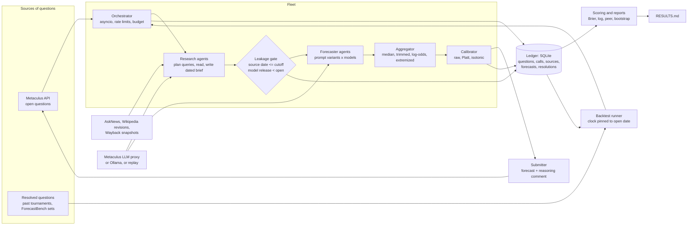

# Augur: plan

## Goal

**The problem.** A forecast about a real event is scored only after the event
happens, often months later, so a team building an AI forecaster cannot tell in
time whether a change helped, and most forecasters that look accurate in
backtests quietly read the answer in news written after the question closed.

Both halves are measured facts, not worries:

- **Slow, noisy feedback.** In Metaculus's Spring 2026 bot tournament the ten
  best bots averaged 13.2 to 18.9 spot peer points per question with intervals
  about 8.5 points wide over 297 questions: after three months, no bot was
  clearly separated from the next
  ([results](https://www.lesswrong.com/posts/wZBbDqzfBjYG58CxK)).
- **Leaky backtests.** An audit of Google's `before:` filter on 393 resolved
  Metaculus questions found a page with major post-cutoff information for 71%
  of questions and a direct answer for 41%; feeding those pages to a
  forecaster moved its Brier score from 0.242 to 0.108
  ([El Lahib et al., ACL 2026](https://arxiv.org/abs/2602.00758)). The paper
  recommends frozen, time-stamped snapshots. FutureSearch's closed
  "pastcasting" environment does that (a frozen crawl per question,
  [Bench to the Future](https://arxiv.org/abs/2506.21558)); no open-source
  bot I found does.

**What Augur is.** A fleet of research, forecasting and calibration agents
that enters Metaculus's FutureEval bot tournament ($50k per season) and the
two-week MiniBench rounds, where it is scored on the same questions as about
110 other bots and Metaculus's own template bots. Around the fleet sits the
part I think is the actual contribution: a **ledger** that stores every
question, prompt, source (with the evidence for its date), forecast and
resolution, and a **backtest that cannot leak by construction**: every source
must prove it existed before the question opened, every model must have been
released before the question opened, and a test fails the build otherwise.
Each change is judged on that backtest first and live second.

**Why it is interesting.**

1. The score is an outside result: a public leaderboard I do not control.
2. The backtest's honesty is itself measured (Q2): the same forecaster, the
   same pages, once as they were when the question opened and once as they
   are today.
3. The live ledger doubles as a frozen corpus. Research captured while a
   question was open is leak-free forever, so a new prompt or aggregation rule
   can be replayed against it the day the question resolves.
4. The statistics are the hard part and are stated up front: with 60
   questions per MiniBench round, what difference between two bot versions is
   detectable at all?

**What already exists, and what is different.** Metaculus ships a
[template bot](https://github.com/Metaculus/metac-bot-template) on
[`forecasting-tools`](https://github.com/Metaculus/forecasting-tools) (0.3.7,
2026-11-14): one research call, five forecasts, median. Open-source entrants
(nostreambot, Panshul42's Q2 2025 winner) add model ensembles and more search.
`forecasting-tools` has a benchmarker, but it scores against the community
prediction on open questions, not resolutions. The closest prior work is
FutureSearch's: pastcasting on frozen web snapshots, paired bootstrapped
comparisons, and the finding that at about 1,900 questions Brier differences
near 0.01 are often ties
([Iterating on a forecaster](https://futuresearch.ai/iterating-on-a-forecaster),
2026-07-10). It is closed: the corpus, harness and bot are not public. I did
not find an open-source bot whose backtest enforces source dates as a
failing test, measures its own leakage on the same questions, or reports the
smallest improvement its question count can detect. Augur is not a better
prompt; it is an open version of that measurement apparatus plus a bot that
is developed with it.

## Questions

Each question has a prediction written here before any run, the milestone
that answers it and the number it produces. A prediction that fails is
reported as failed.

| # | Question | Prediction (fixed now) | Milestone | Number |
|---|----------|------------------------|-----------|--------|
| Q1 | Does the bot beat the Metaculus template bot on the same questions? | Yes, but not resolvably in one MiniBench round: the interval on about 60 questions will include 0. | M2 (live), M3 (first scored report) | Mean head-to-head score (100 × ln(p_augur / p_template) on the outcome) against a shadow run of the real template on the same live questions, with a paired bootstrap interval; and the leaderboard peer score beside the `metac-*` bot using the same model. |
| Q2 | How much of a backtest's accuracy is leakage? | Unrestricted retrieval improves Brier by at least 0.05 on the same questions; the date-cut arm is no better than "no retrieval" by more than 0.02. | M4 | Brier and log score for three arms (no retrieval, sources as of the open date, sources as of today) on the same resolved questions, paired intervals, and the share of admitted sources a judge still flags. |
| Q3 | Which part carries the score: research depth, number of forecasters, model mix or the aggregation rule? | Research depth is the largest effect; forecasters beyond 5 add less than the noise; extremizing by a fixed factor hurts. | M5, M6 | An ablation table on the leakage-proof backtest (one factor changed at a time, paired bootstrap intervals), with the minimum detectable effect at the table's n printed beside it. |
| Q4 | Can calibration be learned from the bot's own resolved history? | Not with fewer than about 200 resolutions: Platt and isotonic fitted on past questions will not beat raw on later ones (interval includes 0), and isotonic will be worse than Platt. | M7 | Reliability diagram, expected calibration error, Brier and log score, raw against each calibrator, fitted only on questions that resolved before each test question opened. |
| Q5 | Where does the fleet stand against the frontier? | Above the median bot and above the best same-model template bot; below the top 10. | M8 (first standing), M10 (final) | Rank and average spot peer score with interval in each MiniBench round and in FutureEval, the gap to the best template bot, the best open-source bot and rank 1, the gap to the pro baseline where Metaculus publishes it, and prize money if any. |
| Q6 | Open: does the bot know when it does not know? | Disagreement among forecasters predicts the final forecast's error with AUROC above 0.6, and shrinking high-disagreement forecasts toward the prior improves the backtest score by less than the detectable effect. | M9 | AUROC of disagreement against error (Brier above the median), and the change in score from shrink and from skip policies on the backtest, then live on a pre-registered half of questions split by question id. |

## Architecture

### Components

| Module | Job |
|--------|-----|
| `augur/metaculus.py` | Typed `httpx` client for the five calls the bot needs: list a tournament's posts, post details, submit a forecast, create a comment, read my scores. Token from the environment only. Client-side rate limit, `Retry-After` honoured. |
| `augur/questions.py` | `Question` models for binary, multiple choice, numeric and discrete, with open, close and resolve times. Converts percentiles to the 201-point CDF Metaculus accepts (fewer points for discrete) and enforces its validity rules. |
| `augur/llm/` | `Provider` protocol with `metaculus_proxy` (OpenAI- and Anthropic-format endpoints through the official SDKs with a base URL), `ollama`, and `replay` (serves recorded calls by prompt hash). Each model has a registry entry with its **release date**. Token-bucket and semaphore limits per provider. |
| `augur/research/` | Searchers that all take an `as_of` instant: `asknews` (news, with `end_timestamp`), `wikipedia` (the revision current at `as_of`), `wayback` (latest capture at or before `as_of`). Each returns `Source` records with `published_at`, `retrieved_at` and `date_evidence` (which field or capture timestamp proves the date). |
| `augur/leakage.py` | The gate. Admits a source only if its date evidence is at or before the cutoff; refuses undated sources in backtests; refuses a model whose release date is not before the question's open date. Everything it rejects is logged with the reason. |
| `augur/agents/` | `researcher` (plans queries, reads, writes a brief that cites source ids), `forecaster` (prompt variants: outside view, inside view, sceptic), `parser` (structured output into a typed forecast). |
| `augur/aggregate.py` | Median, trimmed mean, mean of log-odds, extremized log-odds; for numeric questions, a mixture of CDFs; for multiple choice, normalised per-option aggregates. |
| `augur/calibrate.py` | Calibrators fitted on resolved history: identity, fixed extremizing, Platt (a line in log-odds), isotonic (pool adjacent violators), with a time-ordered fitting harness. |
| `augur/score.py` | Brier, log score, Metaculus baseline score, head-to-head and peer score for all question types; paired, question-clustered bootstrap; minimum detectable effect. |
| `augur/ledger.py` | Append-only SQLite store and its JSONL export. Nothing is updated in place; a resolution is a new row. |
| `augur/backtest.py` | Runs the same orchestrator with the clock pinned to each question's open date and submission disabled. |
| `augur/cli.py` | `augur forecast`, `augur backtest`, `augur resolve`, `augur score`, `augur report`, `augur ledger export|import`, `augur models probe`. |

### Data flow for one live question

1. `augur forecast --tournament minibench` lists open questions and drops the
   ones the account has already forecast (`my_forecasts` in the API payload),
   then takes at most `AUGUR_MAX_QUESTIONS_PER_RUN`.
2. The researcher plans queries and each searcher runs with `as_of = now`.
   Every source is written to the ledger before any model sees it.
3. The gate checks each source against the cutoff (live: now; backtest: the
   open date) and the brief is built from admitted sources only.
4. N forecasters run in parallel within the provider's limits; each returns a
   typed forecast and its reasoning. The aggregator combines them and the
   calibrator maps the result.
5. With `--submit` and a token, the submitter posts the forecast and a comment
   built from the members' actual reasoning and the sources cited. Without
   either, it prints what it would have posted (dry run).
6. Later, `augur resolve` appends resolutions and `augur score` reports.

### Design decisions

| Decision | Chosen | Alternative considered | Which part of the problem needs it |
|----------|--------|------------------------|-------------------------------------|
| Language and runtime | Python 3.12, `asyncio`, `uv` | 3.14 (the runner's default): `forecasting-tools` does not support it yet, and the shadow baseline needs that package | A question is open for about 1.5 hours; research and several forecasters must run concurrently within rate limits. |
| Metaculus access | Own `httpx` client, about 200 lines, strict types | Build on `forecasting-tools`' `ForecastBot`: it brings LiteLLM, `nest_asyncio` and its own report types, and hides the calls I need to record | Every request and response has to land in the ledger, and I have to be able to explain each call. |
| Template baseline | The real `TemplateBot` from `forecasting-tools`, run unpublished in an optional `baseline` extra | Reimplementing the template's prompt: then "beats the template" would mean "beats my copy of it" | Q1 must be like for like. |
| Models | Metaculus's sponsored proxy (`llm-proxy.metaculus.com`, OpenAI and Anthropic formats) in the tournament; Ollama with small open models for development; `replay` for tests | Paid keys or OpenRouter: ruled out, free resources only | The tournament provides credits; development and CI must cost nothing and be deterministic. |
| News | AskNews through the tournament's sponsorship, Wikipedia revisions, Wayback captures | Google or DuckDuckGo date filters: measured to leak on 71% and 81% of questions; Perplexity or Exa: paid | Backtests need a date that can be proven, not a date filter that is hoped to work. |
| Source dating | A source is admitted on **evidence**: an archive capture timestamp, a revision timestamp, or the news provider's publish date bounded by the query's `end_timestamp`; otherwise rejected in backtests | Trusting the page's own date metadata: the cited audits show it is often wrong | "Leakage is a build failure" needs a rule a test can check on every row. |
| Model memory | A model may forecast a backtest question only if it was released before the question opened | Trusting stated training cutoffs: they are not guarantees, and a release date is a hard upper bound | Otherwise the model can simply remember the answer and the backtest measures recall. |
| Store | SQLite, append-only, one file, plus JSONL export | DuckDB: columnar speed is not needed at tens of thousands of rows, and SQLite's single-writer transactions suit an append-only ledger and ship with Python. PostgreSQL: a server for a bot that runs in a CI job is the wrong shape | Replay and audits need every prompt and source exactly as used. |
| Ledger across scheduled runs | The workflow is stateless (skip logic reads `my_forecasts` from Metaculus); each run uploads its JSONL as an artifact; `augur ledger import` merges them, and snapshots are committed under `data/ledger/` | A `ledger` branch the workflow pushes to: history noise and write contention between overlapping runs | The live record must survive a runner and stay reproducible from the repo. |
| Scheduling | GitHub Actions `schedule` with a concurrency group, a first job that polls with the standard library only and exits when nothing is open, and caps per run | A server or a cloud function: something to pay for and operate | The bot has to run unattended through a season at no cost. |
| Statistics | Paired comparisons on the same questions, bootstrap resampled by question cluster (same post group or same opening week), intervals on everything, minimum detectable effect printed with each table | Unpaired means: the Spring results show they cannot separate even the top ten | The whole point is knowing whether a change helped. |
| Comments | Generated from the members' recorded reasoning and the cited sources, posted privately as the template does | A fixed boilerplate comment: against the prize rule that comments "accurately represent the reasoning process and final decision" | Prize eligibility. |

### The hard part

Making a backtest whose result I would bet on. Three things have to hold at
once and each is tested:

1. **No source from the future.** Enforced by the gate, by a schema
   constraint in the ledger (a `source_use` row cannot reference a source
   dated after its run's cutoff), and by `tests/test_leakage.py`, which scans
   every committed backtest ledger and fails on any violation. Then measured:
   Q2 runs the unrestricted arm on purpose and a judge audits the admitted
   sources for residual leaks (a page captured before the cutoff can still
   embed a widget; a revision cannot).
2. **No answer from memory.** The model registry's release dates gate which
   questions each model may be scored on. This shrinks the usable backtest
   for new models to almost nothing, which is the honest state of affairs and
   the reason the live ledger matters: research captured live stays valid.
3. **Enough questions to see the effect.** Every comparison is paired and
   reports its minimum detectable effect, so "no difference" and "could not
   tell" are never confused.

## Evaluation

### Data

| Set | What | Access | Used for |
|-----|------|--------|----------|
| Live | MiniBench rounds (about 60 questions per two weeks) and Fall 2026 FutureEval (id 33121) while it still opens questions, then Spring 2027 | `METACULUS_TOKEN` | Q1, Q5, Q6 live arm |
| Past tournaments | Resolved questions from earlier bot tournaments (`spring-aib-2026`, Summer 2026 id 33022, earlier seasons) with open time and resolution | `METACULUS_TOKEN` (the API returns 403 without one; checked 2026-11-17) | Q2, Q3, Q4, Q6 backtests |
| ForecastBench | Biweekly question sets and resolution sets, 2024-07 onward, CC BY-SA 4.0 ([datasets repo](https://github.com/forecastingresearch/forecastbench-datasets)) | Public, no key | M2's first measured number, a backtest corpus that needs no token, and the same-question comparison in the Frontier table |
| Replay corpus | The bot's own live research, frozen in the ledger | Grows with every run | Re-scoring a new variant on resolved live questions |

A question enters a backtest only if: it resolved (not annulled); it opened
after the release date of every model in the variant; and it was not resolved
before it opened. The filters and the counts they remove are printed with
every result.

### Metrics

- **Brier** and **log score** on binary questions; log score of the
  probability placed on the outcome for multiple choice; the Metaculus log
  score on the submitted CDF for numeric.
- **Metaculus baseline score**, `100 × (log2(p_outcome) + 1)` for binary, so
  backtest numbers are in the tournament's units.
- **Head-to-head score** between two forecasters on the same question,
  `100 × ln(p_a / p_b)` on the outcome, as Metaculus uses for pros against
  bots. A **peer score** is its mean against all others.
- **Calibration**: reliability diagram, expected calibration error with
  equal-mass bins, and the sharpness beside it (calibration alone rewards
  guessing the base rate).
- **Uncertainty**: paired bootstrap over question clusters, 10,000 resamples,
  seed recorded; the minimum detectable effect at 80% power for each table.
- **Cost and latency**: tokens, sponsored-credit cost estimate and wall time
  per question, from the ledger.

### Baselines

1. Always 50%, and the tournament base rate (binary questions resolved Yes
   33% of the time in Spring 2026).
2. One model call with no research.
3. The real Metaculus template bot (shadow run, same questions, same model).
4. Live: the `metac-*` template bots on the same leaderboard.

### Frontier

The strongest outside results on this problem, re-read at their sources on
2026-11-17.

| Result | Number | Protocol | Source, date |
|--------|--------|----------|--------------|
| Best bot, FutureEval Spring 2026 | GreeneiBot2: average spot peer score 18.90 [15.18, 22.61], 288 of 297 questions, 1st of 173 bots (111 outside Metaculus). Closed source; parallel AskNews, Perplexity and GPT-5 search pipelines. | Spot peer score at question close | [LessWrong results post](https://www.lesswrong.com/posts/wZBbDqzfBjYG58CxK), 2026 |
| Best template bot, same tournament | `metac-gpt-5-1-high+asknews`: 11.32 [7.18, 15.45], 18th of 173 | Same | Same |
| Best open-source bot, same tournament | nostreambot, 10th or 11th (the post gives both), MIT licence, model ensemble with median | Same | Same |
| Professional forecasters | Top-10 bot team minus pro team: −1.25 head-to-head points per question, 95% CI [−4.87, 2.37], 99 shared questions (not significant) | Head-to-head on shared questions | Same |
| Prize money, Q2 2025 | 1st Panshul42 (open source) $7,550; 2nd pgodzinai $4,563; 3rd CumulativeBot $3,270 | Tournament payout | [Metaculus notebook 39140](https://www.metaculus.com/notebooks/39140/), 2025 (re-read 2026-11-17) |
| Best bot, Summer 2026 and MiniBench (self-reported) | FutureSearch: 1st of 163 bots in Summer 2026 FutureEval at time of writing (not final); won the 2026-06-29 MiniBench against 130 other bots | Spot peer score, live | [FutureSearch](https://futuresearch.ai/iterating-on-a-forecaster), 2026-07-10 |
| ForecastBench | Superforecasters: Brier Index 70.6%; best LLM systems (CassiAI `ensemble_2_crowdadj`, Grok 4.20 preview) 67.9%; Brier Index = (1 − √Brier) × 100 | Biweekly live question sets | [FRI, Brier Index post](https://forecastingresearch.substack.com/p/introducing-the-brier-index), 2026 (page returned 403 on 2026-11-17; figures from search snippets) |
| Leakage through date-filtered search | Brier 0.244 with no retrieval, 0.242 with leak-free documents, 0.108 with documents rated 3 to 4 on their 0 to 4 rubric; 93 binary questions opened in 2025 (from 393 audited); gpt-oss-120b | Retrospective, Google `before:` | [El Lahib et al.](https://arxiv.org/abs/2602.00758), ACL 2026 |
| What separated winners | No strategy significant after correction (n about 42); strongest raw signals: frontier final model r = 0.42, checking similar markets 0.34; extremizing in code −0.30 | Self-reported survey against score | [Spring 2026 survey](https://forum.effectivealtruism.org/posts/tJoxFWkRev5wrEBar), 2026 |

**How Augur is compared, like for like.**

- **Live leaderboard (Q5).** Same questions, same scoring, same close times
  as every other bot, by construction. The target to beat is the best
  template bot (the `metac-*` entry using the same model family); the gaps to
  the best open-source bot and to rank 1 are reported with intervals whatever
  they are. The compute budget is stated: sponsored credits only (about $100
  to start, more if MiniBench results are above average), against top bots
  that pay for Perplexity and frontier models. That is unfair in their
  favour and RESULTS.md will say so.
- **Template, controlled (Q1).** The real template run in shadow on the same
  live questions with the same model, so the difference is the pipeline and
  not the model.
- **Leakage (Q2).** The published gap (0.242 to 0.108) was measured on
  Google results with one model. I reproduce the experiment's shape on
  sources I can date (Wikipedia as of open against today; Wayback captures)
  and report my gap beside theirs, noting the different retrieval and model.
  Their three relevant arms map onto mine (no retrieval 0.244, leak-free
  0.242, leaky 0.108); Q2's prediction is that my no-retrieval and as-of-open
  arms are as close as theirs, which is the like-for-like check. The judge
  uses their 0 to 4 rubric so the residual leak rates are comparable.
- **Power (Q3).** FutureSearch reports that about 1,900 questions leave
  Brier differences near 0.01 as ties. M6's power curve converts that
  claim into my units on my questions and states whether it agrees.
- **ForecastBench (Q5, secondary).** Brier on a past question set against
  the forecasts in its public `forecast_sets`, same questions. The
  leaderboard entrants forecast live and I would be backtesting, so this row
  is labelled a backtest and never ranked against them.

No claim of "beats X" is written without a same-protocol number and the
source of X in RESULTS.md.

### Budget

Sponsored credits are finite. Every model call is recorded with tokens and an
estimated cost; `AUGUR_MAX_COST_PER_QUESTION` and `AUGUR_MAX_COST_PER_RUN`
stop a run before it overspends. Backtests default to local models and to the
replay cache; a proxy-model backtest is a manual run with a stated question
count.

## Release

- **Package.** `pip install augur-forecast` (the name `augur` is taken on
  PyPI; the import and the CLI stay `augur`). Published by trusted publishing
  from a tag; nothing is published until the maintainer does it.
- **CLI.** `augur forecast --tournament minibench` is a dry run unless
  `--submit` is passed and `METACULUS_TOKEN` is set.
- **Scheduled Action.** `.github/workflows/tournament.yml`: a cron with a
  concurrency group; job one polls for open, unforecast questions using only
  the standard library and stops if there are none; job two installs from the
  lock file and forecasts, capped per run. A repository variable
  `AUGUR_SCHEDULE` (`off`, `minibench`, `all`) switches it without a commit.
- **Going public.** The repository becomes public at M8. Open-source bots get
  about twice the sponsored credits and public repositories have no Actions
  minute limit. Until then the schedule is throttled (see Risks).
- **Heavy runs.** Backtests and local-model evals are `make` targets and a
  `workflow_dispatch` workflow; the per-PR workflow is lint, types and unit
  tests only.

**The maintainer provides:**

| What | Where | Why |
|------|-------|-----|
| A Metaculus bot account and its token, as `METACULUS_TOKEN` | Repository secret | Reading questions, submitting, the LLM proxy |
| The participation form (first section) and the credit request | Metaculus | Sponsored LLM credits |
| AskNews access for the bot (their Discord or email), as `ASKNEWS_CLIENT_ID` and `ASKNEWS_CLIENT_SECRET` | Repository secrets | News search. The template names the second one `ASKNEWS_SECRET`; Augur reads either. |
| The end-of-season bot survey | Metaculus | Required for prizes |
| A PyPI trusted publisher for `augur-forecast` | PyPI | Release |

Rules the bot follows: one bot account; forecasts and private comments only
through the documented API; no scraping behind logins; no creating, editing
or commenting publicly on questions; client-side rate limits below the
documented ones.

## Risks

| Risk | Effect | Mitigation |
|------|--------|------------|
| No credentials in the build environment yet | Nothing live can be verified; the Metaculus API returns 403 without a token | M1 is built against payloads shaped from the template's documented formats and a fake server; everything live sits behind `--submit` and is listed under "To measure" with its exact command until a token exists. |
| The Fall season stops opening questions a few weeks before 2027-01-01 | Few FutureEval questions left | MiniBench runs back to back (rounds from 2026-11-16, 2026-11-30 and 2026-12-14 if the two-week cadence from 2026-09-21 holds; confirmed from the API in M2). Most MiniBench questions launch in a round's first few days and the second week is usually empty (Fall announcement), so the schedule concentrates there and the 2026-11-30 round is the first realistic live target. The Fall result is reported as partial coverage; Spring 2027 is the first full season. |
| Questions are open for about 1.5 hours | A missed window scores nothing | Cron cadence chosen from measured open times (M2); the forecast path has a deadline and submits the best aggregate it has when the deadline is near. |
| Actions minutes while the repository is private | A 20-minute cron is about 2,160 billed minutes a month, more than the whole shared allowance | Until public: MiniBench only, a cadence set from the measured windows, the poll job exits in seconds, caps per run. Go public at M8 or earlier if the maintainer agrees. |
| Model memory in backtests | Scores measure recall | Release-date gate; the count of questions it leaves is printed; local models with old release dates for most backtests. |
| Residual leakage inside admitted sources | A capture taken before the cutoff can still be wrong about its own date | Prefer revisions and news items with provider dates bounded by the query; judge audit in Q2 reports the residual rate; anything flagged is fixed at the gate, never by editing results. |
| Small n | A real improvement looks like noise, or noise like an improvement | Paired design, clustered bootstrap, minimum detectable effect, predictions fixed beforehand, no tuning on the test split. |
| Small local models forecast badly | Backtest conclusions may not carry to proxy models | Each Q3 finding is re-checked on a small proxy-model sample when credits allow, and labelled by model. |
| Sponsored credits or AskNews access not granted | No frontier models or news | Wikipedia and Wayback need no key; Ollama runs the pipeline; the result is then reported as what a zero-budget bot achieves. |
| Wayback and Wikipedia rate limits | Slow backtests, blocked requests | One request at a time with backoff, a descriptive user agent, and every response cached in the ledger so a source is fetched once. |
| A bad deploy posts wrong forecasts | Real score damage | Dry run by default, a bot-testing-area check for each question type before the first live run, validity checks on every payload, and a kill switch (`AUGUR_SCHEDULE=off`). |

## Milestones

- [ ] M1: Scaffold, CI and one MiniBench question forecast end to end — `uv` project on Python 3.12, `ruff`, `mypy --strict`, `pytest`, `make check`, GitHub Actions with a dependency cache and `timeout-minutes`; the `Question` model and Metaculus client (list open questions, details, `my_forecasts` skip) against a fake server; `Provider` protocol with `ollama`, `metaculus_proxy` and `replay`; one searcher (`wikipedia`, as of an instant) and the AskNews searcher behind its credentials; the `Source` record, the leakage gate and `tests/test_leakage.py` from the first commit that stores a source; a single researcher and five forecaster draws combined by median for binary questions; the ledger schema; the comment renderer; `augur forecast --tournament minibench` (dry run without a token, on committed sample questions; real listing, binary submission and the private reasoning comment with `--submit` and a token). Done when `make check` is green, `augur forecast` on the sample questions with a local Ollama model writes questions, calls, dated sources and forecasts to the ledger and prints the forecast and comment it would post, a fake-server test covers the submit and comment calls, a test proves a source dated after the cutoff is rejected and that a ledger containing one fails, and no token ever appears in logs (tested). If `METACULUS_TOKEN` is present in the build environment, the bot also submits binary forecasts with comments in the bot-testing-area and then on the current MiniBench round, and the ledger rows are cited in the PR; otherwise the exact commands are under "To measure".
- [ ] M2: Live on MiniBench (Q1 starts) — multiple choice, numeric and discrete forecasts (percentiles to a valid CDF, property-tested against Metaculus's validity rules); submission and private comment posting; per-run and per-question caps, cost estimates and a deadline; `augur models probe` listing which proxy models answer; the scheduled workflow with the standard-library poll job, concurrency group and `AUGUR_SCHEDULE` switch; the shadow template baseline (`baseline` extra) logging the real template's unpublished forecast for the same questions; a measurement of last season's question open times and durations that sets the cron; and a first measured number that needs no token: the M1 pipeline without retrieval on qwen2.5:7b over at least 100 resolved ForecastBench binary questions that opened after the model's release (a minimal loader, extended in M4), Brier and Metaculus baseline score against always-50% and the set's base rate, with paired bootstrap intervals. Done when every question type is accepted in the bot-testing-area and the bot has submitted forecasts with comments on live MiniBench questions (with `METACULUS_TOKEN`; otherwise the fake-server integration test passes for all four types and the exact live commands are under "To measure"), a fake-server test proves a second run never forecasts a question twice, the scheduled workflow passes a `workflow_dispatch` or `act` dry run (its first scheduled runs can only be observed after merge and are checked in M3), RESULTS.md holds the ForecastBench row with its method, model and cost ($0), and it records the open-time measurement and the chosen cadence with its billed minutes per month (or the command under "To measure" without a token).
- [ ] M3: Resolutions, scoring and the first scored report (Q1 answered or its interval reported) — `augur resolve` appending resolutions and annulments; `augur score` with Brier, log, baseline and head-to-head scores for all question types, the question-clustered paired bootstrap and the minimum detectable effect; `augur ledger export|import` and the artifact merge; `augur report` rendering RESULTS.md from the ledger with a test that the committed file matches a render; the first scheduled runs on `main` checked from their artifacts (questions forecast, skipped, missed, minutes billed). Done when scoring is checked against hand-computed cases and against Metaculus's own score for at least one resolved question per type, RESULTS.md holds Augur against the shadow template on every resolved live question with intervals and the detectable effect at that n, and Q1's prediction is marked held, failed or not yet resolvable.
- [ ] M4: The leakage-proof backtest and what leakage is worth (Q2) — the resolved-question loader (past tournaments by API, ForecastBench sets without a token) with its eligibility filters; the model registry's release dates enforced; the `wayback` searcher (capture at or before the instant; the CDX `to=` bound is inclusive of the whole day, so the capture timestamp is compared, not the query); `augur backtest` with the clock pinned to each open date; the three-arm experiment (no retrieval, as of open, as of today) on the same questions, with the prediction above; an LLM judge using the published 0 to 4 leakage rubric on admitted sources, with a hand-labelled sample to check the judge. Done when `tests/test_leakage.py` passes on the committed backtest ledger and fails on a planted violation of each kind (late source, undated source, model too new), RESULTS.md holds the three arms with paired intervals, the residual leak rate and the judge's agreement with the hand labels, and the published 0.242 to 0.108 gap is shown beside mine with the protocol differences stated.
- [ ] M5: The fleet, and whether research depth or head count matters (Q3, part one) — the orchestrator: several research agents (query planning, sub-questions, a second pass that looks for what would change the answer), forecaster prompt variants, token-bucket limits per provider and a per-question budget, with a concurrency test on a fake provider that proves limits hold under load and a failed member does not sink the question; then the ablation on the M4 backtest: research depth (none, one pass, two passes with sub-questions) and number of forecasters (1, 3, 5, 9), one factor at a time. Done when RESULTS.md holds the table with paired intervals, cost and latency per variant and the detectable effect, each prediction is answered, the live default is changed only under the rule stated in this file (a variant replaces the default only if its interval against the default excludes 0, or it is no worse and cheaper), and throughput under the limits is measured.
- [ ] M6: Model mix and the aggregation rule (Q3, part two) — aggregation rules (median, trimmed mean, mean of log-odds, extremized log-odds with a fixed factor) for all question types; mixed-model fleets from the proxy models the probe found, or two local models without a token; a simulation that plants a known improvement in resampled backtest scores and reports how often each n detects it. Done when RESULTS.md holds the aggregation and model-mix tables on the same questions, the power curve (questions needed to detect 2, 5 and 10 head-to-head points, and a 0.01 Brier difference, set beside FutureSearch's published estimate), the Q3 verdict naming which factor carried the score, and a plain statement of which differences this backtest cannot resolve.
- [ ] M7: Calibration learned from resolved history (Q4) — the calibrator interface, contract tests and reference oracle; a time-ordered harness in which each test question is calibrated only with questions that resolved before it opened (a test fails otherwise); reliability diagrams, calibration error and sharpness; raw against fixed extremizing, Platt and isotonic on the backtest and on the live ledger's resolved questions. Done when RESULTS.md holds the diagram and the table with intervals, the prediction about data size is answered with a learning curve (score against number of resolutions used to fit), and the live calibrator is chosen under the same replacement rule as M5.
- [ ] M8: Standing against the frontier, and going public (Q5, first reading) — `augur standings`: rank, average spot peer score and interval per MiniBench round and for FutureEval from the leaderboard API, beside the best template bot, the best open-source bot and rank 1; coverage (share of questions forecast in time) and the reasons for each miss; the ForecastBench same-question backtest row; the repository audit for going public (no secrets in history, licence, schedule at full cadence once public). Done when RESULTS.md holds the standings table with dated sources and every unfair comparison named, each missed question is explained from the ledger, the Frontier table is re-verified at its sources and updated with any Summer or Fall 2026 results published since, and RELEASE.md lists the steps to make the repository public.
- [ ] M9: Does the fleet know when it does not know? (Q6) — disagreement measures (spread of log-odds across forecasters, across models, across research passes); AUROC of each against the final forecast's error on the backtest; shrink-toward-prior and skip policies simulated in tournament units; then the live test, pre-registered here before it starts: questions split by question id parity, the policy applied to one half, analysed after a fixed number of resolutions. Done when RESULTS.md holds the AUROC table, the simulated and live score changes with intervals, the pre-registered block byte for byte, and the verdict (adopted, rejected, or not resolvable at this n with the count needed).
- [ ] M10: Release readiness and the final standing (Q5, final) — packaging as `augur-forecast` with a clean-environment install check, `release.yml` guarded by tags and trusted publishing, RELEASE.md, a Dockerfile for running the bot outside Actions, the README complete (what and why, demo with capture instructions, quickstart, architecture diagram, decisions and trade-offs, results table, roadmap), RESULTS.md complete with every number's method, cost and raw output and a "To measure" section for anything unrun, and the season's final rank and any prize recorded. Done when a fresh clone runs the README quickstart as a dry run with a local model, `make check`, `make eval` and `make results` are green and byte-stable, the release workflow dry-runs, and every claim in the README traces to RESULTS.md.
