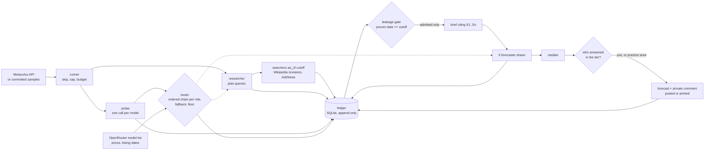

# Augur

**Status: in progress.** M2 of 10 (model access and the submit floor on the
model that answers); see [PLAN.md](PLAN.md).

A forecast about a real event is scored only after the event happens, often
months later, so a team building an AI forecaster cannot tell in time whether
a change helped, and most forecasters that look accurate in backtests quietly
read the answer in news written after the question closed.

Augur is a forecasting bot for Metaculus's FutureEval bot tournament and the
two-week MiniBench rounds, where it is scored on the same questions as every
other bot. Around it is a ledger that keeps every question, prompt, source
(with proof of its date) and forecast, and a leakage gate that refuses any
source dated after the question's cutoff, enforced three times: in code, in
the ledger's own triggers, and by a test that scans every committed ledger.

## Demo

```text
$ export AUGUR_FORECAST_MODELS=openrouter:nvidia/nemotron-3-ultra-550b-a55b:free,openrouter:inclusionai/ling-3.2-flash:free,openrouter:google/gemma-4-31b-it:free
$ export AUGUR_RESEARCH_MODELS=openrouter:google/gemma-4-26b-a4b-it:free,openrouter:inclusionai/ling-3.2-flash:free,openrouter:nvidia/nemotron-3-ultra-550b-a55b:free
$ augur forecast --tournament bot-testing-area --submit --reforecast
run run_f18e2cb98e624da6bb6f (live) on metaculus:bot-testing-area
probe:
  openrouter:nvidia/nemotron-3-ultra-550b-a55b:free answered    697 ms  $0/$0 per M  listed 2026-06-04  below tier  [research+forecast]
  openrouter:inclusionai/ling-3.2-flash:free        answered   1389 ms  $0/$0 per M  listed 2026-11-13  below tier  [research+forecast]
  openrouter:google/gemma-4-31b-it:free             rate_limited 1121 ms $0/$0 per M  listed 2026-04-02  below tier  [forecast]
  openrouter:google/gemma-4-26b-a4b-it:free         rate_limited 3005 ms $0/$0 per M  listed 2026-04-03  below tier  [research]

== Will any of Belgium, France, Italy, Luxembourg, Netherlands, and/or Germany leave the EU before 2027?
   https://www.metaculus.com/questions/43327/
   sources: 4 admitted, 0 rejected; members: 1% 1% 1% 1% 1%; median: 1.0%
   submitted 1.0%; posted this private comment:
   | **Forecast: 1%**, the median of 5 independent forecasts (1%, 1%, 1%, 1%, 1%) by nvidia/nemotron-3-ultra-550b-a55b:free.
   | **Research** (only sources dated at or before 2026-11-18 11:14 UTC): …
   | - [S1] [Withdrawal from the European Union](https://en.wikipedia.org/w/index.php?oldid=1386162346) (wikipedia, revision of 2026-11-17)
done: 1 forecast, 5 skipped, 0 failed; estimated cost $0.0000
```

A real run on free OpenRouter models (trimmed; the full output is
`data/runs/m2-live-bot-testing-area-2.txt`). The probe found both Gemma
models busy upstream, so planning and the brief fell back to the next model,
and each switch is a ledger row. These models are below the frontier tier,
so the same command against MiniBench refuses before any model call. To
capture a GIF: `vhs` or `asciinema rec` around the command.

## Quickstart

```sh
uv sync
ollama pull qwen2.5:7b
uv run augur forecast --tournament minibench            # dry run on a local model; prints what it would post
uv run augur ledger check augur.db                      # leakage and floor scan; exit 1 on a violation
```

Hosted models are configuration: an ordered chain per role, `endpoint:model`.

```sh
export OPENROUTER_API_KEY=...                            # Metaculus's sponsored key, or any key for :free models
export AUGUR_FORECAST_MODELS=openrouter:openai/gpt-5.1,openrouter:anthropic/claude-sonnet-5.5
export AUGUR_RESEARCH_MODELS=openrouter:nvidia/nemotron-3-ultra-550b-a55b:free
uv run augur models list                                 # prices, listing dates, tier; no calls
uv run augur models probe                                # one call per model: who answers right now
export METACULUS_TOKEN=...                               # the bot account's token
uv run augur forecast --tournament bot-testing-area --submit
```

Presets: `openrouter`, `groq`, `gemini`, `github` (each reads its own key
variable) and `ollama`; any other OpenAI-compatible host is
`AUGUR_ENDPOINT_<NAME>_URL` plus `_KEY_ENV`. `--submit` to MiniBench or
FutureEval refuses unless the first forecasting model is a hosted model in
the named frontier tier (`augur/llm/registry.py`), and a question whose
forecasts would have to fall back below that tier is skipped, not posted: a
weak forecast costs peer points that skipping does not.

## Architecture



| Module | Job |
|--------|-----|
| `augur/metaculus.py` | Typed `httpx` client: list, detail (`my_forecasts`), binary forecast, private comment; token bucket and `Retry-After`. |
| `augur/llm/` | `endpoints` (presets and `AUGUR_ENDPOINT_*`, `endpoint:model` routes), `openai_compat` (one provider for every OpenAI-compatible host, sorting refusals into rate-limited, out-of-credit, auth, unavailable, empty), `router` (the chain per role, cool-downs, the floor), `catalog` (OpenRouter's model list: prices, listing dates), `probe` (opening probe, burst limit measurement), `registry` (frontier tier, local release dates), `ollama`, `replay`. |
| `augur/research/` | `Source` record with `date_evidence`; `wikipedia` (the revision current at `as_of`), `asknews` (bounded by `end_timestamp`). |
| `augur/leakage.py` | The gate, and `scan_ledger`, which re-checks every stored row. |
| `augur/ledger.py` | Numbered migrations; every table refuses `UPDATE` and `DELETE`. |
| `augur/agents/` | Researcher, forecaster draws, and the recorder every model call passes through: it walks the role's chain, and times, costs, budgets and ledgers every attempt and switch. |
| `augur/comment.py` | The private comment, built only from the members' reasoning and the cited sources. |
| `augur/runner.py`, `augur/cli.py` | `augur forecast`, `augur models list|probe|snapshot`, `augur ledger check`. |

### The hard part

A backtest is only worth anything if no forecast could have read the answer.
In Augur a source enters a prompt only after it has been written to the
ledger and the gate has admitted it on **evidence** for its date (a wiki
revision's save time, a news provider's publish date from a query bounded at
the cutoff), never on a date the page states about itself. The rule is held
three times, so a bug in one layer is caught by the next:

1. `admit_source` in `augur/leakage.py` decides at run time.
2. SQLite triggers in `augur/migrations/0001_initial.sql` abort an admitted
   use of a source dated after its question's cutoff, an admitted undated
   source in a backtest, and a model call that cites a source the gate did
   not admit.
3. `tests/test_leakage.py` scans every ledger committed under `data/ledgers/`
   and plants one violation of each kind to prove the scan finds it.

M2 adds a second rule held the same way: **a scored forecast comes only from
a frontier-tier model**, even when the models in front of it fail mid-run.
The router never walks a scored question's chain past the tier (it skips
the question and writes the refusal to the ledger); the runner checks the
routes that actually answered before posting; and `augur ledger check`
flags any submitted forecast whose members came from outside the tier.

## Design decisions

| Decision | Chosen | Alternative | Why |
|----------|--------|-------------|-----|
| Metaculus access | Own `httpx` client | `forecasting-tools`' `ForecastBot` | Every request must land in the ledger and be explainable. |
| Model hosts | One OpenAI-compatible provider over plain `httpx`; a host is a base URL and a key variable | One class per host, or the `openai` SDK | Credits moved from a Metaculus proxy to an OpenRouter key in a week; the next move is a config change. One HTTP stack to mock and record. |
| Fallback | Ordered chain per role; rate limit cools a route, a spent key or dead model disables it for the run, an empty answer moves only that call | Retry the same model; a single model | Free tiers fail often (8 of 10 recorded Gemma attempts hit upstream 429s); a question is open for 3 hours. |
| Prices | OpenRouter's model list; a billed model with no price is not called | M1's rule: unknown models priced above frontier rates | M1's rule would have charged every free OpenRouter model at $15/$75 per million, so the caps could stop a run that cost nothing; refusing an unpriced model is safe both ways. |
| Model dates | OpenRouter's listing date as the release date | Hand-written dates for every hosted model | A model cannot be listed before it exists, so the listing date only excludes more backtest questions. |
| Limits | Measured by `augur models probe --burst`, recorded in the ledger | Documented numbers | The free limit turned out to be per key across models, enforced loosely above the advertised 20 a minute, plus a separate upstream limit with no headers. |
| Ollama | Its native API | Its OpenAI-compatible `/v1` | `/v1` cannot set the context window per request and silently drops the start of long prompts (M1). |
| Source dates | Evidence only (revision, capture, bounded publish date) | Page metadata | Audits show self-reported dates leak. |
| Ledger | SQLite, append-only by trigger | DuckDB, PostgreSQL | Tens of thousands of rows, one writer, ships with Python. |
| Aggregation (M1) | Median of 5 draws | Mean | Robust to one wild draw; Q3 tests alternatives in M7. |
| Submit floor | Live tournaments need a frontier-tier hosted model | Submit whatever model answers | An expired key must never post small-model forecasts. |
| Comments | Private, rendered from the members' own reasoning | Boilerplate | Prize rules require the reasoning that produced the forecast. |

## Results

Nothing is scored yet; the first scored number arrives in M4. What M1 and
M2 measured (details, commands and raw output in [RESULTS.md](RESULTS.md)):

| Run | Outcome |
|-----|---------|
| M1, dry run on the committed sample (`qwen2.5:7b` on 4 CPUs, $0) | 3 dated Wikipedia revisions admitted, 5 draws, median 5%; 11 min 25 s |
| M2, live bot-testing-area forecast on free OpenRouter models ($0) | Probe, two fallbacks recorded, 5 of 5 draws, forecast and private comment accepted (HTTP 201 each); 2 min 32 s |
| M2, OpenRouter's free-model limit, three burst sessions | Per key across all free models, fixed clock minutes; 24 to 25 accepted against an advertised 20 |
| M2, frontier tier against OpenRouter's names | M1's rule matched 4 of 11 tier names (no Claude model); now 9 of 11 |
| Leakage and floor scan of all four committed ledgers | 0 violations |

## Known limits

- Wikipedia's search ranks today's index, so *which* pages are chosen can
  reflect later events even though each page's *text* is the revision as of
  the cutoff. Old revisions are also rendered with today's templates. Both
  matter for backtests (M6), where the judge audit measures the residual.
- No frontier model has answered yet: the only key here has a $1 limit that
  may not be the sponsorship, so only free models were called. Until a
  frontier model answers, the floor keeps the bot out of scored
  tournaments. The frontier tier also predates the newest models on
  OpenRouter; reviewing it is a maintainer decision (RELEASE.md).
- Groq, Gemini and GitHub Models are configured but not exercised (no keys).
  AskNews is wired but unverified without keys.
- Binary questions only until M3.

## Roadmap

M2 (done) one OpenAI-compatible provider with probed model chains, and the
repository public at its merge; M3 live on
MiniBench with every question type, a scheduled workflow and a durable
ledger; M4 the shadow template, scoring and the first standings; M5 market
prices and the community prior, and a replay evaluation on the hosted
models; M6 the leakage-proof backtest; M7 ablations; M8 calibration; M9
"does it know when it does not know"; M10 release and a season postmortem. Details in
[PLAN.md](PLAN.md).

## Development

See [CONTRIBUTING.md](CONTRIBUTING.md).

## Licence

MIT
