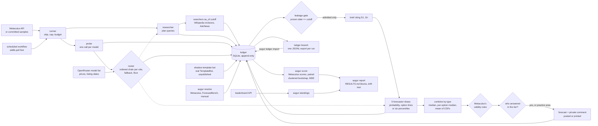

# Augur

**Status: in progress.** M4 of 10 (scoring checked against Metaculus's own
code, the shadow template bot, standings, and the first scored number); see
[PLAN.md](PLAN.md).

A forecast about a real event is scored only after the event happens, often
months later, so a team building an AI forecaster cannot tell in time whether
a change helped, and most forecasters that look accurate in backtests quietly
read the answer in news written after the question closed.

Augur is a forecasting bot for Metaculus's FutureEval bot tournament and the
two-week MiniBench rounds, where it is scored on the same questions as every
other bot. Around it is a ledger that keeps every question, prompt, source
(with proof of its date) and forecast, and a leakage gate that refuses any
source dated after the question's cutoff, enforced three times: in code, in
the ledger's own triggers, and by a test that scans every committed ledger.

## Demo

```text
$ export AUGUR_FORECAST_MODELS=openrouter:nvidia/nemotron-3-ultra-550b-a55b:free,openrouter:inclusionai/ling-3.2-flash:free,openrouter:google/gemma-4-31b-it:free
$ export AUGUR_RESEARCH_MODELS=openrouter:inclusionai/ling-3.2-flash:free,openrouter:google/gemma-4-26b-a4b-it:free,openrouter:nvidia/nemotron-3-ultra-550b-a55b:free
$ augur forecast --tournament bot-testing-area --submit --reforecast
run run_53eeaa89f3784e2a8bbf (live) on metaculus:bot-testing-area
probe:
  openrouter:nvidia/nemotron-3-ultra-550b-a55b:free answered      939 ms  $0/$0 per M  listed 2026-06-04  below tier  [research+forecast]
  openrouter:google/gemma-4-31b-it:free             rate_limited 1524 ms  $0/$0 per M  listed 2026-04-02  below tier  [forecast]
  ...
estimated worst case $0.0000 a question, $0.0000 for 6 (caps $0.50 a question, $5.00 a run)

== What will be Donald Trump's net approval on December 31, 2026?
   https://www.metaculus.com/questions/43323/ (numeric)
   sources: 5 admitted, 0 rejected; members: median -22.0% (80% between -32.0 and -12.0) | ...
   combined: median -22.1% (80% between -32.5 and -11.7)
   submitted median -22.1% (80% between -32.5 and -11.7); posted this private comment:
   | **Forecast: median -22.1% (80% between -32.5 and -11.7)**, the average of the CDFs of 5 independent forecasts by ...

== Which party's nominee will win the 2028 US presidential election?
   https://www.metaculus.com/questions/46223/ (multiple_choice)
   combined: Democratic Party 48%, Republican Party 50%, Other 2%
   submitted Democratic Party 48%, Republican Party 50%, Other 2%; posted this private comment: ...

coverage: 6 listed; 6 forecast in time (6 submitted), 0 missed, 0 skipped, 0 failed; estimated cost $0.0000
```

A real run on free OpenRouter models (trimmed; the full output is
`data/runs/m3-live-bot-testing-area-2.txt`): one question of every type in
the practice area, soonest-closing first, each CDF and option set built to
Metaculus's validity rules and accepted. These models are below the
frontier tier, so the same command against MiniBench refuses before any
model call. To capture a GIF: `vhs` or `asciinema rec` around the command.

## Quickstart

```sh
uv sync
ollama pull qwen2.5:7b
uv run augur forecast --tournament minibench            # dry run on a local model; prints what it would post
uv run augur ledger check augur.db                      # leakage and floor scan; exit 1 on a violation
```

Hosted models are configuration: an ordered chain per role, `endpoint:model`.

```sh
export OPENROUTER_API_KEY=...                            # Metaculus's sponsored key, or any key for :free models
export AUGUR_FORECAST_MODELS=openrouter:openai/gpt-5.1,openrouter:anthropic/claude-sonnet-5.5
export AUGUR_RESEARCH_MODELS=openrouter:nvidia/nemotron-3-ultra-550b-a55b:free
uv run augur models list                                 # prices, listing dates, tier; no calls
uv run augur models probe                                # one call per model: who answers right now
export METACULUS_TOKEN=...                               # the bot account's token
uv run augur forecast --tournament bot-testing-area --submit
```

After questions resolve:

```sh
uv run augur resolve --ledger augur.db                  # append resolutions; hidden ones are counted, not guessed
uv run augur score augur.db --cluster week               # scores, and paired intervals against every reference
uv run augur standings --round minibench                 # the round's leaderboard beside Augur
make eval                                                # offline: re-score the committed backtest, check RESULTS.md
```

Presets: `openrouter`, `groq`, `gemini`, `github` (each reads its own key
variable) and `ollama`; any other OpenAI-compatible host is
`AUGUR_ENDPOINT_<NAME>_URL` plus `_KEY_ENV`. `--submit` to MiniBench or
FutureEval refuses unless the first forecasting model is a hosted model in
the named frontier tier (`augur/llm/registry.py`), and a question whose
forecasts would have to fall back below that tier is skipped, not posted: a
weak forecast costs peer points that skipping does not.

## Architecture



| Module | Job |
|--------|-----|
| `augur/metaculus.py` | Typed `httpx` client: list, detail (`my_forecasts`), a forecast of any type, private comment; token bucket and `Retry-After`. |
| `augur/predictions.py`, `augur/distributions.py` | What a forecast is per type, how members combine, the payload; percentiles to the CDF Metaculus accepts, its validity rules mirrored from the server, property-tested. |
| `augur/llm/` | `endpoints` (presets and `AUGUR_ENDPOINT_*`, `endpoint:model` routes), `openai_compat` (one provider for every OpenAI-compatible host, sorting refusals into rate-limited, out-of-credit, auth, unavailable, empty), `router` (the chain per role, cool-downs, the floor), `catalog` (OpenRouter's model list: prices, listing dates), `probe` (opening probe, burst limit measurement), `registry` (frontier tier, local release dates), `ollama`, `replay`. |
| `augur/research/` | `Source` record with `date_evidence`; `wikipedia` (the revision current at `as_of`), `asknews` (bounded by `end_timestamp`). |
| `augur/leakage.py` | The gate, and `scan_ledger`, which re-checks every stored row. |
| `augur/ledger.py` | Numbered migrations; every table refuses `UPDATE` and `DELETE`. |
| `augur/agents/` | Researcher, forecaster draws, and the recorder every model call passes through: it walks the role's chain, and times, costs, budgets and ledgers every attempt and switch. |
| `augur/comment.py` | The private comment, built only from the members' reasoning and the cited sources. |
| `augur/score.py`, `augur/scorecard.py` | Metaculus's baseline, head-to-head and peer scores for every type (matched to its own `score_math.py`), Brier and log score; scoring every resolved forecast against the template, the community, a market price, 50% and the base rate with a paired, clustered bootstrap and the minimum detectable effect. |
| `augur/resolve.py`, `augur/baseline.py`, `augur/standings.py` | Resolutions (hidden ones counted, not guessed), the shadow template run unpublished on Augur's model, and each round's leaderboard beside Augur. |
| `augur/forecastbench.py`, `augur/backtest.py` | ForecastBench question sets, eligibility filters, and the bot's own forecaster run with the clock pinned to each question's freeze date. |
| `augur/report.py`, `augur/importer.py` | RESULTS.md's generated blocks (a test fails on drift); one ledger rebuilt from the `ledger` branch's exports. |
| `augur/runner.py`, `augur/cli.py` | `augur forecast` (soonest-closing first, a deadline per question, a coverage report), `augur models list|probe|snapshot`, `augur ledger check|export`. |
| `.github/workflows/tournament.yml`, `scripts/` | The schedule: `poll.py` (standard library) decides whether to install anything; the forecast job posts from `main` only and `push_ledger.sh` commits each run's export to the `ledger` branch. `question_windows.py`, `cron_delay.py` and `cadence.py` measured how often it must run. |

### The hard part

A backtest is only worth anything if no forecast could have read the answer.
In Augur a source enters a prompt only after it has been written to the
ledger and the gate has admitted it on **evidence** for its date (a wiki
revision's save time, a news provider's publish date from a query bounded at
the cutoff), never on a date the page states about itself. The rule is held
three times, so a bug in one layer is caught by the next:

1. `admit_source` in `augur/leakage.py` decides at run time.
2. SQLite triggers in `augur/migrations/0001_initial.sql` abort an admitted
   use of a source dated after its question's cutoff, an admitted undated
   source in a backtest, and a model call that cites a source the gate did
   not admit.
3. `tests/test_leakage.py` scans every ledger committed under `data/ledgers/`
   and plants one violation of each kind to prove the scan finds it.

M2 adds a second rule held the same way: **a scored forecast comes only from
a frontier-tier model**, even when the models in front of it fail mid-run.
The router never walks a scored question's chain past the tier (it skips
the question and writes the refusal to the ledger); the runner checks the
routes that actually answered before posting; and `augur ledger check`
flags any submitted forecast whose members came from outside the tier.

M3 adds a third: **every posted forecast is one the server accepts, inside
its three-hour window.** A numeric answer is six percentiles; the server
wants 201 CDF points with a minimum and maximum step and exact or open
ends. `augur/distributions.py` builds to those rules, Hypothesis checks it
over arbitrary questions and answers, and the fake server re-checks every
body with its own transliteration of the server code. Each question has a
deadline from its close; work still running there is cancelled and charged,
and what finished is posted.

## Design decisions

| Decision | Chosen | Alternative | Why |
|----------|--------|-------------|-----|
| Metaculus access | Own `httpx` client | `forecasting-tools`' `ForecastBot` | Every request must land in the ledger and be explainable. |
| Model hosts | One OpenAI-compatible provider over plain `httpx`; a host is a base URL and a key variable | One class per host, or the `openai` SDK | Credits moved from a Metaculus proxy to an OpenRouter key in a week; the next move is a config change. One HTTP stack to mock and record. |
| Fallback | Ordered chain per role; rate limit cools a route, a spent key or dead model disables it for the run, an empty answer moves only that call | Retry the same model; a single model | Free tiers fail often (8 of 10 recorded Gemma attempts hit upstream 429s); a question is open for 3 hours. |
| Prices | OpenRouter's model list; a billed model with no price is not called | M1's rule: unknown models priced above frontier rates | M1's rule would have charged every free OpenRouter model at $15/$75 per million, so the caps could stop a run that cost nothing; refusing an unpriced model is safe both ways. |
| Model dates | OpenRouter's listing date as the release date | Hand-written dates for every hosted model | A model cannot be listed before it exists, so the listing date only excludes more backtest questions. |
| Limits | Measured by `augur models probe --burst`, recorded in the ledger | Documented numbers | The free limit turned out to be per key across models, enforced loosely above the advertised 20 a minute, plus a separate upstream limit with no headers. |
| Ollama | Its native API | Its OpenAI-compatible `/v1` | `/v1` cannot set the context window per request and silently drops the start of long prompts (M1). |
| Source dates | Evidence only (revision, capture, bounded publish date) | Page metadata | Audits show self-reported dates leak. |
| Ledger | SQLite, append-only by trigger | DuckDB, PostgreSQL | Tens of thousands of rows, one writer, ships with Python. |
| Aggregation | Binary: median of 5 draws. Multiple choice: per-option median, renormalised. Numeric and discrete: the mean of the members' CDFs | Mean; median of each percentile | The median is robust to one wild draw. A mixture of valid CDFs is valid by construction and keeps the members' disagreement as spread instead of inventing a confident consensus. M7 tests alternatives. |
| Percentiles to a CDF | Linear between six stated percentiles in Metaculus's unscaled space, exponential tails, isotonic repair of a non-monotone answer, then the least uniform mixing that clears the server's minimum step | Asking the model for 201 numbers; a parametric fit | The server's rules are hard constraints (minimum and maximum step, exact or open ends); building to them, and checking against an independent transliteration in the fake server, means no live forecast is rejected. |
| Deadlines | Each question stops at its close less 5 minutes (never past the run's own deadline); draws still running are cancelled and charged the worst case; the finished ones are posted | One timeout for the whole run | A MiniBench question is open for 3 hours; a forecast posted after close scores nothing, and a cancelled request may still be billed. |
| Schedule | Cron every 90 min on two offset lines, plus a self-dispatch chain (`AUGUR_CHAIN_MINUTES`) once public | Cron every 20 to 30 min, as many bots use | Measured: GitHub dropped about 95% of short-interval ticks on public bot repositories, and every 30 min would bill more than the shared allowance while private. A `workflow_dispatch` from the job's own token is not subject to the scheduler. |
| Live record | Each scheduled run pushes its ledger as JSONL to a `ledger` branch, one new file per run | Actions artifacts | Artifacts expire; M5's replay evaluation needs every live source forever. |
| Submit floor | Live tournaments need a frontier-tier hosted model | Submit whatever model answers | An expired key must never post small-model forecasts. |
| Comments | Private, rendered from the members' own reasoning | Boilerplate | Prize rules require the reasoning that produced the forecast. |
| Template baseline | Metaculus's real `TemplateBot` (optional `baseline` extra), unpublished, every role on Augur's model | Reimplementing its prompt | "Beats the template" must not mean "beats my copy of it", and the model must be the same so the difference is the pipeline. |
| Comparisons | Paired per question, bootstrap over clusters (question, opening week), 10,000 resamples, seeded; the detectable effect printed beside every interval | Unpaired means, or a t-test | Pairing removes question difficulty; questions that move together are not independent; the detectable effect keeps "no difference" apart from "could not tell". |
| Checking the scores | Against Metaculus's own `score_math.py` run on fixed cases (outputs committed) | Against the API's per-question scores | The API hides resolutions and scores from a bot token (0 of 80 resolved posts). The code check found an open-tail bug that hand-computed cases had not. |
| RESULTS.md | Prose plus blocks rendered from the committed ledgers; a test fails if the file differs from a fresh render | Hand-copied tables | A number in the report cannot drift from the data it came from. |

## Results

Details, commands and raw output are in [RESULTS.md](RESULTS.md).

| Run | Outcome |
|-----|---------|
FB_README_ROW
| M4, scoring against Metaculus's own `score_math.py` (pinned commit) | Spot baseline and spot peer scores match to 1e-9 on 8 cases of every type, open tails included, after fixing one bug the check found (an out-of-range outcome scored 34.7 points too high) |
| M4, what a bot token sees of resolved questions | 0 of 80 resolved posts (two MiniBench rounds, Fall and Spring 2026) show a resolution, an aggregate or a score |
| M4, MiniBench 2026-11-02 standings (435 entries, 59 questions) | Rank 1 averaged 22.77 spot peer points a question, the best template bot 3.66, the community aggregates 5.06 to 7.56, the median bot 50.0 summed over 19 questions; Augur has no entry (the floor has kept it out until a frontier model answers) |
| M4, shadow template on 3 bot-testing-area questions (same free model as Augur, unpublished, $0) | 3 of 3 recorded; close to Augur's own forecasts on all three; none resolved yet |
| M3, every question type in the bot-testing-area (free OpenRouter models, $0) | 11 of 11 forecasts accepted by the live API (2 numeric, 2 discrete, 1 multiple choice, 1 binary; HTTP 201 each), each with a private comment |
| M3, MiniBench windows over 16 rounds | 954 questions, 47% not binary; every window since June exactly 3.00 h; median 0.67 h between opens |
| M3, GitHub's cron on 55 public bot repositories (2,813 scheduled runs) | Crons every 20 min or less ran on 5.0% of ticks (median 5.5 h between runs); the two on-time workflows: delay p50 9 min, p99 108 min |
| M3, cadence simulated on the measured windows and delays | Every 90 min catches 99.25% of 3-hour windows for about 979 billed min a month while private; throttled as most forks are, no cron catches over 43%, hence the dispatch-chain fallback |
| M2, OpenRouter's free-model limit, three burst sessions | Per key across all free models, fixed clock minutes; 24 to 25 accepted against an advertised 20 |
| Leakage and floor scan of every committed ledger | 0 violations |

Q1 (does Augur beat the same-model template?) is not yet resolvable and Q5
(where it stands) has no reading: no live question with both forecasts has
resolved. The decision rule is committed in PLAN.md; at the measured spread
a 5-point difference needs about 300 resolved questions.

## Known limits

- Wikipedia's search ranks today's index, so *which* pages are chosen can
  reflect later events even though each page's *text* is the revision as of
  the cutoff. Old revisions are also rendered with today's templates. Both
  matter for backtests (M6), where the judge audit measures the residual.
- No frontier model has answered yet: the only key here has a $1 limit that
  may not be the sponsorship, so only free models were called. Until a
  frontier model answers, the floor keeps the bot out of scored
  tournaments, so no MiniBench forecast has been posted. The tier was
  reviewed in M3 (GPT-5.4 and Claude Opus 5 admitted on cited results).
- Groq, Gemini and GitHub Models are configured but not exercised (no keys).
  AskNews is wired but unverified without keys.
- Date questions are listed and skipped (MiniBench had none in 16 rounds).
- The scheduled workflow has run under `act` and against the live listing,
  not yet on GitHub: the repository is private and the ledger-branch push is
  proven only against a local bare remote.
- A bot token sees no resolution on scored tournaments, so live questions
  are resolved by hand (`augur resolve --manual ... --evidence URL`) until
  Metaculus shows them; scoring itself is checked against Metaculus's code.
- The ForecastBench number uses one forecaster draw (CPU time), market
  questions only, and no retrieval; it is not comparable to published
  ForecastBench results with search and frontier models.

## Roadmap

M2 (done) one OpenAI-compatible provider with probed model chains, and the
repository public at its merge; M3 (done) every question type, a deadline
per question, the scheduled workflow and the durable ledger; M4 (done) scoring checked against Metaculus's code, the shadow template, standings and the
first scored number; M5 market
prices and the community prior, and a replay evaluation on the hosted
models; M6 the leakage-proof backtest; M7 ablations; M8 calibration; M9
"does it know when it does not know"; M10 release and a season postmortem. Details in
[PLAN.md](PLAN.md).

## Development

See [CONTRIBUTING.md](CONTRIBUTING.md).

## Licence

MIT
