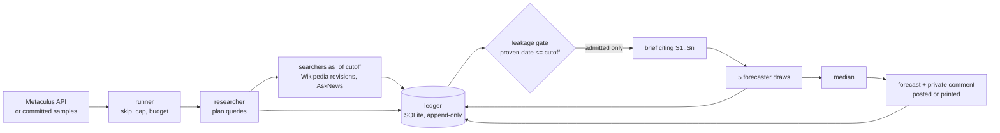

# Augur

**Status: in progress.** M1 of 10 (scaffold and one question end to end); see
[PLAN.md](PLAN.md).

A forecast about a real event is scored only after the event happens, often
months later, so a team building an AI forecaster cannot tell in time whether
a change helped, and most forecasters that look accurate in backtests quietly
read the answer in news written after the question closed.

Augur is a forecasting bot for Metaculus's FutureEval bot tournament and the
two-week MiniBench rounds, where it is scored on the same questions as every
other bot. Around it is a ledger that keeps every question, prompt, source
(with proof of its date) and forecast, and a leakage gate that refuses any
source dated after the question's cutoff, enforced three times: in code, in
the ledger's own triggers, and by a test that scans every committed ledger.

## Demo

```text
$ augur forecast --tournament minibench     # no METACULUS_TOKEN: the committed samples
METACULUS_TOKEN is not set: dry run on the committed sample questions.
run run_43e36bbc2074456c8fe7 (dry_run) on samples:data/samples/minibench, model qwen2.5:7b

== Will any of Belgium, France, Italy, Luxembourg, Netherlands, and/or Germany leave the EU before 2027?
   https://www.metaculus.com/questions/43327/
   sources: 3 admitted, 0 rejected; members: 5% 5% 10% 5% 5%; median: 5.0%
   would POST /api/questions/forecast/ (dry run, not sent):
   [{"question": 43332, "source": "api", "probability_yes": 0.05, "probability_yes_per_category": null, "continuous_cdf": null}]
   would POST /api/comments/create/ as a private comment (dry run):
   | **Forecast: 5%**, the median of 5 independent forecasts (5%, 5%, 10%, 5%, 5%) by qwen2.5:7b.
   | 
   | **Research** (only sources dated at or before 2026-11-17 20:08 UTC):
   | …
   | - [S1] [European Travel Information and Authorisation System](https://en.wikipedia.org/w/index.php?oldid=1382341240) (wikipedia, revision of 2026-10-28)
   | - [S2] [Exit tax](https://en.wikipedia.org/w/index.php?oldid=1382000754) (wikipedia, revision of 2026-10-26)
   | - [S3] [European Union](https://en.wikipedia.org/w/index.php?oldid=1384741164) (wikipedia, revision of 2026-11-09)
done: 1 forecast, 0 skipped, 0 failed; estimated cost $0.0000
```

That is a real run (`qwen2.5:7b` on CPU, 11 minutes), trimmed; the full output is `data/runs/m1-dryrun-samples.txt`. To capture a
screenshot or GIF: `vhs` or `asciinema rec` around the command above.

## Quickstart

```sh
uv sync
ollama pull qwen2.5:7b
uv run augur forecast --tournament minibench            # dry run, prints what it would post
uv run augur ledger check augur.db                      # leakage scan; exit 1 on a violation
```

With `METACULUS_TOKEN` set the listing is live; nothing is posted without
`--submit`:

```sh
export METACULUS_TOKEN=...                               # the bot account's token
uv run augur forecast --tournament bot-testing-area --submit
```

## Architecture



| Module | Job |
|--------|-----|
| `augur/metaculus.py` | Typed `httpx` client: list, detail (`my_forecasts`), binary forecast, private comment; token bucket and `Retry-After`. |
| `augur/llm/` | `Provider` protocol: `ollama`, `metaculus_proxy`, `replay` (and a recorder); model registry with release dates. |
| `augur/research/` | `Source` record with `date_evidence`; `wikipedia` (the revision current at `as_of`), `asknews` (bounded by `end_timestamp`). |
| `augur/leakage.py` | The gate, and `scan_ledger`, which re-checks every stored row. |
| `augur/ledger.py` | Numbered migrations; every table refuses `UPDATE` and `DELETE`. |
| `augur/agents/` | Researcher, forecaster draws, and the recorder every model call passes through (time, cost, budget, ledger). |
| `augur/comment.py` | The private comment, built only from the members' reasoning and the cited sources. |
| `augur/runner.py`, `augur/cli.py` | `augur forecast`, `augur ledger check`. |

### The hard part

A backtest is only worth anything if no forecast could have read the answer.
In Augur a source enters a prompt only after it has been written to the
ledger and the gate has admitted it on **evidence** for its date (a wiki
revision's save time, a news provider's publish date from a query bounded at
the cutoff), never on a date the page states about itself. The rule is held
three times, so a bug in one layer is caught by the next:

1. `admit_source` in `augur/leakage.py` decides at run time.
2. SQLite triggers in `augur/migrations/0001_initial.sql` abort an admitted
   use of a source dated after its question's cutoff, an admitted undated
   source in a backtest, and a model call that cites a source the gate did
   not admit.
3. `tests/test_leakage.py` scans every ledger committed under `data/ledgers/`
   and plants one violation of each kind to prove the scan finds it.

## Design decisions

| Decision | Chosen | Alternative | Why |
|----------|--------|-------------|-----|
| Metaculus access | Own `httpx` client | `forecasting-tools`' `ForecastBot` | Every request must land in the ledger and be explainable. |
| Proxy provider | Plain `httpx` in the OpenAI format | The `openai` SDK | One HTTP stack to mock and record; the proxy speaks the same format. |
| Source dates | Evidence only (revision, capture, bounded publish date) | Page metadata | Audits show self-reported dates leak. |
| Ledger | SQLite, append-only by trigger | DuckDB, PostgreSQL | Tens of thousands of rows, one writer, ships with Python. |
| Aggregation (M1) | Median of 5 draws | Mean | Robust to one wild draw; Q3 tests alternatives in M6. |
| Comments | Private, rendered from the members' own reasoning | Boilerplate | Prize rules require the reasoning that produced the forecast. |

## Results

Nothing is scored yet; the first scored number arrives in M2. What M1
measured (details, commands and raw output in [RESULTS.md](RESULTS.md)):

| Run (2026-11-17, `qwen2.5:7b`, $0) | Outcome |
|-----|---------|
| Dry run on the committed sample | 3 dated Wikipedia revisions admitted, 5 draws, median 5%, payload and comment printed; 11 min 25 s on 4 CPUs |
| Live, bot-testing-area | Forecast and private comment accepted (HTTP 201 each); the next run skipped the question with no model call |
| Leakage scan of both ledgers | 0 violations |

## Known limits

- Wikipedia's search ranks today's index, so *which* pages are chosen can
  reflect later events even though each page's *text* is the revision as of
  the cutoff. Old revisions are also rendered with today's templates. Both
  matter for backtests (M4), where the judge audit measures the residual.
- The sponsored LLM proxy did not resolve on 2026-11-17, so live forecasts
  come from a local 7B model. AskNews is wired but unverified without keys.
- Binary questions only until M2.

## Roadmap

M2 live on MiniBench with every question type and the shadow template, and
the repository public; M3 resolutions and scoring, against the template and
the community prediction; M4 the leakage-proof backtest and what leakage is
worth; M5-M6 ablations; M7 calibration; M8 standings; M9 "does it know when
it does not know"; M10 release and a season postmortem. Details in
[PLAN.md](PLAN.md).

## Development

See [CONTRIBUTING.md](CONTRIBUTING.md).

## Licence

MIT
