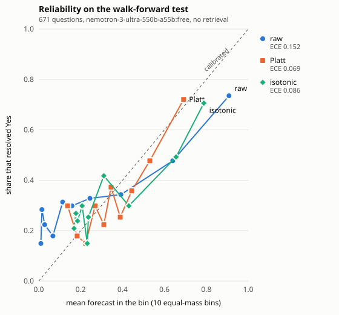

# Results

Every number here comes from a command in this repository, with the model,
date, cost and raw output recorded. Blocks between `augur:begin` and
`augur:end` comment markers are rendered by `augur report` (`make
results`) from the committed ledgers and snapshots, and a test fails if the
committed file differs from a fresh render. M13 adds dated news to the
leak-free backtest arm (GDELT discovery, Wayback text) and asks whether
thin evidence or the model limits it. M12 builds a forecast with no
model in it (a readable price, a base rate, or a quoted series' own
history), scores it and one registered blend on C4 with no model call, and
writes both beside Augur on every shadow tick. M11 registers the rule that
decides whether the free model may submit. M10 records the season's
standing (Augur has no scored forecast), places Augur's backtest arms
beside every ForecastBench entrant on the same questions, and checks the
release (a fresh clone, the built package, the release workflow and the
container). M9 asks whether disagreement
among the fleet's forecasts predicts its errors (Q6), against controls for
plain overconfidence, and pre-registers the live test; it also makes the
calibrator source-aware, which withholds M8's map from Metaculus questions.
M8 learns calibration from
926 resolved questions under a strict time order and ships a Platt map for
the model it was fitted on (Q4); M7 ablates the fleet (research depth,
head count, aggregation, model mix) and measures how many questions a
difference needs (Q3); M6 measures what leakage is worth on a retrieval
backtest (Q2) and tries an iterative research loop; M5 sets the bot
against the market price on resolved ForecastBench questions (the price
alone wins); M4 has the first scored number and the scoring it rests on;
the first live score waits on a scored round (see Q1 and Q5 below).

## M13: dated news in the backtest: is the limit the evidence or the model?

The registration below (design, P41 to P46 and the verdict rule) was
committed before the `gdelt` searcher was written or any arm ran, and is
rendered here from PLAN.md; item 7 was added, dated, after GDELT's API
refused the build machine and before any arm ran.

<!-- augur:begin m13-registration -->
1. *The searcher (`gdelt`).* For each of a question's shared planned
   queries (`data/backtest/m6-c2-queries.json`, the plan every Q2 arm
   used), one GDELT DOC 2.0 `artlist` request: the query's words with
   punctuation removed, words under three letters and a fixed stop list
   dropped, at most six words, plus `sourcelang:english`;
   `startdatetime` 90 days before the cutoff and `enddatetime` at the
   cutoff, relevance order, at most 10 articles. One request every 5
   seconds, with backoff on 429 and 5xx; every response is cached on disk
   (`data/backtest/gdelt-cache/`) and committed, so a resumed or re-run
   arm sends nothing twice. The query bound is never trusted: an article
   whose `seendate` is after the cutoff is refused, whatever GDELT
   returned. Nothing assumes how far back GDELT searches; an empty
   answer is recorded as empty.
2. *The text.* An article's text comes only from a Wayback capture of its
   URL at or before the cutoff (the existing `wayback` capture code: the
   capture's own timestamp is compared, redirects followed only while
   still at or before the cutoff). No capture, no source: the live page is
   never fetched. Market and forecasting hosts are excluded as in
   `wayback`. The source's date is the capture timestamp
   (`archive_capture`), its evidence names the capture and the `seendate`,
   and it is written to the ledger before any model sees it, so the
   leakage gate and `tests/test_leakage.py` cover it like any other
   source. Per query, GDELT's articles are tried in order, at most four
   Wayback lookups, and the first one admitted is kept: at most three news
   sources a question.
3. *Arm G.* The 64 questions of C2's fixed sample, as of each question's
   open instant. Each question's evidence is arm O's admitted sources
   exactly as O's forecasters saw them (read back from
   `data/ledgers/m6-c2-open.sqlite`), plus the news sources from items 1
   and 2; the brief is rewritten from all of them by the same prompt and
   model, and three draws forecast from it, combined by the median. Model
   `openrouter:nvidia/nemotron-3-ultra-550b-a55b:free` in every role, as
   in O. Where no news source is admitted, G's inputs are O's, no call is
   made and G's forecast is O's recorded one. So G − O measures news
   added to O's evidence and nothing else, and G − N is set beside M6's
   O − N.
4. *What is reported* (`make eval`, rendered by `make results`): the
   share of the 64 questions that gained at least one news source whose
   `seendate` is in the 30 days before open; sources admitted per question
   in O and in G; G − O and G − N, paired Brier with 95% bootstrap
   intervals (seeded, as in M6) and the detectable effect, overall and
   split into priced (an as-of price from M5) and unpriced questions;
   G − O on the questions that gained news alone; the leakage judge (same
   model, El Lahib et al.'s 0 to 4 rubric) on the news sources; the cost
   per question; and the result beside Hindcast, AIA and El Lahib et al.
5. *The verdict*, on G − O over all 64: **moved** if the 95% interval is
   entirely below 0; **not the limit** if the interval includes 0 and its
   lower end is above −0.055 (Hindcast's Qwen3-32B gain), or if it is
   entirely above 0; otherwise **unresolved**, with the questions needed
   to detect a 0.02 and a 0.055 gain at 80% power from G − O's own paired
   spread (M7's normal-approximation rule), set beside M7's power curve
   for research (110 questions for 0.02).
6. *If GDELT cannot be reached.* GDELT refused this repository's shared
   addresses on 2026-11-23 and 2026-11-24 (HTTP 429 on a first request).
   If it refuses every address the run can use, G is recorded as not run,
   not as zero coverage, and the commands go under To measure.
7. *Amendment, 2026-11-25 04:30 UTC, before any arm ran.* The DOC 2.0
   API answered HTTP 429 to all six requests sent from the build machine
   between 04:12 and 04:22 UTC (one every 75 seconds or more), while
   GDELT's static files (`data.gdeltproject.org/gdeltv2/`) answered
   at once. So discovery has a second route over the same index, used
   only when the API refuses: GDELT's 15-minute GKG 2.1 files for the 30
   days before the cutoff (every file stamped after 2026-05-12 00:00 and
   at or before 2026-06-11 00:00 UTC, C2's single cutoff), each checked
   against the MD5 GDELT's master list gives, reduced to a local index of
   (batch time, URL, page title). The batch time plays the `seendate`'s
   part and is checked against the cutoff the same way. A query's
   keywords (item 1's rule) match an article when at least three of its
   non-numeric keywords (all of them, if it has fewer) appear in the
   title; matches are ordered by keywords matched, then newest first,
   at most 10, and that list is cached and committed exactly as an API
   answer would be. The window is 30 days rather than 90 to keep the
   download near 15 GB; P41 counts the 30 days before open either way.
   Item 2 (text only from a Wayback capture at or before the cutoff),
   item 3, the predictions and the verdict are unchanged. Title matching
   is narrower than the API's full-text search, which works against P41's
   coverage, not for it.

| # | Prediction |
|---|------------|
| P41 | Fewer than 60% of the 64 questions gain a news source whose `seendate` is in the 30 days before open. |
| P42 | G adds fewer than 1.5 news sources a question on average (O showed 5.1 sources a question). |
| P43 | G − O over all 64 has a point estimate between −0.055 and −0.002 and a 95% interval that includes 0. |
| P44 | The verdict in item 5 is *unresolved*. |
| P45 | G − N has a 95% interval that includes 0, as O − N's did. |
| P46 | The judge rates fewer than 5% of the admitted news sources at 3 or 4. |

**Reading rule.** Each prediction is marked held or failed as written,
never edited. Nothing about the live bot changes from this arm: live
research uses AskNews and the markets, not GDELT, and a backtest on one
free model cannot move a live default. A second reader model and a split
by source age stay cut (Considered and not chosen).
<!-- augur:end m13-registration -->

<!-- augur:begin news -->
C2's fixed sample, 64 questions, cutoff each question's open instant. Model `nvidia/nemotron-3-ultra-550b-a55b:free` in every role, 3 draws, median. Arm G is arm O's sources exactly as O's forecasters saw them plus at most three news sources (GDELT discovery, text from a Wayback capture at or before the cutoff); where none was admitted G's forecast is O's.

- Questions that gained a news source: 54/64 (84%); with a news source GDELT saw in the 30 days before open: 54/64 (84%).
- News sources admitted: 99 question-source pairs (1.55 a question), 72 distinct pages. Sources a question was shown: O 5.06, G 6.61.
- One AP wire-digest page (a GKG "title" thousands of characters long) matched 26 questions' queries and was the only news for 15 of them. Real articles only: 39/64 (61%) questions, 73 uses (1.14 a question). The last row below leaves the digest-only questions out (exploratory, chosen after the run).
- Most frequent news hosts: bostonherald.com 26, bleacherreport.com 6, wgme.com 3, fox29.com 2, nypost.com 2, abc.net.au 1, abc13.com 1, abcnews.com 1.

| Arm | Brier [95% interval] | Log score | n |
|---|---|---|---|
| N: no retrieval | 0.2045 [0.1284, 0.2859] | -0.697 | 64 |
| O: one pass, sources as of open | 0.1887 [0.1173, 0.2642] | -0.563 | 64 |
| G: O's sources plus dated news | 0.1947 [0.1218, 0.2725] | -0.595 | 64 |

| Paired difference | Brier [95% interval] (MDE) |
|---|---|
| G − O (what dated news adds) | +0.0060 [-0.0096, +0.0221] (0.0227) |
| G − N (news and the rest of retrieval) | -0.0098 [-0.0486, +0.0291] (0.0556) |
| O − N (M6, for reference) | -0.0158 [-0.0503, +0.0170] (0.0483) |
| G − O (questions that gained news, n = 54) | +0.0072 [-0.0113, +0.0256] (0.0266) |
| G − O (priced, n = 47) | +0.0120 [-0.0085, +0.0326] (0.0290) |
| G − N (priced, n = 47) | -0.0101 [-0.0593, +0.0383] (0.0693) |
| G − O (unpriced, n = 17) | -0.0105 [-0.0275, +0.0018] (0.0214) |
| G − N (unpriced, n = 17) | -0.0089 [-0.0690, +0.0466] (0.0811) |
| G − O (gained a real article, n = 39; exploratory) | +0.0098 [-0.0064, +0.0288] (0.0254) |

Spread of the per-question G − O Brier difference: SD 0.0648; at 80% power (two-sided 5%) that needs 83 questions for 0.020, 11 questions for 0.055 (M7's research curve: 110 for 0.02).

The judge on the news sources (same model, El Lahib et al.'s 0 to 4 rubric): 99 question-source pairs judged, scores 0/1/2/3/4 97/1/1/0/0, at 3 or more 0/99 (0%).

Cost per question that gained news ($0: free model): 4.0 successful model calls (1.0 research), 4,214 output tokens, 101 s wall time.

Beside outside results (not the same protocol): Hindcast (arXiv 2607.14051): dated posts from a frozen Reddit snapshot lowered Brier on 8 of 9 open-weight models over 216 Polymarket markets, Qwen3-32B 0.234 to 0.179 (−0.055); AIA Forecaster (arXiv 2511.07678, re-read 2026-11-25): no search 0.1230, agentic search 0.1140 (−0.009) on ForecastBench (its Table 3, set not named), and 0.116 to 0.085 (−0.031) on its market subset (Table 4), with a frontier model; El Lahib et al. (arXiv 2602.00758): no retrieval 0.244, leak-free documents 0.242 (−0.002), gpt-oss-120b, Google results.

**Verdict (registration item 5): not the limit.**

Predictions registered in PLAN.md before the run:

- P41 (under 60% gain recent news): 84% **failed**.
- P42 (under 1.5 news sources a question): 1.55 **failed**.
- P43 (G − O between −0.055 and −0.002, interval includes 0): +0.0060 [-0.0096, +0.0221] **failed**.
- P44 (verdict unresolved): not the limit **failed**.
- P45 (G − N interval includes 0): [-0.0486, +0.0291] **held**.
- P46 (judge under 5% at 3 or more): 0.0% **held**.
<!-- augur:end news -->

**What it shows.**

- **The experiment happened, with more coverage than predicted.** I
  predicted that fewer than 60% of questions would gain news, because
  Wayback captures of news articles are sparse (P41). By the registered
  count 54 of 64 did (84%), at 1.55 news sources a question, so P41 and
  P42 failed. Two qualifications, both found after the run. First, 26 of
  the 99 uses are one wire-digest page (below). Counting real articles
  only, 39 of 64 questions (61%) gained news, at 1.14 a question. Second,
  the title index covers only the 30 days before the cutoff, so P41's
  30-day condition held almost by construction: only one admitted source
  came from the API's 90-day window.
- **Dated news did not measurably help this model.** For a question that gained
  news, G − O also includes a rewritten brief and three fresh draws, so
  it is news plus that noise, which averages out over questions. G − O is +0.006 [−0.010,
  +0.022]: if anything worse, and the interval's lower end (−0.010) rules
  out a gain the size of Hindcast's 0.055, so the registered verdict is
  *not the limit*, not the *unresolved* I predicted (P43 and P44 failed).
  It does not rule out a gain under 0.010, the size of AIA's 0.009 or
  El Lahib et al.'s 0.002: 64 questions cannot see an effect that small
  (83 are needed for 0.02).
  On the 47 priced questions it is +0.012 [−0.009, +0.033]. On the 17
  unpriced (Metaculus and INFER) questions it is −0.011 [−0.028, +0.002],
  the only split pointing the right way, and too small a sample to call.
- **One page explains a quarter of the news, and removing it does not
  change the answer.** The GKG "title" of one AP wire-digest page on
  bostonherald.com is the whole feed, thousands of characters long, so it
  matched three keywords for 26 questions and was the only news for 15 of
  them. Leaving those 15 out (a cut chosen after the run, so exploratory),
  G − O on the 39 questions that gained a real article is +0.010
  [−0.006, +0.029]. The other matches are mixed. Some are on topic (Trump's
  Taiwan remarks for a Taiwan question, a Donetsk strike for a front-line
  question) and some only share words (Senegal's prime minister for a UK
  prime-minister question).
- **The gate held.** The judge rated 97 of the 99 news uses at 0, and
  none at 3 or more (P46 held), and the ledger scan finds 0 violations.
  The only score of 4 in G's ledger is M6's known Wikipedia revision,
  carried over in O's evidence.
- **What this says about the gap to the outside results.** Hindcast's
  gain (−0.055 on Qwen3-32B) came from dated Reddit posts about each
  market's own event, and AIA's (−0.009 overall, −0.031 on its market
  subset) from agentic search on a frontier model. Both are retrieval much
  closer to the question than keyword titles. Here,
  adding dated, leak-free news to the same free model's brief gained
  nothing measurable; El Lahib et al. report a similarly small change with
  leak-free documents (−0.002), under a different protocol. On this model,
  more evidence of this kind is not what holds the backtest back by
  anything near Hindcast's margin. Two things remain untested: better-targeted news (the
  API's full-text search, To measure) and a stronger reader model (cut
  from this milestone).

**Unfair or missing comparisons, named.** GDELT's DOC 2.0 API refused the
build machine (HTTP 429, timeouts, dropped connections) on almost every
request. Three of the run's 193 discovery answers came from the API (one
of them an empty `{}`, see below) and 190 from the registered fallback, a title index over GDELT's GKG files for
the 30 days before the cutoff (2,880 files, 3,109,386 titled articles,
built in 6 minutes; manifest `data/backtest/gdelt-gkg-manifest.json`).
Matching three title words is cruder than the API's full-text relevance,
so G tests "dated news found by keyword titles", not the best GDELT can
do. Every news text is a Wayback capture, so pages the archive missed
or refused are lost: the first run's log has 81 articles with no
capture at or before the cutoff, 6 empty captures, 92 archive connection
errors retried and 22 articles given up after the retries. One question (metaculus 43343) had news
admitted on its first attempt (through the title index) but lost two of
three draws to the model's length limit. The resumed process asked
GDELT's API first, and the API answered that query with HTTP 200 and an
empty `{}`, which the searcher read as "no articles". So the question
keeps O's forecast because the discovery route changed, not because news
was missing. Two rules were written after the first run had printed its
outcomes: each question is scored from its last run, and a question
settled as "nothing added" is not searched again on resume. They touch
only this question, and neither looked at a score. The review also found
three faults, fixed after the run and not applied to it.
(1) A news source's title came from GDELT, not the capture, so the digest
page's feed-length "title" (106,084 characters) went into 26 brief
prompts. That breaks item 2's "text only from Wayback" for that one page,
which GDELT saw before the cutoff. (2) An archive failure on every
candidate article settled a question as "nothing added". Of the 10
questions without news, 7 had candidate articles, and the ledger does not
record whether the archive failed or simply had no capture. (3) The
ledger scan did not check `seendate`. Now titles come from the capture,
archive failures fail the question so a resume retries it, and the scan
refuses a news source GDELT saw after its cutoff. One free model, 64 questions, one ForecastBench set; the
bootstrap treats questions as independent. Cost $0. Run: 2026-11-25,
04:24 to 07:18 UTC, `make backtest-q2-news` step by step; raw output
`data/runs/m13-c2-news.txt`; ledger `data/ledgers/m13-c2-news.sqlite`;
GDELT answers `data/backtest/gdelt-cache/`.

## M12: a forecast with no model in it, and one registered blend

The registration below was committed before the statistical arm was built
or run on anything, and is rendered here from PLAN.md, so a later edit to
either copy fails the build.

<!-- augur:begin m12-registration -->
**M12's statistical arm, its blends and its predictions, registered
2026-11-24, before the arm is built or run on anything.**

1. *The arm* (`augur/statarm.py`, no model call). Binary: the question's
   own price where the markets searcher reads an exact one (a `match =
   exact` quote dated at or before the cutoff); otherwise the base rate of
   the question's source, the Laplace-smoothed frequency (yes + 1) / (n +
   2) of that source's outcomes public before the question opened, or of
   every source's if that source has fewer than 20. Numeric and discrete:
   the series rule below. Multiple choice, and anything the rules do not
   reach: the arm abstains, and says why.
2. *The series rule.* A question is about a quoted series only if its
   title names a ticker in parentheses or one of the fixed aliases in
   `augur/research/series.py` (named stock indices, Bitcoin, Ether,
   currency pairs, gold, WTI and Brent), asks for a close, closing price
   or level, and names the day; the value is that series' daily close on
   that day. The series comes from one free keyless source verified before
   this registration (Yahoo Finance's chart endpoint; FRED and Stooq
   answer this environment with a browser challenge). Each observation of
   trading day D is dated 00:00 UTC of D + 1, is admitted only if that is
   at or before the cutoff, and the series is written to the ledger as one
   dated source before the arm uses it, so the leakage gate covers it. The
   forecast is the last admitted close times exp(c), c drawn from the
   empirical distribution of the series' own log changes over h
   observations in its last two years of daily closes, h the number of
   observations the series averaged over the last 365 days for the
   calendar days from the last close to the target day (at least 1); the
   levels 1, 5, 10, 20, ..., 90, 95 and 99% go through
   `cdf_from_percentiles`. It abstains with fewer than 100 such changes, or
   when the last close lies outside the question's range (a unit
   mismatch).
3. *The primary candidate*, the one combination the floor may admit:
   one-third Augur and two-thirds arm, in log-odds for binary (both
   clipped to [0.01, 0.99]) and as a mixture of CDFs for numeric and
   discrete, **only where the arm has a price or a series**; everywhere
   else it is Augur's forecast unchanged. The weight is M5's
   `BLEND_WEIGHT`, fixed before M5's first run.
4. *Reported, never a candidate:* the arm alone; the base-rate blend (the
   same one-third weight wherever the arm has any value, base rates
   included); Augur alone.
5. *The floor, amended for the 2026-11-30 round.* If this registration is
   on `main` before that round's first question opens, the candidate in
   item 1 of M11's floor rule is the primary candidate above, read from
   the ledger's `blend` reference rows (`augur floor --candidate blend`);
   items 2 to 8 are unchanged, with the template as the opponent. If it is
   not on `main` by then, M11's item 1 stands as written. The shadow job
   records `stat` and `blend` rows before each question closes; Augur's
   own aggregate is scored beside it and is not a candidate.
6. *C4, no model call.* M8's walk-forward instances W (each instance's
   base rate fitted only on outcomes public before it opened), Augur =
   the raw no-retrieval forecast, priced = Polymarket and Manifold
   instances with a freeze price (Metaculus and INFER prices are hidden
   from the bot). Brier differences paired by instance, 95% bootstrap
   intervals resampling markets (10,000 resamples, seeded), reported
   overall and by source by `augur statarm`, re-checked by `make eval`.

| # | Prediction |
|---|------------|
| P34 | On W's priced instances, Brier(primary candidate) − Brier(Augur) has its interval below 0: M5's gain on C2 replicates on C4 (a replication, not a new finding). |
| P35 | On W's priced instances, Brier(primary candidate) − Brier(price alone) is above 0 (point estimate): the price alone stays at least as good, as on C2 (0.129 against 0.106). |
| P36 | On W's Metaculus instances, Brier(base-rate blend) − Brier(Augur) is between +0.01 and +0.04 (point estimate). |
| P37 | On all of W, Brier(arm alone) − Brier(Augur) has its interval below 0. |
| P38 | The series rule matches fewer than 12 of the 60 questions of the 2026-11-16 round's list, and fewer than 12 of the 2026-11-30 round's. |
| P39 | On the 2026-11-30 round, the primary candidate's mean head-to-head against Augur alone has a 90% interval that includes 0. |
| P40 | The floor's verdict on the primary candidate for the 2026-11-30 round is *not admitted*. |

**Reading rule.** A prediction is marked held or failed as written,
never edited. Nothing goes live from C4: the candidate reaches a
submission only through the floor rule. The series rule has no backtest
(every committed corpus is binary), so its live coverage and scores are
reported with that limit stated.
<!-- augur:end m12-registration -->

### The arm and both blends on C4 (2026-11-24, no model call, $0)

`augur statarm` (re-checked by `make eval`); snapshot
`data/statarm/m12-c4.json`. On C4 the arm is the freeze price where the bot
could read it live (Polymarket, Manifold) and the source's walk-forward base
rate elsewhere; there is no numeric question in any committed corpus, so the
series rule is not in this table.

<!-- augur:begin statarm -->
Corpus C4, `nvidia/nemotron-3-ultra-550b-a55b:free`, no retrieval, one draw; M8's walk-forward set W: 671 of 926 instances, 425 markets. No model call, $0. Brier score (lower is better); differences are paired by instance with a 95% bootstrap interval resampling markets (10,000 resamples, seeded).

| Group | n (markets) | Base rate | Arm used | Augur | Arm alone | Primary candidate | Base-rate blend | Price alone |
|---|---|---|---|---|---|---|---|---|
| All of W | 671 (425) | 0.334 | base-rate 191, price 480 | 0.2240 | 0.1466 | 0.1455 | 0.1494 | hidden |
| Priced (Polymarket, Manifold) | 480 (344) | 0.398 | price 480 | 0.2682 | 0.1353 | 0.1584 | 0.1584 | 0.1353 |
| Unpriced (Metaculus, INFER) | 191 (81) | 0.173 | base-rate 191 | 0.1129 | 0.1753 | 0.1129 | 0.1267 | hidden |
| Polymarket | 341 (272) | 0.399 | price 341 | 0.2556 | 0.1433 | 0.1589 | 0.1589 | 0.1433 |
| Manifold | 139 (72) | 0.396 | price 139 | 0.2989 | 0.1154 | 0.1574 | 0.1574 | 0.1154 |
| Metaculus | 190 (80) | 0.168 | base-rate 190 | 0.1115 | 0.1741 | 0.1115 | 0.1253 | hidden |
| INFER | 1 (1) | 1.000 | base-rate 1 | 0.3844 | 0.3933 | 0.3844 | 0.3904 | hidden |

Each arm minus Augur (negative: the arm is better than the model's raw forecast), and on priced instances each minus the price alone:

| Group | Arm alone − Augur | Primary candidate − Augur | Base-rate blend − Augur | Primary candidate − price |
|---|---|---|---|---|
| All of W | -0.077 [-0.110, -0.046] | -0.079 [-0.099, -0.060] | -0.075 [-0.097, -0.054] | — |
| Priced (Polymarket, Manifold) | -0.133 [-0.172, -0.095] | -0.110 [-0.137, -0.084] | -0.110 [-0.137, -0.084] | +0.023 [+0.008, +0.038] |
| Unpriced (Metaculus, INFER) | +0.062 [+0.017, +0.107] | 0 (Augur unchanged) | +0.014 [-0.015, +0.039] | — |
| Polymarket | -0.112 [-0.156, -0.069] | -0.097 [-0.127, -0.069] | -0.097 [-0.127, -0.069] | +0.015 [-0.002, +0.033] |
| Manifold | -0.184 [-0.271, -0.104] | -0.141 [-0.206, -0.086] | -0.141 [-0.206, -0.086] | +0.042 [+0.016, +0.072] |
| Metaculus | +0.063 [+0.017, +0.107] | 0 (Augur unchanged) | +0.014 [-0.015, +0.039] | — |
| INFER | +0.009 (n = 1, no interval) | 0 (Augur unchanged) | +0.006 (n = 1, no interval) | — |

| # | Statistic | Estimate | Registered rule | Verdict |
|---|---|---|---|---|
| P34 | priced: Brier(candidate) - Brier(Augur) | -0.110 [-0.137, -0.084] | interval below 0 | **held** |
| P35 | priced: Brier(candidate) - Brier(price) | +0.023 [+0.008, +0.038] | point estimate above 0 | **held** |
| P36 | Metaculus: Brier(base-rate blend) - Brier(Augur) | +0.014 [-0.015, +0.039] | point estimate between +0.01 and +0.04 | **held** |
| P37 | all of W: Brier(arm) - Brier(Augur) | -0.077 [-0.110, -0.046] | interval below 0 | **held** |
<!-- augur:end statarm -->

### The series rule on a real round's question list (2026-11-24, $0)

`augur statarm --coverage minibench-2026-11-16` (needs `METACULUS_TOKEN`
for the posts' ranges and open times; closes from Yahoo Finance's keyless
chart endpoint, read as of each question's open, so every close of a day
the question had not yet seen is refused). Raw output:
`data/statarm/m12-coverage-minibench-2026-11-16.json`; `make eval`
re-derives which titles the rule reaches from the standings snapshot and
fails if the file disagrees.

<!-- augur:begin statarm-coverage -->
Round `minibench` (project 33169): 60 questions, 31 numeric or discrete; the series rule reaches **7** and forecasts **5**. Every other question gets no series (multiple choice, binary, or a numeric title naming no quoted series).

| Post | Title | Series | Closes admitted (refused) | Last close | Outcome | 10% / 40% / 80% |
|---|---|---|---|---|---|---|
| 46563 | What will Magazine Luiza (MGLU3) close at on Friday, November 27, 2026? | MGLU3.SA | 491 (6) | 7.81 (2026-11-13) | forecast | 6.55 / 7.453 / 8.834 |
| 46564 | What will be Grupo Casas Bahia's (BHIA3) closing share price on 27 November 2026? | BHIA3.SA | 491 (6) | 0.68 (2026-11-13) | forecast | 0.5226 / 0.6246 / 0.7239 |
| 46567 | What will the Ibovespa close at on 26 November 2026? | ^BVSP | 491 (6) | 172,458 (2026-11-13) | forecast | 165,417 / 172,327 / 178,437 |
| 46576 | What will the Nasdaq Composite (^IXIC) close at on Friday, November 27, 2026? | ^IXIC | 494 (7) | 25,136 (2026-11-13) | forecast | 24,116 / 25,066 / 25,960 |
| 46595 | What will SpaceX's (SPCX) closing share price be on Friday, November 27, 2026? | SPCX | 108 (7) | — | abstains: Space Exploration Technologies Corp. (SPCX): 98 past 10-observation changes, fewer than 100 | — |
| 46602 | What will Nvidia's (NVDA) closing share price be on Friday, November 27, 2026? | NVDA | 495 (6) | 156.1 (2026-11-16) | forecast | 144.1 / 154.9 / 165.9 |
| 46607 | What will Anthropic (ANT) close at on Friday, November 27, 2026? | ANT | 0 (4) | — | abstains: Anthropic, PBC Class A Common Stock (ANT): no close dated at or before the cutoff | — |
<!-- augur:end statarm-coverage -->

**A shadow tick with the arm, on the real APIs** (2026-11-24,
bot-testing-area, route `openrouter:nvidia/nemotron-3-ultra-550b-a55b:free`,
`--max-questions 2`, $0; raw output
`data/runs/m12-shadow-tick-bot-testing-area.txt`). On the binary question
the arm gave the Metaculus base rate (51 of 255) and the `blend` row kept
Augur's forecast, since a base rate is not an anchor the candidate blends
with; on the numeric question (Trump's net approval) the series rule did
not reach the title and the arm abstained, saying so. Both rows were
written before delivery, nothing was submitted, and `augur ledger check`
found 0 violations. No series question was open on the bot-testing-area,
so the series path ran live only in the coverage run above and against the
fake server in `tests/test_statlive.py`.

## M11: the shadow round and the rule that decides the floor (Q1)

The rule below was committed before the 2026-11-30 MiniBench round opened
(commit "Register M11's floor rule before the 2026-11-30 round", 2026-11-24),
and is rendered here from PLAN.md, so a later edit to either copy fails the
build. The round itself has not opened yet: its numbers, its resolution and
the verdict are under To measure with the exact commands.

### What a shadow tick costs (2026-11-24, bot-testing-area, $0)

Route `openrouter:nvidia/nemotron-3-ultra-550b-a55b:free` for both
contestants; no AskNews keys here, so neither had news (the scheduled job
passes them when the repository has them). Raw output:
`data/runs/m11-shadow-tick-bot-testing-area.txt`,
`data/runs/m11-template-calls.txt`, `data/runs/m11-act-tick-1.txt`,
`data/runs/m11-act-tick-2.txt`, `data/runs/m11-poll-after-two-ticks.txt`.

| What | Measured |
|------|----------|
| Augur, model calls a question | 7 (planner, brief, five draws), plus one probe a tick; the same in all three runs (3, 2 and 2 questions) |
| Augur, time a question | 90 to 139 s locally (3 questions, 363 s with listing and probe); 3 min 56 s and 6 min 37 s for the two questions of each `act` tick |
| Template (`forecasting-tools` 0.3.7 `TemplateBot`), model calls a question | 15 (45 for 3 questions, every request to `acompletion` counted) |
| Template, time a question | 335 s for 3 questions; 3 min 19 s and 3 min 17 s for each `act` tick's two |
| Free calls a question, both contestants | 22 |
| The key's free allowance | 1,000 requests a day (`augur models probe`, `free_model_daily_requests`); $0 used, limit $1 |
| A tick under `act`, poll to last push | 480 s (tick 1) and 608 s (tick 2), two questions each |

A 60-question MiniBench round is about 1,320 free calls, more than one
day's allowance; the 2026-11-16 round opened its questions over three days
(PLAN.md), about 440 calls a day. The poll budgets the day from the shadow
exports and polls FutureEval only when MiniBench has nothing to do and a
whole tick still fits. At the default of 4 questions a tick, a round is
about 15 ticks of roughly 15 minutes, about 225 runner minutes, plus a
few seconds for every empty poll. The repository is public, so these
minutes are not billed; on a private repository they would be about 11%
of GitHub's 2,000-minute monthly free allowance per round.

**Two consecutive ticks under `act`** (`act` 0.2.98, image
`catthehacker/ubuntu:act-latest`, `workflow_dispatch` with `shadow=true`,
`tournament=bot-testing-area`, `max_questions=2`, the `ledger` branch on a
local bare repository through `AUGUR_LEDGER_REMOTE`): the first tick's poll
found 6 open questions and 0 held; Augur forecast 2 (the other 4 over the
cap), the first push wrote `shadow/2026-11-24/<tick>.jsonl`, the template
recorded 2, and the second push replaced the file with the superset. The
second tick skipped both of those as "already in the shadow ledger",
forecast the next two, and the template ran only on those. Rebuilt from
the branch (`augur ledger import`), the shadow ledger holds 4 questions,
each with Augur's aggregate and a template forecast, and 0 submissions;
the poll then reports 2 of 6 left. Both jobs finished well inside their
timeouts. The fake-server test (`tests/test_shadow.py`) proves the
stricter claim: a tick whose every question is held makes no model call,
not even the probe. A third tick after the review's workflow fixes
(`data/runs/m11-act-tick-3.txt`, `max_questions=1`, 288 s) skipped the 4
held questions, forecast 1, and the ordinary forecast job did not start.

<!-- augur:begin floor-rule -->
**The floor rule for the free model, registered 2026-11-24, before the
2026-11-30 MiniBench round opens.** `augur floor --round SLUG --ledger L
--standings S` applies it from the shadow ledger and a standings snapshot;
nothing in it is decided by hand.

1. *Contestants.* The candidate is Augur's aggregate forecast as the
   schedule's shadow mode records it: the shipped pipeline (the median of
   the forecaster draws, the live calibrator withheld on Metaculus
   sources, the exact-price blend) on the free route
   `openrouter:nvidia/nemotron-3-ultra-550b-a55b:free`, nothing
   submitted. M12's blend is not registered before the round, so it is
   not the candidate. Against it: the shadow template, Metaculus's
   `TemplateBot` from `forecasting-tools`, run unpublished by `augur
   baseline` on the same route in the same job.
2. *Questions.* The round's questions are the posts in its standings
   snapshot. A question is scored when the ledger holds both Augur's
   aggregate and a template forecast for it and its latest resolution is
   `resolved`. Annulled and ambiguous questions are dropped and counted; a
   question with only one of the two forecasts is counted as uncovered and
   never scored.
3. *Score per question.* The head-to-head h = 100 × ln(p_A / p_T), p the
   probability each forecast gave the outcome, halved on numeric and
   discrete questions (`augur.score.head_to_head`), with binary and option
   probabilities held to [0.001, 0.999]. Where the ledger holds more than
   one forecast from one side for a question, the latest counts, as in
   `augur score`.
4. *Proxy for the peer score.* The implied peer score is S + mean(h), S
   being the average spot peer score (`score / coverage`) of
   `metac-nemotron-3-ultra+asknews` on the round's primary leaderboard in
   the snapshot. It is wrong in known ways, stated beside every number:
   the shadow template is another run of the same code, not the public
   bot's forecasts; S enters as a constant, so the interval is too narrow;
   and the two can cover different questions.
5. *Intervals.* A 90% percentile bootstrap of mean(h) over questions,
   10,000 resamples, seed 20261119; the implied peer score's interval is S
   plus that interval. Printed with them: n, the standard deviation of h
   (the measured paired spread), and the uncovered and annulled counts.
6. *Verdict.* **Not yet decidable** while any of the round's questions in
   the ledger with an Augur or template forecast has no resolution, while
   the snapshot's leaderboard has scored fewer than half of the round's
   questions (`max_coverage` below half the snapshot's posts), or while
   the snapshot has no `metac-nemotron-3-ultra+asknews` entry. Otherwise
   **not admitted** if n is below 20. Otherwise **admitted** if and only
   if the lower end of the head-to-head interval is above 0 and the lower
   end of the implied peer score's interval is above 0; anything else is
   **not admitted**.
7. *Which snapshot, and what admission means.* For the 2026-12-14 round
   the snapshot is the last one fetched on or before 2026-12-13 (UTC); a
   verdict from a snapshot fetched later decides nothing for 2026-12-14
   and is recorded for the season only. Admitted lets the free route
   submit to MiniBench only, from 2026-12-14; FutureEval and every other
   tournament keep the frontier-tier floor. Not admitted: the floor stays
   and Fall 2026 is the shakedown. Either way the verdict and every number
   above go in RESULTS.md and the postmortem.
8. *Resolutions.* All of the round's forecast questions or none: from
   `augur resolve`, or where the bot token is blind from `augur resolve
   --manual-file F` (post, value and evidence URL on each line), which
   refuses a file that would leave any of the round's ledger questions
   without a resolution.
<!-- augur:end floor-rule -->

## M10: release, and the season's standing (2026-11-23)

### The season so far (Q5)

Every leaderboard snapshot committed under `data/standings/`, one row per
round (`augur standings --round SLUG --out data/standings/...`; from M10 the
`Standings` workflow re-reads the current MiniBench round, the two before it
and the FutureEval season every day and keeps each reading on the `ledger`
branch). Averages are spot peer points a question covered, with Metaculus's
interval on the sum divided by the same count.

<!-- augur:begin season -->
| Round | Status, as read | Entries | Questions scored | Rank 1 | Best template bot | `metac-nemotron-3-ultra+asknews` (Augur's free model) | Community (unweighted) | Augur | Questions Augur submitted |
|---|---|---|---|---|---|---|---|---|---|
| Fall 2026 FutureEval Bot Tournament (`fall-futureeval-2026`, project 33121) | open, 2026-11-25 | 610 | 51 | Panshul42 20.91 [11.89, 30.53], rank 1 | metac-claude-fable-5-1-high+asknews 12.59 [5.39, 20.36], rank 50 | -12.19 [-23.66, -1.52], rank 456 | 13.48 [10.67, 16.52], rank 43 | no entry | 0 of 182 |
| MiniBench - 2026-10-19 (`minibench-2026-10-19`, project 33132) | finalized, 2026-11-23 | 410 | 59 | notatrollBotV1 14.47 [7.33, 22.22], rank 1 | metac-claude-opus-5-5-high+asknews 3.10 [-4.97, 10.01], rank 106 | -2.55 [-9.12, 3.53], rank 222 | 7.58 [5.31, 10.44], rank 37 | no entry | 0 of 60 |
| MiniBench - 2026-11-02 (`minibench-2026-11-02`, project 33135) | finalized, 2026-11-20 | 435 | 59 | takeoff.watch 22.77 [17.36, 29.05], rank 1 | metac-claude-opus-5-5-high+asknews 3.66 [-0.97, 7.94], rank 107 | -7.66 [-14.51, -0.73], rank 295 | 5.06 [4.08, 6.12], rank 80 | no entry | 0 of 60 |
| MiniBench (`minibench`, project 33169) | open, 2026-11-23 | 0 | 0 | none | none | none | none | no entry | 0 of 60 |
<!-- augur:end season -->

### The ForecastBench same-question row

**Method.** ForecastBench publishes every entrant's forecasts for each
question set (its processed forecast sets, CC BY-SA 4.0, Forecasting
Research Institute); the archive was fetched on 2026-11-23 and
`scripts/extract_forecast_sets.py` cut it to the question instances
Augur's committed backtests forecast (`data/forecastbench/forecast-sets/`,
values unchanged, with the archive's URL, size, SHA-256 and date). An
instance is a (set, source, id) triple, matched to exactly the instances
each arm scored (C1, C2, O and C4, with the forecast and the outcome
RESULTS.md scores them with), and every entrant's Brier is paired with
Augur's on that entrant's own questions; an entrant's imputed forecasts
are left out and its n is shown. On C4 an entrant is one (organization,
model) pair pooled over the sets it entered, so ForecastBench's own runs,
renamed from 2026-07-05, count as different entrants before and after.
The predictions P30 to P33 and the reading rule were committed to PLAN.md
(`2c3b87d`) before any comparison was computed. The comparison is not
fair, and is not meant to be: the entrants forecast live, many with
frontier models and their own tools (some of ForecastBench's own runs
search the web), while Augur's arms are backtests of one free model (C1:
a small local one), all but O without retrieval. This is a backtest row,
never a place on ForecastBench's leaderboard.

**Sensitivity (checked at review, from the snapshot).** Two readings in
the verdicts below are fragile. P30's C4 half counts ForecastBench's
web-search runs as zero-shot LLMs, as the reading rule says; they are 25 of
the 77 and the strongest of them. Without them Augur ranks 34 of 53 on C4
(median difference +0.0087), not in the bottom quarter; keeping only
entrants compared on at least 50 instances it ranks 54 of 72, also not.
P30 fails on C2 either way, so its verdict does not move. P33's failure
rests on two entries of one team, Anonymous 18's raw forecasts and their
Platt-calibrated version, on the same 183 instances, each with an upper
bound of -0.004, among 309 external comparisons with no correction for
multiplicity: in effect one marginal result, about what chance alone
could produce.

<!-- augur:begin fbcompare -->
Source: ForecastBench's processed forecast sets (https://www.forecastbench.org/assets/data/processed-forecast-sets/processed_forecast_sets.tar.gz, 141,253,184 bytes, SHA-256 `3b3b9630f2ccf4da401e703266a116cdc7de535eabb4cb44c9a10d1c01315b0f`, last modified Tue, 17 Nov 2026 08:27:21 GMT, fetched 2026-11-23; CC BY-SA 4.0, Forecasting Research Institute), cut to Augur's instances in `data/forecastbench/forecast-sets/` by `scripts/extract_forecast_sets.py`; snapshot `data/forecastbench/m10-same-question.json` (`augur fbcompare`). A positive Augur − entrant means the entrant beat Augur on the same questions. Intervals: paired bootstrap over markets, 10,000 resamples, seeded. Each entrant is compared only on its non-imputed forecasts (n per row). Best and worst are by Augur − entrant, among the group's entrants compared on at least half its median n; the external rows are the 5 with the largest Augur − entrant under the same floor. Counts, ranks and medians use every entrant; full per-entrant numbers are in the snapshot.

**C1**: ForecastBench 2026-05-24, no retrieval, one draw (M4), `qwen2.5:7b`; 139 instances (139 markets, 2026-05-24), base rate 40.3%. Augur's Brier 0.2395 [0.1922, 0.2893]. ForecastBench's processed files resolve every instance as Augur was scored.

| Row | Entrant | n | Entrant's Brier | Augur's Brier, same n | Augur − entrant [95% interval] |
|---|---|---|---|---|---|
| market | market value on the due date | 139 | 0.111 | 0.239 | +0.129 [+0.077, +0.181] |
| market | freeze value (question set) | 139 | 0.131 | 0.239 | +0.108 [+0.059, +0.160] |
| ForecastBench zero-shot LLMs, no freeze value: best | GPT-5.5-2026-04-23 (zero shot) (1 imputed excluded) | 138 | 0.205 | 0.241 | +0.036 [-0.020, +0.090] |
| ForecastBench zero-shot LLMs, no freeze value: median of 21 | — | 138 (median) | 0.243 | — | -0.001 |
| ForecastBench zero-shot LLMs, no freeze value: worst | Grok-4.20-0309-Non-Reasoning (zero shot) | 139 | 0.358 | 0.239 | -0.118 [-0.179, -0.060] |
| ForecastBench zero-shot LLMs, shown the freeze value: best | GPT-5.5-2026-04-23 (zero shot with freeze values) (1 imputed excluded) | 138 | 0.128 | 0.241 | +0.114 [+0.062, +0.167] |
| ForecastBench zero-shot LLMs, shown the freeze value: median of 21 | — | 139 (median) | 0.139 | — | +0.103 |
| ForecastBench zero-shot LLMs, shown the freeze value: worst | Grok-4.20-0309-Non-Reasoning (zero shot with freeze values) | 139 | 0.257 | 0.239 | -0.018 [-0.076, +0.040] |
| external entries: best | Anonymous 8 / ensemble (nocritique-1-99) | 139 | 0.108 | 0.239 | +0.132 [+0.079, +0.186] |
| external entries: median of 14 | — | 139 (median) | 0.115 | — | +0.124 |
| external entries: worst | LightningRodLabs / foresight-v3-05-2026 | 139 | 0.185 | 0.239 | +0.054 [+0.015, +0.095] |
| ForecastBench baselines: best | Imputed Forecaster | 139 | 0.111 | 0.239 | +0.129 [+0.077, +0.181] |
| ForecastBench baselines: median of 6 | — | 139 (median) | 0.314 | — | -0.075 |
| ForecastBench baselines: worst | Always 1 | 139 | 0.597 | 0.239 | -0.358 [-0.470, -0.245] |
| external #1 | Anonymous 8 / ensemble (nocritique-1-99) | 139 | 0.108 | 0.239 | +0.132 [+0.079, +0.186] |
| external #2 | Anonymous 8 / ensemble (critique-1-99) | 139 | 0.110 | 0.239 | +0.130 [+0.077, +0.183] |
| external #3 | Anonymous 8 / ensemble (critique-5-95) | 139 | 0.110 | 0.239 | +0.129 [+0.077, +0.183] |
| external #4 | Artificial Judgement / aj-v1 | 139 | 0.110 | 0.239 | +0.129 [+0.077, +0.182] |
| external #5 | Anonymous 4 / excited-seal | 139 | 0.112 | 0.239 | +0.128 [+0.073, +0.183] |

| Group | Entrants | Beat Augur (point) | Beat Augur (interval above 0) | Augur beats (interval below 0) | Augur's rank | Median Augur − entrant | Median entrant Brier |
|---|---|---|---|---|---|---|---|
| ForecastBench zero-shot LLMs, no freeze value | 21 | 10 | 1 | 2 | 11 of 22 | -0.001 | 0.243 |
| ForecastBench zero-shot LLMs, shown the freeze value | 21 | 19 | 18 | 0 | 20 of 22 | +0.103 | 0.139 |
| external entries | 14 | 14 | 14 | 0 | 15 of 15 | +0.124 | 0.115 |
| ForecastBench baselines | 6 | 2 | 2 | 3 | 3 of 7 | -0.075 | 0.314 |

**C2**: ForecastBench 2026-06-21, no retrieval, median of three draws (M5's arm (b)), `nvidia/nemotron-3-ultra-550b-a55b:free`; 138 instances (138 markets, 2026-06-21), base rate 40.6%. Augur's Brier 0.2176 [0.1663, 0.2708]. ForecastBench's processed files resolve every instance as Augur was scored.

| Row | Entrant | n | Entrant's Brier | Augur's Brier, same n | Augur − entrant [95% interval] |
|---|---|---|---|---|---|
| market | market value on the due date | 138 | 0.096 | 0.218 | +0.121 [+0.072, +0.173] |
| market | freeze value (question set) | 138 | 0.108 | 0.218 | +0.110 [+0.061, +0.160] |
| ForecastBench zero-shot LLMs, no freeze value: best | Grok-4.3 (zero shot) | 138 | 0.186 | 0.218 | +0.032 [+0.007, +0.056] |
| ForecastBench zero-shot LLMs, no freeze value: median of 22 | — | 138 (median) | 0.219 | — | +0.002 |
| ForecastBench zero-shot LLMs, no freeze value: worst | Grok-4.20-0309-Non-Reasoning (zero shot) | 138 | 0.258 | 0.218 | -0.040 [-0.098, +0.016] |
| ForecastBench zero-shot LLMs, shown the freeze value: best | Claude-Sonnet-4-6 (zero shot with freeze values) | 138 | 0.101 | 0.218 | +0.117 [+0.069, +0.167] |
| ForecastBench zero-shot LLMs, shown the freeze value: median of 22 | — | 138 (median) | 0.119 | — | +0.098 |
| ForecastBench zero-shot LLMs, shown the freeze value: worst | Grok-4.20-0309-Non-Reasoning (zero shot with freeze values) | 138 | 0.207 | 0.218 | +0.011 [-0.049, +0.070] |
| external entries: best | Artificial Judgement / aj-v1 | 138 | 0.088 | 0.218 | +0.129 [+0.081, +0.180] |
| external entries: median of 16 | — | 138 (median) | 0.104 | — | +0.113 |
| external entries: worst | Anonymous 10 / alice | 138 | 0.142 | 0.218 | +0.076 [+0.032, +0.122] |
| ForecastBench baselines: best | Naive Forecaster | 138 | 0.096 | 0.218 | +0.122 [+0.073, +0.173] |
| ForecastBench baselines: median of 6 | — | 138 (median) | 0.280 | — | -0.063 |
| ForecastBench baselines: worst | Always 1 | 138 | 0.594 | 0.218 | -0.377 [-0.495, -0.258] |
| external #1 | Artificial Judgement / aj-v1 | 138 | 0.088 | 0.218 | +0.129 [+0.081, +0.180] |
| external #2 | Google DeepMind / Gemini | 138 | 0.095 | 0.218 | +0.123 [+0.080, +0.168] |
| external #3 | haoxin1998 / CLOUD_01 | 138 | 0.096 | 0.218 | +0.121 [+0.073, +0.171] |
| external #4 | haoxin1998 / CLOUD_03 | 138 | 0.096 | 0.218 | +0.121 [+0.071, +0.173] |
| external #5 | Anonymous 4 / excited-seal | 138 | 0.099 | 0.218 | +0.118 [+0.068, +0.171] |

| Group | Entrants | Beat Augur (point) | Beat Augur (interval above 0) | Augur beats (interval below 0) | Augur's rank | Median Augur − entrant | Median entrant Brier |
|---|---|---|---|---|---|---|---|
| ForecastBench zero-shot LLMs, no freeze value | 22 | 12 | 1 | 0 | 13 of 23 | +0.002 | 0.219 |
| ForecastBench zero-shot LLMs, shown the freeze value | 22 | 22 | 17 | 0 | 23 of 23 | +0.098 | 0.119 |
| external entries | 16 | 16 | 16 | 0 | 17 of 17 | +0.113 | 0.104 |
| ForecastBench baselines | 6 | 2 | 2 | 3 | 3 of 7 | -0.063 | 0.280 |

**O**: ForecastBench 2026-06-21, the first 64 questions by id, one research pass as of open, median of three draws (M6), `nvidia/nemotron-3-ultra-550b-a55b:free`; 64 instances (64 markets, 2026-06-21), base rate 35.9%. Augur's Brier 0.1887 [0.1173, 0.2642]. ForecastBench's processed files resolve every instance as Augur was scored.

| Row | Entrant | n | Entrant's Brier | Augur's Brier, same n | Augur − entrant [95% interval] |
|---|---|---|---|---|---|
| market | market value on the due date | 64 | 0.097 | 0.189 | +0.091 [+0.029, +0.157] |
| market | freeze value (question set) | 64 | 0.106 | 0.189 | +0.082 [+0.019, +0.149] |
| ForecastBench zero-shot LLMs, no freeze value: best | Grok-4.3 (zero shot) | 64 | 0.175 | 0.189 | +0.013 [-0.028, +0.054] |
| ForecastBench zero-shot LLMs, no freeze value: median of 22 | — | 64 (median) | 0.199 | — | -0.009 |
| ForecastBench zero-shot LLMs, no freeze value: worst | Grok-4.20-0309-Non-Reasoning (zero shot) | 64 | 0.249 | 0.189 | -0.060 [-0.141, +0.020] |
| ForecastBench zero-shot LLMs, shown the freeze value: best | DeepSeek-V4-Pro (zero shot with freeze values) | 64 | 0.097 | 0.189 | +0.091 [+0.037, +0.151] |
| ForecastBench zero-shot LLMs, shown the freeze value: median of 22 | — | 64 (median) | 0.113 | — | +0.074 |
| ForecastBench zero-shot LLMs, shown the freeze value: worst | Grok-4.20-0309-Non-Reasoning (zero shot with freeze values) | 64 | 0.183 | 0.189 | +0.006 [-0.071, +0.083] |
| external entries: best | Artificial Judgement / aj-v1 | 64 | 0.084 | 0.189 | +0.105 [+0.044, +0.170] |
| external entries: median of 16 | — | 64 (median) | 0.105 | — | +0.083 |
| external entries: worst | Anonymous 10 / alice | 64 | 0.128 | 0.189 | +0.061 [+0.010, +0.117] |
| ForecastBench baselines: best | Imputed Forecaster | 64 | 0.097 | 0.189 | +0.091 [+0.029, +0.157] |
| ForecastBench baselines: median of 6 | — | 64 (median) | 0.281 | — | -0.093 |
| ForecastBench baselines: worst | Always 1 | 64 | 0.641 | 0.189 | -0.452 [-0.618, -0.281] |
| external #1 | Artificial Judgement / aj-v1 | 64 | 0.084 | 0.189 | +0.105 [+0.044, +0.170] |
| external #2 | haoxin1998 / CLOUD_01 | 64 | 0.096 | 0.189 | +0.093 [+0.029, +0.160] |
| external #3 | haoxin1998 / CLOUD_03 | 64 | 0.096 | 0.189 | +0.093 [+0.026, +0.162] |
| external #4 | hliu763 / CAIR_01 | 64 | 0.098 | 0.189 | +0.090 [+0.026, +0.157] |
| external #5 | hliu763 / CAIR_02 | 64 | 0.098 | 0.189 | +0.090 [+0.026, +0.157] |

| Group | Entrants | Beat Augur (point) | Beat Augur (interval above 0) | Augur beats (interval below 0) | Augur's rank | Median Augur − entrant | Median entrant Brier |
|---|---|---|---|---|---|---|---|
| ForecastBench zero-shot LLMs, no freeze value | 22 | 7 | 0 | 0 | 8 of 23 | -0.009 | 0.199 |
| ForecastBench zero-shot LLMs, shown the freeze value | 22 | 22 | 15 | 0 | 23 of 23 | +0.074 | 0.113 |
| external entries | 16 | 16 | 16 | 0 | 17 of 17 | +0.083 | 0.105 |
| ForecastBench baselines | 6 | 2 | 2 | 3 | 3 of 7 | -0.093 | 0.281 |

**C4**: ForecastBench 2026-06-21 to 2026-10-11 (nine sets), no retrieval, one draw (M8), `nvidia/nemotron-3-ultra-550b-a55b:free`; 926 instances (541 markets, 2026-06-21 to 2026-10-11), base rate 34.9%. Augur's Brier 0.2248 [0.1956, 0.2539]. ForecastBench's processed files resolve every instance as Augur was scored.

| Row | Entrant | n | Entrant's Brier | Augur's Brier, same n | Augur − entrant [95% interval] |
|---|---|---|---|---|---|
| market | market value on the due date | 926 | 0.105 | 0.225 | +0.119 [+0.092, +0.147] |
| market | freeze value (question set) | 926 | 0.121 | 0.225 | +0.104 [+0.078, +0.131] |
| ForecastBench zero-shot LLMs, no freeze value: best | claude-opus-5-5-high-web-search-128k (web search) | 130 | 0.122 | 0.268 | +0.146 [+0.092, +0.203] |
| ForecastBench zero-shot LLMs, no freeze value: median of 77 | — | 206 (median) | 0.203 | — | +0.017 |
| ForecastBench zero-shot LLMs, no freeze value: worst | grok-4.20-0309-non-reasoning | 659 | 0.302 | 0.213 | -0.088 [-0.123, -0.056] |
| ForecastBench zero-shot LLMs, shown the freeze value: best | claude-opus-5-5-high-web-search-128k-zero-shot-with-freeze-values (web search) | 130 | 0.117 | 0.268 | +0.151 [+0.096, +0.207] |
| ForecastBench zero-shot LLMs, shown the freeze value: median of 77 | — | 210 (median) | 0.121 | — | +0.102 |
| ForecastBench zero-shot LLMs, shown the freeze value: worst | grok-4.20-0309-non-reasoning-zero-shot-with-freeze-values | 659 | 0.227 | 0.213 | -0.013 [-0.046, +0.019] |
| external entries: best | Anonymous 24 / golden-jaguar | 85 | 0.094 | 0.285 | +0.191 [+0.115, +0.269] |
| external entries: median of 309 | — | 85 (median) | 0.124 | — | +0.107 |
| external entries: worst | Anonymous 18 / blind-36b1beb99820+platt209 (1 imputed excluded) | 183 | 0.223 | 0.185 | -0.038 [-0.071, -0.004] |
| ForecastBench baselines: best | Imputed Forecaster | 926 | 0.105 | 0.225 | +0.119 [+0.092, +0.147] |
| ForecastBench baselines: median of 6 | — | 926 (median) | 0.289 | — | -0.064 |
| ForecastBench baselines: worst | Always 1 | 926 | 0.651 | 0.225 | -0.426 [-0.494, -0.358] |
| external #1 | Anonymous 24 / golden-jaguar | 85 | 0.094 | 0.285 | +0.191 [+0.115, +0.269] |
| external #2 | NeuroFusion / hybrid ensemble 1 | 85 | 0.094 | 0.285 | +0.191 [+0.115, +0.269] |
| external #3 | Anonymous 39 / stat-v1 (calibrated market anchor + dataset base rates) | 85 | 0.107 | 0.285 | +0.178 [+0.105, +0.253] |
| external #4 | yarrow / Yarrow Liang Pi | 85 | 0.108 | 0.285 | +0.177 [+0.103, +0.254] |
| external #5 | yarrow / Yarrow Mixian | 85 | 0.108 | 0.285 | +0.177 [+0.103, +0.254] |

| Group | Entrants | Beat Augur (point) | Beat Augur (interval above 0) | Augur beats (interval below 0) | Augur's rank | Median Augur − entrant | Median entrant Brier |
|---|---|---|---|---|---|---|---|
| ForecastBench zero-shot LLMs, no freeze value | 77 | 58 | 29 | 5 | 59 of 78 | +0.017 | 0.203 |
| ForecastBench zero-shot LLMs, shown the freeze value | 77 | 76 | 71 | 0 | 77 of 78 | +0.102 | 0.121 |
| external entries | 309 | 302 | 292 | 2 | 303 of 310 | +0.107 | 0.124 |
| ForecastBench baselines | 6 | 2 | 2 | 3 | 3 of 7 | -0.064 | 0.289 |

Not compared (every forecast imputed): gemini-3.5-flash-high-web-search (125 imputed excluded).

Predictions stated in PLAN.md before the comparison:

- P30 (On C2 and on C4, Augur's no-retrieval arm is worse than the median zero-shot LLM entrant shown no freeze value (point estimate), and ranks in that group's bottom quarter.): **failed**. C2: median Augur − entrant +0.0024 over 22 entrants (worse than the median); Augur ranks 13 of 23 (12 beat it), not in the bottom quarter (rank above 17.25); C4: median Augur − entrant +0.0171 over 77 entrants (worse than the median); Augur ranks 59 of 78 (58 beat it), in the bottom quarter (rank above 58.5). Read as: the median entrant is the median of Augur − entrant over the group's entrants, each on its own non-imputed questions; the group is every ForecastBench zero-shot file without freeze values, including runs that name web search and entrants left with few questions after imputed ones are excluded; bottom quarter: Augur's rank above 0.75 × the number ranked (the group and Augur).
- P31 (On C2, at least 90% of the zero-shot entrants shown the freeze value beat Augur's no-retrieval arm with an interval of Augur − entrant wholly above 0.): **failed**. C2: 17 of 22 entrants shown the freeze value (77%) beat Augur with an interval of Augur − entrant wholly above 0 (needed: at least 90%). Read as: share = entrants with the interval wholly above 0 / entrants in the group.
- P32 (Researched as of open (O, 64 questions), Augur is still worse than the median external entry on the same questions (point estimate).): **held**. O: median Augur − entrant over 16 external entries +0.0834 on the same questions (median n 64); 16 of 16 beat Augur (point estimate). Read as: the median of Augur − entrant over the external entries, on O's 64 questions.
- P33 (No Augur arm beats any external entry with an interval wholly below 0.): **failed**. external entries with an interval of Augur − entrant wholly below 0: 2 (C1 14, C2 16, O 16, C4 309 entries compared): C4: Anonymous 18 / blind-36b1beb99820 -0.0351 [-0.0667, -0.0041]; C4: Anonymous 18 / blind-36b1beb99820+platt209 -0.0379 [-0.0709, -0.0038]. Read as: every external entry on C1, C2, O and C4; an entry compared on one market has no interval and cannot count.
<!-- augur:end fbcompare -->

### Release readiness (2026-11-23, $0)

| Check | Command | Result | Raw output |
|---|---|---|---|
| A fresh clone runs the README quickstart | `git clone` of this branch into an empty directory, then the quickstart under `env -i PATH HOME` (no token, no key): `uv sync`, `ollama pull qwen2.5:7b`, `augur forecast --tournament minibench`, `augur ledger check augur.db` | The committed sample question forecast in a dry run (5 draws, 5 Wikipedia revisions admitted, 0 rejected), the comment it would post printed, 13 min 50 s on a 4-core CPU shared with other jobs; ledger scan 0 violations | `data/runs/m10-fresh-clone-quickstart.txt` |
| The built package works outside the repository | `make install-check` | Wheel 291,626 bytes, sdist 558,884 bytes (ledgers, runs and CI left out); `twine check` passed both; each installed into a fresh Python 3.12 venv run from an empty directory with no network: `--help`, `models list` from the bundled snapshot, a dry run on the sample bundled in the wheel, the leakage scan, scoring a committed backtest ledger (Brier 0.2395, as in M4) and an export, import and re-score that matches; with Ollama, a full dry run from the wheel. PASS (19 checks; 18 without the local model, re-run at review) | `data/runs/m10-install-check.txt` |
| The release workflow dry-runs | `act workflow_dispatch -W .github/workflows/release.yml --input dry_run=true -j build` (act 0.2.98) and `act -n` for a dispatch and for a pushed `v0.1.0` tag | The build job ran in a container and succeeded (`make check` 1 min 38 s, the install check, `uv build`, `twine check`, the artifact upload). A dispatch never plans the publish job; a tag plans the tag-against-version check and the trusted-publishing upload. The tag check run alone: `v0.1.0` passes, `v0.1.1` exits 1. Nothing was published | `data/runs/m10-release-dry-run.txt` |
| The bot runs outside Actions | `make docker`, then `docker run` with `--network none` (help, model list, the sample listing) and with the host's Ollama (a dry run) | Image `augur-forecast:0.1.0`, 202 MB on disk, runs as a non-root user (uid 10001), ledger on the `/data` volume; the dry run forecast the sample question and its ledger scanned clean (0 violations) | `data/runs/m10-docker.txt` |
| A ledger survives the round trip | `augur ledger export` then `augur ledger import` of `m4-forecastbench-qwen.sqlite` | Every data table has the same row count (979 rows exported, 974 imported: the 5 old `schema_migrations` rows are not copied, the new ledger records its own 7) | this table |
| README and postmortem numbers trace to this file | `tests/test_readme_claims.py` in `make check` | Every decimal, percentage and "N of M" count in README.md and `docs/postmortem-fall-2026.md` appears in RESULTS.md as written; at its first run six README numbers did not and were corrected | `make check` |

## M9: does the fleet know when it does not know? (2026-11-22)

**Question.** Does disagreement among the fleet's forecasts predict its
own errors well enough to shrink toward a prior or skip, and does that
raise the score (Q6)? The plan's prediction, written at the start: AUROC
above 0.6, and a shrink gain smaller than the detectable effect. The
design, P25 to P29, the controls and the live test were committed to
PLAN.md (`ca3aaa9`) before any M9 number was computed.

**Why controls.** M8 measured this model's log-odds at about a third of
their face value (Platt slope 0.32). Any rule that pulls forecasts toward
50% will therefore look good against raw, whether or not disagreement
carries information. So a disagreement policy counts only if it beats, on
the same questions, (A) constant shrinkage (a Platt map, one slope for
every question) and (B) the source-aware calibrator (the partially pooled
map from the M8 follow-up below); the fixed shrink also faces a constant
shrink of the same average strength. The one published attempt I could
verify is a null: BLF scaled the mean logit by the disagreement of five
draws, and leave-one-out tuning chose no shrinkage (arXiv 2604.18576v5).

**Method.** Draws already in the ledgers, no new call, $0
(`augur q6`, snapshot `data/q6/m9-q6.json`; `make eval` re-runs it and
fails on any difference). Three disagreement measures, on log-odds of
forecasts clipped to [0.01, 0.99]: the spread of one model's draws, the
gap between two models' medians on the same briefs, and the spread of
three research passes (one pass, the loop, two passes) on the same
question. Every fitted map is fitted leave-one-out, so the question being
scored never enters its own fit; the history is one ForecastBench set, not
time-ordered, so absolute gains are optimistic for controls and policies
alike. Three questions of C2 lack a third draw and one of M7's 40 lacks a
fifth, so the samples are 135 and 39, not the 138 and 40 planned.

<!-- augur:begin q6 -->
Samples: **S138**, C2 (ForecastBench 2026-06-21), no retrieval, three draws, median, 135 questions with all three draws; **S40**, M7's 40 (ForecastBench 2026-06-21), one research pass as of open, five draws, median, 39 questions with five draws, the second model's three and all three research passes. Model `nvidia/nemotron-3-ultra-550b-a55b:free`; second model `nvidia/nemotron-3-nano-omni-30b-a3b-reasoning:free`; no new call, $0. A large error is a Brier score above the sample's median (0.032 on S138, 0.006 on S40). Intervals: percentile bootstrap over questions, 10,000 resamples, seeded. What the n can resolve: the AUROC's half-width at 0.5 is 0.18 at n = 40 and 0.10 at n = 138; a true AUROC of 0.6 needs 250 questions to clear 0.5 with 80% power (Hanley and McNeil).

| Measure | S138: AUROC for a large error | S40: AUROC for a large error | S138: wrong side of 50% (exploratory) | S40: wrong side of 50% (exploratory) |
|---|---|---|---|---|
| spread across draws (one model) | 0.507 [0.405, 0.608] | 0.563 [0.372, 0.743] | 0.598 [0.494, 0.696] | 0.670 [0.465, 0.851] |
| gap between two models | — | 0.325 [0.164, 0.505] | — | 0.513 [0.308, 0.721] |
| spread across research passes | — | 0.533 [0.337, 0.719] | — | 0.683 [0.468, 0.876] |
| confidence: distance of the forecast from 50% in log-odds (a reference) | 0.169 [0.098, 0.247] | 0.012 [0.000, 0.043] | 0.456 [0.341, 0.572] | 0.185 [0.068, 0.335] |

Large errors: 67 of 135 and 19 of 39. Wrong side of 50% (|p − outcome| > 0.5, added after the run, see below): 36 and 11.

The controls and the trap (paired Brier difference, below 0 is better; head-to-head in tournament points, 100 × ln on the outcome, above 0 is better). Every fitted map is fitted leave-one-out.

| Comparison | S138: Brier | S138: points | S40: Brier | S40: points |
|---|---|---|---|---|
| control A (Platt) − raw | -0.009 [-0.034, +0.016] | +14.3 [+1.9, +27.8] | -0.014 [-0.049, +0.018] | +4.7 [-7.3, +18.3] |
| control B (source-aware) − raw | -0.010 [-0.037, +0.017] | +14.8 [+2.2, +28.6] | -0.016 [-0.052, +0.017] | +5.1 [-7.1, +19.1] |
| control B − control A | -0.001 [-0.009, +0.007] | +0.5 [-1.4, +2.4] | -0.002 [-0.011, +0.008] | +0.4 [-1.9, +2.7] |
| matched constant shrink − raw | -0.007 [-0.014, -0.000] | +9.2 [+4.1, +14.8] | -0.015 [-0.028, -0.003] | +6.3 [+0.7, +12.8] |

The matched constant shrink multiplies every log-odds by k, the sample mean of 1 / (1 + spread): k = 0.741 on S138 and 0.774 on S40 (the live test's frozen k).

Policies that use disagreement, against each control. Forecast-changing policies: Brier difference [interval], tournament points, and the questions needed to detect 0.01 Brier at 80% power on the measured per-question spread. Skip: the tournament-point gain per question of leaving out the most-disagreed quarter, against ForecastBench's freeze-time value as the field (a skipped question scores 0).

| Sample | Policy | Against | Brier | Points | n for 0.01 | Verdict |
|---|---|---|---|---|---|---|
| S138 | fitted slope on draws | A | +0.002 [-0.007, +0.013] | -0.3 [-2.6, +1.9] | 292 | not resolvable at this n |
|  |  | B | +0.004 [-0.002, +0.010] | -0.8 [-2.2, +0.5] | 95 |  |
| S138 | fixed spread shrink (draws) | A | -0.003 [-0.020, +0.014] | -3.6 [-11.7, +3.5] | 844 | not resolvable at this n |
|  |  | B | -0.002 [-0.021, +0.018] | -4.1 [-12.6, +3.6] | 1063 |  |
|  |  | the matched constant | -0.005 [-0.011, +0.002] | +1.5 [-1.8, +4.9] | 120 |  |
| S138 | skip the top quarter by draws | on top of A, against forecasting every question | — | +7.3 [+2.9, +12.2] | — | not resolvable at this n |
|  |  | on top of A, against skipping 33 at random | — | +0.8 [-3.0, +5.1] | — |  |
|  |  | on top of B, against forecasting every question | — | +7.8 [+3.3, +12.8] | — |  |
|  |  | on top of B, against skipping 33 at random | — | +1.4 [-2.5, +5.8] | — |  |
| S40 | fitted slope on draws | A | -0.001 [-0.017, +0.016] | -1.9 [-11.1, +4.4] | 218 | not resolvable at this n |
|  |  | B | +0.001 [-0.011, +0.015] | -2.4 [-11.3, +3.5] | 146 |  |
| S40 | fitted slope on models | A | -0.002 [-0.016, +0.013] | +0.3 [-3.2, +3.8] | 172 | not resolvable at this n |
|  |  | B | +0.000 [-0.010, +0.012] | -0.1 [-3.0, +2.5] | 94 |  |
| S40 | fitted slope on passes | A | -0.007 [-0.038, +0.024] | +1.4 [-7.5, +9.6] | 800 | not resolvable at this n |
|  |  | B | -0.005 [-0.034, +0.025] | +0.9 [-7.8, +9.0] | 748 |  |
| S40 | fixed spread shrink (draws) | A | -0.006 [-0.025, +0.014] | +2.9 [-4.9, +9.2] | 319 | not resolvable at this n |
|  |  | B | -0.004 [-0.024, +0.018] | +2.4 [-5.6, +9.1] | 372 |  |
|  |  | the matched constant | -0.005 [-0.013, +0.001] | +1.2 [-2.1, +4.7] | 39 |  |
| S40 | skip the top quarter by draws | on top of A, against forecasting every question | — | +9.6 [+1.8, +19.6] | — | not resolvable at this n |
|  |  | on top of A, against skipping 9 at random | — | +4.2 [-2.8, +12.8] | — |  |
|  |  | on top of B, against forecasting every question | — | +9.4 [+1.6, +19.3] | — |  |
|  |  | on top of B, against skipping 9 at random | — | +4.1 [-2.8, +12.6] | — |  |
| S40 | skip the top quarter by models | on top of A, against forecasting every question | — | +7.8 [-0.3, +18.4] | — | not resolvable at this n |
|  |  | on top of A, against skipping 9 at random | — | +2.4 [-4.9, +11.5] | — |  |
|  |  | on top of B, against forecasting every question | — | +7.0 [-0.6, +17.2] | — |  |
|  |  | on top of B, against skipping 9 at random | — | +1.8 [-5.2, +10.4] | — |  |
| S40 | skip the top quarter by passes | on top of A, against forecasting every question | — | +5.7 [-2.7, +15.4] | — | not resolvable at this n |
|  |  | on top of A, against skipping 9 at random | — | +0.3 [-7.0, +8.5] | — |  |
|  |  | on top of B, against forecasting every question | — | +5.6 [-2.0, +14.8] | — |  |
|  |  | on top of B, against skipping 9 at random | — | +0.3 [-6.4, +8.2] | — |  |

Live half (pre-registered below): 0 units in the committed ledgers, 0 in the policy half (odd ids, 0 resolved) and 0 in the control half (even ids, 0 resolved). The analysis runs when the policy half has 60 resolved binary questions or on 2027-03-31: not yet due, so no interval is computed.

Predictions stated in PLAN.md before the run:

- P25 (draws' AUROC below 0.6 with an interval including 0.5, on S138 and S40): **held** (0.507 [0.405, 0.608]; 0.563 [0.372, 0.743]).
- P26 (the two-model gap has the highest AUROC of the three on S40, above 0.6, interval including 0.5: **failed**, it is 0.325 [0.164, 0.505] and the highest is spread across draws (one model); passes' interval includes 0.5: **held** (0.533 [0.337, 0.719])).
- P27 (control A beats raw on S138 with the interval below 0: **failed** (-0.009 [-0.034, +0.016]); the matched constant beats raw on S138: **held** (-0.007 [-0.014, -0.000])).
- P28 (no policy beats both controls, A and B, with an interval excluding 0: **failed**: S138 skip the top quarter by draws; S40 skip the top quarter by draws beat A and B forecasting every question, but not random skipping, which is why none is adopted; every forecast-changing policy within ±0.01 Brier of B: **held**).
- P29 (not resolvable at this n for every measure: **held**; an AUROC of 0.6 needs more than 300 questions to clear 0.5: **failed** (250)).
- Q6 as written (disagreement predicts error with AUROC above 0.6: **failed**; the fixed shrink improves on its matched constant by less than the detectable effect: **held**).

Verdict (M9's decision rule): no policy is adopted. Every disagreement-conditioned policy is **not resolvable at this n** against the controls; the fixed spread shrink is not posted live, and the live half is recomputed from the member rows as registered.
<!-- augur:end q6 -->

**What it says.** Nothing in the fleet's disagreement predicts its large
errors at this n. The spread of one model's draws scores 0.51 on 135
questions, the research passes 0.53, and the gap between two models
0.33, *below* chance on the pre-registered label, the opposite of what I
predicted (P26 failed). The trap the controls guard against is real: a
constant shrink of the same average strength beats raw on both samples
with an interval that excludes 0 (−0.007 [−0.014, −0.000] on S138,
−0.015 [−0.028, −0.003] on S40). Against it, the disagreement-scaled shrink
adds −0.005 on both samples, inside the interval. Skipping the most-disagreed
quarter looks good against forecasting everything (+7.3 to +9.6 points a
question, intervals above 0), but only because this model trails the
market price on almost every question: skipping the same number of
questions at random gains nearly as much, and against that control every
interval includes 0. Without the controls, both shrink and skip would
have read as wins. Q6's first half fails as written; its second half holds.
The verdict is *not resolvable at this n*: an AUROC of 0.6 needs about
250 questions to clear 0.5, and the policies need 95 to 1,063 questions
to detect 0.01 Brier against their controls.

**The label, diagnosed after the run.** The pre-registered label, a
Brier score above the sample's median, turned out to mark hedged
forecasts more than wrong ones. Researched as of open, the model is very
confident and usually right on these market questions, so S40's median
Brier is 0.006, and a forecast near 50% scores 0.25 whatever happens.
The reference row shows it: confidence predicts the label *inversely*
(AUROC 0.17 on S138, 0.01 on S40), and two models that are both near 50%
agree closely, so the model gap lands below chance. The exploratory
columns use a label chosen after seeing this, a forecast on the wrong
side of 50%. There the draw spread scores 0.60 [0.49, 0.70] on S138 and
the research passes 0.68 [0.47, 0.88] on S40: the right direction, no
interval clear of 0.5, and not a pre-stated test. A future pre-registration
should use the wrong-side label, or score error relative to confidence.

**What it cannot say.** It is one free model, mostly without retrieval,
on one ForecastBench set of market questions. The two-model measure has
only S40's 39 questions, and both models are NVIDIA Nemotron variants;
Henry et al.'s within-crowd agreement result was across 32 model
configurations. Skip is scored against ForecastBench's freeze-time value
as the stand-in for the field, which is the market for these questions,
not Metaculus's bots. The live half has no unit yet. Two clarifications
of the registration, made before any unit exists: only runs that start
at or after the registration (2026-11-22 15:09:51 UTC, `ca3aaa9`) count,
so the two earlier dry runs in the ledgers (one of them the local model
on a committed sample question, M1) are not units; and the split uses
the question id inside the Metaculus post, not the post id, which can
differ in parity. FutureEval runs, which the ledger records by project
id (`33121`), count as the registration says.

<!-- augur:begin q6-preregistration -->
**Q6's live test, pre-registered 2026-11-22 before it starts.**

1. *Policy:* the fixed spread shrink, `q = sigmoid(logit(p) / (1 + d))`,
   p the median of the question's draws and d the standard deviation of
   their log-odds (forecasts clipped to [0.01, 0.99]). Nothing is fitted.
2. *Unit:* a binary question in MiniBench, FutureEval or a shadow round
   (dry run) whose forecast in the committed ledgers has at least three
   member draws, all from one model. The first such forecast per question
   counts; backtests and the bot-testing-area do not.
3. *Split:* the question's Metaculus id. Odd ids are the policy half;
   even ids are the control half.
4. *What is recorded:* nothing new. Every member draw is already in the
   ledger, so the policy, the default (the median, raw) and the controls
   are recomputed from the member rows on every question.
5. *What is submitted:* on odd ids the policy's forecast, only if the
   backtest verdict above adopts the fixed spread shrink; otherwise the
   default everywhere, and the policy is never posted.
6. *Controls:* the default, and the matched constant shrink
   `q = sigmoid(k · logit(p))` with k frozen at the value S40 gives.
7. *Analysis, fixed now:* when the odd half has 60 resolved binary
   questions, or on 2027-03-31, whichever is first, the mean paired
   Brier(policy) − Brier(control) and the head-to-head score on the odd
   half, for each control, with a bootstrap interval clustered by the
   week the question opened (10,000 resamples, seeded). The even half is
   analysed the same way and reported beside it, as a replication.
8. *Verdict:* adopted if both intervals on the odd half lie wholly below
   0 (Brier); rejected if either lies wholly above 0; otherwise not
   resolvable at that n, with the count needed.
<!-- augur:end q6-preregistration -->

## M8: calibration learned from the bot's own resolved history (2026-11-22)

**Question.** Can calibration be learned from the bot's own resolved
history (Q4)? The plan's prediction, written at the start: not with fewer
than about 200 resolutions, and isotonic worse than Platt. The design,
P18 to P22 and the decision rule were committed to PLAN.md (`951f0a7`)
before any run; P19 says why I expected a fitted line to help on this
model.

**Method.** Corpus C4: every market question in nine ForecastBench sets
(2026-06-21 to 2026-10-11, frozen 2026-06-11 to 2026-10-09) that resolved
to 0 or 1 and was posed after the model's listing date, forecast by
`nvidia/nemotron-3-ultra-550b-a55b:free` with no retrieval and one draw.
2026-06-21 is member 0 of M5's C2 arm (b); the eight later sets ran
2026-11-22 05:20 to 06:05 UTC, eight processes on one key (`make
backtest-q4`, raw output `data/runs/m8-c4-*.txt`, ledger
`data/ledgers/m8-c4.sqlite`): 802 calls, 457,570 input and 786,525
output tokens, $0. 789 of 792 instances were forecast; three never gave a
parseable answer in three attempts, and one 2026-06-21 question has no
member 0, so C4 holds 926 instances, not the 930 planned, and W 671, not
673. A question is calibrated only on outcomes known before the day it
opened (`augur/q4.py`, `check_time_order`). An outcome counts as known on
the later of ForecastBench's resolution date and the resolution time
from the market's own API (Manifold `resolutionTime`, Polymarket
`closedTime`, Metaculus `actual_resolve_time`; fetched 2026-11-22 by
`scripts/resolution_times.py` into `data/calibration/m8-resolution-times.json`).
INFER has no public API, so its five markets are never trained on. Each
fit's latest known outcome is in `data/calibration/m8-calibration.json`,
and a test checks that it is before the open day for every fit. `augur
calibrate` writes the snapshot, the diagram and the live calibrator;
`make eval` re-runs it and fails on any difference.

**The first reading leaked, and was corrected.** As first run (`ac6e974`),
the harness trusted ForecastBench's resolution date. An independent review
checked the markets' own APIs and found that date is often only the
market's close, weeks before the outcome was public (Hormuz and Navalny
markets: 2026-06-30 in ForecastBench, resolved 2026-09-11 and 2026-09-14).
With the APIs' times, 239 of the 536 datable markets became public after
ForecastBench's date, so the first reading's fits had seen 2 to 18
outcomes each that were not yet known. The correction barely moves W
(Platt −0.022 [−0.037, −0.008] then, −0.022 [−0.037, −0.007] now). It
changes the learning curve: there are fewer known outcomes at each open
day, so L shrinks from 206 to 130 instances. Below 200 resolutions the
first reading had no interval clear of 0, and the corrected one has
isotonic's at k = 100. Both readings are from the same pre-stated rules;
the corrected one is reported, and `git checkout ac6e974 && augur
calibrate` reproduces the first.

<!-- augur:begin calibration -->
Corpus C4: 926 question instances (541 markets) from 9 ForecastBench sets (2026-06-21 to 2026-10-11), `nvidia/nemotron-3-ultra-550b-a55b:free`, no retrieval, one draw, base rate 34.9%. An outcome counts as known on the later of ForecastBench's resolution date and the time the market's own API says it resolved: 536 markets have that evidence, 239 of them resolved after ForecastBench's date, and the 5 without it (6 instances) are never trained on. Walk-forward test (W): 671 instances (425 markets, sets 2026-07-19 to 2026-10-11), each calibrated on every outcome known before it opened (57 to 641; the latest each fit saw is in the snapshot, always before the day its questions opened). Intervals: paired bootstrap over markets, 10,000 resamples.

| Calibrator | Brier | Brier − raw | Log score − raw (higher is better) | Log score | ECE | Sharpness | Mean | Rule |
|---|---|---|---|---|---|---|---|---|
| raw (the default) | 0.224 [0.192, 0.258] | — | — | -0.754 | 0.152 | 0.291 | 0.259 | — |
| fixed extremizing, ×1.5 | 0.239 [0.203, 0.278] | +0.015 [+0.010, +0.020] | -0.125 [-0.162, -0.090] | -0.879 | 0.189 | 0.322 | 0.234 | raw stays |
| history's base rate (ignores the forecast) | 0.226 [0.213, 0.240] | +0.002 [-0.026, +0.029] | +0.110 [+0.010, +0.220] | -0.644 | 0.074 | 0.034 | 0.367 | raw stays |
| Platt | 0.202 [0.184, 0.222] | -0.022 [-0.037, -0.007] | +0.159 [+0.085, +0.238] | -0.596 | 0.069 | 0.163 | 0.353 | replaces raw (interval below 0) |
| isotonic | 0.206 [0.183, 0.230] | -0.018 [-0.030, -0.007] | +0.149 [+0.082, +0.225] | -0.605 | 0.086 | 0.210 | 0.340 | replaces raw (interval below 0) |

Edge over the price (Brier of the forecast minus Brier of ForecastBench's recorded price at the freeze, on the same instances; below 0 would beat the price). *Readable*: Polymarket and Manifold, whose prices the bot can read live; *hidden*: Metaculus and INFER, whose prices it cannot. Brier − raw is the calibrator's effect within the group, from the same walk-forward fits on the pooled history.

| Calibrator | Prices | n | Base rate | Price's Brier | Edge over the price | Brier − raw |
|---|---|---|---|---|---|---|
| raw (the default) | readable | 480 | 39.8% | 0.135 | +0.133 [+0.095, +0.172] | — |
| raw (the default) | hidden | 191 | 17.3% | 0.098 | +0.015 [-0.016, +0.045] | — |
| fixed extremizing, ×1.5 | readable | 480 | 39.8% | 0.135 | +0.153 [+0.112, +0.196] | +0.020 [+0.014, +0.026] |
| fixed extremizing, ×1.5 | hidden | 191 | 17.3% | 0.098 | +0.018 [-0.018, +0.056] | +0.004 [-0.005, +0.014] |
| history's base rate (ignores the forecast) | readable | 480 | 39.8% | 0.135 | +0.107 [+0.080, +0.133] | -0.025 [-0.060, +0.007] |
| history's base rate (ignores the forecast) | hidden | 191 | 17.3% | 0.098 | +0.085 [+0.047, +0.121] | +0.070 [+0.029, +0.108] |
| Platt | readable | 480 | 39.8% | 0.135 | +0.089 [+0.061, +0.116] | -0.044 [-0.063, -0.026] |
| Platt | hidden | 191 | 17.3% | 0.098 | +0.050 [+0.023, +0.074] | +0.035 [+0.013, +0.054] |
| isotonic | readable | 480 | 39.8% | 0.135 | +0.098 [+0.069, +0.127] | -0.035 [-0.050, -0.021] |
| isotonic | hidden | 191 | 17.3% | 0.098 | +0.040 [+0.010, +0.067] | +0.025 [+0.012, +0.037] |

Learning curve (L): the same 130 instances (115 markets) at every k, each calibrated on the k outcomes most recently known before it opened (the instances with at least 400 known when they opened). Raw Brier on them: 0.268. Cells: Brier − raw [95% interval].

| Resolutions used to fit (k) | history's base rate (ignores the forecast) | Platt | isotonic |
|---|---|---|---|
| 25 | -0.036 [-0.096, +0.023] | -0.004 [-0.057, +0.048] | -0.025 [-0.065, +0.012] |
| 50 | -0.031 [-0.094, +0.029] | -0.018 [-0.073, +0.035] | -0.026 [-0.070, +0.016] |
| 100 | -0.036 [-0.097, +0.022] | -0.042 [-0.088, +0.002] | -0.041 [-0.077, -0.006] |
| 200 | -0.037 [-0.095, +0.018] | -0.054 [-0.092, -0.019] | -0.046 [-0.078, -0.015] |
| 400 | -0.038 [-0.097, +0.019] | -0.057 [-0.092, -0.024] | -0.047 [-0.072, -0.023] |

The diagram's points (W, ten equal-mass bins): mean forecast → share resolved Yes.

| Bin | raw (the default) | Platt | isotonic |
|---|---|---|---|
| 1 | 0.01 → 0.15 (n 67) | 0.14 → 0.30 (n 67) | 0.17 → 0.21 (n 67) |
| 2 | 0.02 → 0.28 (n 67) | 0.18 → 0.18 (n 67) | 0.18 → 0.27 (n 67) |
| 3 | 0.03 → 0.22 (n 67) | 0.22 → 0.15 (n 67) | 0.19 → 0.24 (n 67) |
| 4 | 0.07 → 0.18 (n 67) | 0.27 → 0.30 (n 67) | 0.21 → 0.30 (n 67) |
| 5 | 0.11 → 0.31 (n 67) | 0.31 → 0.22 (n 67) | 0.23 → 0.15 (n 67) |
| 6 | 0.16 → 0.30 (n 67) | 0.35 → 0.37 (n 67) | 0.24 → 0.25 (n 67) |
| 7 | 0.24 → 0.33 (n 67) | 0.39 → 0.25 (n 67) | 0.31 → 0.42 (n 67) |
| 8 | 0.39 → 0.34 (n 67) | 0.44 → 0.36 (n 67) | 0.43 → 0.30 (n 67) |
| 9 | 0.64 → 0.48 (n 67) | 0.53 → 0.48 (n 67) | 0.66 → 0.49 (n 67) |
| 10 | 0.91 → 0.74 (n 68) | 0.69 → 0.72 (n 68) | 0.79 → 0.71 (n 68) |

Source-aware maps (the follow-up stated in PLAN.md before it ran, P23 and P24): the same 671 walk-forward instances and the same 7 fits, now with maps that see each question's source. Cells: Brier − raw [95% interval]; below 0 is better than raw. The last row of each group is against pooled Platt instead.

| Source | n | Base rate | Raw Brier | pooled Platt (M8) | per-source Platt | partially pooled Platt |
|---|---|---|---|---|---|---|
| all of W | 671 | 33.4% | 0.224 | -0.022 [-0.037, -0.007] | -0.029 [-0.045, -0.013] | -0.026 [-0.043, -0.011] |
| Polymarket | 341 | 39.9% | 0.256 | -0.041 [-0.062, -0.021] | -0.041 [-0.065, -0.019] | -0.042 [-0.064, -0.020] |
| Manifold | 139 | 39.6% | 0.299 | -0.051 [-0.093, -0.013] | -0.056 [-0.100, -0.013] | -0.051 [-0.091, -0.013] |
| Metaculus | 190 | 16.8% | 0.112 | +0.035 [+0.013, +0.054] | +0.014 [-0.008, +0.032] | +0.019 [-0.008, +0.043] |
| INFER | 1 | 100.0% | 0.384 | -0.066 [-0.066, -0.066] | -0.066 [-0.066, -0.066] | -0.059 [-0.059, -0.059] |
| all of W, against pooled Platt | 671 | | | — | -0.007 [-0.011, -0.003] | -0.005 [-0.009, -0.000] |
| Metaculus, against pooled Platt | 190 | | | — | -0.022 [-0.029, -0.013] | -0.017 [-0.027, -0.004] |

The partially pooled map's last walk-forward fit (641 outcomes): slope 0.32, shared intercept -0.31, offsets manifold +0.55, metaculus -0.82, polymarket +0.27 (log-odds, prior SD 0.5). INFER is never trained on (no public resolution time), so it takes the pooled map or the shared intercept; its one W instance is shown, not read.

- P23 (partially pooled still worse than raw on Metaculus, point above 0 and upper bound above +0.01: **held** (+0.019 [-0.008, +0.043]); cuts pooled Platt's Metaculus loss at least in half: **failed** (+0.035 → +0.019)).
- P24 (per-source Platt on Metaculus, upper bound below +0.01: **failed** (+0.014 [-0.008, +0.032]); both maps within ±0.01 of pooled Platt overall: **held**).

Decision (the source-aware rule): neither map's Metaculus interval clears the +0.01 margin against raw, so the live map stays pooled Platt and is **withheld from Metaculus questions** (`withheld_from` in `augur/live_calibrator.json`). Every live question is a Metaculus question, so live binary forecasts now go out raw.

Live: 3 posted binary forecasts in the committed ledgers, 0 with a resolution the ledger holds, so the live arm has nothing to fit or test yet.

Predictions stated in PLAN.md before the run:

- P18 (Q4 as written: with k = 25, 50 and 100, no interval of Platt or isotonic against raw wholly below 0: **failed**; isotonic worse than Platt at each k: **failed**).
- P19 (on W, Platt at least 0.02 better than raw with the interval below 0: **held** (-0.022 [-0.037, -0.007]); halves raw's ECE: **held** (0.152 → 0.069); isotonic's interval below 0: **held** (-0.018 [-0.030, -0.007])).
- P20 (extremizing ×1.5 worse than raw, interval above 0): **held** (+0.015 [+0.010, +0.020]).
- P21 (Platt's gain at k = 50 at least half its gain at k = 400): **failed** (+0.018 against +0.057).
- P22 (Platt beats the history's base rate, interval including 0): **failed** (Platt − base rate -0.024 [-0.038, -0.009]).

Decision (M7's replacement rule on W): **Platt** replaces raw for this model's binary forecasts.
<!-- augur:end calibration -->

**What it says.** The free model, with no retrieval, is badly
overconfident: it puts 1% to 3% on questions that resolve Yes about 20%
of the time, and 91% on ones that resolve Yes 74% of the time. A
two-parameter line in log-odds, fitted only on outcomes known before each
question opened, removes most of that. On the 671 walk-forward questions
Platt is 0.022 Brier better than raw [0.007, 0.037], and the calibration
error falls from 0.152 to 0.069. The fitted slope on all of C4 is 0.32
(`augur/live_calibrator.json`), so the model's log-odds are worth about a
third of what it states. M7 saw the same fact from the other side:
extremizing by 1.5 hurt there and hurts here (+0.015 [+0.010, +0.020]).
Calibration is more than a regression to the base rate: Platt beats the
history's base rate by 0.024 [0.009, 0.038], so once rescaled the
forecasts carry information. Q4's prediction about data size holds for
Platt and fails for isotonic. Platt's first interval clear of 0 comes at
200 resolutions (at 100 it is [−0.088, +0.002]); isotonic's comes at 100.
Q4's other half fails as well: isotonic is not worse than Platt at small
k. Platt still wins on W, where it is 0.004 better than isotonic, and so
becomes the live map.

**What it cannot say.** The learning curve's 130 questions opened on only
two days, so each k is two fits, and its points move together. Read the
curve's shape, not its steps. Everything here is one free model with no retrieval, on market
questions. The gain is not uniform. It all comes from Polymarket and
Manifold (480 instances, base rate 39.8%), where Platt is 0.044 better
than raw [0.026, 0.063]. On the 191 Metaculus questions (base rate 17.3%),
the closest match in C4 to what the bot forecasts on MiniBench, Platt is
0.035 *worse* than raw [0.013, 0.054], and isotonic is 0.025 worse. The
map is fitted on the pooled history, so it moves every forecast toward the
pooled base rate (34.9%), which is the wrong direction for a group that
resolves Yes half as often. The pre-stated rule was on W as a whole, so
the decision stands, but nothing here shows that this map helps on
Metaculus questions. The source-aware follow-up below tested that, and
the live map is now withheld from Metaculus questions. Calibrated, the bot still trails the price by 0.089 on the
markets the bot can read; on Metaculus it goes from level with the
price (+0.015 [−0.016, +0.045]) to behind it (+0.050 [+0.023, +0.074]).
The price is ForecastBench's recorded freeze value. On the learning curve,
the history's base rate alone is 0.031 to 0.038 better than raw at every
k, and Platt does no better than that until k = 100, so with few
resolutions most of what a fitted map buys is the base rate. Live forecasts have research, five draws, prices
and, from M5, the blend, so their miscalibration may differ. And under
the submit floor no scored forecast comes from this model. The live
calibrator therefore applies only where its model answers (dry runs and
the bot-testing-area), and a frontier model's forecasts stay raw until
it has resolved history of its own (To measure).

**The source-aware follow-up (2026-11-22).** Two maps that see a
question's source were added to the same harness, with P23, P24 and the
decision rule committed first (`ca3aaa9`): Platt fitted per source (the
pooled map for a source with under 30 outcomes), and a partially pooled
map with one shared slope and a per-source intercept shrunk toward the
shared one (prior SD 0.5 log-odds, fixed in advance). Both help overall:
per-source Platt is 0.007 better than pooled Platt on all of W [0.003,
0.011], and both cut pooled Platt's Metaculus loss (+0.035 to +0.014 and
+0.019). Neither is shown to be no worse than raw on Metaculus: their
upper bounds, +0.032 and +0.043, sit above the +0.01 margin. The reason is
the slope, not the intercept. The partially pooled map moves Metaculus's
intercept down by 0.82 log-odds, close to its base rate, but the shared
slope of 0.32 still flattens forecasts that, on Metaculus questions, are
nearly right as stated (raw Brier 0.112 against a constant base rate's
0.140). By the rule, the live map stays pooled Platt and is withheld from
Metaculus questions, which is every question the bot forecasts live, so
live binary forecasts now go out raw. (M8's "191 Metaculus questions" are
190 Metaculus and one INFER question; this table splits them.) For reading
beside it: AIA Forecaster's calibration step is a fixed, unfitted
extremizer, log-odds × √3, on a frontier model (arXiv 2511.07678), the
opposite direction to this free model's fitted 0.32; Dai et al. found a
Platt map fitted on Metaculus and Polymarket made Kalshi worse than raw
(0.238 to 0.251, arXiv 2605.27668). A calibration map belongs to one model
and one kind of question, and does not transfer.

## M7: what carries the score, and how many questions it takes to tell (2026-11-21)

**Question.** Which part of the pipeline carries the score: research depth,
the number of forecasters, the aggregation rule or the model mix (Q3)? And
how many questions would a backtest need to see a difference of the size
these factors could plausibly make? The design, the predictions P12 to P17
and the exact replacement rule were committed to PLAN.md (`5b6023d`)
before any run.

**Method.** The first 40 questions of M6's fixed C2 sample (ForecastBench
2026-06-21 market questions, frozen 2026-06-11; 29 have an as-of price
from M5, 11 do not). One model, `nvidia/nemotron-3-ultra-550b-a55b:free`
(listed 2026-06-04), in every role unless a row names another; cost $0.
Depth: no retrieval (M5's run), one pass (M6's run) and a new two-pass run
on the same shared query plan. Head count and model mix hold the research
fixed: each question's brief and sources were read back from M6's
one-pass ledger, the rebuilt forecaster request was checked against the
recorded request hash (40 of 40 matched), and six more draws (seeds 3 to
8) and three draws of `nvidia/nemotron-3-nano-omni-30b-a3b-reasoning:free`
(listed 2026-04-28) were made on them. Aggregation rules are computed from
the same nine draws with no calls. Every difference is paired by question
with a 10,000-resample bootstrap. The arms ran 2026-11-21 21:28 to 22:48
UTC, two processes sharing one key. Commands: `make backtest-q3` (each line
of it); ledgers `data/ledgers/m7-c2-{draws,nano,twopass}.sqlite`; raw
output `data/runs/m7-c2-*.txt`; power `data/power/m7-power.json`.

<!-- augur:begin fleet -->
The first 40 questions of C2's fixed sample; 40 were forecast by every arm. A negative Brier difference, or a positive head-to-head score, favours the first arm. Cost is $0 for every row (free models); calls, tokens and seconds are per question from the ledgers. Head-count costs add the one-pass research to k draws. On 3 question(s) one of the nine draws returned no text (the model spent its 4,000-token cap reasoning). It is dropped and k forecasters are the first k that answered, so on those questions the next member stands in (a live run would combine one draw fewer). This substitution was chosen after the draws were seen; PLAN.md planned members 0 to k − 1 with the empty draw left out.

**Research depth** (3 draws, median):

| Variant | Model | Brier [95% interval] | Log score | n | Calls / question | Output tokens / question | Wall s / question |
|---|---|---|---|---|---|---|---|
| D0: no retrieval | `nvidia/nemotron-3-ultra-550b-a55b:free` | 0.2304 [0.1336, 0.3377] | -0.800 | 40 |  |  |  |
| D1: one pass (default) | `nvidia/nemotron-3-ultra-550b-a55b:free` | 0.2056 [0.1148, 0.3040] | -0.615 | 40 | 4.0 | 4,295 | 85 |
| D2: two passes with sub-questions | `nvidia/nemotron-3-ultra-550b-a55b:free` | 0.2053 [0.1138, 0.3054] | -0.629 | 40 | 5.8 | 5,764 | 120 |

| Paired difference | Brier [95% interval] (MDE) | Head-to-head points [95% interval] | Replacement rule |
|---|---|---|---|
| D1 − D0 (one pass against none) | -0.0248 [-0.0673, +0.0147] (0.0583) | +18.5 [+1.7, +38.3] | (reference) |
| D2 − D1 (second pass against one pass) | -0.0003 [-0.0251, +0.0217] (0.0334) | -1.3 [-10.1, +7.7] | default stays |
| D2 − D0 | -0.0250 [-0.0690, +0.0195] (0.0628) | +17.1 [+0.7, +35.9] | (reference) |

**Number of forecasters** (median of the first k of nine draws on the one-pass briefs):

| Variant | Model | Brier [95% interval] | Log score | n | Calls / question | Output tokens / question | Wall s / question |
|---|---|---|---|---|---|---|---|
| 1 forecaster | `nvidia/nemotron-3-ultra-550b-a55b:free` | 0.2024 [0.1166, 0.2966] | -0.586 | 40 | 2.0 | 2,361 |  |
| 3 forecasters | `nvidia/nemotron-3-ultra-550b-a55b:free` | 0.2056 [0.1148, 0.3040] | -0.615 | 40 | 4.0 | 4,295 |  |
| 5 forecasters (default) | `nvidia/nemotron-3-ultra-550b-a55b:free` | 0.2044 [0.1130, 0.3026] | -0.611 | 40 | 6.0 | 6,228 |  |
| 9 forecasters | `nvidia/nemotron-3-ultra-550b-a55b:free` | 0.2050 [0.1130, 0.3051] | -0.621 | 40 | 10.0 | 10,095 |  |

| Paired difference | Brier [95% interval] (MDE) | Head-to-head points [95% interval] | Replacement rule |
|---|---|---|---|
| 1 − 5 | -0.0019 [-0.0244, +0.0171] (0.0297) | +2.5 [-5.2, +12.3] | default stays |
| 3 − 5 | +0.0012 [-0.0135, +0.0143] (0.0199) | -0.4 [-5.8, +5.3] | default stays |
| 9 − 5 | +0.0007 [-0.0087, +0.0083] (0.0122) | -1.0 [-4.0, +1.8] | default stays |

**Aggregation rule** (the same nine draws; no extra calls):

| Variant | Model | Brier [95% interval] | Log score | n |
|---|---|---|---|---|
| median (default), 9 draws | `nvidia/nemotron-3-ultra-550b-a55b:free` | 0.2050 [0.1130, 0.3051] | -0.621 | 40 |
| trimmed mean (20% each side), 9 draws | `nvidia/nemotron-3-ultra-550b-a55b:free` | 0.2059 [0.1151, 0.3042] | -0.613 | 40 |
| mean of log-odds, 9 draws | `nvidia/nemotron-3-ultra-550b-a55b:free` | 0.2065 [0.1151, 0.3055] | -0.615 | 40 |
| extremized log-odds, factor 1.5, 9 draws | `nvidia/nemotron-3-ultra-550b-a55b:free` | 0.2323 [0.1260, 0.3466] | -0.789 | 40 |

| Paired difference | Brier [95% interval] (MDE) | Head-to-head points [95% interval] | Replacement rule |
|---|---|---|---|
| trimmed mean (20% each side) − median | +0.0008 [-0.0052, +0.0076] (0.0090) | +0.8 [-1.9, +3.8] | default stays |
| mean of log-odds − median | +0.0014 [-0.0055, +0.0093] (0.0105) | +0.5 [-2.5, +3.7] | default stays |
| extremized log-odds, factor 1.5 − median | +0.0272 [+0.0089, +0.0483] (0.0283) | -16.8 [-29.1, -5.9] | default stays |

**Model mix** (draws on the same one-pass briefs):

| Variant | Model | Brier [95% interval] | Log score | n |
|---|---|---|---|---|
| 3 draws | `nvidia/nemotron-3-ultra-550b-a55b:free` | 0.2056 [0.1148, 0.3040] | -0.615 | 40 |
| 3 draws | `nvidia/nemotron-3-nano-omni-30b-a3b-reasoning:free` | 0.2194 [0.1267, 0.3213] | -0.679 | 40 |
| 6 draws | `nvidia/nemotron-3-ultra-550b-a55b:free` | 0.2039 [0.1133, 0.3027] | -0.612 | 40 |
| mixed: 3 + 3 draws | `nvidia/nemotron-3-ultra-550b-a55b:free + nvidia/nemotron-3-nano-omni-30b-a3b-reasoning:free` | 0.2098 [0.1188, 0.3087] | -0.615 | 40 |

| Paired difference | Brier [95% interval] (MDE) | Head-to-head points [95% interval] | Replacement rule |
|---|---|---|---|
| mixed 3 + 3 − 6 of the first model | +0.0059 [-0.0149, +0.0258] (0.0288) | -0.3 [-9.2, +10.0] | default stays |

| Paired difference | Brier [95% interval] (MDE) | Head-to-head points [95% interval] |
|---|---|---|
| second model × 3 − first model × 3 | +0.0138 [-0.0171, +0.0466] (0.0455) | -6.4 [-21.8, +8.6] |

**Edge over the price** (the as-of price from M5, on the 29 priced questions; a negative difference would be an edge):

| Paired difference | Brier [95% interval] (MDE) | Head-to-head points [95% interval] |
|---|---|---|
| D0 no retrieval − price | +0.1381 [+0.0281, +0.2571] (0.1649) | -54.6 [-100.6, -14.0] |
| D1 one pass, 5 draws − price | +0.1184 [+0.0177, +0.2318] (0.1527) | -32.7 [-66.7, -2.8] |
| D2 two passes − price | +0.1192 [+0.0198, +0.2300] (0.1511) | -35.6 [-71.8, -4.6] |
| 9 draws, median − price | +0.1166 [+0.0146, +0.2310] (0.1544) | -32.5 [-67.2, -2.3] |
| mixed fleet − price | +0.1243 [+0.0236, +0.2360] (0.1531) | -32.8 [-63.1, -5.4] |

**Throughput under the limits** (every call through OpenRouter's client-side bucket of 20 requests a minute, burst 2, one bucket per process; wall minutes are the questions' own measured seconds, since a backtest's call times are its pinned clock):

| Run | Questions | Calls | Failed | Wall minutes | Calls / minute | Latency p50 / p90 (s) |
|---|---|---|---|---|---|---|
| head count (6 draws a question in parallel) | 40 | 240 | 3 | 30.9 | 7.8 | 23.4 / 45.4 |
| two passes (one question at a time) | 40 | 237 | 3 | 79.7 | 3.0 | 16.3 / 29.4 |
| second model (3 draws a question in parallel) | 40 | 120 | 0 | 9.2 | 13.1 | 9.6 / 16.6 |

Unpriced questions (n = 11; no price to set beside): D0 no retrieval 0.1633 [0.0444, 0.3105]; D1 one pass, 5 draws 0.1207 [0.0162, 0.2683]; D2 two passes 0.1222 [0.0158, 0.2618]; 9 draws, median 0.1281 [0.0173, 0.2882]; mixed fleet 0.1252 [0.0183, 0.2715].

Predictions stated in PLAN.md before the run:

- P12 (two passes within ±0.02 of one, interval including 0, at least two more calls): **held**, **failed** (+1.8 calls).
- P13 (one forecaster at least 0.01 worse than five: **failed**; nine within ±0.005 of five, interval including 0: **held**; three against five, interval including 0: **held**).
- P14 (log-odds mean and trimmed mean within ±0.005 of the median: **held**, **held**; extremizing worse, interval including 0: **failed**).
- P15 (mixed fleet against six draws, interval including 0: **held**; the second model worse than the first: **held**).
- P17 (Q3: no factor's interval against its default excludes 0): **failed** (extremized log-odds, factor 1.5 − median).

Live default under the replacement rule: unchanged (one pass, five forecasters, median, one model).
<!-- augur:end fleet -->

**Power.**

<!-- augur:begin power -->
1000 simulated studies per n (seed 20261121), each n questions drawn with replacement from the 40 per-question differences of a real paired comparison on this backtest (`nvidia/nemotron-3-ultra-550b-a55b:free`), centred, with a known improvement planted. Power is the share of studies whose 95% interval excludes 0 in the improvement's direction; the δ = 0 row is the false-alarm rate (about 2.5% expected). Questions needed is the n reaching 80% power (interpolated in log n).

**research (D2 against D1)**: per-question SD 0.0765 Brier, 29.3 head-to-head points.

| Planted improvement | n = 25 | n = 50 | n = 100 | n = 200 | n = 400 | n = 800 | n = 1,600 | n = 3,200 | n = 6,400 | n = 12,800 | Questions needed |
|---|---|---|---|---|---|---|---|---|---|---|---|
| 0 Brier | 1% | 2% | 2% | 2% | 3% | 3% | 2% | 2% | 2% | 2% | — |
| 0.005 Brier | 3% | 5% | 8% | 14% | 27% | 45% | 74% | 96% | 100% | 100% | 1,920 |
| 0.01 Brier | 8% | 14% | 23% | 48% | 76% | 96% | 100% | 100% | 100% | 100% | 452 |
| 0.02 Brier | 29% | 48% | 77% | 97% | 100% | 100% | 100% | 100% | 100% | 100% | 110 |
| 0 points | 2% | 3% | 2% | 2% | 3% | 3% | 2% | 2% | 2% | 3% | — |
| 2 points | 7% | 8% | 10% | 18% | 31% | 51% | 79% | 98% | 100% | 100% | 1,655 |
| 5 points | 20% | 25% | 41% | 71% | 93% | 100% | 100% | 100% | 100% | 100% | 268 |
| 10 points | 47% | 68% | 92% | 100% | 100% | 100% | 100% | 100% | 100% | 100% | 71 |

Questions needed for 80% power, by the comparison whose spread is resampled:

| Comparison | SD (Brier) | 0.01 Brier | 2 points | 5 points | 10 points |
|---|---|---|---|---|---|
| research (D2 against D1) | 0.0765 | 452 | 1,655 | 268 | 71 |
| retrieval (D1 against D0) | 0.1329 | 1,337 | 6,772 | 1,117 | 266 |
| model mix (mixed against 6 draws) | 0.0664 | 344 | 1,950 | 311 | 66 |
| head count (9 against 5) | 0.0278 | 47 | 179 | 32 | 25 |

Beside FutureSearch's reported lead of 0.010 ± 0.003 Brier at n = 1,810: if ± is one standard error, their per-question SD is about 0.128 and a 0.01 difference needs about 1,279 questions; if it is a 95% half-width, about 0.065 and 333. Here, at the measured SD of the primary comparison, the same formula gives 460 (the simulation's figure is in the table).

Prediction stated in PLAN.md before the run:

- P16 (80% power on 0.01 Brier needs over 1,000 questions: **failed**; on 10 points under 300: **held**; on 2 points over 2,000: **failed**).

P16 as written does not name the comparison whose spread it is judged on. The verdict above uses the research comparison, chosen after the runs had started; on the other spreads its three parts read: retrieval (D1 against D0): held, held, held; model mix (mixed against 6 draws): failed, held, failed; head count (9 against 5): failed, held, failed. The reading depends on the spread, which is the finding: a backtest's power is a property of the change being tested, not of the backtest.
<!-- augur:end power -->

**What it says.** On these 40 questions nothing the fleet adds beats the
plain bot. A second research pass is level with one pass (−0.0003
[−0.025, +0.022]) for 1.8 more calls and 35 more seconds a question; one,
three, five and nine forecasters are within 0.002 of each other; the
trimmed mean and the mean of log-odds are within 0.0014 of the median; a
second, smaller model mixed in is no better than more draws of the first.
The one resolved effect is a loss: extremizing by 1.5 costs 0.027 Brier
[+0.009, +0.048] (17 head-to-head points), because this model is already
overconfident when it is wrong, and the Spring 2026 survey's "extremizing
−0.30" agrees in sign. Q3's prediction (nothing resolvable) failed only
on that row. Head count barely matters because the nine draws of one model
on one brief agree closely (the per-question SD of 9 against 5 is 0.028
Brier): sampling the same model again is not a second opinion here. AIA
saw a small gain from the median of several runs (0.1138 against one run's
0.1182), larger than anything this backtest could detect; the survey's
"aggregates multiple forecasts" (−0.19, a raw correlation, not
significant) points the same way as this result. Every arm still
trails the market price on the 29 priced questions by about 0.12 Brier,
so none of these settings is where the edge would come from. The live
default is unchanged under the replacement rule: one pass, five
forecasters, the median, one model. One finding is cost, not score: one
forecaster is no worse than five here (−0.0019 [−0.024, +0.017]), but the
rule fixed before the run needs the upper bound under +0.01 for a cheaper
variant, so five stay.

**Throughput.** Six draws a question in parallel ran at 7.8 calls a minute
against the bucket's ceiling of 20, and one question at a time with two
research passes at 3.0: the limit is latency (a median 16 to 23 s a call on
the free model), not the token bucket. That is why the fleet can run
questions in parallel (`AUGUR_QUESTION_CONCURRENCY`), still inside the one
bucket per endpoint; a MiniBench question open for three hours never
needed it on one model. Six of the 597 calls failed, every one a reasoning
model spending its whole token cap (4,000 for a draw, 3,000 for the
sub-question call) before writing an answer; no call was refused by a
limit.

**What this backtest cannot resolve.** At 40 questions the detectable
difference is 0.012 to 0.058 Brier depending on the comparison (the MDE
column), so every difference in the tables except extremizing is "could
not tell", not "no effect". The power simulation, resampling the spread of
a research change, puts 80% power on a 0.01 Brier difference at about 450
questions and on 2 head-to-head points at about 1,650; on retrieval
against none, whose per-question spread is larger (0.133), 0.01 needs
about 1,340. FutureSearch's 0.010 lead at n = 1,810 is consistent with
either reading of its ±0.003 (needing 333 or 1,279 questions). So a
change worth 0.01 Brier, the size of the FutureSearch lead quoted above,
is out of reach of any backtest this key can pay for in a day
(1,000 free calls is about 160 questions of one arm), and Q1's +5-point
target needs about 270 paired questions on a spread like these. Every
finding here is one free model on one ForecastBench set; none says what a
frontier model would do.

## M6: what leakage is worth, and the research loop (2026-11-20)

**Question.** If a backtest's retrieval is not cut at the question's open
date, how much better does the bot look than it is (Q2)? And does an
iterative research loop beat the one-pass brief on sources it is allowed to
read? The design, the predictions P7 to P11 and the decision rules were
committed to PLAN.md (`e391152`) before any run.

**Method.** C2's fixed sample: the first 64 of its 138 eligible questions
in question-id order (a hash, so unrelated to topic or outcome); 47 have an
as-of price from M5, 17 (Metaculus and INFER) do not. One model in every
role, `nvidia/nemotron-3-ultra-550b-a55b:free` (listed 2026-06-04, a week
before the 2026-06-11 freeze; the release gate now checks every route at
call time), 3 draws, median. The planner wrote three queries per question
once, as of its open instant (`data/backtest/m6-c2-queries.json`, ledger
`m6-c2-plan.sqlite`), and every arm read that plan, so O and T differ only
in when the searchers read: Wikipedia (the revision current at the cutoff)
and Wayback (the newest capture at or before the cutoff of each non-market
URL the question names). N is M5's no-retrieval run of the same model on
the same questions. T is recorded as an `unrestricted` run (cutoff = the
moment it ran, 2026-11-20), never as a backtest. The judge is the same free
model with El Lahib et al.'s rubric, shown the question, its open date and
its resolution; the reference labels are a provisional second-model
rating (not hand labels) of a hash-drawn sample of 40 shown sources (20
from O, 20 from T) against the same rubric, made blind to the judge's
scores. Cost $0 (free model); the
arms ran 04:36 to 06:01 UTC with three processes sharing one key.
Commands: `make backtest-q2` (each step is one line of it); ledgers
`data/ledgers/m6-c2-{plan,open,now,loop}.sqlite`; labels
`data/judge/m6-reference-labels.json`.

<!-- augur:begin leakage -->
C2's fixed sample: the first 64 eligible questions by question id; 64 were forecast by every arm. Model `nvidia/nemotron-3-ultra-550b-a55b:free` (listed 2026-06-04, before the 2026-06-11 freeze) in every role, 3 draws, median. Lower Brier is better; a negative difference favours the first arm.

| Arm | Brier [95% interval] | Log score | n |
|---|---|---|---|
| N: no retrieval | 0.2045 [0.1284, 0.2859] | -0.697 | 64 |
| O: one pass, sources as of open | 0.1887 [0.1173, 0.2642] | -0.563 | 64 |
| T: one pass, sources as of today (leaky on purpose) | 0.0628 [0.0239, 0.1096] | -0.192 | 64 |

| Paired difference | Brier [95% interval] (MDE) |
|---|---|
| T − N (what retrieval as of today is worth) | -0.1418 [-0.2170, -0.0741] (0.1023) |
| O − N (what leak-free retrieval is worth) | -0.0158 [-0.0503, +0.0170] (0.0483) |
| T − O (the leak, same queries) | -0.1259 [-0.1930, -0.0652] (0.0919) |

**Edge over the price** (the as-of price from M5, on the 47 priced questions of the sample; a negative difference would be an edge):

| Arm minus the price | Brier [95% interval] (MDE) |
|---|---|
| N − price | +0.1156 [+0.0256, +0.2077] (0.1300) |
| O − price | +0.0934 [+0.0125, +0.1761] (0.1164) |
| T − price | -0.0456 [-0.1168, +0.0222] (0.0992) |
| L − price (loop sample, n = 29) | +0.1577 [+0.0442, +0.2815] (0.1697) |

Unpriced questions of the sample (Metaculus and INFER, n = 17; no price to set beside): N 0.1112 [0.0311, 0.2168]; O 0.1128 [0.0271, 0.2316]; T 0.0230 [0.0007, 0.0529].

**The research loop** (the first 40 of the sample; 40 forecast by the loop and the one pass):

| Arm | Brier [95% interval] | Log score | n |
|---|---|---|---|
| N: no retrieval | 0.2304 [0.1336, 0.3377] | -0.800 | 40 |
| O: one pass, sources as of open | 0.2056 [0.1148, 0.3040] | -0.615 | 40 |
| L: research loop, sources as of open | 0.2317 [0.1317, 0.3386] | -0.793 | 40 |
| L − O (loop against one pass) | +0.0261 [-0.0050, +0.0596] (MDE 0.0460) | | |

Cost per question forecast ($0: free model): successful model calls (of which research), output tokens, wall seconds.

| Arm | Questions | Calls (research) | Output tokens | Seconds |
|---|---|---|---|---|
| O | 64 | 4.0 (1.0) | 4,174 | 79 |
| T | 64 | 4.0 (1.0) | 3,720 | 66 |
| L | 40 | 6.0 (3.0) | 4,955 | 91 |

**The judge** (the same free model, El Lahib et al.'s 0 to 4 rubric, against each question's open instant, shown the resolution). Major leakage is a score of 3 or 4.

| Arm | Questions judged | Sources | Scores 0/1/2/3/4 | Sources at 3+ | Questions with a source at 3+ |
|---|---|---|---|---|---|
| O | 64 | 324 | 323/0/0/0/1 | 1/324 (0%) | 1/64 (2%) |
| T | 64 | 336 | 204/50/13/22/47 | 69/336 (21%) | 40/64 (62%) |

**Judge against the provisional reference labels** (40 sources; a second model's rating, not hand labels: see To measure): exact agreement with 0 and 1 merged 90.0%, quadratic weighted kappa 0.90; on major leakage (3+ against 0 to 2) 97.5% agreement, kappa 0.91 (labels 7, judge 6 at 3+). The paper's judge against two annotators: 76.1% and 0.85 on 134 documents.

Questions where the judge found a source at 3+ in T (n = 40), the nearest to the paper's selection: N 0.2580 [0.1580, 0.3665]; O 0.2300 [0.1381, 0.3302]; T 0.0439 [0.0048, 0.0942].

Beside the published experiment (not the same protocol): no retrieval 0.244; leak-free (score 0) 0.242; leaky (scores 3-4) 0.108 (gap 0.136). Here: N 0.2045, O 0.1887, T 0.0628 (gap N − T 0.1418).

Predictions stated in PLAN.md before the run:

- P7 (Q2): retrieval as of today improves Brier by at least 0.05 with the interval below 0: **held**; as of open no better than none by more than 0.02: **held**.
- P8 (the judge flags at least 30% of T's questions and under 10% of O's): T 62% **held**, O 2% **held**.
- P9 (judge against the hand labels: kappa at least 0.6, major-leak agreement at least 85%): **not yet tested**; the labels are not hand labels. Against the provisional reference labels: kappa 0.90, 97.5%.
- P10 (loop within ±0.02 of the one pass, interval including 0; more calls): **failed**, **held**.
- P11 (N, O and L all worse than the price, interval above 0; T's point estimate above 0): N **held**, O **held**, L **held**, T **failed**.
<!-- augur:end leakage -->

**What it shows.**

- **Leakage is worth about as much here as in the published audit.**
  Researched as of today, the same free model on the same questions with
  the same queries scores 0.063 against 0.205 without retrieval, 0.142
  better [0.074, 0.217]; El Lahib et al.'s leaky arm moved 0.244 to 0.108
  (0.136). My prediction was that naive retrieval as of today would leak
  less than their arm, which keeps only documents their judge rated 3 or 4;
  it did not. The mechanism is visible in the sources: today's Wikipedia
  leads with the outcome ("She won a third term in the 2026 election";
  "the governor-elect of Florida"). The judge found a source at 3 or 4 for
  40 of the 64 questions, and on those 40 the gap is wider still (0.258 to
  0.044).
- **Leak-free retrieval is worth almost nothing to this model.** As of the
  open instant the same searches score 0.189, 0.016 better than none with
  an interval that includes 0 [−0.050, +0.017], as El Lahib et al. found
  (0.244 to 0.242). So almost all of what a leaky backtest credits to
  retrieval is the leak.
- **A leaky backtest would erase a real gap to the market.** On the 47
  priced questions the bot trails the as-of price by 0.093 [0.013, 0.176]
  with leak-free sources and draws level with it with today's (−0.046
  [−0.117, +0.022]). That is the Copier Line's warning made concrete: an
  apparent edge over the market on a backtest is the first number to
  suspect.
- **The gate leaves a residual leak, and the judge finds it.** Of 324
  sources the forecasters saw in arm O, the judge rated one at 4: the
  revision of "2026 United States House of Representatives elections"
  saved on 2026-06-10, one day before the cutoff, which reads "As of
  November 2026, 58 representatives ... (24 Democrats and 36 Republicans)
  have announced their retirement". MediaWiki renders an old revision with
  today's templates, and an "as of" sentence built from a template carried
  November's count into a June page. It decided one question (Republican
  retirements between 24 and 27: N 0.35, O 0.01, resolved No), worth
  −0.002 of O's mean. So the residual leak rate is 1 of 64 questions here,
  and the date gate alone cannot catch it: it is the judge's job.
- **The judge is not yet checked against hand labels (P9 untested).** The
  40 reference labels are a provisional rating by a second, stronger
  model, blind to the judge but made outside the pipeline, so no call is
  recorded and the rating cannot be re-run from this repository. Against
  them the judge agrees on 90% (0 and 1 merged) with a quadratic weighted
  kappa of 0.90, and on "3 or 4" for 39 of 40 (kappa 0.91); the paper's
  judge scored 76.1% and 0.85 against two human annotators. Two models
  agreeing is weaker evidence than that, and 20 of the 40 come from arm O,
  where both raters gave 0 to all 20, so the agreement rests mostly on the
  20 from T (on those 20 alone: kappa 0.84, 19 of 20 on "3 or 4"). P9
  holds or fails only once the same 40 are scored by hand.
- **The research loop did not help, and cost more.** On the first 40
  questions the loop (3 searches, a written belief after each) scored
  0.232 against the one pass's 0.206: 0.026 worse [−0.005, +0.060], with
  six model calls a question instead of four and 91 seconds instead of 79.
  P10 failed: the point estimate is outside ±0.02, on the wrong side. One
  likely reason is in the design: the forecasters read the loop's last
  belief (at most 120 words) instead of a 250-word brief written from every
  excerpt. Another is the model: Metaculus's agentic bots beat the template
  by 7.7 to 16.2 points a question on frontier models with live search in
  MiniBench 2026-11-02 (in Fall FutureEval the agent is ahead in 7 of 9
  same-model pairs, every pair's intervals overlapping; see the agent-pairs
  table), and none of that transfers to a free model reading Wikipedia
  revisions.
  Under the replacement rule the one pass stays the default.

**Unfair or missing comparisons, named.** One free model, one ForecastBench
set, 64 questions (40 for the loop): the MDE of the paired differences is
0.05 to 0.10 Brier, so only the leak itself is resolved. El Lahib et al.
used Metaculus questions, Google results and gpt-oss-120b; the arms here
read Wikipedia revisions and Wayback captures, and the archive refused or
timed out on many connections (12 of O's and 11 of T's Wayback URLs failed
after retries), so most sources are Wikipedia: 249 Wikipedia and 40 Wayback
sources were shown in O, 264 and 39 in T. Past Metaculus tournaments could
not be used (a bot token sees no resolutions; `augur/resolved.py` kept 0 of
269 resolved posts). The planner's query plan is shared, so the arms test
the instant of reading, not what a leaky planner would search for.
The bootstrap resamples questions as independent, but several share a
subject and their sources (the Thanedar and MI-13 primaries, the
impoundment questions), so every interval here is probably somewhat too
narrow. Not every question got all 3 draws (N has 3 questions with 2, T
and L one each). The as-of price is the market's last trade before the
freeze, and on Manifold that can be old: 7 of the 47 priced questions had
no bet in the 7 days before the freeze, and one had none for 198 days.

## M5: market prices, and the bot that ships against them (2026-11-19)

**Question.** How much of a forecast's score could a copier get by reading
the market, and does Augur add anything to it? The question a quant asks
first: "how does yours compare to just reading Polymarket?" The arms,
corpora, predictions P1 to P6 and the decision rules were committed to
PLAN.md (`5c2e32e`) before any run.

**Method.** `augur backtest prices` reads each ForecastBench market
question's price from its market's public API as of the freeze instant
(Manifold's last bet, Polymarket's last hourly price-history point) and
records it as a dated market source; the leakage scan covers it like any
other source. Arm (b) is the bot's own forecaster with no sources
(`augur backtest forecastbench`), arm (d) the same forecaster with the price
as the brief's only source (`--prices`), arm (a) the price itself, arm (c)
the fixed blend. C1 reuses M4's `qwen2.5:7b` run (one draw) and adds prices;
C2 is new: 138 resolved market questions frozen 2026-06-11, three draws on
`nvidia/nemotron-3-ultra-550b-a55b:free`, the free model that answered most
live forecasts in M3, listed on OpenRouter 2026-06-04 (before the freeze, so
the release gate admits it). Arm (b): 419 calls (4 failed; three draws
parsed on 135 questions, two on 3), 420,556 output tokens, 2.2 h of model
time; arm (d): 303 calls (1 failed; three draws on 100 questions, two on 1),
307,086 output tokens, 1.6 h; $0,
2026-11-19 (`data/runs/m5-replay-c2-b.txt`, `-d.txt`; one question was
re-run after its first attempt lost two draws to the token cap). The table
is rendered from the ledgers by `make results` and re-scored by `make eval`.

<!-- augur:begin replay -->
| Corpus | Model (arm b) | Draws | Questions | Exact price as of the freeze | Within 0.01 of ForecastBench's freeze value |
|---|---|---|---|---|---|
| C1 | `qwen2.5:7b` | 1 | 139 | 105 (infer 0/6, manifold 44/44, metaculus 0/28, polymarket 61/61) | 84/105 (80%) |
| C2 | `nvidia/nemotron-3-ultra-550b-a55b:free` | 3 | 138 | 101 (infer 0/5, manifold 45/45, metaculus 0/32, polymarket 56/56) | 91/101 (90%) |

| Arm | C1 | C2 |
|---|---|---|
| (a) price only | 0.1362 [0.1034, 0.1705], log -0.418 (n=105) | 0.1062 [0.0742, 0.1417], log -0.354 (n=101) |
| (b) Augur, no price | 0.2760 [0.2170, 0.3360], log -0.860 (n=105) | 0.2401 [0.1746, 0.3094], log -0.860 (n=101) |
| (c) blend, ⅓ Augur in log-odds | 0.1462 [0.1137, 0.1807], log -0.453 (n=105) | 0.1291 [0.0904, 0.1721], log -0.420 (n=101) |
| (d) Augur, price shown | not run | 0.1432 [0.0978, 0.1940], log -0.463 (n=101) |
| (b) on every question, priced or not | 0.2395 [0.1922, 0.2893] (n=139) | 0.2176 [0.1663, 0.2708] (n=138) |

| Paired Brier difference [95% CI] (MDE) | C1 | C2 |
|---|---|---|
| (b) − (a): Augur minus the price | +0.1398 [+0.0736, +0.2052] (0.0937) | +0.1338 [+0.0726, +0.1980] (0.0900) |
| (c) − (b): blend minus Augur | -0.1298 [-0.1786, -0.0822] (0.0689) | -0.1110 [-0.1567, -0.0685] (0.0634) |
| (c) − (a): blend minus the price | +0.0101 [-0.0130, +0.0318] (0.0316) | +0.0229 [-0.0013, +0.0471] (0.0350) |
| (d) − (b): showing the price |  | -0.0969 [-0.1437, -0.0536] (0.0645) |
| (d) − (a): Augur shown the price, minus the price |  | +0.0370 [+0.0030, +0.0729] (0.0498) |

Settings arms on C2, re-aggregated from (b)'s own draws (135 questions with three parsed draws; no new calls):

| Paired Brier difference against the median of 3 [95% CI] (MDE) | C2 |
|---|---|
| one draw - median of 3 | +0.0223 [+0.0040, +0.0440] (0.0283) |
| mean - median | -0.0017 [-0.0072, +0.0039] (0.0080) |
| mean log-odds - median | -0.0002 [-0.0052, +0.0050] (0.0073) |
| extremized x1.5 - median | +0.0076 [-0.0021, +0.0182] (0.0145) |

C3, live and dry-run questions in the committed ledgers with a resolution: 0. Research depth and the replay of live research wait on these.

Predictions stated in PLAN.md before the run:

- P1 (price alone beats Augur, interval above 0): C1 **held**, C2 **held**.
- P2 (blend beats Augur, interval below 0): C1 **held**, C2 **held**.
- P3 (blend worse than the price on C1; within ±0.01 on C2, interval including 0): C1 **held**, C2 **failed**.
- P4 (showing the price improves Brier by at least 0.03, interval below 0; the model still under-uses it): first part **held**, second part **held**.
- P5, first two parts (freeze value matched on ≥90% of priced C2 questions; an exact price for ≥90% of Polymarket and Manifold, 0% of Metaculus and INFER): 91/101 matched **held**; 101/101 priced **held**; 0 of 37 Metaculus and INFER priced **held**. The third part (MiniBench) is below.
  As first measured, with the seven-day staleness cut the price run applied before Manifold was exempted (a change made after seeing the data): 75/85 matched **failed**; 85/101 priced **failed**. So P5's first two parts failed as first measured and hold only after that change.
- P6 (one draw within 0.01 of three, interval including 0; mean of log-odds within 0.005 of the median; extremizing worse, interval including 0): **failed**, **held**, **held**.

Method: arms (a)–(d) are paired on the questions with an exact price (C1 has no arm (d)); every probability is clipped to [0.01, 0.99] before scoring; log is the mean natural log of the probability given to the outcome (higher is better). Intervals: paired bootstrap over questions, 10,000 resamples, seed 20261119; MDE is the true difference this n would detect with 80% power at the 5% level.
<!-- augur:end replay -->

**What it says.**

- **The price alone beats the bot, by a lot.** On C2's 101 priced
  questions the price scores 0.106 and Augur without it 0.240, 0.134 worse
  [0.073, 0.198]; C1 says the same with a 7B local model. Both are
  ForecastBench market questions, the best case for prices; most MiniBench
  questions have no market at all (below).
- **Showing the price helps, and the bot still under-uses it.** With the
  price as its only source Augur scores 0.143: 0.097 better than without
  [0.054, 0.144] (P4 held), yet still 0.037 worse than the price it was shown
  [0.003, 0.073]. The survey's r = +0.34 for "checking similar questions or
  markets" is a correlation across bots; this is the same direction measured
  as a paired difference on one bot.
- **The fixed blend recovers most of the gap without a second call.** One
  third Augur in log-odds: 0.129, 0.111 better than Augur alone (P2 held),
  0.023 worse than the price alone (P3's C2 half failed: the interval
  [−0.001, +0.047] includes 0 but the point estimate is outside ±0.01).
  On C1 the blend is 0.010 worse than the price (P3's C1 half held).
- **Settings.** One draw is 0.022 worse than the median of three [0.004,
  0.044] (P6's first part failed: three draws matter more than predicted).
  "One draw" is each question's first draw, a choice the plan did not
  state; the second or third draw alone is within 0.004 of the median, so
  this part of P6 rests on which draw is taken;
  mean, mean of log-odds and median are within 0.002 of each other;
  extremizing at 1.5 is 0.008 worse, interval including 0 (held).
- **Decision rules.** Both pre-stated conditions are met on C2: the
  interval of (d) − (b) and of (c) − (b) lie below 0. So `augur forecast`
  now runs the markets searcher by default, and blends a binary forecast
  with the question's own community prediction when the API shows it to
  the bot (`--no-markets`, `--no-blend` turn them off). In practice the
  blend will rarely fire on scored tournaments: a bot token sees no
  community prediction there (M4, and 0 of 59 in the coverage run below).

### How often a live question has a market (P5)

`scripts/market_coverage.py` ran the markets searcher on the 59 questions
of the 2026-11-16 MiniBench round as of each question's open time, then I
judged each top hit by hand (`data/runs/m5-market-coverage-labels.json`).
The first run (`m5-market-coverage-1.json`) found a priced hit for 5
questions, three of them matched only on a shared date ("November 26,
2026"); after dates stopped counting as shared words the second run
(`m5-market-coverage.json`) found 4. In both, the top hit was about the same
event for **2 of 59** (3%): the Alaska Senate race and La Jolla's peak water
level. P5's third part (under 25%) held. No question showed its community
prediction to the bot's token.

P5's first two parts also held on C2 (above), with one disclosed change:
the first price run cut prices older than seven days and found 85 of 101.
A Manifold market maker's price stands until the next bet, so the last bet
is the price however old; I checked one (`1y80gk7t9k`: last bet 12 days
before the freeze, equal to ForecastBench's value to 16 digits), removed the
cut for Manifold, and re-ran: 101 of 101. The
change was made after seeing the data, so the block above reports P5 both
ways: as first measured its first two parts failed (85 of 101 priced, 75 of
85 matched), and they hold only after the change. The seven-day window still bounds
the Polymarket and Kalshi history reads.

**ForecastBench's freeze value is not always an as-of price.** Where
Augur's as-of Polymarket price and ForecastBench's value differ by more
than 0.01 (9 questions on C2, 19 on C1), `scripts/freeze_value_timing.py`
looks for their value in the hourly history three days either side. On C2
the nearest exact match is after the freeze for 5 of 9 (1 to 6 hours); on
C1 it is most often a day or more before. Polymarket resamples history
per query, so this is evidence, not proof, but it means M4's "market"
reference row (built from ForecastBench's values) may read a few hours past
its cutoff, and the price arms here use Augur's own as-of reads instead
(`data/runs/m5-freeze-value-timing.txt`, `-c1.txt`).

**Beside the frontier, not against it.** AIA Forecaster's ablation on
ForecastBench (arXiv 2511.07678, self-reported) runs the same experiment
on a frontier model with agentic search (FB-Market, Table 4; the table states no n): the
market price alone 0.096, the model shown the price without search 0.103,
no search 0.116, search 0.085, both 0.075. Its shown-the-price row is the
outside twin of arm (d): a frontier model shown the price without search
also failed to beat the price (0.103 against 0.096), as Augur's arm (d)
does here (0.143 against 0.106). On liquid markets the market beats
it (0.1258 against 0.1106) and a fixed ⅓ : ⅔ blend scores 0.106. C2's
direction matches that last row (the price beats the bot), but the gap is
far larger here (0.240 against 0.106) because arm (b) has no search and a
free model; the question sets differ, so none of these numbers is
comparable to C2's, and nothing here places Augur against AIA.

**Unfair or missing comparisons, named.** C2 is one free model, not the
frontier model the floor requires live; the replay of live research (C3,
and research depth with it) waits on resolved live questions; ForecastBench
market questions are a best case for price-only, since each question is a
market.

## M4: scoring, baselines and the first scored number (2026-11-19)

**Setup.** Scoring is Metaculus's (`augur/score.py`): the baseline score,
head-to-head and peer scores for every type, Brier and log score; paired
comparisons with a bootstrap that resamples questions (or opening weeks),
10,000 resamples, a fixed seed, and the minimum detectable effect (MDE) at
80% power and 5% two-sided. Everything below cost $0: the backtest ran on a
local model, hosted calls used OpenRouter `:free` models, and the
Metaculus and GitHub reads are free API calls.

### Scoring, checked against Metaculus's own code

`scripts/metaculus_score_vectors.py` runs Metaculus's `scoring/score_math.py`
(BSD 2-Clause, pinned at commit `8d7ac79`, its Django imports stubbed) on
eight fixed cases and commits the outputs; `tests/test_score_vectors.py`
requires Augur's spot baseline and spot peer scores to match them to 1e-9.

| Case | Forecasters | Matched |
|------|-------------|---------|
| Binary, resolved Yes and resolved No | 3 each | yes |
| Multiple choice, 3 options (one uniform) | 3 | yes |
| Numeric, closed bounds, inside the range | 3 | yes |
| Numeric, open bounds, inside, below and above the range | 3 each | yes |
| Discrete, 11 outcomes, closed bounds | 3 | yes |

The check found one bug before any number was reported: Augur split the
0.05 baseline mass between a question's two open tails, while Metaculus
gives each open tail 0.05. An out-of-range outcome on such a question
would have scored 34.7 points too high (100 ln 2 / 2). Hand-computed cases
for every type are in `tests/test_score.py`.

**Why not against the API's scores.** The plan was to compare with
Metaculus's score for a resolved question of each type. With this
account's token the API hides that: `scripts/resolution_visibility.py`
(output `data/runs/m4-resolution-visibility.txt`, 2026-11-19) read 20
resolved posts from each of four tournaments (two MiniBench rounds, Fall
2026, Spring 2026), and **0 of 80** showed a `resolution`, a community
aggregate or a score for this account; the account is a bot (`Augur-bot-1`).
So `augur resolve` counts such questions as *hidden* instead of guessing,
and the comparison with Metaculus's own per-question score is under To
measure. On open bot-testing-area questions the community aggregate *is*
shown: `augur resolve` kept it for all 6 questions in the M3 ledger
(`data/runs/m4-resolve-live.txt`).

### The tokenless ForecastBench number (no retrieval, `qwen2.5:7b`)

The bot's own forecaster prompt and median, no sources, the clock pinned to
each question's freeze date, on ForecastBench market questions that
resolved to 0 or 1 and were posed after the model's release (2024-09-19).
The market's price at the freeze date is a reference row only: the model
never saw it. Keeping only questions already resolved to 0 or 1 by the
resolution set favours markets that resolved early (often "by a date"
markets settled before it), which is a property of the sample, not of the
model.

<!-- augur:begin forecastbench -->
Question set `2026-05-24-llm.json` (ForecastBench, CC BY-SA 4.0): 500 questions; removed 250 not a market question (dataset questions are M6's); 111 not resolved to 0 or 1 in the resolution set; **139 scored** (139 binary, 40.3% resolved Yes).

| Forecaster | Brier [95% CI] | Baseline score | Augur minus it: Brier [95% CI] | MDE (Brier) | Augur over it: head-to-head [95% CI] | MDE (points) |
|---|---|---|---|---|---|---|
| **Augur**, qwen2.5:7b, no retrieval | 0.2395 [0.1929, 0.2895] | -7.9 [-30.9, 12.9] | | | | |
| Market price at the freeze date (not shown to Augur) | 0.1311 | 41.4 | +0.1084 [+0.0582, +0.1612] | 0.0740 | -34.2 [-50.9, -19.0] | 22.8 |
| Always 50% | 0.2500 | 0.0 | -0.0105 [-0.0571, +0.0395] | 0.0691 | -5.5 [-21.4, +9.0] | 22.0 |
| Base rate (40%) | 0.2406 | 2.7 | -0.0011 [-0.0432, +0.0427] | 0.0614 | -7.4 [-22.0, +5.8] | 20.2 |

Method: 1 backtest run(s) in `data/ledgers/m4-forecastbench-qwen.sqlite` (code 0.1.0.dev0+8e787a7faf8c); 1 draw(s) per question, median; clock pinned to each question's freeze date (2026-05-14 00:00 UTC); no sources. 139 model calls (0 failed), 32,185 output tokens, 3.1 h of model time on a 4-core CPU, cost $0.00. Outcomes: forecast 139. Intervals: paired bootstrap over questions, 10,000 resamples, seed 20261119; MDE is the true difference this n would detect with 80% power at the 5% level. The base rate is the scored set's own, known only after the fact.
<!-- augur:end forecastbench -->

**What it says.** Without sources, `qwen2.5:7b` in Augur's forecaster
prompt is no better than a constant: Brier 0.2395 against 0.2500 for always
50% and 0.2406 for the set's own base rate, and both paired intervals span
zero. The market's price at the freeze date, which the model never saw,
scores 0.1311; Augur is behind it by 0.108 Brier [0.058, 0.161], well past
the detectable effect at n = 139. So the run measured the floor a pipeline
starts from, not a forecaster: a small model's prior about events after its
training cut-off carries almost no information, and the price of a liquid
market carries most of what is knowable. That is the gap retrieval (M5's
market prices and news, M6's backtest) and a frontier model have to close.
For scale only, El Lahib et al. report 0.244 with no retrieval for
gpt-oss-120b on their own 93 questions (arXiv 2602.00758): the same
neighbourhood, on different questions and a different model, so not a
comparison. Nothing was predicted for this number before the run.

**One draw, not five.** The plan said "the M1 pipeline", five draws and the
median. On this 4-core CPU `qwen2.5:7b` decodes about the same number of
tokens a second whether one request runs or five run at once
(`scripts/ollama_throughput.py`, `data/runs/m4-qwen-throughput.txt`), so
five draws cost five times the model time in the block above (3.1 h),
about 15 hours. The run used `AUGUR_FORECASTERS=1`; the five-draw run is under To
measure. The outside evidence on what the median adds is small: AIA
Forecaster's ablation went from 0.1182 (one draw) to 0.1138 (median of
several), arXiv 2511.07678.

**Beside the frontier, not against it.** AIA Forecaster reports Brier
0.1076 against superforecasters' 0.1110 on ForecastBench's FB-7-21 set
(self-reported; agentic search and a frontier model). This run is **not
comparable** to that: a different question set (one 2026 set, market
questions only), no search, a 7B local model. ForecastBench's public
`forecast_sets` hold only the 2024-07-21 set, so no outside forecaster can
be scored on these same questions yet; that row is M10's.

### Live: Augur against the shadow template and the community

`augur baseline` runs Metaculus's real `TemplateBot` (forecasting-tools
0.3.7, `FallTemplateBot2026`) unpublished on questions Augur forecast, with
Augur's first forecast route for every template role, and records its
forecast as a `template` reference. First run, 2026-11-19
(`data/runs/m4-shadow-template.txt`, ledger `m4-shadow-template.sqlite`), on
three bot-testing-area questions Augur forecast in M3 with the same free
model (`nvidia/nemotron-3-ultra-550b-a55b:free`):

| Question | Augur (M3, posted) | Shadow template (M4, unpublished) |
|----------|--------------------|-----------------------------------|
| 43327 EU exit before 2027 (binary) | 1% | 1.0% |
| 46223 2028 presidential winner (multiple choice) | Democratic 48%, Republican 50%, Other 2% | Democratic 47.4%, Republican 50.2%, Other 2.4% |
| 43323 Trump net approval, 31 Dec (numeric) | median −22.1, 80% in [−32.5, −11.7] | 40th to 60th percentile −18.1 to −13.0, 80% in [−32.1, −2.0] |

The template had no news search (no AskNews keys here) while Augur's M3 run
read Wikipedia, and it forecast about 10 hours after Augur did (05:07 on
2026-11-19 against 18:46 the day before), so this pair is not yet like for
like; none of the three questions has resolved. The same caution applies to
the community aggregate `augur resolve` keeps: it is the latest one when
resolve runs, usually after Augur's forecast, so a head-to-head against it
favours the community. Each reference row records its `as_of` for that
reason; a live comparison should run the template at Augur's forecast time. The first try on `google/gemma-4-31b-it:free` got
HTTP 429 on all 15 template calls (an upstream shared pool).

<!-- augur:begin live-scores -->
Live questions in the committed ledgers: 6; posted by Augur: 6 (bot-testing-area 6). Reference forecasts recorded: community on 6, market on 0, template on 3. With a resolution in the ledger: 0; annulled 0; scored **0**.

Nothing is scored yet, so no interval and no detectable effect can be computed from data. Until there is a measured spread, the detectable effect at the sizes this season can reach, for a per-question spread of 32 points (PLAN.md, from the Spring 2026 winner's interval; a paired difference against the same-model template is likely tighter, and M4's first resolved round replaces this with the measured one):

| Resolved questions | Detectable mean difference (points per question, 80% power, 5% two-sided) |
|---|---|
| 30 | 16.4 |
| 60 | 11.6 |
| 120 | 8.2 |
| 300 | 5.2 |
<!-- augur:end live-scores -->

**Q1 (does Augur beat the same-model template?): not yet resolvable.** No
live question with both forecasts has resolved, and Augur has posted no
MiniBench forecast: the submit floor refuses until a frontier-tier model
answers (M3). The decision rule was committed to PLAN.md before any round
resolved: target +5 points per question; held if the paired interval is
above 0; failed if below 0, or if the point estimate is negative after both
remaining Fall rounds. At the 32-point spread above, a 5-point difference
needs about 300 resolved questions to be detected four times in five; Fall
2026 can give at most about 120.

### Standings

`augur standings` reads each round's primary leaderboard
(`/api/leaderboards/project/{id}/`) and keeps a snapshot
(`data/standings/*.json`); `augur report` renders from the snapshots.

<!-- augur:begin standings -->
#### Fall 2026 FutureEval Bot Tournament (`fall-futureeval-2026`)

Finalized: no. Leaderboard entries: 610. Most questions any entry covers: 51. Score type: spot_peer_tournament. Fetched 2026-11-25T04:17:48.984745Z from https://www.metaculus.com/api/leaderboards/project/33121/.

| Row | Rank | Name | Kind | Questions | Avg spot peer score / question [interval] | Summed score |
|---|---|---|---|---|---|---|
| Rank 1 | 1 | Panshul42 | open-source bot | 51 | 20.91 [11.89, 30.53] | 1066.5 |
| Best template bot | 50 | metac-claude-fable-5-1-high+asknews | Metaculus template bot | 51 | 12.59 [5.39, 20.36] | 641.9 |
| Best Metaculus house bot (not the template) | 29 | metac-asknews-deepnews[research-only] | Metaculus house bot (not the template) | 51 | 15.26 [8.81, 22.37] | 778.2 |
| Best listed open-source bot | 1 | Panshul42 | open-source bot | 51 | 20.91 [11.89, 30.53] | 1066.5 |
| Community prediction | 43 | community prediction (unweighted) | community prediction | 51 | 13.48 [10.67, 16.52] | 687.3 |
| Community prediction | 54 | community prediction (recency_weighted) | community prediction | 51 | 11.84 [9.41, 14.46] | 603.9 |
| Community prediction | 43 | community prediction (reputation_weighted) | community prediction | 51 | 13.34 [10.27, 16.79] | 680.6 |

- Augur (Augur-bot-1) is not on this round's leaderboard: it has no scored forecast here.
- Average = summed score / questions covered; the interval is Metaculus's interval on the sum divided by the same count (their method is not verified here). Rank is Metaculus's, by summed score; ties share a rank. Template variants (`+asknews[...]`, `+asknews(...)`) are Metaculus's experiments on the template. Open-source bots are matched against a short sourced list: nostreambot (https://www.lesswrong.com/posts/wZBbDqzfBjYG58CxK (Spring 2026 results, MIT)); Panshul42 (https://www.metaculus.com/notebooks/39140/ (Q2 2025 winner, open source)).

Median bot by summed score (the line Q5 predicts Augur clears): 26.7 over 1 questions, 26.71 a question (rank 255; the middle of 606 bot entries, many of which covered only part of the round, which a summed score punishes).

Questions in the round: 182; forecast and submitted by Augur: 0; not forecast: 182 no run saw it (from the committed ledgers; `augur standings --from data/standings/fall-futureeval-2026.json --ledger ...` lists each one).

#### MiniBench - 2026-10-19 (`minibench-2026-10-19`)

Finalized: yes. Leaderboard entries: 410. Most questions any entry covers: 59. Score type: spot_peer_tournament. Fetched 2026-11-23T06:20:57.410455Z from https://www.metaculus.com/api/leaderboards/project/33132/.

| Row | Rank | Name | Kind | Questions | Avg spot peer score / question [interval] | Summed score |
|---|---|---|---|---|---|---|
| Rank 1 | 1 | notatrollBotV1 | bot | 58 | 14.47 [7.33, 22.22] | 839.3 |
| Best template bot | 106 | metac-claude-opus-5-5-high+asknews | Metaculus template bot | 58 | 3.10 [-4.97, 10.01] | 179.6 |
| Best Metaculus house bot (not the template) | 2 | metac-autocast-experimental | Metaculus house bot (not the template) | 58 | 13.46 [7.18, 20.02] | 780.8 |
| Community prediction | 37 | community prediction (unweighted) | community prediction | 58 | 7.58 [5.31, 10.44] | 439.6 |
| Community prediction | 34 | community prediction (recency_weighted) | community prediction | 58 | 7.89 [5.08, 11.45] | 457.6 |
| Community prediction | 32 | community prediction (reputation_weighted) | community prediction | 58 | 8.21 [5.65, 11.43] | 476.4 |

- Augur (Augur-bot-1) is not on this round's leaderboard: it has no scored forecast here.
- Best listed open-source bot: no listed open-source bot in this round.
- Average = summed score / questions covered; the interval is Metaculus's interval on the sum divided by the same count (their method is not verified here). Rank is Metaculus's, by summed score; ties share a rank. Template variants (`+asknews[...]`, `+asknews(...)`) are Metaculus's experiments on the template. Open-source bots are matched against a short sourced list: nostreambot (https://www.lesswrong.com/posts/wZBbDqzfBjYG58CxK (Spring 2026 results, MIT)); Panshul42 (https://www.metaculus.com/notebooks/39140/ (Q2 2025 winner, open source)).

Median bot by summed score (the line Q5 predicts Augur clears): 18.7 over 7 questions, 2.67 a question (rank 164; the middle of 407 bot entries, many of which covered only part of the round, which a summed score punishes).

Questions in the round: 60; forecast and submitted by Augur: 0; not forecast: 60 no run saw it (from the committed ledgers; `augur standings --from data/standings/minibench-2026-10-19.json --ledger ...` lists each one).

#### MiniBench - 2026-11-02 (`minibench-2026-11-02`)

Finalized: yes. Leaderboard entries: 435. Most questions any entry covers: 59. Score type: spot_peer_tournament. Fetched 2026-11-20T04:36:14.128494Z from https://www.metaculus.com/api/leaderboards/project/33135/.

| Row | Rank | Name | Kind | Questions | Avg spot peer score / question [interval] | Summed score |
|---|---|---|---|---|---|---|
| Rank 1 | 1 | takeoff.watch | bot | 59 | 22.77 [17.36, 29.05] | 1343.4 |
| Best template bot | 107 | metac-claude-opus-5-5-high+asknews | Metaculus template bot | 59 | 3.66 [-0.97, 7.94] | 216.0 |
| Best Metaculus house bot (not the template) | 3 | metac-autocast-experimental | Metaculus house bot (not the template) | 59 | 16.34 [10.92, 21.58] | 964.2 |
| Community prediction | 80 | community prediction (unweighted) | community prediction | 59 | 5.06 [4.08, 6.12] | 298.6 |
| Community prediction | 63 | community prediction (recency_weighted) | community prediction | 59 | 6.17 [4.77, 7.69] | 364.2 |
| Community prediction | 48 | community prediction (reputation_weighted) | community prediction | 59 | 7.56 [6.13, 9.07] | 446.2 |

- Augur (Augur-bot-1) is not on this round's leaderboard: it has no scored forecast here.
- Best listed open-source bot: no listed open-source bot in this round.
- Average = summed score / questions covered; the interval is Metaculus's interval on the sum divided by the same count (their method is not verified here). Rank is Metaculus's, by summed score; ties share a rank. Template variants (`+asknews[...]`, `+asknews(...)`) are Metaculus's experiments on the template. Open-source bots are matched against a short sourced list: nostreambot (https://www.lesswrong.com/posts/wZBbDqzfBjYG58CxK (Spring 2026 results, MIT)); Panshul42 (https://www.metaculus.com/notebooks/39140/ (Q2 2025 winner, open source)).

Median bot by summed score (the line Q5 predicts Augur clears): 50.0 over 19 questions, 2.63 a question (rank 177; the middle of 431 bot entries, many of which covered only part of the round, which a summed score punishes).

Questions in the round: 60; forecast and submitted by Augur: 0; not forecast: 60 no run saw it (from the committed ledgers; `augur standings --from data/standings/minibench-2026-11-02.json --ledger ...` lists each one).

#### MiniBench (`minibench`)

Finalized: no. Leaderboard entries: 0. Most questions any entry covers: 0. Score type: spot_peer_tournament. Fetched 2026-11-23T06:20:41.230931Z from https://www.metaculus.com/api/leaderboards/project/33169/.

The leaderboard has no entries yet (round starts 2026-11-16T00:00:00Z, closes 2026-12-04T00:00:00Z); there is nothing to compare.

Questions in the round: 60; forecast and submitted by Augur: 0; not forecast: 59 no run saw it; 1 forecast in a dry run, not submitted (from the committed ledgers; `augur standings --from data/standings/minibench.json --ledger ...` lists each one).
<!-- augur:end standings -->

### The agent harness against the template, same model (FutureEval and finalized MiniBench rounds)

Is the MiniBench agent lead a property of the harness or of one round? The
same pairs on the FutureEval project, beside each finalized MiniBench round
with enough questions (M13).

<!-- augur:begin agent-pairs -->
`metac-agent-X` against the plain template `metac-X+asknews` (or `metac-X-<effort>+asknews`) on the same model, from the committed snapshots in `data/standings` (`augur standings --from PATH` prints the same). Averages are Metaculus's summed spot peer score divided by questions covered (n); each interval is Metaculus's own on that entry, rescaled the same way. Overlapping intervals are not a paired test: the per-question scores are not in the snapshot.

**Fall 2026 FutureEval Bot Tournament** (`fall-futureeval-2026`, project 33121; not finalized, read 2026-11-25; 51 questions scored at most).

| Model | Agent | Agent avg [interval] | Agent n | Template | Template avg [interval] | Template n | Ahead |
|---|---|---|---|---|---|---|---|
| grok-4-7 | `metac-agent-grok-4-7` | 8.55 [-2.94, 19.70] | 51 | `metac-grok-4-7-high+asknews` | -2.27 [-12.20, 6.89] | 51 | agent |
| gpt-6-1-sol | `metac-agent-gpt-6-1-sol` | 9.31 [-2.47, 20.68] | 51 | `metac-gpt-6-1-sol-high+asknews` | 4.21 [-4.03, 12.04] | 51 | agent |
| gpt-6-astra | `metac-agent-gpt-6-astra` | 11.16 [0.77, 21.59] | 51 | `metac-gpt-6-astra-high+asknews` | 6.99 [-1.99, 15.88] | 51 | agent |
| claude-opus-5-5 | `metac-agent-claude-opus-5-5` | 12.81 [1.33, 24.06] | 51 | `metac-claude-opus-5-5-high+asknews` | 10.34 [3.46, 18.42] | 51 | agent |
| qwen-3-8-max | `metac-agent-qwen-3-8-max` | 0.64 [-15.99, 15.22] | 51 | `metac-qwen-3-8-max+asknews` | -0.84 [-8.25, 6.43] | 51 | agent |
| gemini-3-8-flash | `metac-agent-gemini-3-8-flash` | 6.52 [-7.18, 19.02] | 51 | `metac-gemini-3-8-flash+asknews` | 5.31 [-4.39, 14.30] | 51 | agent |
| claude-fable-5-1 | `metac-agent-claude-fable-5-1` | 12.68 [2.81, 22.10] | 51 | `metac-claude-fable-5-1-high+asknews` | 12.59 [5.39, 20.36] | 51 | agent |
| kimi-k3 | `metac-agent-kimi-k3` | -0.42 [-14.94, 12.75] | 51 | `metac-kimi-k3+asknews` | 1.27 [-8.20, 9.92] | 49 | template |
| glm-5-3 | `metac-agent-glm-5-3` | -0.57 [-14.70, 11.24] | 51 | `metac-glm-5-3+asknews` | 4.16 [-6.34, 13.54] | 50 | template |

Agent ahead in 7 of 9 pairs; intervals overlap in 9. Pairs with both entries at 30 or more scored questions only; left out: claude-fable-5-2 (agent 3, template 3), gemini-4-argon (agent 27, template 29), muse-spark-1-3 (agent 28, template 46), muse-wonder (agent 4, template 24).

**MiniBench - 2026-10-19** (`minibench-2026-10-19`, project 33132; finalized, read 2026-11-23; 59 questions scored at most).

| Model | Agent | Agent avg [interval] | Agent n | Template | Template avg [interval] | Template n | Ahead |
|---|---|---|---|---|---|---|---|
| gpt-6-astra | `metac-agent-gpt-6-astra` | 9.19 [3.56, 15.25] | 58 | `metac-gpt-6-astra-high+asknews` | -2.64 [-7.32, 1.63] | 58 | agent |
| grok-4-7 | `metac-agent-grok-4-7` | 7.91 [0.96, 14.30] | 58 | `metac-grok-4-7-high+asknews` | -3.33 [-10.71, 3.57] | 58 | agent |
| kimi-k3 | `metac-agent-kimi-k3` | 6.93 [-0.05, 14.17] | 58 | `metac-kimi-k3+asknews` | -2.35 [-9.88, 3.78] | 54 | agent |
| gemini-3-8-flash | `metac-agent-gemini-3-8-flash` | 3.78 [-3.69, 10.67] | 58 | `metac-gemini-3-8-flash+asknews` | -4.60 [-12.72, 2.19] | 58 | agent |
| gemini-4-argon | `metac-agent-gemini-4-argon` | 8.66 [0.82, 16.63] | 58 | `metac-gemini-4-argon-high+asknews` | 0.51 [-6.25, 6.56] | 57 | agent |
| gpt-6-1-sol | `metac-agent-gpt-6-1-sol` | 4.89 [-1.81, 11.64] | 58 | `metac-gpt-6-1-sol-high+asknews` | -2.69 [-7.53, 1.75] | 58 | agent |
| claude-fable-5-1 | `metac-agent-claude-fable-5-1` | 10.05 [1.63, 17.19] | 58 | `metac-claude-fable-5-1-high+asknews` | 2.70 [-4.19, 8.96] | 57 | agent |
| claude-opus-5-5 | `metac-agent-claude-opus-5-5` | 7.29 [-1.09, 15.37] | 58 | `metac-claude-opus-5-5-high+asknews` | 3.10 [-4.97, 10.01] | 58 | agent |
| glm-5-3 | `metac-agent-glm-5-3` | 1.37 [-6.29, 8.28] | 58 | `metac-glm-5-3+asknews` | -2.12 [-8.54, 3.46] | 58 | agent |
| qwen-3-8-max | `metac-agent-qwen-3-8-max` | 2.82 [-4.80, 9.67] | 58 | `metac-qwen-3-8-max+asknews` | -0.55 [-7.51, 5.20] | 58 | agent |

Agent ahead in 10 of 10 pairs; intervals overlap in 9. Pairs with both entries at 30 or more scored questions only.

**MiniBench - 2026-11-02** (`minibench-2026-11-02`, project 33135; finalized, read 2026-11-20; 59 questions scored at most).

| Model | Agent | Agent avg [interval] | Agent n | Template | Template avg [interval] | Template n | Ahead |
|---|---|---|---|---|---|---|---|
| gemini-4-argon | `metac-agent-gemini-4-argon` | 15.39 [8.55, 21.27] | 59 | `metac-gemini-4-argon-high+asknews` | -0.84 [-7.18, 4.61] | 59 | agent |
| qwen-3-8-max | `metac-agent-qwen-3-8-max` | 6.79 [-2.84, 14.37] | 59 | `metac-qwen-3-8-max+asknews` | -6.63 [-10.71, -2.44] | 59 | agent |
| claude-fable-5-1 | `metac-agent-claude-fable-5-1` | 11.81 [5.94, 16.99] | 59 | `metac-claude-fable-5-1-high+asknews` | -0.08 [-5.63, 4.61] | 59 | agent |
| grok-4-7 | `metac-agent-grok-4-7` | 4.67 [-2.70, 11.56] | 59 | `metac-grok-4-7-high+asknews` | -7.02 [-12.10, -1.90] | 59 | agent |
| kimi-k3 | `metac-agent-kimi-k3` | 5.05 [-3.13, 11.84] | 59 | `metac-kimi-k3+asknews` | -3.21 [-9.28, 2.18] | 59 | agent |
| glm-5-3 | `metac-agent-glm-5-3` | 5.58 [0.73, 9.99] | 59 | `metac-glm-5-3+asknews` | -2.61 [-7.43, 1.72] | 59 | agent |
| gpt-6-1-sol | `metac-agent-gpt-6-1-sol` | 5.51 [-0.52, 11.30] | 59 | `metac-gpt-6-1-sol-high+asknews` | -2.55 [-6.63, 1.63] | 59 | agent |
| gemini-3-8-flash | `metac-agent-gemini-3-8-flash` | 10.78 [2.97, 17.66] | 59 | `metac-gemini-3-8-flash+asknews` | 2.76 [-0.37, 6.13] | 59 | agent |
| gpt-6-astra | `metac-agent-gpt-6-astra` | 6.19 [0.30, 11.41] | 59 | `metac-gpt-6-astra-high+asknews` | -1.77 [-5.96, 2.43] | 59 | agent |
| claude-opus-5-5 | `metac-agent-claude-opus-5-5` | 11.34 [5.72, 16.67] | 59 | `metac-claude-opus-5-5-high+asknews` | 3.66 [-0.97, 7.94] | 59 | agent |

Agent ahead in 10 of 10 pairs; intervals overlap in 8. Pairs with both entries at 30 or more scored questions only; left out: muse-spark-1-3 (agent 17, template 59), muse-wonder (agent 17, template 59).
<!-- augur:end agent-pairs -->

### Template bots by model, the agent harness, and the proposed floor (MiniBench 2026-11-02, finalized)

<!-- augur:begin templates -->
Source: https://www.metaculus.com/api/leaderboards/project/33135/, fetched 2026-11-20T04:36:14.128494Z; round `minibench-2026-11-02`, score type spot_peer_tournament. The snapshot's finalized flag is yes. Averages are Metaculus's summed spot peer score divided by questions covered; intervals are Metaculus's, rescaled the same way.

**1. Template bots (`metac-<model>+asknews`).** 57 entries (54 plain, 3 experiment variants); 4 plain templates average >= 0.

| Model | Bot | Rank | Avg spot peer score / question [interval] | Questions |
|---|---|---|---|---|
| claude-opus-5-5-high | `metac-claude-opus-5-5-high+asknews` | 107 | 3.66 [-0.97, 7.94] | 59 |
| gemini-3-8-flash | `metac-gemini-3-8-flash+asknews` | 130 | 2.76 [-0.37, 6.13] | 59 |
| claude-sonnet-5-5-high | `metac-claude-sonnet-5-5-high+asknews` | 136 | 2.39 [-2.31, 6.57] | 59 |
| claude-haiku-5-5-high | `metac-claude-haiku-5-5-high+asknews` | 177 | 0.87 [-5.90, 7.37] | 59 |
| claude-fable-5-1-high | `metac-claude-fable-5-1-high+asknews` | 211 | -0.08 [-5.63, 4.61] | 59 |
| glm-5-3-flash | `metac-glm-5-3-flash+asknews` | 213 | -0.12 [-4.30, 4.22] | 59 |
| gemini-4-argon-high | `metac-gemini-4-argon-high+asknews` | 238 | -0.84 [-7.18, 4.61] | 59 |
| muse-wonder-high | `metac-muse-wonder-high+asknews` | 248 | -1.51 [-5.56, 2.45] | 59 |
| gpt-6-astra-high | `metac-gpt-6-astra-high+asknews` | 251 | -1.77 [-5.96, 2.43] | 59 |
| gpt-6-1-sol-high | `metac-gpt-6-1-sol-high+asknews` | 261 | -2.55 [-6.63, 1.63] | 59 |
| glm-5-3 | `metac-glm-5-3+asknews` | 261 | -2.61 [-7.43, 1.72] | 59 |
| qwen-3-8-flash | `metac-qwen-3-8-flash+asknews` | 269 | -2.86 [-7.77, 2.28] | 59 |
| gpt-6-sol-high | `metac-gpt-6-sol-high+asknews` | 273 | -2.97 [-8.77, 2.01] | 59 |
| gpt-6-luna-high | `metac-gpt-6-luna-high+asknews` | 277 | -3.18 [-7.13, 0.98] | 59 |
| kimi-k3 | `metac-kimi-k3+asknews` | 277 | -3.21 [-9.28, 2.18] | 59 |
| inkling-small | `metac-inkling-small+asknews` | 280 | -3.50 [-10.84, 3.98] | 59 |
| muse-spark-1-3 | `metac-muse-spark-1-3+asknews` | 282 | -3.64 [-10.18, 2.09] | 59 |
| claude-sonnet-5 | `metac-claude-sonnet-5+asknews` | 282 | -3.68 [-7.74, 0.25] | 59 |
| glm-5-1 | `metac-glm-5-1+asknews` | 284 | -3.87 [-8.78, 0.94] | 59 |
| qwen-3-7-plus | `metac-qwen-3-7-plus+asknews` | 284 | -4.23 [-12.20, 3.21] | 59 |
| mistral-large-4-high | `metac-mistral-large-4-high+asknews` | 285 | -4.25 [-9.98, 1.67] | 59 |
| nemotron-3-5-super-vl-high | `metac-nemotron-3-5-super-vl-high+asknews` | 280 | -4.75 [-11.38, 1.89] | 44 |
| deepseek-v4-pro-high | `metac-deepseek-v4-pro-high+asknews` | 287 | -4.89 [-10.02, 0.36] | 59 |
| glm-5-2 | `metac-glm-5-2+asknews` | 288 | -5.07 [-10.41, 0.12] | 59 |
| kimi-k2-6 | `metac-kimi-k2-6+asknews` | 288 | -5.27 [-9.90, -0.69] | 59 |
| qwen-3-6-plus | `metac-qwen-3-6-plus+asknews` | 290 | -6.20 [-13.32, 0.37] | 59 |
| deepseek-v3-1 (variance-test-2) | `metac-deepseek-v3-1+asknews(variance-test-2)` | 290 | -6.21 [-13.25, 0.60] | 59 |
| gpt-5-4-mini | `metac-gpt-5-4-mini+asknews` | 292 | -6.35 [-12.71, -0.30] | 59 |
| grok-4-6 | `metac-grok-4-6+asknews` | 292 | -6.49 [-11.69, -1.59] | 59 |
| minimax-m3 | `metac-minimax-m3+asknews` | 292 | -6.61 [-12.11, -0.75] | 59 |
| qwen-3-8-max | `metac-qwen-3-8-max+asknews` | 292 | -6.63 [-10.71, -2.44] | 59 |
| claude-haiku-4-5 | `metac-claude-haiku-4-5+asknews` | 293 | -6.97 [-13.29, -1.00] | 59 |
| grok-4-7-high | `metac-grok-4-7-high+asknews` | 293 | -7.02 [-12.10, -1.90] | 59 |
| gpt-4-1 | `metac-gpt-4-1+asknews` | 294 | -7.37 [-15.39, -0.09] | 59 |
| nemotron-3-ultra | `metac-nemotron-3-ultra+asknews` | 295 | -7.66 [-14.51, -0.73] | 59 |
| gemini-3-1-pro-high | `metac-gemini-3-1-pro-high+asknews` | 297 | -8.31 [-19.30, 0.73] | 59 |
| gpt-4-1 [optimized-prompt] | `metac-gpt-4-1+asknews[optimized-prompt]` | 300 | -8.44 [-16.75, -1.08] | 59 |
| deepseek-3-2-reasoning | `metac-deepseek-3-2-reasoning+asknews` | 307 | -9.42 [-15.76, -3.14] | 59 |
| deepseek-v3-1-reasoning | `metac-deepseek-v3-1-reasoning+asknews` | 308 | -9.54 [-16.67, -2.70] | 59 |
| gpt-5-4-nano | `metac-gpt-5-4-nano+asknews` | 308 | -9.56 [-16.59, -2.72] | 59 |
| gemini-3-1-pro | `metac-gemini-3-1-pro+asknews` | 308 | -9.71 [-20.41, -0.88] | 59 |
| gpt-oss-120b | `metac-gpt-oss-120b+asknews` | 308 | -9.82 [-17.98, -2.10] | 59 |
| deepseek-v3-1 (variance-test-1) | `metac-deepseek-v3-1+asknews(variance-test-1)` | 309 | -9.97 [-18.63, -1.97] | 59 |
| muse-glimmer-30b | `metac-muse-glimmer-30b+asknews` | 309 | -10.01 [-18.13, -2.30] | 59 |
| deepseek-v3-1 | `metac-deepseek-v3-1+asknews` | 310 | -10.51 [-19.35, -2.19] | 59 |
| llama-4-maverick-17b | `metac-llama-4-maverick-17b+asknews` | 310 | -10.58 [-18.91, -1.57] | 59 |
| gpt-4o | `metac-gpt-4o+asknews` | 311 | -10.77 [-18.20, -3.59] | 59 |
| gemma-4-26b | `metac-gemma-4-26b+asknews` | 313 | -11.48 [-18.82, -4.24] | 59 |
| zai-glm-4-5 | `metac-zai-glm-4-5+asknews` | 314 | -11.85 [-20.77, -4.11] | 59 |
| nemotron-3-5-lightning | `metac-nemotron-3-5-lightning+asknews` | 315 | -12.14 [-21.08, -3.29] | 59 |
| deepseek-v4-flash | `metac-deepseek-v4-flash+asknews` | 315 | -12.50 [-19.45, -5.82] | 59 |
| inkling | `metac-inkling+asknews` | 315 | -12.74 [-22.50, -3.46] | 59 |
| deepseek-v3 | `metac-deepseek-v3+asknews` | 315 | -12.88 [-21.65, -4.42] | 59 |
| gpt-4-1-mini | `metac-gpt-4-1-mini+asknews` | 319 | -13.79 [-20.68, -7.13] | 59 |
| gemini-3-1-flash-lite | `metac-gemini-3-1-flash-lite+asknews` | 319 | -15.23 [-25.01, -6.36] | 59 |
| gpt-4o-mini | `metac-gpt-4o-mini+asknews` | 322 | -16.55 [-24.88, -8.75] | 59 |
| minimax-m2-7 | `metac-minimax-m2-7+asknews` | 322 | -16.65 [-24.13, -9.28] | 59 |

**2. Agent harness against template, same model.** `metac-agent-X` is matched to the plain template `metac-X+asknews` (or `metac-X-<effort>+asknews`). Each difference is a difference of two averages, with no paired interval: the two bots' per-question scores are not in the snapshot.

| Model | Agent avg | Template avg | Agent minus template |
|---|---|---|---|
| gemini-4-argon | 15.39 | -0.84 | +16.24 |
| muse-spark-1-3 | 11.80 | -3.64 | +15.44 |
| qwen-3-8-max | 6.79 | -6.63 | +13.42 |
| claude-fable-5-1 | 11.81 | -0.08 | +11.89 |
| grok-4-7 | 4.67 | -7.02 | +11.69 |
| kimi-k3 | 5.05 | -3.21 | +8.26 |
| glm-5-3 | 5.58 | -2.61 | +8.19 |
| gpt-6-1-sol | 5.51 | -2.55 | +8.07 |
| gemini-3-8-flash | 10.78 | 2.76 | +8.02 |
| gpt-6-astra | 6.19 | -1.77 | +7.96 |
| claude-opus-5-5 | 11.34 | 3.66 | +7.68 |
| muse-wonder | 0.01 | -1.51 | +1.51 |

Unmatched agents: none. Templates with no agent: metac-claude-haiku-4-5+asknews, metac-claude-haiku-5-5-high+asknews, metac-claude-sonnet-5+asknews, metac-claude-sonnet-5-5-high+asknews, metac-deepseek-3-2-reasoning+asknews, metac-deepseek-v3+asknews, metac-deepseek-v3-1+asknews, metac-deepseek-v3-1-reasoning+asknews, metac-deepseek-v4-flash+asknews, metac-deepseek-v4-pro-high+asknews, metac-gemini-3-1-flash-lite+asknews, metac-gemini-3-1-pro+asknews, metac-gemma-4-26b+asknews, metac-glm-5-1+asknews, metac-glm-5-2+asknews, metac-glm-5-3-flash+asknews, metac-gpt-4-1+asknews, metac-gpt-4-1-mini+asknews, metac-gpt-4o+asknews, metac-gpt-4o-mini+asknews, metac-gpt-5-4-mini+asknews, metac-gpt-5-4-nano+asknews, metac-gpt-6-luna-high+asknews, metac-gpt-6-sol-high+asknews, metac-gpt-oss-120b+asknews, metac-grok-4-6+asknews, metac-inkling+asknews, metac-inkling-small+asknews, metac-kimi-k2-6+asknews, metac-llama-4-maverick-17b+asknews, metac-minimax-m2-7+asknews, metac-minimax-m3+asknews, metac-mistral-large-4-high+asknews, metac-muse-glimmer-30b+asknews, metac-nemotron-3-5-lightning+asknews, metac-nemotron-3-5-super-vl-high+asknews, metac-nemotron-3-ultra+asknews, metac-qwen-3-6-plus+asknews, metac-qwen-3-7-plus+asknews, metac-qwen-3-8-flash+asknews, metac-zai-glm-4-5+asknews.

**3. Proposed floor: admit a model iff its template's average spot peer score is >= 0.** 4 admitted, 49 not, of 53 models (a model with templates at two effort settings counts once, by its unsuffixed bot). Worst case per question, from the constants in the agents: one planner call, one brief and 5 draws, 22,500 input and 26,000 output tokens in all, priced at the OpenRouter list (2026-11-18); a round is 60 questions. Where several listings share the name, the dearest prices it.

| Model | Template avg | OpenRouter id (match by name) | $/M in | $/M out | Per question | Per 60-question round |
|---|---|---|---|---|---|---|
| claude-opus-5-5 | 3.66 | `anthropic/claude-opus-5.5` (+1 more) | 4 | 20 | $0.61 | $36.60 |
| gemini-3-8-flash | 2.76 | `google/gemini-3.8-flash` (+1 more) | 0.825 | 4.125 | $0.13 | $7.55 |
| claude-sonnet-5-5 | 2.39 | `anthropic/claude-sonnet-5.5` (+1 more) | 2 | 10 | $0.30 | $18.30 |
| claude-haiku-5-5 | 0.87 | `anthropic/claude-haiku-5.5` (+1 more) | 0.1 | 0.5 | $0.02 | $0.92 |

Not admitted (average < 0): claude-fable-5-1 (-0.1), glm-5-3-flash (-0.1), gemini-4-argon (-0.8), muse-wonder (-1.5), gpt-6-astra (-1.8), gpt-6-1-sol (-2.6), glm-5-3 (-2.6), qwen-3-8-flash (-2.9), gpt-6-sol (-3.0), gpt-6-luna (-3.2), kimi-k3 (-3.2), inkling-small (-3.5), muse-spark-1-3 (-3.6), claude-sonnet-5 (-3.7), glm-5-1 (-3.9), qwen-3-7-plus (-4.2), mistral-large-4 (-4.3), nemotron-3-5-super-vl (-4.8), deepseek-v4-pro (-4.9), glm-5-2 (-5.1), kimi-k2-6 (-5.3), qwen-3-6-plus (-6.2), gpt-5-4-mini (-6.3), grok-4-6 (-6.5), minimax-m3 (-6.6), qwen-3-8-max (-6.6), claude-haiku-4-5 (-7.0), grok-4-7 (-7.0), gpt-4-1 (-7.4), nemotron-3-ultra (-7.7), deepseek-3-2-reasoning (-9.4), deepseek-v3-1-reasoning (-9.5), gpt-5-4-nano (-9.6), gemini-3-1-pro (-9.7), gpt-oss-120b (-9.8), muse-glimmer-30b (-10.0), deepseek-v3-1 (-10.5), llama-4-maverick-17b (-10.6), gpt-4o (-10.8), gemma-4-26b (-11.5), zai-glm-4-5 (-11.8), nemotron-3-5-lightning (-12.1), deepseek-v4-flash (-12.5), inkling (-12.7), deepseek-v3 (-12.9), gpt-4-1-mini (-13.8), gemini-3-1-flash-lite (-15.2), gpt-4o-mini (-16.5), minimax-m2-7 (-16.6).

Current frontier tier (`frontier-2026-11b`) without template evidence in this round: `claude-opus-4-1`, `claude-opus-4-5`, `claude-opus-5`, `claude-sonnet-4-5`, `gemini-2-5-pro`, `gemini-3-pro-preview`, `gpt-5`, `gpt-5-1`, `gpt-5-4`, `grok-4`, `o3`. With evidence: `claude-opus-5-5` (+3.7), `claude-sonnet-5-5` (+2.4).
<!-- augur:end templates -->

**Unfair comparisons, named.** (1) Augur has no entry: there is nothing of
its own to compare yet. (2) The averages divide Metaculus's summed score
and its interval by the questions covered; Metaculus's interval method was
not checked. (3) In MiniBench the community prediction is an aggregate of
the bots themselves (`include_bots_in_aggregates` is true on these
questions), not of human forecasters, so it is not the human Community
Prediction of the Frontier table (14.8 among humans in Spring 2026).
(4) The template bots search AskNews and run on paid frontier models; the
house bots (`metac-agent-*`, `metac-autocast*`) are Metaculus's own agentic
systems, not the template. (5) Open-source bots are recognised only from a
short sourced list; none of them entered this round.

**Q5's first reading: not placed.** The prediction was "above the median
bot and above the best same-model template bot; below the top 10." With no
scored forecast in any round, Q5 has no reading; the line it would have to
clear is now measured (the median bot above), and the best template bot of
the 2026-11-02 round averaged 3.66 a question against rank 1's 22.77. One
round of about 60 questions gives an interval of about ±8 points on an
average (PLAN.md), enough to place the bot above or below the median, not
among the leaders.

### Scheduled runs on `main`

Not observed: the repository is still private and this environment has no
GitHub credentials, so the `ledger` branch could not be read. The commands
are under To measure; `augur ledger import` and `augur standings --ledger`
are what turn that branch into the coverage check (forecast, skipped,
missed, and why).

### Ledgers

<!-- augur:begin ledgers -->
| Ledger | Runs (modes) | Questions | Model calls | Forecasts (aggregate) | Posted | Resolutions | References |
|---|---|---|---|---|---|---|---|
| `m1-dryrun-samples.sqlite` | 1 (dry_run 1) | 1 | 7 | 1 | 0 | 0 | 0 |
| `m1-live-bot-testing-area.sqlite` | 2 (live 2) | 1 | 7 | 1 | 1 | 0 | 0 |
| `m13-c2-news.sqlite` | 3 (backtest 3) | 64 | 274 | 54 | 0 | 0 | 0 |
| `m2-live-bot-testing-area.sqlite` | 2 (live 2) | 1 | 16 | 2 | 2 | 0 | 0 |
| `m2-probe.sqlite` | 0 (-) | 0 | 0 | 0 | 0 | 0 | 0 |
| `m3-dryrun-minibench-2.sqlite` | 1 (dry_run 1) | 1 | 6 | 1 | 0 | 0 | 0 |
| `m3-dryrun-minibench.sqlite` | 1 (dry_run 1) | 1 | 9 | 0 | 0 | 0 | 0 |
| `m3-live-bot-testing-area-2.sqlite` | 1 (live 1) | 6 | 53 | 6 | 6 | 0 | 6 |
| `m3-live-bot-testing-area.sqlite` | 1 (live 1) | 5 | 43 | 5 | 5 | 0 | 0 |
| `m4-forecastbench-qwen.sqlite` | 1 (backtest 1) | 139 | 139 | 139 | 0 | 139 | 139 |
| `m4-shadow-template.sqlite` | 0 (-) | 0 | 0 | 0 | 0 | 0 | 3 |
| `m5-replay-c1-prices.sqlite` | 1 (backtest 1) | 139 | 0 | 0 | 0 | 0 | 0 |
| `m5-replay-c2-prices.sqlite` | 2 (backtest 2) | 138 | 303 | 101 | 0 | 0 | 0 |
| `m5-replay-c2.sqlite` | 4 (backtest 4) | 138 | 419 | 138 | 0 | 138 | 138 |
| `m6-c2-loop.sqlite` | 2 (backtest 2) | 40 | 239 | 40 | 0 | 0 | 0 |
| `m6-c2-now.sqlite` | 4 (unrestricted 4) | 64 | 328 | 64 | 0 | 0 | 0 |
| `m6-c2-open.sqlite` | 3 (backtest 3) | 64 | 320 | 64 | 0 | 0 | 0 |
| `m6-c2-plan.sqlite` | 1 (backtest 1) | 64 | 64 | 0 | 0 | 0 | 0 |
| `m7-c2-draws.sqlite` | 1 (backtest 1) | 40 | 240 | 40 | 0 | 0 | 0 |
| `m7-c2-nano.sqlite` | 1 (backtest 1) | 40 | 120 | 40 | 0 | 0 | 0 |
| `m7-c2-twopass.sqlite` | 1 (backtest 1) | 40 | 237 | 40 | 0 | 0 | 0 |
| `m8-c4.sqlite` | 16 (backtest 16) | 470 | 802 | 789 | 0 | 470 | 470 |
<!-- augur:end ledgers -->

## M3: every question type live, deadlines, and the schedule (2026-11-18)

**Setup.** Hosted runs used OpenRouter `:free` models only (nemotron-3-ultra
first in the forecast chain, ling-3.2-flash first for research), so every
call cost $0; no billed model was called (the key still reports a $1 limit,
$0 used). Measurements of Metaculus and GitHub used their public APIs,
read-only. Raw output for everything below is in `data/runs/m3-*`.

### Every question type, accepted by the real API

Two runs of `augur forecast --tournament bot-testing-area --submit` against
the practice area, which held one question of each kind on 2026-11-18
(ledgers `data/ledgers/m3-live-bot-testing-area{,-2}.sqlite`, recordings
`data/recordings/m3-live-bot-testing-area{,-2}.jsonl`, coverage JSON beside
the printed output in `data/runs/`).

| Question (post) | Type | Run 1 (18:28, 1,500-token cap) | Run 2 (18:40, `--reforecast`, 2,500 for non-binary) |
|-----------------|------|-------------------------------|------------------------------------------------------|
| 43323 Trump net approval, 31 Dec | numeric, 200 buckets, open bounds | 5 of 5 draws; forecast 201, comment 201 | 5 of 5; 201, 201 |
| 43321 officials out before 2027 | discrete, 16 buckets, closed bounds | 4 of 5; 201, 201 | 5 of 5; 201, 201 |
| 45517 new forecasters per day | discrete, 71 buckets, step 0.01 | 4 of 5; 201, 201 | 4 of 5; 201, 201 |
| 46224 US outlays FY 2028 | numeric, 200 buckets | 3 of 5; 201, 201 | 4 of 5; 201, 201 |
| 46223 2028 presidential winner | multiple choice, 3 options | 3 of 5; 201, 201 | 5 of 5; 201, 201 |
| 43327 EU exit before 2027 | binary | skipped: already forecast by this account | 5 of 5; 201, 201 |
| Coverage line | | 6 listed; 5 forecast in time (5 submitted), 1 skipped, 0 failed; 11 min 2 s | 6 listed; 6 forecast in time (6 submitted); 15 min 35 s |

Every forecast the bot built was accepted by the server: 11 of 11, every
CDF and every option set. What the runs found:

- **Draws lost to the token cap.** Run 1 kept 19 of 25 draws. Five had used
  exactly the 1,500-token cap and stopped before their last percentile or
  option line (the ledger's `output_tokens` equals the request's
  `max_tokens`); in the sixth, the first two models ran out of tokens with
  no answer text and the third returned a 429. Non-binary answers end in six
  lines rather than one, so run 2 gave them 2,500: 28 of 30 draws kept. No
  kept or recorded call ended at exactly the cap, but in both lost draws the
  first two models again ran out of tokens (reported as an error, so the
  ledger has no token count) before the third returned a 429: the cap still
  contributed to both losses.
- **The same on a binary question, live.** A dry run on MiniBench question
  [46620](https://www.metaculus.com/questions/46620/) (open 18:43 to 21:43
  UTC, found by the workflow under `act`, below) failed at 1,500 tokens: 3 of
  5 binary draws ran out before their probability line, so the question was
  reported failed rather than posted with two members. At 4,000 tokens for
  every type, the same question gave 5 of 5 draws (one used 3,632 tokens),
  median 35%, nothing posted (`data/runs/m3-dryrun-minibench{,-2}.txt`).
  At GPT-5.4's listed $15 per million output tokens, five draws at 4,000
  cost at most about $0.30, inside the $0.50 per-question cap.
- **The floor on MiniBench.** `augur forecast --tournament minibench
  --submit` with the free chain refused before any model call, exit 2
  (`data/runs/m3-submit-floor-minibench.txt`).
- All four new ledgers scan clean: `augur ledger check` 0 violations each.

**The CDF rules, tested before the server saw one.** `tests/test_distributions.py`
generates arbitrary scalings (linear and log, 2 to 200 buckets, every bound
combination) and arbitrary percentile sets with Hypothesis (400 examples per
property, derandomized) and asserts every CDF passes Metaculus's rules as
read from its server code (`questions/serializers/common.py`, 2026-11-18):
n+1 values, every step at least 0.01/n and at most 0.2 × 200/n, the open or
closed ends. The fake server checks every posted body against its own
transliteration of those rules (`tests/fakes/metaculus.py::_continuous_errors`),
which does not import Augur's validator.

**Never twice.** `test_every_question_type_is_accepted_and_a_second_run_forecasts_none_twice`
runs the five-question practice area on the fake server twice: the first run
posts five forecasts and five comments, the second lists the same five and
posts nothing ("already forecast by this account" for each). Live, run 1
skipped 43327 for the same reason.

### MiniBench windows, measured

`python3 scripts/question_windows.py --interval 2` read every question of the
current round and of each earlier round reachable by slug (2026-11-18 18:23
UTC, 36 requests; `data/runs/m3-question-windows.{txt,json}`): 954 questions
in 16 rounds from 2026-04-13.

| Measure | Value |
|---------|-------|
| Types | binary 503, numeric 216, discrete 165, multiple choice 70: **47% are not binary** |
| Window (scheduled close − open) | 3.00 h for all 729 questions from the 2026-06-05 change on (716 of them in rounds from 2026-06-15); 1.50 h for the 225 before |
| Gap between consecutive opens in a round | median 0.67 h, p90 3.47 h, max 115.6 h |
| Opens by UTC hour | every hour of the day; fewest 20 (22:00), most 58 (00:00) |
| Share of a round open by day 2 | 22% to 100% (median round 92%) |
| Current round (from 2026-11-16) | 59 questions by 18:23 on 2026-11-18, all 3.00 h |

So a forecast has a three-hour window that can open at any hour, often less
than an hour after the previous one.

### How late GitHub's cron fires, measured on public bot repositories

This repository is private and no session here can push to it, so its own
schedule cannot be measured yet. `python3 scripts/cron_delay.py`
(unauthenticated GitHub API, 2026-11-18 19:38 UTC; `data/runs/m3-cron-delay.{txt,json}`)
measured the same kind of workflow on public forks of Metaculus's template
bot instead. It listed 439 forks, fetched 94 recently pushed ones, and found
55 with recent scheduled runs: 99 workflow and cron groups, 2,813 runs. Each
run is matched to the latest cron tick before it.

| Group | Runs | What happened |
|-------|------|---------------|
| Crons every 20 min or less (47 repos, 56 workflows) | 1,971 | 5.0% of ticks produced a run; median 5.5 h between runs |
| Crons every 30 to 60 min (9 repos, 11 workflows) | 460 | 12.7% of ticks produced a run; median 6.0 h between runs |
| Crons every 1 to 12 h (7 repos, 10 workflows) | 238 | 53.2% of ticks |
| Daily and twice-daily crons (7 repos, 22 workflows) | 144 | every tick ran, but late: delay p50 374, p90 553, max 591 min |
| The two workflows with near-complete coverage | 174 | delay p50 9.1, p90 59.5, p99 107.8, max 175.7 min; 1 tick of 175 dropped |

On these repositories GitHub's scheduler is not a clock. Short crons are
throttled to a run every five to six hours, and long ones fire hours late.
The repositories also recorded 16,938 runs from other triggers between their
scheduled runs: bot makers already work around the scheduler. Caveats: public
forks only, newest push first, at most 100 scheduled runs per repository; a
delay longer than a short cron's interval looks like a dropped tick; private
repositories like this one, and paid accounts, are not in the sample.

### The cadence, and the fallback

`python3 scripts/cadence.py` (`data/runs/m3-cadence.txt`, seed 20261118, 200
replications) replays the 954 measured open times against each candidate
cron. Delays and drops are drawn from the two on-time workflows above. Each
run that finds work is billed an 8-minute forecast job, and each poll 1 minute
(GitHub rounds every job up to a minute). A question counts as caught if it
is forecast with at least 15 minutes left.

| Cadence | Caught, all windows | Caught, 3 h windows | Billed min per 30 days (poll + forecast) |
|---------|---------------------|---------------------|-------------------------------------------|
| every 30 min | 99.42% | 100.00% | 2,164 (1,432 + 732) |
| every 60 min | 96.02% | 99.93% | 1,307 |
| **every 90 min (chosen)** | 91.58% | **99.25%** | **979 (477 + 502)** |
| every 90 min + a line 45 min later | 97.43% | 100.00% | 1,607 |
| every 120 min | 86.97% | 96.97% | 791 |
| throttled, as on most public forks (any cadence) | 37.4% | 43.2% | |

Chosen while the repository is private: every 90 minutes on two offset lines
(`0 0,3,…,21 * * *` and `30 1,4,…,22 * * *`). Every window since June is
3 hours, and this is the cheapest cadence that catches 99% of those, for
about 979 billed minutes a month. That is half of the shared 2,000-minute
allowance; every 30 minutes would exceed it. The estimate charges all 954
questions an 8-minute job, including the earlier 1.5-hour rounds.

**Fallback trigger.** The measurement says the cron cannot be the only
trigger: on a throttled repository no cron catches more than 43% of 3-hour
windows. The fallback is `workflow_dispatch`, which a job may send with its
own token and which is not subject to the scheduler. With the repository
variable `AUGUR_CHAIN_MINUTES` set, each scheduled or chained run on `main`
waits that long and dispatches the next run. It dispatches nothing while
another run is queued, so there is never more than one chain, and the cron
restarts the chain if it breaks. The chain's waiting bills minutes on a
private repository, so it is off until the repository is public (RELEASE.md).
That this repository's own runs fire on time is unmeasured until its first
scheduled runs land on the `ledger` branch (M4). Until the chain is on, the
cron is the only trigger, and the 99.25% rests on the delay tail of the only
two on-time workflows found (174 delays); at 90 minutes no question gets a
second tick in time, so a repository throttled like most forks would catch
about 43%. The M4 check of this repository's own run times decides between
those two numbers.

### The workflow, run under `act`

`act` 0.2.98 on `catthehacker/ubuntu:act-latest` ran
`.github/workflows/tournament.yml` five ways (`data/runs/m3-act-dry-run.txt`):

1. No secrets: the poll reports no token and the forecast job is skipped.
2. The real token on the practice area: "bot-testing-area: 6 open, 0 not yet
   forecast", job skipped.
3. A fake token: the poll's 403 counts as work, so the forecast job installs,
   runs, fails as it should, and the job is marked failed.
4. Scheduled with `AUGUR_SCHEDULE` unset: "schedule is off", no request.
5. Scheduled with `AUGUR_SCHEDULE=minibench` and the real token: the poll
   found MiniBench question 46620, opened minutes earlier. The forecast job
   ran the bot on the live listing and wrote the coverage report. No model
   variable was set, so it reported "skipped: no forecasting model answered
   the probe". The ledger push then failed before writing anything, because
   this machine has no GitHub credentials.

`scripts/push_ledger.sh` was tested against a local bare remote: it creates
the orphan `ledger` branch, pushes two runs in a row, and retries after a
refused push.

## M2: model access, measured limits and the floor on who answered (2026-11-18)

**Setup.** OpenRouter through the generic OpenAI-compatible provider, with
the key in `OPENROUTER_API_KEY`; `:free` models only, so every call below
cost $0. The key reports a $1 credit limit, $0 used throughout, and 1,000
free-model requests a day (`augur models probe` prints this from
OpenRouter's `GET /key`). I did not call any billed model: whether that $1
is Metaculus's sponsorship or not is not visible from the key, so no frontier
model was probed. Prices and listing dates are from OpenRouter's model list
fetched at 11:05 UTC (478 models, 14 of them `:free`), committed as
`augur/llm/openrouter_models.json`.

### What the free tier really allows

`augur models probe --burst 30` sends one short request per route, then
sends requests back to back to each free route until the first refusal
(three sessions, ledger `data/ledgers/m2-probe.sqlite`, printed output in
`data/runs/m2-probe-*.txt`).

| Session (UTC) | Route | Probe | Burst: accepted / sent, seconds | First refusal |
|---------------|-------|-------|----------------------------------|---------------|
| 11:10 | `google/gemma-4-31b-it:free` | 429 in 265 ms, "temporarily rate-limited upstream" (Google AI Studio) | not run | |
| 11:10 | `nvidia/nemotron-3-ultra-550b-a55b:free` | answered, 1,139 ms | 23 / 24, 24.9 s | 429 `free-models-per-min`, `X-RateLimit-Limit: 20`, reset at the next minute boundary |
| 11:10 | `google/gemma-4-26b-a4b-it:free` | answered, 2,154 ms | 0 / 1, 0.4 s | 429 upstream, no headers |
| 11:11 | `nvidia/nemotron-3-ultra-550b-a55b:free` | answered, 613 ms | 20 / 21, 25.7 s | 429 `free-models-per-min`, reset 11:12:00 |
| 11:11 | `inclusionai/ling-3.2-flash:free` | answered, 1,705 ms | 2 / 3, 3.1 s (right after the burst above) | 429 `free-models-per-min`, **same reset, 11:12:00** |
| 11:11 | `thinkingmachines/inkling-2-small:free` | 403 "only available on agentic harnesses" | not run | |
| 11:18 | `nvidia/nemotron-3-ultra-550b-a55b:free` | answered, 1,816 ms | 18 / 19, 17.4 s | 429 `free-models-per-min`, reset 11:19:00 |
| 11:18 | `inclusionai/ling-3.2-flash:free` | answered, 1,447 ms | 4 / 5, 9.1 s (right after) | 429 `free-models-per-min`, **same reset, 11:19:00** |
| 11:18 | `thinkingmachines/inkling-2-small:free` | 403, now classed `unavailable` | not run | |

What this measured, against what the documentation and headers say:

- **The per-minute limit is per key, across all free models, in fixed
  clock-minute windows.** The second free model was refused with the same
  `free-models-per-min` error and the same reset time as the first, in both
  sessions that tried it. The header says 20; the key's accepted requests in
  the minute before its last refusal were 25, 24 and 24 (probe calls
  included), so the limit is enforced loosely above 20. Augur's client-side
  ceiling for the `openrouter` endpoint stays at 20 a minute.
- **A second, independent limit: upstream capacity.** Google's free Gemma
  models returned 429 "temporarily rate-limited upstream" with no rate-limit
  headers on 8 of the 10 attempts the ledgers record across the probes and
  the forecast runs below (a forecast-run attempt includes up to three short
  retries), including the first request of a session. That is
  shared capacity, not this key's quota, so it cannot be planned around;
  only a fallback handles it.
- **Not every 403 is the key.** Inkling's 403 is a gate on the model. The
  first session recorded it as `auth` ("check OPENROUTER_API_KEY"), which
  would have sent a maintainer to the wrong place; a 403 whose body does not
  mention the key or credentials is now `unavailable`
  (`test_compat_classifies_refusals`).
- **Tokens per minute: not measured.** OpenRouter sends no token-limit
  header, and the bursts use about ten tokens a request. Groq, Gemini and
  GitHub Models were not probed (no keys here); see To measure.

The first two sessions' `limit_tests.started_at` holds each burst's end
time rather than its start (fixed before the third session); the times in
the table come from the probe rows.

### A bot-testing-area forecast on a free hosted model

`augur forecast --tournament bot-testing-area --submit --reforecast` with
`AUGUR_FORECAST_MODELS=openrouter:nvidia/nemotron-3-ultra-550b-a55b:free,openrouter:inclusionai/ling-3.2-flash:free,openrouter:google/gemma-4-31b-it:free`
and `AUGUR_RESEARCH_MODELS=openrouter:google/gemma-4-26b-a4b-it:free,openrouter:inclusionai/ling-3.2-flash:free,openrouter:nvidia/nemotron-3-ultra-550b-a55b:free`
(question 43327, the only binary question in the practice area, forecast
in M1, hence `--reforecast`). Ledger `data/ledgers/m2-live-bot-testing-area.sqlite`,
recordings `data/recordings/m2-live-bot-testing-area.jsonl`, output
`data/runs/m2-live-bot-testing-area-{1,2}.txt`.

| Run | Probe | Research | Forecasters | Median | Posted | Wall time |
|-----|-------|----------|-------------|--------|--------|-----------|
| 1 (11:12) | nemotron, ling answered; both Gemmas 429 upstream | planner on ling returned **no text** (its 200 tokens went on reasoning), so the title became the query; brief on gemma-26b, 2 sources | 5 nemotron calls, **2 without a probability line** (stopped at 600 tokens), 1 with only a number | 1% of 3 | forecast 201, private comment 201 | 41 s |
| 2 (11:14), after the fix below | same pattern | planner and brief each **fell back** from gemma-26b (429 upstream) to ling: 2 `model_switches` rows; 4 sources | 5 of 5 parsed, 643 to 1,472 output tokens each (all 5 above the old 600 cap, reasoning included) | 1% of 5 | forecast 201, private comment 201 | 2 min 32 s |

The fix between the runs (commit "Give reasoning models room to answer"):
token budgets 200 to 600 (planner), 500 to 1,000 (brief), 600 to 1,500
(forecasters); an empty answer now moves that one call to the next model
without disabling the route; and a draw whose answer is only a number is
explained in the comment by the model's own reasoning trace, labelled as
such. For scale: M1's live run of the same question on `qwen2.5:7b` on
CPU took 11 min 40 s.

Not a result: one question is not a score, and these are below-tier models
that the floor keeps out of scored tournaments. The runs show the path
(probe, chains, fallback, ledger, private comment) works against the real
APIs.

### The floor, live and in the ledger

- `augur forecast --tournament minibench --submit` with the free chain
  above: refused before any model call, exit 2
  (`data/runs/m2-submit-floor-minibench.txt`).
- `test_a_fallback_below_the_tier_never_submits`: on the fake Metaculus
  server, a scored MiniBench run whose frontier model runs out of credit
  mid-run skips the question rather than letting the free model behind it
  forecast; nothing is posted and the refusal is a `model_switches` row. The
  same chain in the bot-testing-area falls back and posts.
- `augur ledger check` on all four committed ledgers: 0 violations, now
  including `below_floor` (a submitted forecast whose members came from a
  model outside the tier).

**The tier did not match OpenRouter's names.** Matched against the
committed model list, M1's rule (bare name, as written) found 4 of the 11
tier names: no Claude model at all, because OpenRouter writes
`anthropic/claude-opus-5.5` where the tier had `claude-opus-5-5`. With dots
and dashes read alike, 9 of 11 match (`gemini-3-pro-preview` and `grok-4`
are not listed). M1's floor would have refused every Claude model on the
sponsored key. The tier also predates the newest listings
(`openai/gpt-6.2-astra`, listed 2026-11-17, is below it); reviewing it is
the maintainer's decision, and it was not widened here.

## M1: one question end to end (2026-11-17)

**Setup.** `qwen2.5:7b` (Q4_K_M, released 2024-09-19) through Ollama 0.40.16
on a 4-vCPU CPU-only runner, 5 forecaster draws (temperature 0.7, seeds 0-4)
combined by the median, one researcher (3 planned queries, Wikipedia
revisions as of the cutoff; AskNews skipped: no credentials). Cost $0 (local
model). The sponsored proxy could not be used (see To measure).

| Run | Command | Question | Sources (admitted / rejected) | Members | Median | Sent | Wall time |
|-----|---------|----------|-------------------------------|---------|--------|------|-----------|
| Dry run, committed sample | `env -u METACULUS_TOKEN augur forecast --tournament minibench` | [43327](https://www.metaculus.com/questions/43327/) (EU exit before 2027) | 3 / 0 | 5, 5, 10, 5, 5% | 5% | nothing (printed) | 11 min 25 s |
| Live, bot-testing-area | `augur forecast --tournament bot-testing-area --submit` | same question, live listing; 5 non-binary questions skipped | 3 / 0 | 5, 5, 5, 7, 5% | 5% | forecast HTTP 201, private comment HTTP 201 (comment id 1336215) | 11 min 40 s |
| Live, second run | same command again | listed 6, skipped 6 (43327: "already forecast by this account") | | | | nothing | seconds, 0 model calls |

What each run left in its ledger (`data/ledgers/`, scanned by
`tests/test_leakage.py` and `augur ledger check`: 0 violations each):

| Ledger | runs | questions | sources | gate decisions | model calls (planner, brief, forecasters) | call-source links | forecasts | submissions |
|--------|------|-----------|---------|----------------|-------------------------------------------|-------------------|-----------|-------------|
| `m1-dryrun-samples.sqlite` | 1 | 1 | 3 | 3 | 7 (1, 1, 5) | 18 | 6 (5 members, 1 median) | 2 `dry_run` |
| `m1-live-bot-testing-area.sqlite` | 2 | 1 | 3 | 3 | 7 (1, 1, 5) | 18 | 6 | 2 `submitted` (201) |

Tokens, live run: planner 487 in / 32 out, brief 2,440 / 285, five
forecasters 4,225 / 1,499. Each draw waits for the one before it (Ollama runs
one generation at a time on CPU), which is why a question takes about 11
minutes.

**Raw output.** The printed run output is in `data/runs/`, every model call
(request and response) in `data/recordings/`. The live run's text file
predates the change that prints the posted comment; the comment as sent is
the `payload_json` of the `comment` row in `submissions`.

**What the runs showed.**

- The first dry run (before commit `1422e20`) had every draw say the question
  closed in "14 days" when it closed in 44: the 7B model miscounted the dates
  in the prompt. The prompt now states the time left; the runs above say
  "44 days".
- The live API returns `my_forecasts` times as Unix seconds, not ISO text.
  Found from the submission above, fixed in `b00863f`; the skip had worked
  anyway because it keys on `forecast_values`, but a withdrawn forecast would
  have been read as standing.
- Both committed ledgers record `code_version` `0.1.0.dev0+cc5994aaa0af`,
  which is not a commit of this repository (a `GITHUB_SHA` from the host job).
  The ledger is append-only, so the rows stay; runs from `code_version`'s fix
  onward record this checkout's commit.

Not a result: one question is not a score. These runs show the pipeline
works against the real API; they say nothing yet about accuracy.

## To measure

| What | Why not yet | Command |
|------|-------------|---------|
| M12's live comparison: the primary candidate (`blend`) and the arm (`stat`) against Augur and the template on the 2026-11-30 round, P38's second half, P39 and P40 | The round opens about 2026-11-30; every shadow tick from M12's merge writes the `stat` and `blend` rows (on by default with `--shadow-ledger`) | After the round resolves, with the round's ledger and snapshot built as in the M11 row below: `augur floor --round ROUND --ledger L --standings data/standings/ROUND.json --candidate blend` (the registered candidate, if M12 merged before the round's first question opened; otherwise without `--candidate`, as M11 registered); `augur floor ... --candidate augur` beside it (reported); the `--candidate blend` run also prints P39 (the blend against Augur alone, the same 90% bootstrap); `augur score L --mode dry_run --cluster week` prints Augur against `stat`, `blend` and `template` at 95%; P38's count: `sqlite3 L "SELECT count(DISTINCT question_id) FROM reference_forecasts WHERE forecaster = 'stat' AND detail LIKE 'series:%'"` |
| Arm G through GDELT's DOC 2.0 API (full-text search, 90 days) rather than the local GKG title index | The API answered every request from the build machine with 429, a timeout or a dropped connection on 2026-11-23, -24 and -25 (one 200 in about 15 tries); the run used registration item 7's fallback | From an address GDELT does not refuse, with a fresh cache directory so no index answer is reused: `augur backtest forecastbench --questions data/forecastbench/2026-06-21-llm.subset.json --resolutions data/forecastbench/2026-06-21_resolution_set.subset.json --sample 64 --retrieval open --searchers gdelt --add-to data/ledgers/m6-c2-open.sqlite --queries data/backtest/m6-c2-queries.json --gdelt-cache data/backtest/gdelt-cache-api --ledger data/ledgers/m13-c2-news-api.sqlite` (move the GKG index aside so the searcher cannot fall back), then the judge as in `make backtest-q2-news`; about 4 minutes of API pacing for 192 queries |
| The series rule's five forecasts on the 2026-11-16 round, scored | Those questions resolve on 2026-11-26 and 2026-11-27; nothing was forecast or written for them (a coverage run, not a tick) | After 2026-11-27: read each close from the question page and score the committed percentiles in `data/statarm/m12-coverage-minibench-2026-11-16.json` (or re-run the arm in a dry-run ledger and `augur resolve --manual POST VALUE --evidence URL`); five questions, so a reading, not a test |
| The 2026-11-30 shadow round, its resolution and the floor verdict (Q1, M11) | The round opens about 2026-11-30; the schedule runs it once the maintainer sets the repository variables (PR M11) | Unattended: `AUGUR_SCHEDULE=minibench`, `AUGUR_SHADOW=true`, `AUGUR_CHAIN_MINUTES=30`. After the round resolves: `git fetch origin ledger && git archive FETCH_HEAD shadow \| tar -x -C branch && augur ledger import branch/shadow --out data/ledgers/m11-shadow-2026-11-30.sqlite`; `augur standings --round ROUND --out data/standings/ROUND.json`; `augur resolve --ledger data/ledgers/m11-shadow-2026-11-30.sqlite` (or `--manual-file round.csv --standings data/standings/ROUND.json` where the token is blind); `augur floor --round ROUND --ledger data/ledgers/m11-shadow-2026-11-30.sqlite --standings data/standings/ROUND.json`; `augur score data/ledgers/m11-shadow-2026-11-30.sqlite --mode dry_run --cluster week` |
| The same two-tick check on GitHub itself | No GitHub credentials in the build environment; `act` ran it locally against a bare repository | `gh workflow run tournament.yml -f shadow=true -f tournament=bot-testing-area -f max_questions=2`, twice in a row; the second run's summary lists the first run's questions as "already in the shadow ledger" |
| The season's final ranks and any prize (Q5) | Fall FutureEval and the last MiniBench rounds are still open on 2026-11-23, and Augur has no scored forecast in any of them | Nothing to run by hand: the `Standings` workflow re-reads them daily onto the `ledger` branch; to render one here, `augur standings --round SLUG --out data/standings/SLUG.json && make results` |
| Publishing 0.1.0 to PyPI and the first real run of the publish job | Publishing is the maintainer's step (trusted publisher, `pypi` environment) | RELEASE.md, "Releasing 0.1.0": `gh workflow run release.yml -f dry_run=true`, then `git tag v0.1.0 && git push origin v0.1.0` |
| The release and standings workflows on GitHub itself | No GitHub credentials here; both ran under `act` or step by step locally (`data/runs/m10-standings-step.txt`) | `gh workflow run release.yml -f dry_run=true`; `gh workflow run standings.yml` and check `standings/` on the `ledger` branch |
| The demo GIF | Needs `vhs` and a terminal recording | `vhs docs/demo.tape` |
| Q6's live half, as pre-registered (M9) | 0 units in the committed ledgers (only runs from the registration on count); the analysis is due when the odd-id half has 60 resolved binary questions or on 2027-03-31 | After each shadow or scored round: commit its ledger to `data/ledgers/`, then `augur resolve --ledger L` (or `--manual POST VALUE --evidence URL` where the bot token is blind) and `augur q6 && make results`; the block reports the paired comparisons once due |
| Q6 at an n that can resolve it, on the wrong-side label | An AUROC of 0.6 needs about 250 questions; the policies need 95 to 1,063 for 0.01 Brier. C2 has 138 eligible questions, and C4 has one draw each | Three to five draws per question on C4's later sets (`AUGUR_FORECASTERS=3 augur backtest forecastbench --questions ... --ledger data/ledgers/m9-c4-draws.sqlite` per set; about 2,400 free calls over three days), a new pre-registration with the wrong-side label, then the same analysis |
| The $0 shadow round: Augur and the real template, same free model, unpublished, on MiniBench 2026-11-30 (Q1, direction of 2026-11-22) | The round opens about 2026-11-30, after this milestone | During the round: `AUGUR_FORECAST_MODELS=openrouter:nvidia/nemotron-3-ultra-550b-a55b:free AUGUR_LEDGER=data/ledgers/m10-shadow-minibench.sqlite augur forecast --tournament minibench --coverage cov.json` (no `--submit`) each window, and `uv sync --extra baseline && augur baseline --ledger data/ledgers/m10-shadow-minibench.sqlite`; commit the ledger before resolution; after it, `augur resolve --ledger L` and `augur score L --mode live --cluster week`, labelled an unsubmitted shadow comparison on a below-floor model |
| Q4's live arm: calibration fitted on the bot's own resolved live forecasts | 3 posted binary forecasts in the committed ledgers, 0 resolved; a bot token sees no resolution on scored tournaments (M4), and under the floor no scored forecast comes from the model the live calibrator was fitted on | Once live questions resolve: `augur resolve --ledger L` (or `--manual POST VALUE --evidence URL`), then `augur calibrate`; the harness counts them in its `live` field. A Spring 2027 measurement (PLAN.md) |
| A calibrator for the frontier model that answers scored forecasts | The live map is fitted on the free model, and a frontier model's forecasts stay raw until it has resolved history. C4 cannot provide it: the release gate admits a model only on questions posed after its listing date, and the admitted routes are listed late (Claude Haiku 5.5 on OpenRouter 2026-10-07), so of C4 only the 2026-10-11 set would remain | Forecast later ForecastBench sets as they resolve (2026-10-25 onward), e.g. `AUGUR_FORECAST_MODELS=openrouter:anthropic/claude-haiku-5.5 AUGUR_FORECASTERS=1 augur backtest forecastbench --questions ... --ledger data/ledgers/m8-haiku.sqlite`, at about $0.0005 a call at its listed $0.10/$0.50 per million and C4's 570 input and 980 output tokens a call (paid: needs the maintainer's approval); or the live arm above |
| Calibration with research, not only on the no-retrieval arm | Live forecasts are researched; a with-research corpus over nine sets is about 4,000 free calls (four days of the key's allowance) | `make backtest-q4` with `--retrieval open --queries ...` per set (M6's one pass), into a second ledger, then the harness on it |
| A frontier model answering, and forecasts with private comments on a live MiniBench round | No billed model was called: the key reports a $1 limit that may not be the sponsorship, and nothing paid is spent without the maintainer's say-so. The floor refused the free chain (exit 2, `data/runs/m3-submit-floor-minibench.txt`) | `AUGUR_FORECAST_MODELS=openrouter:openai/gpt-5.4@high,openrouter:anthropic/claude-opus-5 AUGUR_RESEARCH_MODELS=openrouter:nvidia/nemotron-3-ultra-550b-a55b:free augur models probe`, then the same variables with `augur forecast --tournament minibench --submit --coverage coverage.json` while a round is open (from about 2026-11-30). Worst case about $0.30 to $0.35 a question at GPT-5.4's listed $2.50/$15 per million: five 4,000-token draws ($0.30) plus their prompts of about 3,000 tokens each; needs `METACULUS_TOKEN` |
| This repository's own cron delay and coverage, and the first scheduled runs on `main` | Private, and no GitHub credentials here, so the `ledger` branch cannot be read | After merge, with `AUGUR_SCHEDULE=minibench`: `git fetch origin ledger && git worktree add /tmp/ledger FETCH_HEAD && augur ledger import /tmp/ledger/ledger --out /tmp/live.sqlite && augur standings --round minibench --ledger /tmp/live.sqlite` (forecast, skipped, missed and why per question); the run times are the `*.txt` files' timestamps against the two cron lines; billed minutes: `gh api repos/TheAsianFish/augur/actions/runs --jq '.workflow_runs[] \| select(.event=="schedule") \| [.created_at, .run_started_at, .updated_at]'` |
| Augur against the same-model shadow template and the community prediction on resolved live questions (Q1) | No live MiniBench forecast yet (the floor), and a bot token sees no resolution on scored tournaments | After each forecast run: `uv sync --extra baseline && augur baseline --ledger L` (same model as Augur, AskNews keys set so the template searches as it does on the leaderboard); after resolution: `augur resolve --ledger L` (or `--manual POST VALUE --evidence URL` read from the question page), then `augur score L data/ledgers/m4-shadow-template.sqlite --mode live --cluster week` |
| Augur's score beside Metaculus's own for one resolved question of each type | The API hides resolutions and scores from this bot account (0 of 80) | `augur resolve` records `my_forecasts.score_data` whenever the API returns it, and `augur score` prints each `check` line; with a personal (non-bot) token, `python3 scripts/resolution_visibility.py` first shows whether that account sees them |
| The ForecastBench number with five draws, as the pipeline runs live | About 15 hours of CPU on 4 cores (five times the measured 3.1 h) | `AUGUR_FORECASTERS=5 make backtest FB_LEDGER=data/ledgers/m4-forecastbench-qwen-5.sqlite`, then `make results` after adding the ledger to the report |
| The ledger-branch push and the dispatch chain on GitHub | Need the repository's own token | `gh workflow run tournament.yml --ref main -f tournament=bot-testing-area -f push_ledger=true`, then check the `ledger` branch; set `AUGUR_CHAIN_MINUTES=60` once public and check that consecutive runs are about 60 min apart |
| The replay evaluation (arms b and d on C2) on the frontier model the floor requires live | Nothing paid without the maintainer's say-so; C2 ran on the free model that answered live in M3 | `AUGUR_FORECAST_MODELS=openrouter:openai/gpt-5.4@high AUGUR_FORECASTERS=3 augur backtest forecastbench --questions data/forecastbench/2026-06-21-llm.subset.json --resolutions data/forecastbench/2026-06-21_resolution_set.subset.json --ledger data/ledgers/m5-replay-c2-gpt54.sqlite`, then the same with `--prices data/ledgers/m5-replay-c2-prices.sqlite` (into a copy of that ledger). C2's free run used 430,222 input and 727,642 output tokens over 717 draws: about $12 at GPT-5.4's listed $2.50/$15 per million, more at high effort. The listing date (2026-03) is before the 2026-06-11 freeze, so the gate admits it |
| Research depth, and the similar-market (search) half of the markets searcher, on replayed live research (C3) | No live question with an Augur forecast has resolved (C3 = 0); C1 and C2 have no retrieval, and their price is exact by construction | Once live questions resolve: `augur resolve --ledger L` (or `--manual`), then the replay arms on the ledger's recorded sources (M7's harness) |
| The judge against labels made by hand (P9 as planned) | The 40 labels in `data/judge/m6-reference-labels.json` are a second, blind model rating; no one has yet scored them by hand | `uv run python scripts/judge_sample.py --per-arm 20 --sheet sheet.md --out /tmp/labels.json` (the same 40 sources, in the same order), score each by hand on the rubric in `augur/judge.py` by filling `score` in `/tmp/labels.json` (the sheet shows neither the judge's scores nor the provisional rating), then `uv run python scripts/apply_hand_labels.py /tmp/labels.json --rater NAME` (refuses a different sample or a missing or out-of-range score; sets `by_hand`, which is what lets P9 read held or failed) and `make results`; free; about half an hour. A model cannot stand in: its scores are another model's rating, which P9 does not test |
| Q2 on past Metaculus tournaments (the corpus El Lahib et al. used) | `augur/resolved.py` loads them, but this bot token sees no resolution on any scored tournament: 0 kept of 59 (MiniBench 2026-11-02), 60 (2026-10-19) and 150 (Summer 2026 FutureEval, first three pages) resolved posts, every binary one with its resolution hidden | With a personal (non-bot) token in `METACULUS_TOKEN`: `load_tournament(client, "minibench-2026-11-02", released=...)` then `write_snapshot`, and the same three arms on that snapshot (a `--metaculus SNAPSHOT` loader option for `augur backtest`) |
| Q2 and the loop on the frontier model the floor requires live | Nothing paid without the maintainer's say-so | `make backtest-q2` with `AUGUR_FORECAST_MODELS=openrouter:anthropic/claude-sonnet-5.5` and `AUGUR_RESEARCH_MODELS` the same, into fresh ledgers. The free run's tokens per question (RESULTS, M6 cost table) put the four arms at roughly $10 to $20 at Sonnet 5.5's listed $2/$10 per million |
| A scored MiniBench round under the proposed floor, with the shadow template beside it (Q1, Q5) | The maintainer approves the re-based tier and a route first; the key reports a $1 limit | Approve a route from RESULTS.md's floor table, then `AUGUR_FORECAST_MODELS=openrouter:anthropic/claude-haiku-5.5 augur forecast --tournament minibench --submit` (worst case $0.92 a 60-question round at Haiku 5.5's listed prices) and `augur baseline --ledger L` on the same model; after resolution `augur score L --mode live --cluster week` and `augur standings --round minibench-2026-11-16 --ledger L` |
| Forecaster prompt stances (outside view, inside view, sceptic) as a Q3 factor | Built and tested in M7, not ablated: the day's 1,000 free requests went to depth, head count and model mix | `AUGUR_FORECASTERS=4 AUGUR_FORECASTER_VARIANTS=base,outside,inside,sceptic` with `augur backtest forecastbench ... --sample 40 --research-from data/ledgers/m6-c2-open.sqlite --label variants --ledger data/ledgers/m7-c2-variants.sqlite` (160 free calls), then compare against the first four base draws |
| Q3 at an n that can resolve 0.01 Brier (about 450 questions on a research change, M7's power curve) | One free key gives 1,000 calls a day, about 160 questions of one arm; the C2 set has 138 eligible market questions | Several ForecastBench sets through `augur backtest forecastbench` over several days, or a frontier route once the maintainer approves spend (about $10 to $20 an arm of 64 at Sonnet 5.5 prices, from M6's tokens per question) |
| The fleet's ablation on a frontier model | Nothing paid without the maintainer's say-so | `make backtest-q3` with `Q3_U=openrouter:anthropic/claude-sonnet-5.5` into fresh ledgers |
| Groq, Gemini and GitHub Models free tiers | No `GROQ_API_KEY`, `GEMINI_API_KEY` or `GITHUB_TOKEN` here; the presets are configured, not exercised | `AUGUR_FORECAST_MODELS=groq:<model> augur models probe --burst 30` (and `gemini:`, `github:`) |
| Tokens-per-minute limits | OpenRouter sends no token-limit header and the bursts are tiny | the same burst on Groq, which sends `x-ratelimit-limit-tokens` |
| AskNews sources | No `ASKNEWS_CLIENT_ID`/`ASKNEWS_CLIENT_SECRET` in the build environment; the searcher is tested only against recorded payloads | `make test-integration` with both set, then `augur forecast --tournament minibench` |
